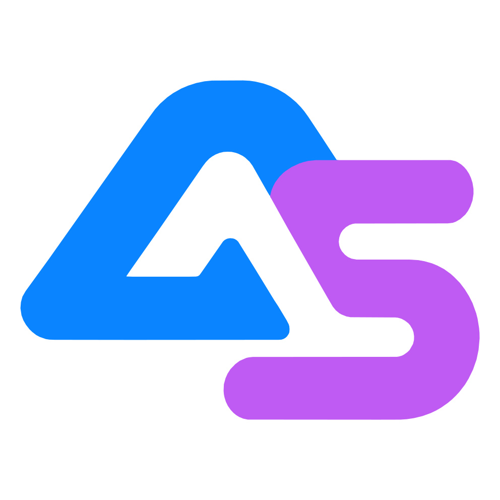
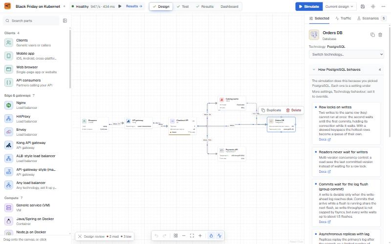
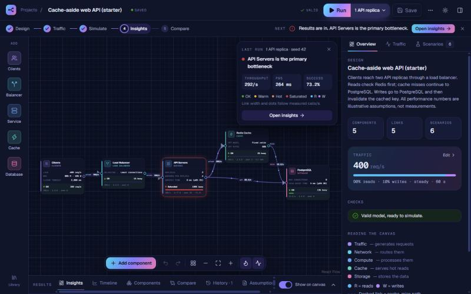
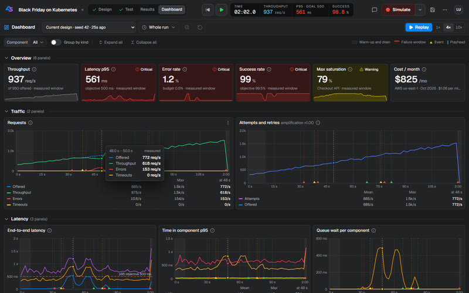
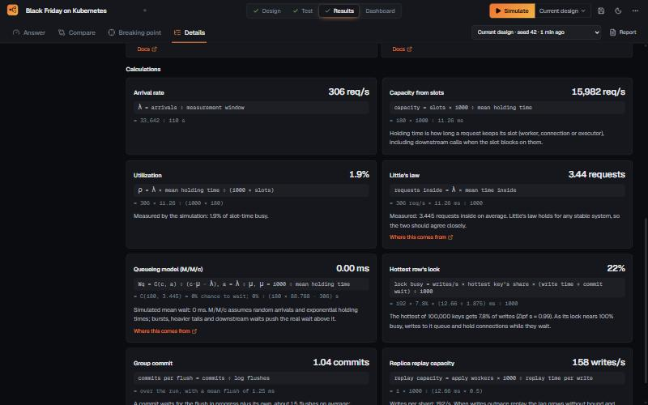
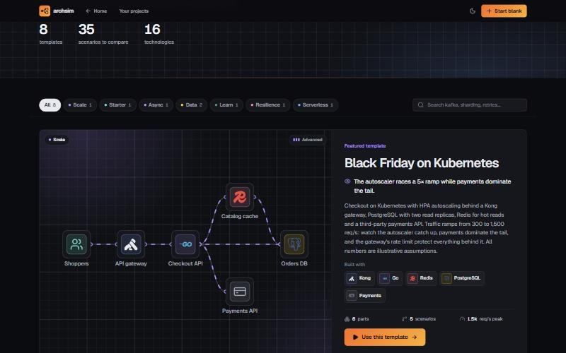
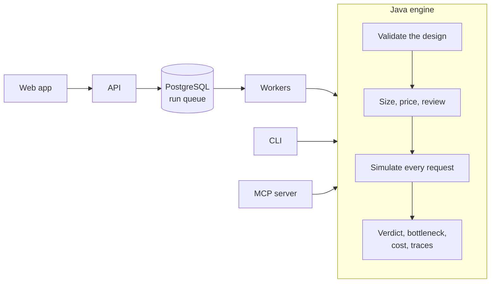

<p align="center">
  
</p>

<h1 align="center">ArchSim</h1>

<h3 align="center">Crash-test your architecture before your users do.</h3>

<p align="center">
  A flight simulator for distributed systems. Draw your stack with real technologies, throw traffic
  and failures at it, and get a straight yes or no against your objectives, with the bottleneck,
  the breaking point and the monthly bill.
</p>

<p align="center">
  <a href="LICENSE"></a>
  <a href="docs/getting-started.md#what-you-need"></a>
  <a href="docs/README.md"></a>
  <a href="docs/validation.md"></a>
</p>

<p align="center">
  <a href="#quick-start">Quick start</a> ·
  <a href="docs/features.md">Features</a> ·
  <a href="#how-accurate-is-it">Accuracy</a> ·
  <a href="docs/README.md">Documentation</a> ·
  <a href="#contributing">Contributing</a>
</p>

<p align="center">
  
  <br>
  <sub>Losing Redis on the cache-aside starter: press a chaos pad and the verdict flips within seconds.</sub>
</p>

## Why ArchSim

- **Real technologies, real behaviour.** PostgreSQL locks rows and waits for its write-ahead log, its
  replicas lag, Redis forks for snapshots, JVMs pause for garbage collection, Lambda starts cold and
  Kubernetes pods wait as Pending for a node. Each behaviour links to the vendor's documentation,
  and each one is a setting you can override.
- **Every request, every second.** A discrete-event engine moves each request through every hop,
  queue, lock and retry, then replays the run second by second on your diagram. Same document and
  seed, same result, down to the digest.
- **A straight answer.** Yes or no against your latency and availability objectives, the
  bottleneck, what to fix first, the highest load that still holds, and the monthly cost on real
  AWS instance types.
- **Honest about what it knows.** Every default says whether it is documented or illustrative,
  calibration replaces them with values measured by Prometheus or OpenTelemetry, and the accuracy
  report publishes predictions against real systems, misses included.
- **Local-first and open.** No account and no telemetry. The web app, a CLI for CI and an MCP
  server for AI agents share one engine, under the AGPL-3.0.

## Features

<table>
<tr>
<td width="50%" valign="top"><br><b>Design with real technologies</b><br>Pick PostgreSQL, Kafka or a Go service on Kubernetes, and see how it behaves and what it costs.</td>
<td width="50%" valign="top"><br><b>Test with traffic and failures</b><br>Ramp the load, drop a cache, slow a database, then scrub the replay to any second.</td>
</tr>
<tr>
<td width="50%" valign="top"><br><b>Get a straight answer</b><br>The verdict, the objective that failed, the bottleneck, what to fix first and the bill.</td>
<td width="50%" valign="top"><br><b>Compare the options</b><br>Every scenario on a cost-against-latency map, then a load sweep to find where it breaks.</td>
</tr>
<tr>
<td width="50%" valign="top"><br><b>Watch it like production</b><br>A Grafana-style dashboard with per-component signals: lag, lock waits, GC pauses, 503s.</td>
<td width="50%" valign="top"><br><b>See the maths</b><br>Every formula behind a number, filled in with the run's values, next to what was simulated.</td>
</tr>
<tr>
<td width="50%" valign="top"><br><b>Follow single requests</b><br>Sampled traces through every hop, wait, lock, log flush and GC pause.</td>
<td width="50%" valign="top"><br><b>Start from a template</b><br>25 ready-made architectures, from a cache-aside starter to Kafka, Cassandra and serverless.</td>
</tr>
</table>

And beyond the canvas:

- **Calibrate** a design from Prometheus metrics or OpenTelemetry traces ([calibration](docs/calibration.md)).
- **Import** docker-compose, Kubernetes manifests or a Terraform plan, and **export** compose,
  Kubernetes or Mermaid ([import](docs/import.md)).
- **Gate pull requests** on your objectives with `archsim check` and a GitHub Action ([CI](docs/ci.md)).
- **Let AI agents drive it** through the MCP server or WebMCP in the browser ([agents](docs/agents.md)).
- **Work as a team** with GitHub or Google sign-in, workspaces, comments, sign-offs and share links
  ([deployment](docs/deployment.md)).

Every workspace and technology behaviour is described in [docs/features.md](docs/features.md).

## Quick start

You need Docker with Compose, and a JDK 17 or later to start Gradle, which fetches JDK 25 for the
build when you don't have it.

```bash
git clone https://github.com/dante0747/archsim.git
cd archsim
./gradlew :archsim-app:jibDockerBuild   # builds the API's image into your local Docker
docker compose up --build               # PostgreSQL, the API, a worker and the web app
```

Open <http://localhost:3000>, choose **Open the starter example** and press **Simulate**. The stack
listens on `127.0.0.1` only and has no sign-in. [Getting started](docs/getting-started.md) covers
running from source and a five-minute tour; [Troubleshooting](docs/troubleshooting.md) helps when
something won't start.

### Command line

The same engine, with the same answers, without a server or database:

```bash
./gradlew :archsim-cli:installDist
export PATH="$PWD/archsim-cli/build/install/archsim/bin:$PATH"
archsim run examples/cache-aside-starter.json --scenario one-api-replica
```

```text
offered 398.9 req/s | throughput 286.8 req/s | success 71.90% | p50 217.0 ms | p95 269.8 ms | ...
  ...
  [critical] API Servers is the primary bottleneck: On average 100% of its 4 workers were busy. ...
```

It also validates, analyzes, compares, calibrates, imports, exports and checks designs in CI
([archsim-cli](archsim-cli/README.md)).

### MCP server

Give Claude Code, Claude Desktop, Cursor or another MCP client the engine as tools:

```bash
./gradlew :archsim-mcp:installDist
claude mcp add archsim -- "$PWD/archsim-mcp/build/install/archsim-mcp/bin/archsim-mcp"
```

Then ask your agent to find the breaking point of `examples/cache-aside-starter.json`. The tools
are listed in [docs/agents.md](docs/agents.md).

## How it works



A design is one versioned JSON document. The engine validates it, sizes every part for the peak
load, prices it on real instance types and reviews it; then a discrete-event simulator moves every
request through every hop, queue, lock and retry, from a seeded random stream. Each run records its
input, seed, engine version and result digest, so it can be repeated and checked bit for bit. The
web app reaches the engine through the API, which checks and sizes designs itself and queues runs in
PostgreSQL for the workers; the CLI and the MCP server call the engine directly. More in
[docs/architecture.md](docs/architecture.md).

## How accurate is it?

Measured, not claimed. In nine experiments on real services, ArchSim was calibrated at low load,
predicted where each would break, and only then was the breaking point measured with k6:

| Experiments | Median error in the predicted breaking point |
| --- | --- |
| **5 held out**, predicted before any of them was measured | −6% to +70%: one within ±25%, and four over-predicted capacity, the unsafe side |
| **4 tuned on**, the model developed with their results in view | −23% to +16% |

These are three to six runs per experiment on one laptop (engine 0.16.0, whose results the Java
engine 1.0.0 reproduces exactly; 1.1.0 and 1.1.1 change only the cost). No technology counts as validated yet: that needs a second
machine. [docs/validation.md](docs/validation.md) shows every run, where the model is wrong and why,
and [how to rerun the benchmarks](docs/validation.md#reproduce) on your own machine.

> **Results are estimates, not production guarantees.** Every number comes from the model you drew
> and the assumptions you entered. Without calibration, trust comparisons between scenarios more
> than any single absolute value. What is and isn't modeled: [docs/simulation-model.md](docs/simulation-model.md).

## Documentation

| Use it | Run it | Understand it |
| --- | --- | --- |
| [Getting started](docs/getting-started.md) | [Running for a team](docs/deployment.md) | [Simulation model](docs/simulation-model.md) |
| [Features](docs/features.md) | [Troubleshooting](docs/troubleshooting.md) | [Assumptions](docs/assumptions.md) |
| [Calibration](docs/calibration.md) | [HTTP API](docs/api.md) | [Accuracy](docs/validation.md) |
| [Import](docs/import.md) and [pricing](docs/pricing.md) | [Security](SECURITY.md) | [Architecture](docs/architecture.md) |
| [CI gate](docs/ci.md) and [AI agents](docs/agents.md) | [Command line](archsim-cli/README.md) | [Decision records](docs/adr/README.md) |

Everything else is indexed in [docs/README.md](docs/README.md).

## Contributing

Bug reports, ideas and questions are welcome as [issues](https://github.com/dante0747/archsim/issues/new/choose). ArchSim is
offered under the AGPL-3.0 and under a commercial license, so a pull request from outside the
project can be merged only once its author has signed the Contributor License Agreement. The
agreement is being prepared; until it is published, outside pull requests wait.

Read [CONTRIBUTING.md](CONTRIBUTING.md) for the setup and checks, [docs/development.md](docs/development.md)
for the layout and tests, and the [Code of Conduct](CODE_OF_CONDUCT.md). Report vulnerabilities
privately, as [SECURITY.md](SECURITY.md) describes.

## License

ArchSim is licensed under the [GNU Affero General Public License v3.0 only](LICENSE)
(`AGPL-3.0-only`). Using it, at work too, is free. If you ship ArchSim inside a product or offer a
changed ArchSim over a network, the AGPL asks you to publish your source under the same license; a
commercial license from the copyright holder lifts those obligations
([ADR-0067](docs/adr/0067-license-under-agpl-3.0-with-a-commercial-license.md)). To ask for one,
write to [abarghooeimajid@gmail.com](mailto:abarghooeimajid@gmail.com). Third-party components keep
their own licenses ([NOTICE](NOTICE)).
