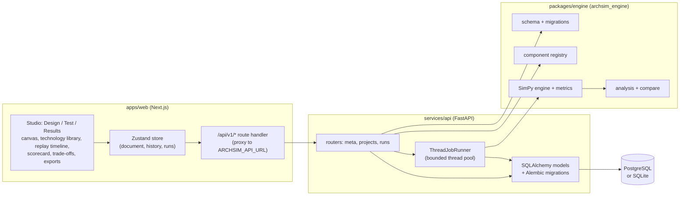
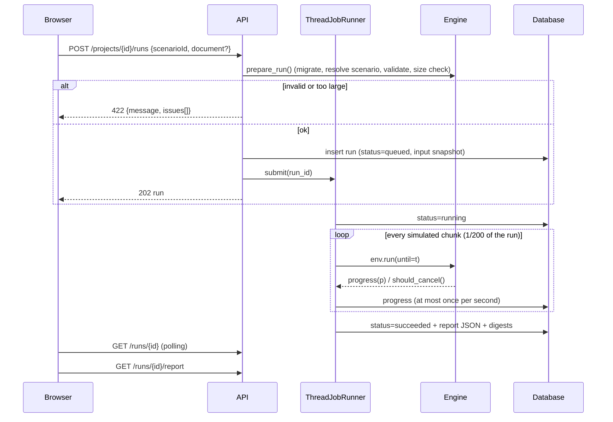

# Architecture

ArchSim has three layers with stable contracts between them. Each can be developed and
tested on its own.



## Layers

### Engine (`packages/engine`, import name `archsim_engine`)

Pure Python, depends only on SimPy and Pydantic. It owns:

| Module | Responsibility |
| --- | --- |
| `schema.py` | Versioned document model (Pydantic, camelCase JSON). |
| `migrations.py` | Upgrades older documents; rejects newer ones. |
| `distributions.py` | Constant, exponential, uniform and lognormal (median/p95) distributions in ms. |
| `registry.py` | `ComponentModel`, `PortSpec`, `ComponentRegistry`, UI field descriptors, entry-point plugin loading. |
| `components/` | Built-in models: traffic source, load balancer, service, cache, database. |
| `validation.py` | Structural, port, request-type routing, cycle and amplification checks with actionable issues. |
| `scenarios.py` | Loading, default materialisation, scenario override resolution. |
| `runtime.py` | Requests, outcomes, worker pools, call/timeout/retry protocol, seeded RNG streams. |
| `metrics.py` | Bounded-memory counters, time-weighted gauges, log-bucketed histograms. |
| `engine.py` | `run_simulation`: arrivals, chunked execution, progress, cancellation, limits. |
| `report.py` | Builds the JSON report (summary, time series, per-node metrics, provenance). |
| `analysis.py` | Node status classification and bottleneck findings. |
| `load.py` | Static peak-load estimate per part (no simulation). |
| `sizing.py` | Auto-sizing: CPU, memory and storage for empty specs, applied before every run. |
| `cost.py` | Monthly cost estimate (per run in the report, per design via `/analyze`). |
| `review.py` | Design review: the architecture linter (single points of failure, timeouts, retries...). |
| `analyze.py` | `analyze_document`: sizes, cost, review and technology tiers of a design without simulating. |
| `technology.py` | Technology profiles: "auto" defaults, traits with documentation links, tier (core or experimental). |
| `provenance.py` | Where every input came from: measured (with source and fit), assumed or illustrative. |
| `calibration/` | Calibration from Prometheus (`prometheus.py`, `mapping.py`, `apply.py`) and OpenTelemetry (`otlp.py`), fitting (`fit.py`) and the replay check. |
| `assumptions.py` | Renders docs/assumptions.md: every default, preset number and constant, documented or illustrative. |
| `export/` | docker-compose, Kubernetes and Mermaid scaffolding (`export_document`; the web app's Export dialog and the MCP server use it through `POST /export` or directly). |
| `importers/` | docker-compose, Kubernetes and Terraform to a design plus an import report (`import_design`; `POST /import`, `archsim import`). |
| `pricing/` | Price snapshots (`archsim.prices/1`), the generic illustrative rates, and choosing the cheapest instance type that covers a part (used by sizing and cost). |
| `roundtrip.py` | What exports carry so an import gives the design back (part ids, links, clients and clusters), shared by both sides. |
| `sweep.py` | Breaking point: constant-load steps, the knee and the highest load within the objectives. |
| `slo.py` | Objectives: the verdict of a run (p95, p99, availability, throughput). |
| `compare.py` | Two-report comparison with input diff and explanations. |
| `cli.py` | The `archsim` command: `validate`, `run`, `analyze`, `compare`, `calibrate`, `import`, `export`, `catalog`, `schema`. |

The engine can be used directly:

```python
from archsim_engine import run_simulation, compare_reports
report = run_simulation(document_dict, scenario_id="three-api-replicas")
```

### MCP server (`packages/mcp`, import name `archsim_mcp`)

A stdio [MCP](https://modelcontextprotocol.io) server on the official SDK (`archsim-mcp`) that
calls the engine directly: tools to list, validate, analyze, simulate, compare, sweep, export
and calibrate, plus resources for the templates, the JSON Schema and the simulation model.
See [`agents.md`](agents.md).

### API (`services/api`, import name `archsim_api`)

FastAPI application created by `create_app(settings)`. It translates HTTP into engine calls,
stores projects and runs, and executes simulations in the background. All endpoints live under
`/api/v1`; see [`api.md`](api.md). OpenAPI is served at `/api/v1/openapi.json` and interactive
docs at `/api/v1/docs`.

### Web app (`apps/web`)

A Next.js App Router application. The browser only talks to its own origin (`/api/v1/*`);
a route handler forwards those requests to the API at `ARCHSIM_API_URL`
(default `http://127.0.0.1:8000`). The editor keeps the working document in a Zustand store,
renders it with React Flow, and builds the technology library, the inspector forms and the
technology presets from the component catalog returned by `GET /api/v1/components`. Domain
rules have one source of truth, the engine: auto sizes, cost estimates and the design review
come from `POST /api/v1/analyze` (called with live validation) and from each run's report, so
the CLI, the API and the web app give the same answers; the docker-compose / Kubernetes /
Mermaid exports come from `POST /api/v1/export`. SLO evaluation, replay events and load sweep
analysis still have TypeScript modules in `apps/web/src/lib/` (the engine has its own
`slo.py` and `sweep.py` for the CLI and the MCP server; moving the web app onto them is open)
with unit tests (web tests use engine fixtures written by
`scripts/export_web_fixtures.py`); the simulation itself only ever runs in the engine.

## The document: four separate concerns

A project is one versioned JSON document (details in [`schema.md`](schema.md)):

| Section | Meaning | Affects simulation? |
| --- | --- | --- |
| `architecture` | Typed nodes and routing edges: what exists and how requests flow. | yes |
| `workload` | Traffic: RPS, pattern, duration, warm-up, seed, read/write mix, keyspace. | yes |
| `scenarios` | Named lists of overrides applied on top of the base document. | when selected |
| `layout` | Node positions and viewport. | never |

Node `config` objects are validated by the component model registered for the node `type`,
so the document schema itself does not depend on the component catalog.

## Component registry

Every component type is a `ComponentModel` subclass registered in a `ComponentRegistry`:

- **ports** (`PortSpec`): direction, accepted/emitted request types (`read`, `write`), min and
  max number of links;
- **config model**: a Pydantic model whose fields carry UI metadata via `ui(...)` (unit, group,
  assumption flag, conditional visibility);
- **validation**: `emitted_types()` for request-type routing and `validate()` for type-specific
  rules;
- **runtime**: `build()` returns a `RuntimeComponent` that implements `handle(request)` as a
  SimPy generator.

`registry.catalog()` turns all of this into JSON for the UI. Adding a component therefore needs
no API or frontend changes; see [`extending-components.md`](extending-components.md).

## Run lifecycle



- **States:** `queued -> running -> succeeded | failed | cancelled`.
- **Validation first.** A run is only created if the document resolves and validates, and the
  expected number of requests is under `ARCHSIM_MAX_REQUESTS`. Errors come back immediately as
  `422` with structured issues.
- **Unsaved edits.** A run request may include the current (unsaved) document. It is stored
  with the run, so results stay reproducible without forcing a save.
- **Progress** is simulated time divided by total simulated time. Live progress is kept in
  memory and written to the database at most once per second.
- **Cancellation** is cooperative: a queued run is cancelled immediately; a running run stops
  at the next chunk boundary.
- **Limits:** `ARCHSIM_MAX_CONCURRENT_RUNS` worker threads; per-run wall-clock limit
  `ARCHSIM_MAX_WALL_SECONDS`, checked between chunks.
- **Restart recovery:** on startup, runs left `queued` or `running` by a previous process are
  marked `failed` with an "Interrupted" message.
- **Reproduce:** `POST /runs/{id}/rerun` re-simulates the stored input with the same scenario
  and seed. Equal `resultDigest` values confirm reproducibility.

## Persistence model

Two tables, created by Alembic revision `0001`:

**`projects`** - `id`, `name`, `description`, `document` (JSON/JSONB), `schema_version`,
`revision`, timestamps. `revision` increments on each update; clients can send
`expectedRevision` and receive `409 Conflict` if someone else saved in between (optimistic
concurrency). Documents that are schema-valid but fail graph validation (for example a missing
link) can be saved, so work in progress is never lost; they cannot be simulated until fixed.

**`simulation_runs`** - status, progress, error, seed, engine version, input/result digests, a
small denormalised `summary` for fast listing, timestamps, plus two large **deferred**
columns: `input_document` (exactly what was submitted) and `report` (the full result). Deferred
columns are not loaded when listing runs. The report is written once, when the run finishes.
Deleting a project deletes its runs (`ON DELETE CASCADE`).

PostgreSQL uses `JSONB` for document columns; SQLite uses its JSON type. Both are exercised in
CI.

## Determinism and provenance

Every report carries `provenance`: engine, schema and report versions, seed, scenario id and
name, the exact overrides applied, `inputDigest` (SHA-256 of the canonical resolved input) and
`resultDigest` (SHA-256 of the canonical results). The same input, scenario, seed and engine
version produce the same `resultDigest` on the same platform. See
[`simulation-model.md`](simulation-model.md#determinism).
