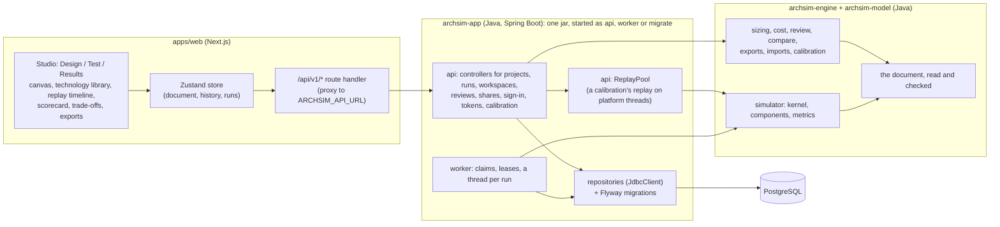
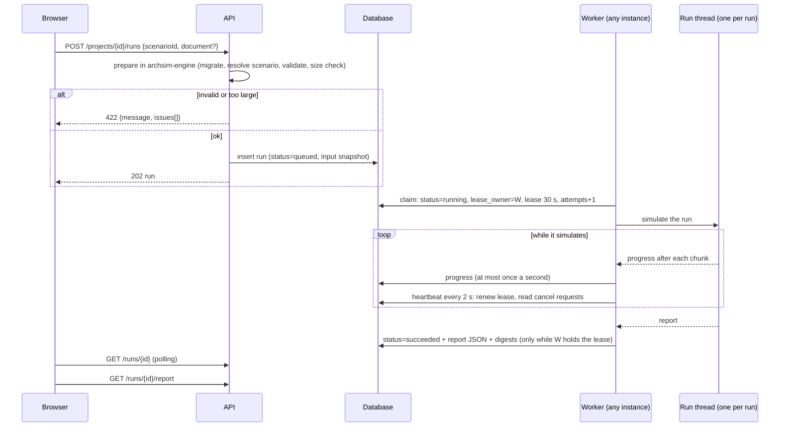

# Architecture

ArchSim has three layers with stable contracts between them. Each can be developed and
tested on its own. Why it is built this way, decision by decision, is in the
[architecture decision records](adr/README.md).



## Layers

### Engine (`packages/engine`, import name `archsim_engine`)

Pure Python, depends only on SimPy, Pydantic and PyYAML, and frozen at 0.16.0 during the Java
port ([ADR-0017](adr/0017-freeze-python-engine-during-port.md)). Since stage 4 the API and the
workers run none of it: the Java engine, `archsim-engine` (below), simulates every run and
replay, checked against this engine's recorded runs. It serves the `archsim` CLI, the MCP server
and the benchmark harness, and the golden files and baselines the Java parity tests compare
with. It owns:

| Module | Responsibility |
| --- | --- |
| `schema.py` | Versioned document model (Pydantic, camelCase JSON). |
| `migrations.py` | Upgrades older documents; rejects newer ones. |
| `distributions.py` | Constant, exponential, uniform and lognormal (median/p95) distributions in ms. |
| `registry.py` | `ComponentModel`, `PortSpec`, `ComponentRegistry`, UI field descriptors, entry-point plugin loading. |
| `components/` | Built-in models: traffic source, load balancer, service, cache, database. |
| `validation.py` | Structural, port, request-type routing, cycle and amplification checks with actionable issues. |
| `scenarios.py` | Loading, default materialisation, scenario override resolution. |
| `runtime.py` | Requests, outcomes, worker pools, call/timeout/retry protocol, seeded RNG streams. |
| `metrics.py` | Bounded-memory counters, time-weighted gauges, log-bucketed histograms. |
| `engine.py` | `run_simulation`: arrivals, chunked execution, progress, cancellation, limits. |
| `report.py` | Builds the JSON report (summary, time series, per-node metrics, provenance). |
| `analysis.py` | Node status classification and bottleneck findings. |
| `load.py` | Static peak-load estimate per part (no simulation). |
| `sizing.py` | Auto-sizing: CPU, memory and storage for empty specs, applied before every run. |
| `cost.py` | Monthly cost estimate (per run in the report, per design in `analyze.py`). |
| `review.py` | Design review: the architecture linter (single points of failure, timeouts, retries...). |
| `analyze.py` | `analyze_document`: sizes, cost, review and technology tiers of a design without simulating. |
| `technology.py` | Technology profiles: "auto" defaults, traits with documentation links, tier (core or experimental). |
| `provenance.py` | Where every input came from: measured (with source and fit), assumed or illustrative. |
| `calibration/` | Calibration from Prometheus (`prometheus.py`, `mapping.py`, `apply.py`) and OpenTelemetry (`otlp.py`), fitting (`fit.py`) and the replay check. |
| `assumptions.py` | Renders docs/assumptions.md: every default, preset number and constant, documented or illustrative. |
| `export/` | docker-compose, Kubernetes and Mermaid scaffolding (`export_document`; `archsim export` and the MCP server; the API's `POST /export` uses its Java port). |
| `importers/` | docker-compose, Kubernetes and Terraform to a design plus an import report (`import_design`; `archsim import`; the API's `POST /import` uses its Java port). |
| `pricing/` | Price snapshots (`archsim.prices/1`), the generic illustrative rates, and choosing the cheapest instance type that covers a part (used by sizing and cost). |
| `roundtrip.py` | What exports carry so an import gives the design's structure back (part ids, technologies, links, clients and clusters; not service times or the workload), shared by both sides. |
| `sweep.py` | Breaking point: constant-load steps, the knee and the highest load within the objectives. |
| `slo.py` | Objectives: the verdict of a run (p95, p99, availability, throughput). |
| `compare.py` | Two-report comparison with input diff and explanations. |
| `check.py` | The CI gate: objectives and regressions against a baseline, the Markdown comment (`archsim check`, `.github/actions/archsim-check`). |
| `cli.py` | The `archsim` command: `validate`, `run`, `analyze`, `compare`, `calibrate`, `import`, `export`, `check`, `catalog`, `schema`. |

The engine can be used directly:

```python
from archsim_engine import run_simulation, compare_reports
report = run_simulation(document_dict, scenario_id="three-api-replicas")
```

### MCP server (`packages/mcp`, import name `archsim_mcp`)

A stdio [MCP](https://modelcontextprotocol.io) server on the official SDK (`archsim-mcp`) that
calls the engine directly: tools to list, validate, analyze, simulate, compare, sweep, export
and calibrate, plus resources for the templates, the JSON Schema and the simulation model.
See [`agents.md`](agents.md).

### API (`archsim-app`, Java)

A Spring Boot application ([`archsim-app/README.md`](../archsim-app/README.md)). It stores
projects, runs, workspaces, reviews and share links in PostgreSQL, with SQL written by hand
(`JdbcClient`) and a schema Flyway owns; it reads and checks documents with `archsim-model`,
and analyzes, prepares, compares, exports, imports and calibrates them with `archsim-engine`;
it signs people in and enforces roles, CSRF, rate limits and the outbound policy, under which it
calls the Prometheus servers calibrations name. Runs are only queued: the workers simulate them.
All endpoints live under `/api/v1`; see [`api.md`](api.md).
OpenAPI is served at `/api/v1/openapi.json` and interactive docs at `/api/v1/docs`. It replaced
the Python (FastAPI) API endpoint for endpoint, with the same JSON, cookies and tables
([the Java port](proposals/java-25-port.md)).

### Engine in Java (`archsim-engine`)

A plain Java library over `archsim-model`, with no framework: the engine's deterministic parts,
what ArchSim works out from a design without simulating it and from a run's report
([`archsim-engine/README.md`](../archsim-engine/README.md)). Sizing, cost and pricing, the instant
estimate, the design review and findings, confidence, comparisons and seed summaries, exports,
importers, calibration and the assumptions page are ported from the frozen engine and checked
against its [golden files](../parity/README.md), with their departures listed in the README. The
API calls it directly, in the API's process, and since stage 4 simulates on it too: a
calibration's replay runs on its `Simulator` through `ReplaySimulator.of`, on the API's pool of
replay threads ([ADR-0054](adr/0054-replay-calibrations-on-a-pool-of-platform-threads.md)), and
the worker role simulates the runs it claims
([ADR-0053](adr/0053-simulate-runs-in-the-java-apps-worker-role.md)). It is engine 1.0.0, which
replays the frozen engine 0.16.0's runs figure for figure
([java-parity.md](validation/java-parity.md)).

### Workers (`archsim-app`'s `worker` role)

`archsim-app worker` processes take the runs the API queues in PostgreSQL and simulate each with
the Java simulator, on a thread of their own
([ADR-0053](adr/0053-simulate-runs-in-the-java-apps-worker-role.md)): the run lifecycle below
says how. Run as many as needed, on any host that reaches the database, each with a heap for the
runs it takes at once ([archsim-app's README](../archsim-app/README.md#the-workers-heap)). Until
stage 4 the Python workers (`archsim-api worker`) did this, and a Python engine service simulated
a calibration's replay for the API
([ADR-0036](adr/0036-python-engine-service-for-synchronous-calls.md),
[ADR-0045](adr/0045-replay-calibrations-through-an-interim-simulate.md)); both are deleted.

### Alembic migrations (`services/api`, import name `archsim_api`)

The SQLAlchemy models and Alembic migrations the schema started from (Flyway's `V1` reproduces
their revision 0008, [ADR-0032](adr/0032-flyway-takes-over-from-alembic.md)), with
`archsim-api migrate`, which brings an older database to that revision, and `archsim-api seed`.
They stay until stage 6 of the port.

### Web app (`apps/web`)

A Next.js App Router application. The browser only talks to its own origin (`/api/v1/*`);
a route handler forwards those requests to the API at `ARCHSIM_API_URL`
(default `http://127.0.0.1:8000`). The editor keeps the working document in a Zustand store,
renders it with React Flow, and builds the technology library, the inspector forms and the
technology presets from the component catalog returned by `GET /api/v1/components`. Domain
rules live in the engine, not the web app (in the API, its Java port, held to the frozen engine's
golden files): auto sizes, cost estimates and the design review come from
`POST /api/v1/analyze` (called with live validation) and from each run's report, so the CLI, the
API and the web app give the same answers; the docker-compose / Kubernetes / Mermaid exports
come from `POST /api/v1/export`. SLO evaluation, replay events and load sweep
analysis still have TypeScript modules in `apps/web/src/lib/` (the engine has its own
`slo.py` and `sweep.py` for the CLI and the MCP server; moving the web app onto them is open)
with unit tests (web tests use engine fixtures written by
`scripts/export_web_fixtures.py`); the simulation itself only ever runs in the engine.

## The document: four separate concerns

A project is one versioned JSON document (details in [`schema.md`](schema.md)):

| Section | Meaning | Affects simulation? |
| --- | --- | --- |
| `architecture` | Typed nodes and routing edges: what exists and how requests flow. | yes |
| `workload` | Traffic: RPS, pattern, duration, warm-up, seed, read/write mix, keyspace. | yes |
| `scenarios` | Named lists of overrides applied on top of the base document. | when selected |
| `layout` | Node positions and viewport. | never |

Node `config` objects are validated by the component model registered for the node `type`,
so the document schema itself does not depend on the component catalog.

## Component registry

Every component type is a `ComponentModel` subclass registered in a `ComponentRegistry`:

- **ports** (`PortSpec`): direction, accepted/emitted request types (`read`, `write`), min and
  max number of links;
- **config model**: a Pydantic model whose fields carry UI metadata via `ui(...)` (unit, group,
  assumption flag, conditional visibility);
- **validation**: `emitted_types()` for request-type routing and `validate()` for type-specific
  rules;
- **runtime**: `build()` returns a `RuntimeComponent` that implements `handle(request)` as a
  SimPy generator.

`registry.catalog()` turns all of this into JSON for the UI. Adding a component therefore needs
no API or frontend changes; see [`extending-components.md`](extending-components.md).

## Run lifecycle



- **States:** `queued -> running -> succeeded | failed | cancelled`.
- **Validation first.** A run is only created if the document resolves and validates, and the
  expected number of requests is under `ARCHSIM_MAX_REQUESTS`. Errors come back immediately as
  `422` with structured issues.
- **Unsaved edits.** A run request may include the current (unsaved) document. It is stored
  with the run, so results stay reproducible without forcing a save.
- **Progress** is simulated time divided by total simulated time, told after each of a run's 200
  chunks. The worker writes it to the database at most once per second; the API reads it from
  there, so any instance can answer.
- **Queue** (`archsim-app`'s `worker` package): the run row is the job. A worker claims as many
  queued runs as it has free slots, oldest first and every workspace's oldest before any
  workspace's second, one claim at a time under a PostgreSQL advisory lock, each workspace kept
  under its cap of runs at once, and leases them; it renews the leases every heartbeat. Progress
  and the outcome are written only while the worker still holds the lease, so a worker that lost
  a run cannot overwrite the one that took it over.
- **Workers** (`archsim-app worker`), as many as needed, on any host that reaches the database;
  the API simulates nothing but a calibration's replay. Each run simulates on a platform thread
  of its worker's, never a virtual one, and a claim waits for a slot to free, a run to be
  requeued, or a second. The runs share their worker's heap, sized for them, and the worker runs
  with `-XX:+ExitOnOutOfMemoryError`: a run that exhausts the heap stops the worker, whose runs
  the reaper then settles as below (compose starts it again).
- **Cancellation:** a queued run is cancelled immediately, by any instance. A running one gets
  `cancel_requested_at`; its worker sees it at the next heartbeat (2 s) and asks the run to
  stop, which it does at its next check (every 4,096 events and after each chunk). A run still
  going `ARCHSIM_CANCEL_GRACE_SECONDS` (10 s) later is written `cancelled`; its thread is asked
  to stop until it does.
- **Limits:** `ARCHSIM_MAX_CONCURRENT_RUNS` runs per worker (default: CPU count - 1); per-run
  wall-clock limit `ARCHSIM_MAX_WALL_SECONDS`, checked by the simulator every 4,096 events and
  after each chunk, and a hard deadline 30 s later at which the worker writes the run `failed`;
  a run's slot stays held until its thread ends.
- **Workers that stop:** a worker that is stopped (SIGTERM, Ctrl+C) claims no more and gives its
  runs back to the queue without counting the attempt, keeping their leases while they stop
  (15 s at most). One that dies stops renewing its leases; every worker reaps expired leases
  every 10 s (and at start-up): requeued after a first attempt, `failed` with "The simulation
  worker stopped unexpectedly…" after a second, `cancelled` if a cancel was requested. Workers
  silent for an hour leave `job_workers`.
- **No orphans:** a run is a thread of its worker's process and ends with it.
- **Reproduce:** `POST /runs/{id}/rerun` re-simulates the stored input with the same scenario
  and seed. Equal `resultDigest` values confirm reproducibility.

## Persistence model

The tables a run goes through (the others hold people, workspaces, reviews and share links):

**`projects`** - `id`, `name`, `description`, `document` (JSON/JSONB), `schema_version`,
`revision`, timestamps. `revision` increments on each update; clients can send
`expectedRevision` and receive `409 Conflict` if someone else saved in between (optimistic
concurrency). Documents that are schema-valid but fail graph validation (for example a missing
link) can be saved, so work in progress is never lost; they cannot be simulated until fixed.

**`simulation_runs`** - status, progress, error, seed, engine version, input/result digests, a
small denormalised `summary` for fast listing, timestamps, plus two large **deferred**
columns: `input_document` (exactly what was submitted) and `report` (the full result). Deferred
columns are not loaded when listing runs. The report is written once, when the run finishes.
Deleting a project deletes its runs (`ON DELETE CASCADE`). Queue columns: `attempts`,
`lease_owner`, `lease_expires_at`, `cancel_requested_at`, with an index on
`(status, created_at)`.

**`job_workers`** - one row per worker: host, process id, slots, runs in flight, status
(`running` or `draining`) and its latest heartbeat.

Flyway owns the schema: its `V1` reproduces Alembic's revision 0008, which `services/api`'s
SQLAlchemy models still describe ([ADR-0032](adr/0032-flyway-takes-over-from-alembic.md)).
Documents are `JSONB`. The Alembic migrations' tests also run on SQLite, as CI does.

## Determinism and provenance

Every report carries `provenance`: engine, schema and report versions, seed, scenario id and
name, the exact overrides applied, `inputDigest` (SHA-256 of the canonical resolved input) and
`resultDigest` (SHA-256 of the canonical results). The same input, scenario, seed and engine
version produce the same `resultDigest`: on every platform with the Java simulator, which takes
its transcendental functions from `StrictMath`, and on the same platform with the frozen Python
engine ([ADR-0050](adr/0050-one-report-per-seed-with-pythons-digest-definitions.md)). See
[`simulation-model.md`](simulation-model.md#determinism).
