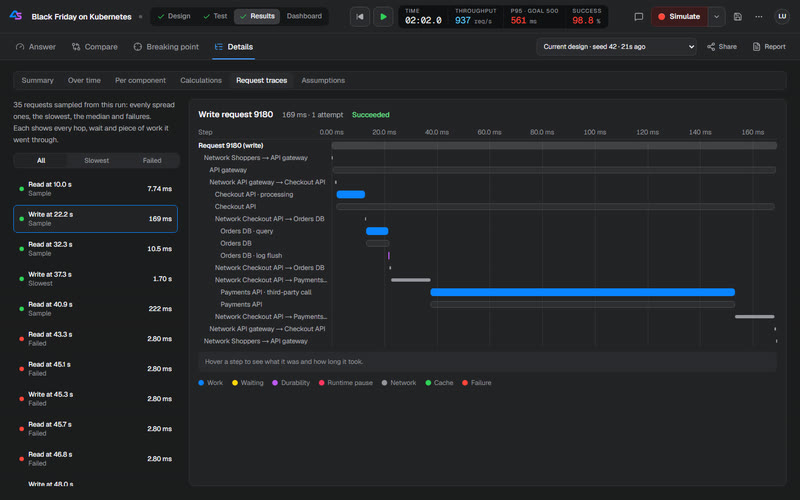

# Features

ArchSim has four workspaces around one canvas, switched from the top bar: **Design**, **Test**,
**Results** and a **Dashboard** (keys 1, 2, 3, 4). One **Simulate** button (Ctrl/⌘ Enter) runs the
design from wherever you are, and results land on the canvas right away. A short guided tour opens
on the first visit (and from the ⋯ menu), and a hint on the canvas says what to do next, for
example adding API servers behind a lone Clients box.

> **Results are hypotheses to test, not production guarantees.** Every number comes from the model
> you drew and the assumptions you entered. Use them to explore alternatives, challenge
> assumptions and decide what to prototype or load-test, not as sign-off, audit evidence or a
> deployment gate. Without calibration against real telemetry, trust comparisons between scenarios
> more than any single absolute value. See [the simulation model](simulation-model.md) and
> [how accurate ArchSim is](validation.md).

- [Design: draw it with real technologies](#design-draw-it-with-real-technologies)
- [Test: traffic, failures and replay](#test-traffic-failures-and-replay)
- [Results: answer, compare, breaking point, details](#results-answer-compare-breaking-point-details)
- [Dashboard: a Grafana-style view of every run](#dashboard-a-grafana-style-view-of-every-run)
- [Bring your own system: calibrate, import, price, check](#bring-your-own-system-calibrate-import-price-check)
- [AI agents](#ai-agents)
- [Teams, review and sharing](#teams-review-and-sharing)
- [Everywhere](#everywhere)
- [Scope and limitations](#scope-and-limitations)

## Design: draw it with real technologies

**A parts library with each technology's logo**, one part a row with its full name and what it is
beneath, and a search box: relational (PostgreSQL, MySQL,
SQL Server, distributed SQL), document (MongoDB replica sets and sharded clusters), wide-column
(Cassandra), key-value (DynamoDB-style provisioned throughput), search (Elasticsearch), caches
(Redis, Valkey, Memcached, CDN edge, Varnish), message queues (Kafka, RabbitMQ, SQS-style...),
gateways (Nginx, HAProxy, Envoy, Kong...), services on VMs, Docker, Kubernetes (HPA autoscaling,
pods on a cluster's nodes) or serverless (cold starts, concurrency limits), Kubernetes clusters
(EKS-, GKE- and AKS-style, k3s), and third-party APIs (payments, e-mail, identity, LLM
inference...).

**Each technology brings the behaviour its documentation describes.**

- PostgreSQL locks rows, makes commits wait for its write-ahead log (sharing flushes between
  concurrent commits) and replays writes on replicas with a single worker, so heavy writes make
  replicas lag and serve stale reads. MySQL replays on four workers; SQL Server's reads wait for
  writers.
- MongoDB waits for a majority of its replica set, reads from the primary and caps concurrency
  with 128 tickets. DynamoDB meters capacity units and throttles a hot key at 1,000 writes per
  second per partition. Elasticsearch sends every search to every shard.
- Redis runs commands on one thread per shard and stalls while forking for snapshots. Kafka keeps
  each key in order on one partition and one consumer; RabbitMQ blocks publishers at its memory
  watermark; SQS delivers slow messages twice after the visibility timeout.
- Envoy answers 503 past 1,024 requests per target and nginx gives up after 60 s. Node.js runs CPU
  work on one event loop; JVMs pause for garbage collection and start slow until the JIT warms up;
  Lambda cold starts depend on the runtime and scale-out is rate limited.
- On a Kubernetes cluster every replica is a pod placed by its CPU and memory requests: when the
  nodes are full, new pods wait as Pending until the cluster autoscaler's node is ready minutes
  later, then pull their image and start. The canvas draws each service's pods (ready, starting,
  Pending) and the cluster's nodes, live during replay.

The inspector shows how the selected technology behaves, each behaviour links to the vendor's
documentation, and every one is a setting (Auto by default) that you can override; each Auto value
says whether it is documented or illustrative. [assumptions.md](assumptions.md) lists every such
number, generated from the code.

**Core and experimental technologies.** A core set comes first: generic, Node.js, Java and Go
services (on VMs, containers, Kubernetes with HPA or serverless), PostgreSQL, Redis, Kafka,
SQS-style queues, and Nginx and ALB-style load balancers (plus the generic part of each kind, which
adds no technology behaviour). Every other technology carries an "experimental" badge in the parts
library, the inspector, reports and exports: its behaviour rests on documentation and illustrative
numbers. No technology is validated against measurements yet; that is the next step.

**Clients as separate parts.** **Mobile app** (iOS, Android, React Native, Flutter), **Web
browser** (React, Next.js, Vue, Angular, Svelte) and **API consumers** (REST / OpenAPI, GraphQL),
alongside the generic Clients box. Each has its own timeouts, retries and network latency on its
link, and a traffic share: put all three in front of one gateway and the workload is split between
them (50 / 35 / 15 by default). Results show success and latency per client.

**Resource specs on every part.** CPU cores, memory and (databases, queues) storage per instance,
with one-click common sizes and an illustrative price. They change the run where it is defensible:
fewer cores than workers makes CPU work queue, a service refuses requests past its memory, a
database whose hot working set does not fit in memory sends reads to disk, a cache evicts least
recently used keys. Left empty they are **auto-sized**: each part gets the CPU, memory and storage
it needs for the design's peak load (CPU at a 60% target, memory for the requests, buffer cache or
keys it holds, storage under 70% full), shown with how it was worked out and used in runs, prices
and exports until you type your own. The engine does the sizing, so the CLI, the API and the web
app simulate a design identically (same result digest).

**Cards, wires and the inspector.** Every part is the same card: its technology logo on a solid
tile in its family's colour, its name, one or two key settings, and after a run a 12-segment level
meter (green, then yellow, then red, like an audio meter) that shows how busy it was. Links are
rounded wires that attach on any of the four sides: drag from a dot on any side of one part to any
side of another, in either direction. Traffic moves along them while a run replays. Click a part to
edit it: its technology, a one-line last-run status and its facts from the run, at most three key
settings (response-time distributions as a one-line summary you click to edit), and "More settings"
for everything else, notes and what the model covers. Every setting shows its label in full and a
one-line help beneath it, and says where its value comes from: measured, documented (with the
vendor's site), your estimate, or default (an illustrative default, the kind the confidence counts
against you), with a reset to the part's default when you changed it
([ADR-0102](adr/0102-lead-each-screen-with-the-answer-and-make-every-input-explain-itself.md)).

**A design review** flags single points of failure, missing timeouts, retry amplification along a
path, timeout inversions, connection-pool exhaustion and more, with the numbers.

**Export** the design as docker-compose, Kubernetes manifests (Deployments, Services, HPAs,
StatefulSets) or Mermaid, as reviewed starting points.

## Test: traffic, failures and replay

- **One test plan.** The Test plan panel holds the last result and one plan card with three rows:
  Traffic, Must stay true (your objectives) and Failures. "Add failure" offers quick tests
  generated from the design ("lose the cache for 15 s", "database 4× slower", "+300 ms on a
  link", "3× spike") and custom outages, slowdowns and link latency. You can also drag the
  traffic line and the failure blocks on the timeline.
- **Chaos pads** on the canvas plan a failure and simulate in one hit.
- **Replay every second.** Every run is recorded second by second and replays on the canvas: each
  component's utilization, queue and traffic at that second. The timeline below stays short:
  play, the time, speed, the traffic plan, events, latency against the objective and failures;
  "More detail" adds throughput and a heat lane per component.
- **Every test checked** against its objectives (what must stay true), including what happened
  during each failure.

## Results: answer, compare, breaking point, details

![Results → Answer in the light theme: "No, it doesn't hold up." Latency p95 561 ms against at most 500 ms and availability 98.8% against at least 99.5%, a note that p95 is within 15% of the objective from one seed with a Check 5 seeds button, Checkout API as the primary bottleneck, "Low confidence: 28 of 42 inputs are illustrative defaults" with how to raise it and the measured accuracy, then 937 req/s handled, p95 561 ms (608 ms counting failures as timeouts), 98.8% success and $844 a month at AWS prices, the queueing-formula estimate, a Review panel and the first findings](images/scorecard.jpg)

- **Answer**: one card with the verdict ("Misses 2 of 2 objectives", then "Yes, it holds up." or
  "No, it doesn't hold up."), the bottleneck with "Show on canvas", and objective tiles with
  editable targets; under it, "How sure is this" names each caveat in a line (the seeds, the
  confidence, experimental parts, what queueing formulas predict) and explains it on demand. Then
  four key numbers, what to fix first by title with what to try (its evidence under "Why"), the
  month's cost as one bar split by part, and the review.
- **Compare**: cost against latency for every run and scenario (Pareto frontier, objective line),
  two runs side by side with the exact input differences, and the run history.
- **Breaking point**: stepped load sweeps that find where latency turns into a hockey stick and the
  highest load that still meets the objectives.
- **Details**: findings in plain language (bottlenecks, hot shards, hot rows, replica lag,
  throttling, autoscaling lag, consumer lag, wasted work), error budget, metrics over time,
  per-component drill-down, Calculations and Request traces, and the assumptions behind every
  number. A Markdown report is one click away.

![Results → Compare for the Black Friday on Kubernetes template at AWS us-east-1 prices, each month with 24 peak hours: monthly cost against p95 for every run. The autoscaled checkout (HPA 3→14 pods) costs $844 a month at 561 ms, above the 500 ms objective line; 3 fixed pods cost $827 and fail a third of the requests; the gateway rate limit and the cache outage sit beside the baseline, and the slower payments provider beside the 3 fixed pods; only 14 fixed pods meet the objectives, at 370 ms and $1,434. A table of the runs follows](images/tradeoffs.jpg)

**Calculations** shows the maths behind the numbers: each formula written out, again with the run's
own values, and the result, next to what the simulation measured (utilization, Little's law, the
M/M/c queueing prediction, the hottest row's lock, group commit, replica replay capacity, DynamoDB
partitions, event-loop capacity...), plus where a typical request's time goes. The same formulas
fold out under the selected part in Design.

**Request traces** follows about thirty sampled requests (evenly spread, the slowest, the median,
failures) through every hop, wait, lock, log flush and GC pause on a waterfall.

## Dashboard: a Grafana-style view of every run

- Rows of panels for the overview (throughput, p95 against the objective, error and success rate,
  the most saturated part, monthly cost), traffic, latency, saturation and errors, then one row per
  component with its own signals: replication lag, lock and commit waits, consumed capacity units,
  evictions, partition lag, redeliveries, GC pauses, event-loop lag, warming replicas, 504s and
  503s.
- A crosshair synced across every panel, table legends you can click to isolate a series,
  drag-to-zoom on any chart, warm-up and failure windows as annotations, fullscreen and "Inspect
  data" (table and CSV) per panel, and Replay at 1x/4x/10x that draws the run live, shared with the
  Test workspace. Each panel's info popover says how its value is calculated.

## Bring your own system: calibrate, import, price, check

- **Calibrate from your telemetry.** Prometheus metrics (with a mapping file) or an OpenTelemetry
  trace export set service times, hit ratios, link latency and the traffic curve; each input is
  marked measured with its source, query, time range and fit error, and the calibrated model
  replays what was observed and reports its largest error, not only p95. The bundled fixtures are
  generated by ArchSim itself, so they show the method, not real-world accuracy. Ctrl/⌘ K →
  Calibrate from telemetry, or `archsim calibrate`. See [calibration.md](calibration.md).
- **Import what you run.** A docker-compose file, Kubernetes manifests or a Terraform plan become a
  design, with a report of what was mapped, what was guessed (marked assumed), what was ignored and
  which links to confirm. ArchSim's own exports come back with the same structure (parts,
  technologies, replicas, autoscaling, links); timings, hit ratios, timeouts, workload and
  scenarios do not. Menu → Import from compose, Kubernetes, Terraform, or `archsim import`. See
  [import.md](import.md).
- **Prices from real machines.** A design names a price snapshot (provider, region, date): parts
  then run on the cheapest real instance type that fits them and every cost line cites it. ArchSim
  ships AWS us-east-1 on-demand list prices (EC2, RDS, ElastiCache, MSK, EBS, Lambda, SQS, ALB),
  refreshed monthly; templates and new projects use them, and every dollar figure names its source.
  Designs saved without a snapshot keep the generic illustrative rates. See
  [pricing.md](pricing.md).
- **Design checks in CI.** `archsim check` simulates a design in a pull request and flags it when
  it misses its objectives or regresses against the base branch (p95, success rate, cost,
  breaking point), and a GitHub Action posts one sticky comment with the comparison. Run it as a
  warning to read, not as a gate ([ci.md](ci.md#run-it-as-a-warning)).

## AI agents

- **In the browser (WebMCP).** The app registers [WebMCP](https://webmachinelearning.github.io/webmcp/)
  tools, so an agent in your browser can open a template, read the design, add and connect parts,
  set traffic and objectives, run the design review, simulate and read the verdict, without
  clicking. Every agent edit shows on the canvas, is announced in a toast and can be undone. WebMCP
  is an experimental draft standard; see [agents.md](agents.md) for the tools and browser support.
- **In your coding agent (MCP).** `archsim-mcp` is an MCP server over stdio for Claude Code, Claude
  Desktop, Cursor and others: list part types and templates, validate, analyze, simulate (with the
  verdict, findings and result digest), compare, find the breaking point, export, import and
  calibrate, with the engine's limits and no browser or API server. Setup:
  [getting-started.md](getting-started.md#the-mcp-server) and [agents.md](agents.md).

## Teams, review and sharing

Locally there is no sign-in: you are the owner of one `default` workspace. With sign-in on
([deployment.md](deployment.md#sign-in-teams-and-api-tokens)), people sign in with GitHub or
Google, work in personal and team workspaces as viewers, editors or owners, and make API tokens for
the CLI, CI and MCP. Anyone in a workspace can comment on parts, links and runs, resolve threads and
review a run (approve it or request changes, with a note); every change is recorded in the
project's history. A review records what the team concluded from a simulated run under its
assumptions, not evidence that the running system meets its objectives. A share link is a frozen,
read-only copy of one run's results that anyone with the link can open. The endpoints are in
[api.md](api.md).

## Everywhere

- A command palette (Ctrl/⌘ K) with every action, and keyboard shortcuts.
- A "Studio" look, modelled on pro audio and design apps: charcoal panels, part families in Apple's
  system colours, a dot-grid canvas, and a transport bar at the top with replay buttons and an LCD
  readout (time, throughput, p95 against the goal, success) next to a red record-style Simulate
  button; on screens narrower than 1440 px the readout leaves out the throughput, and a long
  project name ends in an ellipsis rather than crowd the bar. The replay timeline shows one
  arrangement lane per part, in its family colour. Dark by default, with a matching light theme:
  the sun/moon button at the top right picks one or follows the system; below 1536 px the ⋯ menu
  switches between them instead ([ui-redesign.md](ui-redesign.md)).
- A templates gallery (`/templates`): each card draws the design with its technology logos and
  flowing traffic, says what you will see happen, its level and key numbers, with category
  filters, search and a featured template. Your saved projects are on their own page
  (`/projects`).
- Projects live in PostgreSQL, documents import and export as versioned JSON, and every run stores
  its input, seed, engine version and result digest so it can be re-run and verified bit for bit.

## Scope and limitations

**Supported today:** several client groups per design (Clients, mobile app, web browser, API
consumers) sharing one workload; load balancers, services (with autoscaling and serverless),
caches, databases, message queues and external APIs; synchronous acyclic call graphs; open-loop
synthetic workloads; scheduled faults (outage, slowdown, link latency); local use without sign-in,
or GitHub/Google sign-in with workspaces, roles and API tokens; optional CPU, memory and storage
specs (CPU contention, memory limits, database buffer cache, LRU cache eviction); the technology
behaviours listed above (row locks, write-ahead-log flushes, GC pauses, cold starts and so on).

**Not modeled:** OOM kills and restarts, disk and network bandwidth, packet loss, deadlocks and
range locks, random failures (faults are scheduled), parallel fan-out calls, regions. The full list
is in [simulation-model.md](simulation-model.md#what-is-not-modeled).

**Not built yet:** Grafana integration and an HTTP transport for the MCP server are on the
[roadmap](roadmap.md); AI agents can use the stdio MCP server and, in the browser, the WebMCP
tools. A hosted stack and a full deploy guide are still to come: without
`ARCHSIM_AUTH_MODE=oauth` there is no authentication, so keep it on your machine, and read
[SECURITY.md](../SECURITY.md) before exposing a server. Progress is tracked in
[IMPLEMENTATION_STATUS.md](../IMPLEMENTATION_STATUS.md).

The screenshots on this page were taken on 27 October 2026, before the current logo and some later
interface changes.
