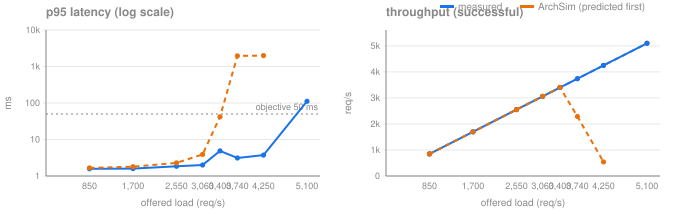

# How accurate is ArchSim?

ArchSim predicts latency and capacity from a model. This page checks those predictions against
real systems running on one machine: for each stack, the model is calibrated from a low-load run,
ArchSim predicts every higher load **before** it is measured, and then k6 measures it. The numbers
below are the latest run's, good or bad; the raw data is in `benchmarks/results/`.

## Headline

<!-- BEGIN GENERATED: summary -->
| Experiment | Knee measured | Knee predicted | Knee error | p95 error below the knee (median / worst) |
| --- | --- | --- | --- | --- |
| [pg-mixed](#pg-mixed) | 2,291 req/s | 2,064 req/s | -10% | 75% / 18316% (6 steps) |
| [pg-hot-row](#pg-hot-row) | 225 req/s | 444 req/s | +97% | 55% / 55% (2 steps) |
| [cache-aside](#cache-aside) | 4,016 req/s | 3,457 req/s | -14% | 32% / 101649% (6 steps) |
| [kafka](#kafka) | 945 req/s | 1,006 req/s | +6% | 303% / 332% (4 steps) |
<!-- END GENERATED: summary -->

The knee is the highest load that still meets the objective (p95 at most 50 ms with at least 99%
of requests successful), interpolated between the two measured steps around it; the predicted
knee uses the same steps and the same interpolation. "p95 error below the knee" covers the steps
at or below the measured knee: error = (predicted - measured) / measured.

## Reproduce

Each stack is one command (Docker and [uv](https://docs.astral.sh/uv/) needed; 20 to 30 minutes
per experiment on the machine below). Keep the machine otherwise idle while it runs: other work
shows up in the measurements (see the protocol history):

```bash
uv run python benchmarks/run.py postgres   # pg-mixed and pg-hot-row
uv run python benchmarks/run.py cache      # cache-aside
uv run python benchmarks/run.py kafka      # kafka
uv run python benchmarks/report.py         # rewrite this page's tables and charts
```

`make benchmark` runs all of them. Results depend on the machine: rerun on yours before quoting
numbers. A manual GitHub Actions workflow (`.github/workflows/benchmark.yml`) runs them on a
hosted runner.

## Protocol

Each experiment (`benchmarks/run.py`) runs on a fresh stack (`benchmarks/compose.yaml`): a small
Node.js service (`benchmarks/service/server.js`, no framework), PostgreSQL 16, Redis 7 and Kafka
3.8 as each experiment needs, and k6 as the open-loop load generator (constant arrival rate,
like ArchSim's clients). Every container is pinned to its own CPUs.

1. **Settle** (protocol v4): after the data load, `VACUUM ANALYZE` and a checkpoint, then a
   discarded 30 s warm-up at the calibration rate, so autovacuum and cold caches do not land in a
   calibration pass.
2. **Calibrate** in two passes of the experiment's traffic: 50 req/s, then a quarter of the most
   pessimistic capacity the first pass implies (still low load). The service records its CPU per
   request (Node's process CPU, including garbage collection and driver work), its own time per
   request (handler minus awaited calls) and the time of every PostgreSQL, Redis and Kafka call;
   the runner reads PostgreSQL's and Redis's own CPU and command time. CPU per request is the
   slope between the passes (the fixed CPU a process burns at any rate cancels out); timings come
   from the second pass, and the one input not measured directly (the client-to-service
   latency) is set so the model reproduces the second pass's median. A pass whose p95 is more
   than 10 times its median was disturbed: it is recorded, discarded and run again. Each input is
   derived by a formula recorded next to it in `calibration.json`.
3. **Predict**: the runner builds the ArchSim design (one Node.js event loop on 1 vCPU, a pool of
   10 database connections, PostgreSQL on 2 vCPU, and so on), searches the knee, and simulates
   every step of the ladder: 0.25, 0.5, 0.75, 0.9, 1.0, 1.1, 1.25 and 1.5 times the predicted
   knee. `predictions.json` is written before the first measured step. When the system still
   meets the objective at the top of the ladder, the runner climbs by 30% (at most four times),
   predicting and saving each new step before measuring it.
4. **Measure** each step three times: 5 s of warm-up, then 20 s measured, 2 s client timeout;
   each metric is the median of the three (robust to one stall), and a step whose three p95s
   differ by more than 2x across the objective is marked unstable. p50, p95 and p99 are over
   successful requests started in the window, as in ArchSim's reports; requests k6 could not
   send in time count as failures. A repeat in which k6 sent nothing (the load generator failed)
   is recorded, discarded and run again.
5. **Compare** step by step (`comparison.json`), and the knee.

Nothing measured at steps 4 and 5 feeds back into the model: the predictions use only the
calibration passes.

### Protocol history

Every run is kept in `benchmarks/results/<experiment>/run-N/`. The protocol changed between
runs, each time because a run exposed a flaw, not to move the numbers toward the measurements:

| Run | Protocol | What it showed |
| --- | --- | --- |
| 1 | one pass at 50 req/s, CPU per request as measured | At 50 req/s a laptop's cores sit in low-power states, so CPU per request came out about 4x what it costs under load. |
| 2 | two passes, CPU per request from the slope (v2) | Fixed CPU cancels out; but the database driver's CPU was counted twice (in the CPU per request and inside the measured query time), so the model started about 2x too slow. Measured steps overlapped with other work on the machine. |
| 3 | v2 plus the anchor at the calibration rate (v3) | pg-mixed's first pass met the post-load autovacuum (p95 280 ms at 50 req/s), which inflated CPU per request 3x and sent every input wrong; hot-row's single-row lock turned short host stalls (package installs and test runs in other work) into seconds-long queues. Neither run measured the model. |
| 4 | v3 plus settling and disturbed-pass retries (v4), machine otherwise idle | This page's numbers. |

## Environment

<!-- BEGIN GENERATED: environment -->
- CPU: 11th Gen Intel(R) Core(TM) i7-1165G7 @ 2.80GHz; Docker 29.1.3 (linux/amd64) with 8 CPUs and 7.6 GiB; Windows-11-10.0.26200-SP0.
- Images: postgres `postgres:16-alpine`, redis `redis:7-alpine`, kafka `apache/kafka:3.8.0`, k6 `grafana/k6:1.3.0`, service `node:24-alpine + pg 8.23.1, redis 4.7.1, kafkajs 2.2.4`.
- CPUs pinned per container (cpuset): service 1, PostgreSQL 2, Redis 1, Kafka 2, k6 2.
<!-- END GENERATED: environment -->

## pg-mixed

<!-- BEGIN GENERATED: pg-mixed -->
**Node.js + PostgreSQL: 90% reads, 10% writes over 100,000 rows.** Calibrated 2026-10-26T11:13:41Z, predicted 2026-10-26T11:15:51Z (engine 0.7.0), measured afterwards. Objective: p95 <= 50 ms with >= 99% success.



Model inputs from the calibration run (50 req/s):

| Input | Value | How it was measured |
| --- | --- | --- |
| `serviceTimeMs` | lognormal, median 0.4236 ms, p95 0.985 ms | mean = Node's CPU per extra request between the passes: (4532 - 1415 ms) / (7951 - 1501 requests) = 0.4832 ms (at 50 req/s alone: 0.9430 ms); shape (p95/median 0.0351/0.0151 ms) from the handler's own time |
| `clientLinkLatencyMs` | 0 ms | anchored: (measured median 0.972 ms - the model's median without it 1.013 ms at 265 req/s) / 2, one way, at least 0 |
| `readServiceTimeMs` | lognormal, median 0.4911 ms, p95 1.1314 ms | SELECT by key as the service sees it (round trip): median 0.491, p95 1.131 ms |
| `writeServiceTimeMs` | lognormal, median 0.6525 ms, p95 1.4308 ms | UPDATE with synchronous_commit off (no WAL flush wait): median 0.652, p95 1.431 ms |
| `commitFlushMs` | lognormal, median 1.0968 ms, p95 2.2908 ms | UPDATE with synchronous_commit on minus off: median 1.749 - 0.652 ms, p95 3.722 - 1.431 ms |
| `dbCpuShare` | 0.4458 | PostgreSQL CPU per extra query between the passes (0.3314 ms) / mean query time (0.744 ms) |

Measured at 50 req/s: p50 0.97 ms, p95 2.74 ms.

| Offered req/s | p50 meas / pred (ms) | p95 meas / pred (ms) | p95 error | p99 meas / pred (ms) | Success meas / pred | Throughput meas / pred |
| --- | --- | --- | --- | --- | --- | --- |
| 516 | 0.53 / 1.01 | 1.57 / 2.47 | +58% | 2.22 / 3.39 | 100% / 100% | 516 / 516 |
| 1,031 | 0.46 / 1.03 | 1.44 / 2.52 | +75% | 2.27 / 3.60 | 100% / 100% | 1,031 / 1,031 |
| 1,546 | 0.76 / 1.14 | 4.18 / 2.73 | -35% | 20.9 / 3.82 | 100% / 100% | 1,546 / 1,546 |
| 1,856 | 0.72 / 1.45 | 3.98 / 3.74 | -6% | 11.4 / 5.24 | 100% / 100% | 1,856 / 1,856 |
| 2,062 | 0.80 / 11.6 | 12.4 / 27.7 | +123% | 37.6 / 34.4 | 100% / 100% | 2,058 / 2,064 |
| 2,268 | 0.75 / 1,264 | 10.4 / 1,916 | +18316% | 34.0 / 1,994 | 100% / 79% | 2,260 / 1,835 |
| 2,578 | 4.54 / 1,635 | 116 / 1,954 | +1585% | 144 / 1,994 | 91% / 15% | 2,335 / 519 |
| 3,093 | 8.62 / - | 101 / - | - | 128 / - | 93% / 0% | 2,867 / 108 |

Knee: measured 2,291 req/s, predicted 2,064 req/s on the same steps (-10%); ArchSim's own search before measuring put it at 2,062 req/s. Raw data: `benchmarks/results/pg-mixed/`.
<!-- END GENERATED: pg-mixed -->

## pg-hot-row

<!-- BEGIN GENERATED: pg-hot-row -->
**Node.js + PostgreSQL: every request updates the same row.** Calibrated 2026-10-26T11:33:38Z, predicted 2026-10-26T11:34:16Z (engine 0.7.0), measured afterwards. Objective: p95 <= 50 ms with >= 99% success.


Model inputs from the calibration run (50 req/s):

| Input | Value | How it was measured |
| --- | --- | --- |
| `serviceTimeMs` | lognormal, median 0.3443 ms, p95 0.8089 ms | mean = Node's CPU per extra request between the passes: (2205 - 1756 ms) / (2641 - 1501 requests) = 0.3940 ms (at 50 req/s alone: 1.1696 ms); shape (p95/median 0.0357/0.0152 ms) from the handler's own time |
| `clientLinkLatencyMs` | 0.1191 ms | anchored: (measured median 2.808 ms - the model's median without it 2.570 ms at 88 req/s) / 2, one way, at least 0 |
| `writeServiceTimeMs` | lognormal, median 0.7592 ms, p95 1.5531 ms | UPDATE with synchronous_commit off (no WAL flush wait): median 0.759, p95 1.553 ms |
| `commitFlushMs` | lognormal, median 1.3784 ms, p95 2.0806 ms | UPDATE with synchronous_commit on minus off: median 2.138 - 0.759 ms, p95 3.634 - 1.553 ms |
| `dbCpuShare` | 0.2644 | PostgreSQL CPU per extra query between the passes (0.6344 ms) / mean query time (2.399 ms) |

Measured at 50 req/s: p50 2.81 ms, p95 4.63 ms.

| Offered req/s | p50 meas / pred (ms) | p95 meas / pred (ms) | p95 error | p99 meas / pred (ms) | Success meas / pred | Throughput meas / pred |
| --- | --- | --- | --- | --- | --- | --- |
| 111 | 2.45 / 2.78 | 3.73 / 3.82 | +3% | 4.95 / 4.47 | 100% / 100% | 111 / 111 |
| 222 | 1.64 / 2.78 | 2.51 / 3.90 | +55% | 7.06 / 4.47 | 100% / 100% | 222 / 222 |
| 333 | 2.02 / 2.84 | 1,639 / 4.05 | -100% | 1,951 / 4.75 | 71% / 100% | 238 / 333 |
| 400 | 1.26 / 3.13 | 1.97 / 5.04 | +156% | 3.18 / 6.27 | 100% / 100% | 400 / 400 |
| 444 | 1.32 / 15.6 | 2.03 / 39.5 | +1844% | 4.84 / 45.4 | 100% / 100% | 444 / 443 |
| 488 | 1.24 / 1,239 | 1.90 / 1,916 | +100808% | 3.51 / 1,994 | 100% / 76% | 488 / 382 |
| 555 | 1.27 / 1,635 | 1.96 / 1,954 | +99435% | 5.52 / 1,994 | 100% / 15% | 555 / 111 |
| 666 | 1.20 / - | 1.87 / - | - | 7.99 / - | 100% / 0% | 666 / 22 |
| 866 | 1.25 / - | 7.87 / - | - | 34.7 / - | 100% / 0% | 866 / 0 |
| 1,126 | 0.00 / - | 0.00 / - | - | 0.00 / - | 0% / 0% | 0 / 0 |

Knee: measured 225 req/s, predicted 444 req/s on the same steps (+97%); ArchSim's own search before measuring put it at 444 req/s. Raw data: `benchmarks/results/pg-hot-row/`.
<!-- END GENERATED: pg-hot-row -->

## cache-aside

<!-- BEGIN GENERATED: cache-aside -->
**Cache-aside: Node.js, Redis (30 s TTL) and PostgreSQL; Zipf 0.99 over 100,000 keys.** Calibrated 2026-10-26T11:53:13Z, predicted 2026-10-26T11:57:39Z (engine 0.7.0), measured afterwards. Objective: p95 <= 50 ms with >= 99% success.


Model inputs from the calibration run (50 req/s):

| Input | Value | How it was measured |
| --- | --- | --- |
| `serviceTimeMs` | lognormal, median 0.2607 ms, p95 0.5474 ms | mean = Node's CPU per extra request between the passes: (3175 - 1738 ms) / (6481 - 1501 requests) = 0.2886 ms (at 50 req/s alone: 1.1579 ms); shape (p95/median 0.0285/0.0136 ms) from the handler's own time |
| `clientLinkLatencyMs` | 0.0771 ms | anchored: (measured median 0.823 ms - the model's median without it 0.669 ms at 216 req/s) / 2, one way, at least 0 |
| `readServiceTimeMs` | lognormal, median 0.4616 ms, p95 0.7043 ms | SELECT by key as the service sees it (round trip): median 0.462, p95 0.704 ms |
| `dbCpuShare` | 0.3126 | PostgreSQL CPU per extra query between the passes (0.1480 ms) / mean query time (0.474 ms) |
| `cacheServiceTimeMs` | exponential, mean 0.00475 ms | Redis INFO commandstats: 44505 us over 9362 GET/SET calls |
| `cacheLinkLatencyMs` | 0.0916 ms | (GET round trip median 0.188 ms - Redis's own time 0.0048 ms) / 2, one way |

Measured at 50 req/s: p50 0.82 ms, p95 1.72 ms.

| Offered req/s | p50 meas / pred (ms) | p95 meas / pred (ms) | p95 error | p99 meas / pred (ms) | Success meas / pred | Throughput meas / pred | Hit ratio meas / pred |
| --- | --- | --- | --- | --- | --- | --- | --- |
| 862 | 0.38 / 0.71 | 1.00 / 1.31 | +32% | 1.54 / 1.51 | 100% / 100% | 862 / 862 | 65% / 65% |
| 1,725 | 0.40 / 0.68 | 1.01 / 1.29 | +27% | 1.66 / 1.51 | 100% / 100% | 1,725 / 1,725 | 71% / 71% |
| 2,588 | 0.44 / 0.71 | 1.21 / 1.36 | +13% | 2.98 / 1.63 | 100% / 100% | 2,588 / 2,588 | 74% / 75% |
| 3,105 | 0.48 / 0.88 | 2.04 / 1.76 | -13% | 7.90 / 2.33 | 100% / 100% | 3,105 / 3,105 | 76% / 76% |
| 3,450 | 0.42 / 4.84 | 1.24 / 13.3 | +968% | 2.91 / 16.5 | 100% / 100% | 3,450 / 3,451 | 77% / 77% |
| 3,795 | 0.43 / 1,239 | 1.88 / 1,916 | +101649% | 10.9 / 1,994 | 100% / 79% | 3,795 / 3,100 | 78% / 77% |
| 4,312 | 0.69 / 1,635 | 20.2 / 1,954 | +9591% | 68.4 / 1,994 | 98% / 16% | 4,211 / 902 | 79% / 77% |
| 5,175 | 0.69 / - | 7.65 / - | - | 49.6 / - | 99% / 0% | 5,133 / 177 | 80% / 77% |
| 6,728 | 0.80 / - | 32.5 / - | - | 95.0 / - | 95% / 0% | 6,414 / 0 | 82% / 77% |

Knee: measured 4,016 req/s, predicted 3,457 req/s on the same steps (-14%); ArchSim's own search before measuring put it at 3,450 req/s. Raw data: `benchmarks/results/cache-aside/`.
<!-- END GENERATED: cache-aside -->

## kafka

<!-- BEGIN GENERATED: kafka -->
**Kafka: Node.js producer, 6 partitions, 3 consumers inserting into PostgreSQL.** Calibrated 2026-10-26T12:22:50Z, predicted 2026-10-26T12:24:22Z (engine 0.7.0), measured afterwards. Objective: p95 <= 50 ms with >= 99% success.


Model inputs from the calibration run (50 req/s):

| Input | Value | How it was measured |
| --- | --- | --- |
| `serviceTimeMs` | lognormal, median 0.8805 ms, p95 1.9421 ms | mean = Node's CPU per extra request between the passes: (5381 - 2623 ms) / (4291 - 1501 requests) = 0.9884 ms (at 50 req/s alone: 1.7476 ms); shape (p95/median 0.0568/0.0257 ms) from the handler's own time |
| `clientLinkLatencyMs` | 0 ms | anchored: (measured median 1.426 ms - the model's median without it 1.948 ms at 143 req/s) / 2, one way, at least 0 |
| `publishTimeMs` | lognormal, median 0.9014 ms, p95 10.1154 ms | producer.send with acks=all on one broker: median 0.901, p95 10.115 ms |
| `consumerTimeMs` | lognormal, median 0.0163 ms, p95 0.0293 ms | consumer's own time per message (handling minus the INSERT): median 0.016, p95 0.029 ms |
| `commitFlushMs` | lognormal, median 0.9563 ms, p95 1.3354 ms | UPDATE with synchronous_commit on minus off: median 1.511 - 0.555 ms, p95 2.222 - 0.886 ms |
| `writeServiceTimeMs` | lognormal, median 0.7051 ms, p95 12.7449 ms | consumer's INSERT time (median 1.661, p95 13.701 ms) minus the flush median |
| `dbCpuShare` | 0.168 | PostgreSQL CPU per extra query between the passes (0.6617 ms) / mean query time (3.939 ms) |

Measured at 50 req/s: p50 1.43 ms, p95 14.1 ms.

| Offered req/s | p50 meas / pred (ms) | p95 meas / pred (ms) | p95 error | p99 meas / pred (ms) | Success meas / pred | Throughput meas / pred | Consumed/s meas / pred | Message age p95 meas / pred (ms) |
| --- | --- | --- | --- | --- | --- | --- | --- | --- |
| 252 | 0.86 / 1.99 | 2.87 / 11.6 | +303% | 7.43 / 29.9 | 100% / 100% | 252 / 252 | 252 / 252 | 6.00 / 48.2 |
| 503 | 0.77 / 2.03 | 2.63 / 11.3 | +332% | 5.93 / 31.2 | 100% / 100% | 503 / 503 | 503 / 503 | 10.0 / 221 |
| 754 | 1.50 / 2.28 | 28.7 / 11.6 | -60% | 96.2 / 29.4 | 100% / 100% | 751 / 754 | 738 / 664 | 432 / 3,206 |
| 905 | 0.88 / 3.01 | 5.71 / 12.5 | +120% | 14.1 / 29.9 | 100% / 100% | 902 / 905 | 903 / 664 | 41.0 / 6,541 |
| 1,006 | 3.11 / 26.1 | 90.5 / 47.2 | -48% | 171 / 57.6 | 98% / 100% | 985 / 1,006 | 987 / 665 | 787 / 8,133 |
| 1,107 | 1.10 / 1,215 | 20.2 / 1,954 | +9595% | 51.0 / 1,994 | 100% / 77% | 1,105 / 874 | 1,100 / 664 | 513 / 8,295 |
| 1,258 | 1.75 / 1,635 | 51.8 / 1,954 | +3670% | 115 / 1,994 | 99% / 15% | 1,247 / 252 | 1,249 / 664 | 2,369 / 8,461 |
| 1,509 | 105 / - | 317 / - | - | 468 / - | 68% / 0% | 1,025 / 50 | 886 / 664 | 11,837 / 8,461 |

Knee: measured 945 req/s, predicted 1,006 req/s on the same steps (+6%); ArchSim's own search before measuring put it at 1,006 req/s. Raw data: `benchmarks/results/kafka/`.
<!-- END GENERATED: kafka -->

## Where the model is wrong, and why

From run 4 (protocol v4, 2026-10-26, one Windows laptop with Docker Desktop):

- **Capacity: within 14% where the measurement was clean.** pg-mixed -10%, cache-aside -14%,
  Kafka +6% (the client side: publish latency). The two misses are on the safe side: ArchSim
  predicted less capacity than the system had.
- **Low-load latency is about 1 ms high.** At a quarter of the knee ArchSim predicts p95 2.5 ms
  where pg-mixed measured 1.6 ms (+58%), cache-aside 1.3 against 1.0 ms. The relative errors
  look large because the latencies are tiny. The likely cause is the calibration: CPU per request
  is measured at 50 and about 250 req/s, where the laptop's cores are clocked down, and the model
  keeps that cost at every rate. Run 1 showed the same effect at four times the size.
- **The model's cliff is sharper than the real one.** Past its knee ArchSim's p95 jumps to the 2 s
  client timeout within one or two steps; the real systems degrade over several steps (pg-mixed
  10 ms at 2,268 req/s where ArchSim predicts 1.9 s). A single-threaded event loop at a fixed CPU
  cost per request saturates abruptly in the model; in the real service the cost per request
  falls as load rises. So "how far past the knee can I go" is answered pessimistically.
- **Commits are cheaper under concurrency than alone.** Kafka's consumers (each message an
  INSERT and a commit) kept up with 1,250 messages/s; ArchSim capped them at 664/s from the
  commit time measured at low load, so its message-age predictions are far too high (8 s against
  0.5 s at 1,107 req/s). PostgreSQL's group commit shares WAL flushes between concurrent commits;
  the model charges every commit its own flush. The same likely explains why hot-row held 866
  req/s with p95 under 8 ms where ArchSim predicted the lock would saturate near 450 req/s.
- **Hot-row could not be measured reliably here.** At 333 req/s two of three repeats stalled for
  1.6 s (success 71%) while 400 to 866 req/s were clean (p95 about 2 ms). Its runs 1 to 3 put the
  knee at 303, 819 and 132 req/s. A single row's lock turns any short host stall into a queue that
  takes seconds to drain, and this laptop has such stalls even when idle. The protocol's knee
  (the first failing step) is 225 req/s; read the table instead of that number, and rerun on a
  quieter Linux host before quoting it.

What would make the model better, in order: let CPU per request fall with load (calibrate at two
higher rates, or fit a curve), model group commit for databases with WAL flushes, and make the
saturation regime gradual (the event loop's latency growth past utilization 1). None of these
is implemented; they are the next model changes this data supports.

Limits of this evidence: one machine, one run per protocol, Windows with Docker Desktop (a
virtual machine between the containers and the hardware), small synthetic services. It shows the
model's capacity estimates are in the right range for these four shapes; it does not show they
hold for other technologies, larger machines or real applications.

## Proposed tier thresholds

The owner decides tiers (docs/prompts/how-to-win.md); this is a proposal, not applied anywhere.

A technology is **validated** when every benchmark that exercises it has, in its latest run on a
clean protocol:

1. a knee error within ±25%;
2. at or below the measured knee, a p95 error within ±100% or 3 ms absolute, whichever is
   larger (so sub-millisecond noise does not fail it);
3. no unstable step at or below the measured knee, reproduced in a second run (on another
   machine, or the hosted runner).

Against run 4: the Node.js service and PostgreSQL in pg-mixed meet 1 and 2 but not 3 (one run);
Redis (cache-aside) the same; Kafka meets 1 and 2 for the client side, but its consumer-side
metrics (consumed per second, message age) miss by about 2x, so it would stay experimental for
asynchronous questions until group commit is modeled; hot-row fails 3. So no technology moves
to validated on this data; the core set stays a focus list, as the badge says today.
