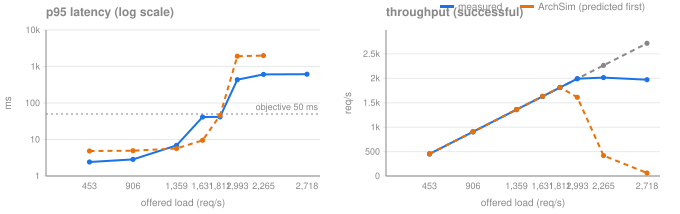
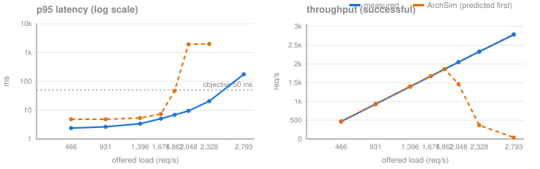
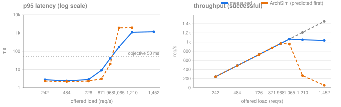
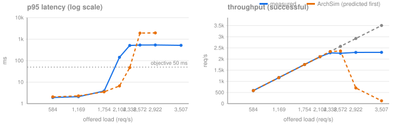
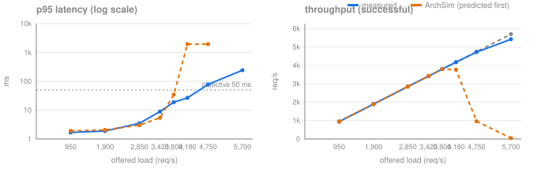
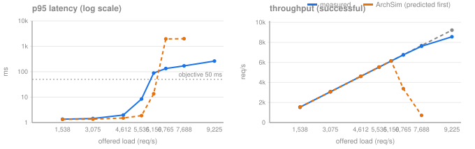
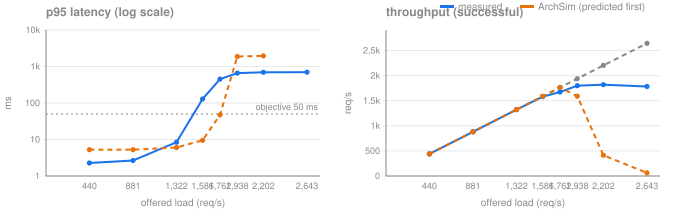
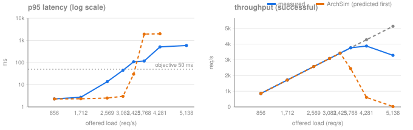
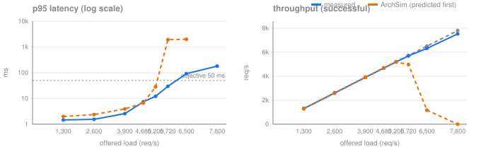

# How accurate is ArchSim?

ArchSim predicts latency and capacity from a model. This page checks those predictions against
real systems running on one machine: for each stack, the model is calibrated from low-load runs,
ArchSim predicts every higher load **before** it is measured, and then k6 measures it. The tables
show the latest run of each experiment, good or bad. `benchmarks/results/` keeps the calibration,
the predictions and every measured repeat's numbers as extracted from k6's end-of-run summary; the
k6 summaries themselves are scratch output and are not committed.

**Every measured run so far was on one laptop, under Docker Desktop on Windows.** None has run on
Linux or on a second machine. The workflow that would measure on a Linux runner every week and on
every release has its weekly and release runs turned off until a run started by hand passes on
Linux, and none has yet ([Reproduce](#reproduce)).

The engine versions on this page are the engine's own, not ArchSim's release number: the
engine's version changes only when the same design and seed could give different results, and
every report records it ([Two version numbers](getting-started.md#two-version-numbers)). The
measured runs up to 4 Nov 2026 were predicted by the Python engine, up to its last version, 0.16.0.
The latest, the second held-out campaign of 21-23 Nov 2026, were predicted by the Java engine
1.6.0, frozen for them ([The Java engine](#the-java-engine)).

## Headline

<!-- BEGIN GENERATED: summary -->
| Experiment | Sample | Knee measured | Knee predicted | Knee error | p95 error at or below the measured knee (median / worst) |
| --- | --- | --- | --- | --- | --- |
| [python-cores](#python-cores) | held out | 1,814 req/s | 1,813 req/s | 0% | 73% / 101% (5 steps) |
| [python-wide](#python-wide) | held out | 2,468 req/s | 1,862 req/s | -25% | 102% / 20162% (7 steps) |
| [java-hot-row](#java-hot-row) | held out | 1,003 req/s | 970 req/s | -3% | 17% / 66% (5 steps) |
| [go-pool](#go-pool) | held out | 2,031 req/s | 2,338 req/s | +15% | 8% / 9% (3 steps) |
| [cache-miss](#cache-miss) | held out | 4,552 req/s | 3,803 req/s | -16% | 27% / 7205% (6 steps) |
| [java-mixed](#java-mixed) | tuned on | 5,178 req/s | 5,101 req/s | -1% | 28% / 196% (5 steps) |
| [go-mixed](#go-mixed) | tuned on | 6,066 req/s | 6,162 req/s | +2% | 15% / 78% (4 steps) |
| [python-mixed](#python-mixed) | tuned on | 1,561 req/s | 1,762 req/s | +13% | 97% / 130% (3 steps) |
| [chain](#chain) | tuned on | 3,103 req/s | 3,429 req/s | +11% | 48% / 93% (4 steps) |
| [cache-ttl](#cache-ttl) | tuned on | 6,328 req/s | 5,206 req/s | -18% | 52% / 6354% (6 steps) |
| [pg-mixed](#pg-mixed) | tuned on | 4,934 req/s | 3,401 req/s | -31% | 94% / 62753% (7 steps) |
| [pg-hot-row](#pg-hot-row) | tuned on | 999 req/s | 1,045 req/s | +5% | 7% / 74% (4 steps) |
| [cache-aside](#cache-aside) | tuned on | 6,335 req/s | 5,460 req/s | -14% | 18% / 8663% (6 steps) |
| [kafka](#kafka) | tuned on | 2,575 req/s | 2,362 req/s | -8% | 59% / 87% (5 steps) |
<!-- END GENERATED: summary -->

Runs that repeat each experiment's latest conditions:

<!-- BEGIN GENERATED: repeatability -->
| Experiment | Sample | Runs repeating the latest | Median knee error | Knee errors | Mean absolute knee error | Measured knee inside the predicted range |
| --- | --- | --- | --- | --- | --- | --- |
| [python-cores](#python-cores) | held out | 3 (v7, engine 1.6.0) | 0% | 0% to +24% | 8% | 3 of 3 runs (nominal 80%) |
| [python-wide](#python-wide) | held out | 3 (v7, engine 1.6.0) | -25% | -27% to -19% | 24% | 1 of 3 runs (nominal 80%) |
| [java-hot-row](#java-hot-row) | held out | 3 (v7, engine 1.6.0) | -3% | -4% to -2% | 3% | 3 of 3 runs (nominal 80%) |
| [go-pool](#go-pool) | held out | 3 (v7, engine 1.6.0) | +15% | +15% to +20% | 17% | 3 of 3 runs (nominal 80%) |
| [cache-miss](#cache-miss) | held out | 3 (v7, engine 1.6.0) | -19% | -26% to -16% | 21% | 2 of 3 runs (nominal 80%) |
| [java-mixed](#java-mixed) | tuned on | 3 (v7, engine 1.6.0) | -8% | -9% to -1% | 6% | 3 of 3 runs (nominal 80%) |
| [go-mixed](#go-mixed) | tuned on | 3 (v7, engine 1.6.0) | -4% | -13% to +2% | 6% | 3 of 3 runs (nominal 80%) |
| [python-mixed](#python-mixed) | tuned on | 3 (v7, engine 1.6.0) | +11% | +10% to +13% | 11% | 3 of 3 runs (nominal 80%) |
| [chain](#chain) | tuned on | 3 (v7, engine 1.6.0) | 0% | 0% to +11% | 4% | 3 of 3 runs (nominal 80%) |
| [cache-ttl](#cache-ttl) | tuned on | 3 (v7, engine 1.6.0) | -18% | -18% to -15% | 17% | 3 of 3 runs (nominal 80%) |
| [pg-mixed](#pg-mixed) | tuned on | 3 (v7, engine 1.6.0) | +11% | -31% to +13% | 18% | 2 of 3 runs (nominal 80%) |
| [pg-hot-row](#pg-hot-row) | tuned on | 3 (v7, engine 1.6.0) | +4% | -13% to +5% | 7% | 3 of 3 runs (nominal 80%) |
| [cache-aside](#cache-aside) | tuned on | 3 (v7, engine 1.6.0) | -18% | -19% to -14% | 17% | 3 of 3 runs (nominal 80%) |
| [kafka](#kafka) | tuned on | 2 (v7, engine 1.6.0; 1 disturbed, not counted) | -18% | -18% to -18% | 18% | 2 of 2 runs (nominal 80%) |

Mean absolute knee error over every such run, held out: 14% (15 runs).

Mean absolute knee error over every such run, tuned on: 11% (26 runs).

The tier criteria below judge the median over at least 3 such runs. The mean absolute error counts every run's miss in full, which the median of a few runs can hide. The nominal coverage is how often the measured knee should fall inside the predicted range. Engine 0.14.0's runs took the range from their three replicate calibration sets ((R - 1) / (R + 1) = 50%), which leaves out how much a calibration moves from one day to the next and the model's own error; since W28 the range is an 80% one that carries both ([Protocol](#protocol), step 3). A disturbed run missed the objective at one load step and met it at a higher one; it is kept and listed under the run history, but not counted.
<!-- END GENERATED: repeatability -->

The knee is the load where the ladder first misses the objective (p95 at most 50 ms with at least
99% of requests successful), interpolated between that step and the one below it; the predicted
knee uses the same steps and the same interpolation. A run that met the objective again higher
up was disturbed and is not counted (see [Protocol](#protocol), step 5). The p95 error covers
the steps at or below the measured knee: error = (predicted - measured) / measured.

Read these numbers as runs on one laptop, three per experiment in the latest campaign.

**The second held-out campaign** ran on 21-23 Nov 2026. Engine 1.6.0, frozen on 20 Nov, predicted
every experiment before it was measured, in three rounds of all fourteen under protocol v7. Five
of them, [registered on 19 Nov](#the-second-set-registered-19-nov-2026), had never been calibrated
or measured; the other nine are tuned on for this engine.

- **Held out: all five within ±25% on the median.** Median knee errors over three runs:
  python-cores -0.1%, java-hot-row -3.3%, go-pool +15.1%, cache-miss -18.9% and python-wide
  -24.5%, which only just meets criterion 1.
- **On a typical run ArchSim ties bottleneck arithmetic; its advantage is the worst case.** Over
  the 15 held-out runs:

  | Estimate of the knee | Median error | Mean error | Worst run | Within ±25% | Over-predicted by more than 25% |
  | --- | --- | --- | --- | --- | --- |
  | **ArchSim's simulator** | 16.5% | 14.4% | -27.4% | 13 of 15 | 0 |
  | Bottleneck arithmetic | 16.2% | 31.3% | +78.7% | 8 of 15 | 7 |
  | Engine's analytic estimate | 27.5% | 82.6% | +316% | 6 of 15 | 7 |
  | Utilisation extrapolation | 43.3% | 188% | +570% | 5 of 15 | 10 |

  Errors are absolute, from each run's `comparison.json` and `baselines.json`. The simulator's
  knees were saved before each run was measured. The three estimates were computed afterwards,
  by rules fixed on 19 Nov, before this campaign ([Against simple
  estimates](#against-simple-estimates)). Fifteen runs on one laptop cannot separate 16.5% from
  16.2%, so this page does not claim ArchSim beats arithmetic on the median.
- **The predicted range held 12 of the 15 held-out runs** (nominal 80%, 12 expected).
  python-wide's held 1 of 3 and misses the plan's target of 2 of 3; cache-miss's held 2 of 3. In
  all three misses the measured knee lay above the range: ArchSim promised too little capacity.
- **The stricter criteria mostly fail.** Of the held-out five only go-pool also meets criteria 2
  and 3a. cache-miss meets 3a and misses 2; python-cores, python-wide and java-hot-row miss both.
  No experiment is validated: criterion 3b needs a second machine
  ([Proposed tier thresholds](#proposed-tier-thresholds)).
- **The other nine, in-sample:** 26 counted runs, median absolute error 11.8%. The engine's
  analytic estimate is level with it at 10.3%, bottleneck arithmetic is at 28.3% and utilisation
  at 27.2%. The range held 25 of the 26. Every one of the nine meets criterion 1 except Kafka,
  whose third run was disturbed (it missed the objective at 2,598 req/s, p95 52.2 ms, and met it
  at 2,952, 48.1 ms), which leaves two counted runs where the criterion needs three.
- **pg-mixed's third round is -31%, and it counts.** One 743 req/s calibration pass read a mean
  database write of 8.64 ms where its repeat read 1.35. The pool bound that implied ended the
  staircase at 743 req/s, where the other two rounds reached 3,000 to 3,800. The pass's p95 was
  9.5 times its p50, just under the 10 times that would have repeated it. PostgreSQL logged
  nothing during it, so its cause is unknown.
- **Three attempts are kept and not counted**
  ([`benchmarks/results/trials/`](../benchmarks/results/trials/)). Round 2's python-cores was
  stopped mid-measurement when the laptop was needed. Round 3's first attempt was stopped because
  the laptop was busy after a day's use, which leaves a complete pg-mixed run (+7.7%, better than
  the -31% that counts) and a partial pg-hot-row. Why that machine was slow is not proven: the
  restart's pg-mixed calibration, with the browser and audio closed, was slow too, and every later
  experiment that night calibrated normally.

### The runs before it (to 4 Nov 2026)

These notes were written for the first held-out campaign and the protocol v6 runs. Their figures
are those runs', kept in each experiment's `run-N/` folders, and no longer the tables above. The
first set's five are tuned on for engine 1.6.0.

- **Held out: one of five predicted within 25%.** Engine 0.16.0 was frozen on 2 Nov 2026 and
  predicted the five [held-out experiments](#held-out-experiments) before any of them was
  measured; each then ran three times on 3-4 Nov. Median knee errors: cache-ttl -6%,
  python-mixed +29%, chain +30%, go-mixed +67% and java-mixed +70%. Only cache-ttl meets
  criterion 1 (within ±25%); python-mixed and chain miss it by about five points.
- **A measured knee is coarser than its one figure.** Each is interpolated between two steps of a
  ladder that stands at shares of the *predicted* knee, and towards a step at which k6 had run
  out of virtual users and dropped requests, so that its latency was cut short
  ([Protocol](#protocol), step 4; each experiment's ladder shows the share dropped at every step
  and names the two steps). java-mixed's 4,650 req/s lies somewhere between 3,950 and 5,925
  req/s, which puts its knee error between +33% and +100%. Protocol v7 (19 Nov 2026,
  [ADR-0086](adr/0086-keep-the-load-open-loop-past-the-objective-and-close-in-on-the-measured-knee.md))
  closes in on the measured knee to 3% and keeps the load open-loop until at least a quarter
  of a second of arrivals are waiting; the second held-out campaign is the first to use it. Its
  check also suggests that
  the kept runs' p95 below the knee carries some of k6's own garbage collection: at 3,000 req/s
  pg-mixed read 6 to 11 ms as the kept runs loaded it and 2.9 to 3.9 ms as v7 does. The two
  differ in both the virtual users and k6's collector, so this is a lead, not a finding, but
  it bears on every p95 error and on criterion 2 below.
- **On stacks it was not tuned on, ArchSim promised too much capacity.** Four of the five
  predicted knees are above the measured ones, the unsafe side: a design sized on them runs out
  of headroom sooner than predicted. The CPU those stacks cost is predicted well (busy cores at
  the highest step below both knees within 8% for every held-out part except cache-ttl's
  service and Redis, +22% and +25%), so the error is in how that CPU turns into capacity. One
  lead, not checked yet: java-mixed, go-mixed and python-mixed ran on the two hyperthreads of one
  physical core, which the model counts as two full cores, and on this laptop a thread that
  shares its core runs at about half speed ([Environment](#environment)); the gap was written
  down before they were measured ([Held-out experiments](#held-out-experiments)). chain, whose
  services had a core each, is +30% too, so that is not the whole story. Model work waits until
  the Java port is done ([ADR 0017](adr/0017-freeze-python-engine-during-port.md)).
- **The predicted range held 9 of the 15 held-out runs**, against a nominal 80% (12 expected).
  Every miss is java-mixed's or go-mixed's: in all six of their runs the measured knee fell below
  the range's low end (java-mixed's latest: 4,650 req/s against a range from 5,926). Fifteen runs
  are too few for the coverage check to reject 80% at 5%, but misses gathered in two experiments
  are a bias, not bad luck. On the tuned-on experiments the range held 20 of 22 runs. It was
  about x0.75 to x1.33 of the predicted knee. Refitted on all nine experiments on 20 Nov 2026
  (ADR-0094), then on the host machine's knees (ADR-0095), it is about x0.81 to x1.23 and holds
  37 of the 49 counted runs leaving out each experiment, 10 of its 12 misses above it.
- **cache-ttl meets criteria 1, 2 and 3a**: median -6%, every step's p95 within a factor of two or
  3 ms at or below the knee, and no unstable step. Only criterion 3b, a second machine, is missing:
  it is the first experiment to pass everything one machine can show.
- **Tuned on: six runs each under engine 0.16.0** (the v6 campaign of 1-2 Nov and a repeat on 4
  Nov), median knee errors **Kafka -3%, pg-hot-row -10%, pg-mixed +16% and cache-aside -23%**. The
  plan's in-sample target was ±15%: Kafka and hot-row meet it, pg-mixed and cache-aside do not.
  These four are in-sample: the protocol (up to v6) and the engine (up to 0.16.0) were developed
  with their results in view. The first hot-row and Kafka runs of 4 Nov were disturbed and are not
  counted. Kafka's third run stopped its calibration staircase at 406 req/s instead of about
  1,000: that pass implied half the consumers' capacity at about 210 req/s, under the next step
  (`run.next_rise`), so it predicted 2,088 req/s against 2,675 and 2,725 in the other two (-12%
  against the measured knee). pg-mixed's first run of 4 Nov, the first experiment after Docker
  Desktop had been restarted, measured 2,875 req/s against 4,371 and 4,483 in the other two
  (+88%); its repeats swung as in no other run (2,658 to 3,869 req/s served at 4,050 offered), but
  it never met the objective higher up, so the rule counts it. Without it the median is +16% too.
- **Tuned on, ArchSim errs on both sides.** It over-predicts pg-mixed's capacity (+6% to +19%
  in five of its six runs) and under-predicts cache-aside's (-27% to -1%: safe, but it would
  buy too much). The causes are under [Where the model is
  wrong](#where-the-model-is-wrong-and-why): pg-mixed's latency climbs before its core fills,
  and cache-aside's cost per request keeps falling above the calibration staircase.
- **Not all of engine 0.16.0's gain over 0.14.0 is the model's.** pg-mixed's prediction barely
  moved between the baseline campaign (v5, 30-31 Oct) and the v6 campaign (4,729 to 5,003 req/s,
  then 4,780 to 5,055); its real knee rose about 10% (3,783 to 4,160, then 4,237 to 4,495) on
  the same laptop, OS build and power mode, with nothing on its path made cheaper. Kafka's real
  knee rose because the broker's healthcheck, which held every earlier Kafka run, is gone (2,028
  to 2,132, then 2,614 to 2,802 req/s), so the v6 runs are the first that measure Kafka.
  Cache-aside's and hot-row's predictions did move: v6's higher staircase (cache-aside) and
  engine 0.15.0's database inputs (hot-row).
- **Criterion 2** (p95 within a factor of two or 3 ms at or below the measured knee) holds for
  cache-ttl, java-mixed and go-mixed; java-mixed's and go-mixed's knees came so early that only
  two light steps are judged. python-mixed misses at 440 req/s (6.1 ms predicted, 2.3
  measured), chain at 3,338 req/s, and every tuned-on experiment misses near its knee.
  pg-mixed and hot-row also miss criterion 3a (an unstable step at or below the knee in more
  than one run in three). See [Proposed tier thresholds](#proposed-tier-thresholds).
- **Light-load latency.** At a quarter and half of the predicted knee ArchSim's p95 is within
  0.6 ms for pg-mixed, hot-row and cache-aside (cache-aside's earlier 2 to 3 times too high is
  gone since W29 anchored the service time's spread to the calibration pass: 0.00 and 0.09 ms
  off), and Kafka's is 0.36 and 1.45 ms under. Held out, it is within 0.7 ms at a quarter of
  the knee for all but python-mixed, whose p95 is predicted 2.6 and 1.9 times too high (6.1 and
  5.9 ms against 2.3 and 3.1). At half the predicted knee java-mixed, go-mixed and chain are
  1.2 to 2.9 ms under, because there they were already near their real knees.
- **Two model features stay off.** Re-simulated on the 12 v6 runs (in-sample,
  [`docs/validation/dev-checks.md`](validation/dev-checks.md) for the defaults): W26's
  extension of the CPU curve above the staircase moves almost nothing (cache-aside -25% to -23%,
  the rest unchanged; v6's staircase already reaches about two thirds of the core), and W27's
  shared machine takes pg-mixed from +11% to 0% but cache-aside to -34% and Kafka to -27%
  (median absolute error 10% to 14%), with k6's CPU and the machine's background still assumed,
  not measured.
- **Nothing is validated.** No experiment meets all the [proposed tier
  thresholds](#proposed-tier-thresholds): criterion 3b needs a second machine.

## Against simple estimates

<!-- BEGIN GENERATED: baselines -->
Would simple arithmetic on the same calibration find the knee as well as the simulation does? This table sets the simulator's predicted knee of each experiment's latest run beside three simpler estimates of it. Each cell is a knee in req/s and its error against the measured knee.

- **Bottleneck arithmetic.** Each part's capacity is what it has (CPU cores, a pool of workers or of connections, the lock of a row that every write updates) divided by what one request takes of it, from the calibrated inputs; a database behind a cache is sent the share of lookups that missed in the top calibration pass. The knee is the smallest capacity among the parts a request waits for. No queueing, no simulation.
- **Engine's analytic estimate.** The highest load at which ArchSim's own instant estimate, the queueing formulas it shows before a run, keeps the p95 within the objective.
- **Utilisation extrapolation.** A straight line through each container's measured CPU over the calibration staircase, extended to the container's CPUs. The knee is the lowest such load among the containers a request waits for. It uses no model input, and it is not a Universal Scalability Law fit: the staircase's low, open-loop loads cannot identify one.

| Experiment | Sample | Knee measured | Simulator | Bottleneck arithmetic | Engine's analytic estimate | Utilisation extrapolation |
| --- | --- | --- | --- | --- | --- | --- |
| [python-cores](#python-cores) | held out | 1,814 req/s | 1,813 (0%) | 2,096 (+16%) | 1,912 (+5%) | 2,009 (+11%) |
| [python-wide](#python-wide) | held out | 2,468 req/s | 1,862 (-25%) | 3,528 (+43%) | 1,850 (-25%) | 3,537 (+43%) |
| [java-hot-row](#java-hot-row) | held out | 1,003 req/s | 970 (-3%) | 984 (-2%) | 4,000 (+299%) | 6,570 (+555%) |
| [go-pool](#go-pool) | held out | 2,031 req/s | 2,338 (+15%) | 3,494 (+72%) | 3,350 (+65%) | 8,143 (+301%) |
| [cache-miss](#cache-miss) | held out | 4,552 req/s | 3,803 (-16%) | 5,204 (+14%) | 4,350 (-4%) | 3,844 (-16%) |
| [java-mixed](#java-mixed) | tuned on | 5,178 req/s | 5,101 (-1%) | 8,849 (+71%) | 5,050 (-2%) | 7,917 (+53%) |
| [go-mixed](#go-mixed) | tuned on | 6,066 req/s | 6,162 (+2%) | 12,146 (+100%) | 6,200 (+2%) | 10,567 (+74%) |
| [python-mixed](#python-mixed) | tuned on | 1,561 req/s | 1,762 (+13%) | 2,042 (+31%) | 1,862 (+19%) | 1,940 (+24%) |
| [chain](#chain) | tuned on | 3,103 req/s | 3,429 (+11%) | 4,976 (+60%) | 3,525 (+14%) | 4,452 (+43%) |
| [cache-ttl](#cache-ttl) | tuned on | 6,328 req/s | 5,206 (-18%) | 7,471 (+18%) | 5,700 (-10%) | 5,751 (-9%) |
| [pg-mixed](#pg-mixed) | tuned on | 4,934 req/s | 3,401 (-31%) | 3,904 (-21%) | 3,525 (-29%) | 4,067 (-18%) |
| [pg-hot-row](#pg-hot-row) | tuned on | 999 req/s | 1,045 (+5%) | 1,053 (+5%) | 4,475 (+348%) | 5,846 (+485%) |
| [cache-aside](#cache-aside) | tuned on | 6,335 req/s | 5,460 (-14%) | 7,960 (+26%) | 6,100 (-4%) | 6,006 (-5%) |
| [kafka](#kafka) | tuned on | 2,575 req/s | 2,362 (-8%) | 3,078 (+20%) | 2,225 (-14%) | 2,640 (+3%) |

Median absolute knee error, held out (5 experiments): simulator 15%, bottleneck arithmetic 16%, engine's analytic estimate 25%, utilisation extrapolation 43%.

Median absolute knee error, tuned on (9 experiments): simulator 11%, bottleneck arithmetic 26%, engine's analytic estimate 14%, utilisation extrapolation 24%.

The simulator's knees are the predictions in the [headline](#headline), made before each run was measured. The three estimates were computed afterwards (on 2026-11-23; the analytic estimate by engine 1.6.0), from the calibration each prediction used and no measured load step. Their rules were fixed on 2026-11-19, with the results of every run calibrated before that day in view: for those runs the estimates check what the simulation adds and are not predictions. The runs shown of python-cores, python-wide, java-hot-row, go-pool, cache-miss, java-mixed, go-mixed, python-mixed, chain, cache-ttl, pg-mixed, pg-hot-row, cache-aside and kafka were calibrated after it: for them the rules predate the measurement, though the estimates are still computed after the run and are not sealed before it as its predictions are. Each run's `baselines.json`, beside its `comparison.json`, has every figure and how it was found ([ADR 0087](adr/0087-compare-the-simulator-with-simple-estimates.md)).

At kafka's knee the engine's estimate already calls the design overloaded, for work no request waits for ("Overloaded at 2,225 req/s: Kafka needs 139% of its capacity; it saturates at about 1,604 req/s."); the p95 it gives there is the requests', which is what the objective judges.
<!-- END GENERATED: baselines -->

The table shows each experiment's third round. Over all the counted rounds, the
[headline](#headline) gives the held-out figures: the simulator and bottleneck arithmetic tie on
the median (16.5% and 16.2%), and the arithmetic's worst run is +78.7% against the simulator's
-27.4%. Since [ADR-0095](adr/0095-run-the-benchmark-designs-on-the-laptops-fitted-host-machine-and-let-a-freeze-name-it.md)
the simulator's designs run on the laptop's fitted host machine, which the arithmetic does not
count, so the two no longer give the same knee. The arithmetic over-predicts where the machine
slows the work down (go-pool +72%, python-wide +43% in this round). The engine's analytic estimate
is level with the simulator on the nine tuned-on experiments and misses where a lock or a small
pool binds (java-hot-row +299%, pg-hot-row +348%, go-pool +65%).

The notes below were written on 19 Nov 2026, for the runs up to then:

- **For the knee, the simulation adds nothing yet.** Bottleneck arithmetic on the same calibrated
  inputs lands within two points of the simulator's error on every experiment, held out and
  tuned on, and within 3% of the knee the simulator searched in 65 of the 67 kept runs. Each of
  these stacks has one limit that is reached first, a core filling or the hot row's lock, and
  the model charges it a fixed cost per request above the calibration staircase, so the simulated
  p95 passes 50 ms just where that limit is reached. Where a predicted knee is wrong, the
  calibrated cost per request is wrong, or the capacity it is divided into: nothing the
  simulation adds to that division moves these knees.
- **No estimate is clearly better.** Held out the four medians are 30% to 34%, tuned on 14% to
  17%. The utilisation line, which reads no model input at all, is within nine points of the
  simulator on eight experiments, and nearer the measured knee on cache-ttl and cache-aside (-1%
  and -13% against -6% and -16%). How far each line is extended differs: 1.4 to 2.5 times past
  the staircase's top rate on seven experiments, 4.9 times on Kafka, whose line stands on two
  rates (50 and 406 req/s), and 10 times on pg-hot-row, whose staircase tops at 363 req/s.
- **What does not know the design fails on pg-hot-row.** No core fills there: the hot row's lock
  binds. The simulator models the lock and the arithmetic counts it (-10% and -9%); the
  utilisation line, which sees CPU alone, is +299%. The engine's analytic estimate leaves lock
  waits out too: its knee is 3,000 req/s (+217%), where the service's core fills at 3,069.
- **The engine's analytic estimate counted a commit's flush as PostgreSQL CPU until engine
  1.5.1**, which the calibration measures without it, and that term set its knee on three
  experiments and showed on a fourth. Engine 1.5.1 counts the flush as the wait it is, as the
  simulator does ([ADR 0089](adr/0089-count-a-commits-log-flush-as-a-wait-in-the-instant-estimate.md)),
  and the table shows the estimate after that change. What moved:
  - go-mixed: the term filled the database's two cores at 8,676 req/s, before the service's
    9,930, so the knee was 8,650 (+45%). It is 9,900 (+66%), the service's core, beside the
    simulator's 9,916 (+67%).
  - java-mixed: the term put PostgreSQL at 7,897 req/s, 6 req/s under the service's 7,902, an
    agreement by coincidence. The knee was 7,850 and is 7,900, the service's core.
  - pg-hot-row: the term filled PostgreSQL's two cores at 1,716 req/s, exactly twice the lock's
    858, so the knee was 1,712 (+81%). It is the 3,000 above.
  - Kafka: the estimate said "PostgreSQL needs 127% of its capacity; it saturates at about 1,612
    req/s", where the same run's arithmetic puts PostgreSQL's cores at 6,438 req/s. The overload
    it reports now, quoted under the table, is the consumers', at the arithmetic's own 1,959
    req/s. The knee, 2,050, did not move.

  On go-mixed and pg-hot-row the estimate was nearer the measured knee before the change, for a
  reason that was not true of either stack. Its medians are unchanged, 30% held out and 16%
  tuned on. Its knee is now within 2% of the simulator's on eight experiments and apart only on
  pg-hot-row, whose lock it does not model. The change was made with these results in view and
  touches the estimate alone: the simulator's predictions are the same
  ([Held-out experiments](#held-out-experiments)).
- **Kafka's consumers do not bound any of these knees.** The objective judges the producer's
  requests, and neither the measured nor the simulated knee waits for the work behind the queue,
  so the estimates leave it out too and list it in `baselines.json`. Counted, the consumers'
  arithmetic would put the knee at 1,959 req/s (-18%).
- **What the table does not test.** Latency below the knee (the headline's last column), which
  the arithmetic and the utilisation line do not predict at all; and designs whose first limit is
  not one resource filling, such as retries, timeouts, a queue backing up or two limits close
  together. None of the nine experiments is such a design, so nothing here shows the simulation
  predicting capacity better than a division. An experiment where the two differ would.

## The Java engine

<!-- BEGIN GENERATED: java-engine -->
Re-simulated, in-sample: on the inputs 0.16.0 derived (whole cores, no cost law, no host machine), engine 1.6.1 (Java) gives exactly 0.16.0's knees on all 65 calibrations the two engines were compared on; the predictions shown for the latest runs use its own inputs instead ([java-parity.md](validation/java-parity.md)).
<!-- END GENERATED: java-engine -->

## Reproduce

Each stack is one command (Docker and a Java 25 needed: the harness, `archsim-benchmarks`, runs
the engine in its own process,
[ADR-0068](adr/0068-port-the-harness-to-a-module-that-calls-the-engine-in-process.md); 20 to 30
minutes per experiment on the machine below). Keep the machine otherwise idle while it runs: other work
shows up in the measurements (see the protocol history). On a Windows laptop, keep it on mains
power and set the power mode to Best performance: the runner records the mode, and runs under
different modes are not compared with each other:

```bash
./gradlew :archsim-benchmarks:run --args="postgres"       # pg-mixed and pg-hot-row
./gradlew :archsim-benchmarks:run --args="cache"          # cache-aside
./gradlew :archsim-benchmarks:run --args="kafka"          # kafka
./gradlew :archsim-benchmarks:run --args="java-mixed"     # a held-out stack: needs a frozen engine (below)
./gradlew :archsim-benchmarks:run --args="all --runs 3"   # three independent runs of each, rotating
./gradlew :archsim-benchmarks:run --args="baselines"      # each kept run's knee by three simple estimates
./gradlew :archsim-benchmarks:run --args="report --json"  # rewrite this page's tables, charts and accuracy.json
```

`make benchmark` runs all of them. The harness's `compare` recomputes every
`comparison.json` from the committed measurements and predictions without Docker;
`resources` first predicts CPU and memory for results whose predictions have none
(see [Resources](#resources-cpu-and-memory)); `baselines`, also without Docker, writes each
kept run's `baselines.json` where it has none or today's harness gives other figures (see
[Against simple estimates](#against-simple-estimates)). Results depend
on the machine: rerun on yours before quoting numbers. `--archive` first moves each
experiment's latest results into its next `run-N/` folder, so the history below keeps them.

Three commands check the model and the machine rather than measure accuracy:

- `resimulate` derives every kept run's inputs again from its calibration passes, with
  today's code, and simulates its measured steps with today's engine (no Docker, about 10
  minutes). It writes `results/dev/<engine>/`, and `report --dev` turns that into
  [`docs/validation/dev-checks.md`](validation/dev-checks.md): each run's knee, measured and
  simulated by every engine checked. These checks are in-sample, designed after the
  measurements were seen, so they show what a model change does without claiming accuracy; this
  page's tables never use them. With engine 0.14.0 they reproduce every run calibrated under v3
  or v4 exactly, step by step, which shows the re-simulation itself is faithful.
- `envcheck` characterises the machine (about 8 minutes of Docker): which CPUs share a
  physical core inside Docker's VM, how much CPU the VM loses to steal, and the service's and
  PostgreSQL's CPU per request and p95 across 50 to 1,600 req/s, with k6 on the CPUs the runner
  gives it and again with the service's physical core left to the service alone. It writes
  `results/envcheck/<time>.json`. Each run's `environment.json` also records how its cpusets fall
  on physical cores (`topology`).
- `contention` measures how this machine turns CPUs into capacity (about 12 minutes of
  Docker): pg-mixed's service at rest, from a quarter of its core to past it and at half of it
  with background work on the other CPUs, with k6's own CPU; then a fixed unit of V8 work on one
  CPU, alone and with its hyperthread sibling, other cores or every CPU busy, and at a part of
  its own time. Windows' counters (each logical processor's busy share as the hypervisor sees
  it, the actual frequency, power and thermal limits) are read every second meanwhile. It writes
  `results/envcheck/<time>-contention.json`, naming the machine (`environment.machineId`).
  Since 20 Nov 2026 the benchmark designs take their host machine (`architecture.host`, engine
  0.16.0) from the checks of the machine they run on, unless `BENCH_HOST=off`
  ([ADR-0095](adr/0095-run-the-benchmark-designs-on-the-laptops-fitted-host-machine-and-let-a-freeze-name-it.md)); a machine with no check of its own gives
  them none (see [What the machine itself does](#environment)). `contention
  --service-only` takes only the machine at rest and the service at three rates (about 4
  minutes).

`report --json` also writes the same numbers as data, to `docs/validation/accuracy.json` and a
copy in `apps/web/src/data/` (the web image is built from `apps/web` alone; a test keeps the two
equal). The web app's public `/accuracy` page is built from that copy.

A GitHub Actions workflow (`.github/workflows/benchmark.yml`) runs everything on a hosted Linux
runner, for now only when started by hand: it archives the previous results, measures, runs
`report --json`, uploads the raw results as an artifact and opens a pull request for a person to
review and merge. Each run takes a hosted runner about 1.5 hours. **Its weekly and release-tag
(`v*`) runs are off**: they sit in a marked block at the top of the workflow, commented out until
a run started by hand passes on Linux. **It has not completed a run yet:** two manual
runs stopped before measuring (the second asked for more CPUs than the hosted runner's 2; the
workflow now shares the runner's own CPUs between the containers). Every measured run so far was
on Windows with Docker Desktop; on Linux, the local runs have not been tried (the k6 container
writes its summary as uid 12345, so the runner makes `benchmarks/results/.k6` world-writable for
it, untested on Linux).

## Protocol

Each experiment (the harness, `archsim-benchmarks`) runs on a fresh stack (`benchmarks/compose.yaml`): a small
Node.js service (`benchmarks/service/server.js`, no framework), PostgreSQL 16, Redis 7 and Kafka
3.8 as each experiment needs, and k6 as the open-loop load generator (constant arrival rate,
like ArchSim's clients). Every container is pinned to its own CPUs.

1. **Settle** (protocol v4): after the data load, `VACUUM ANALYZE` and a checkpoint, then a
   discarded 30 s warm-up at the calibration rate, so autovacuum and cold caches do not land in a
   calibration pass.
2. **Calibrate** (protocol v6, since W26; the kept runs ran v5): 20 s at rest, which gives each
   container's idle CPU, then a staircase of the experiment's traffic: 50 req/s, then each pass
   at 65% of the service's core at the CPU per request the pass before measured, but at most
   half of any other capacity that pass implies (the connection pool, the hot row's lock, the
   Kafka consumers: those bounds come from times that include the network and driver, and past
   them a backlog would carry into the next pass); no higher once a pass's p95 passes 10 ms, and
   no rise of less than 10% (at most five rises). Because each step uses the cost the pass
   before measured, and that cost still falls, the climb ends at about 60% to 65% of the core.
   65% is the most the in-sample stacks took with p95 still a few milliseconds: the kept runs'
   ladders put the service at 1.4 to 2.2 ms around half a core and pg-mixed at 8 to 11 ms by
   three quarters. Protocol v5 stopped at 35% of the core (each pass at half the capacity the
   one before implied, at most three rises of at least 25%), about a third of the knee, so the
   inputs and `cpuByLoad` described a third of the load range. The staircase then comes down
   again and the top rate runs once more: every rate twice, the top three times, so drift on
   the machine shows. `calibration.json` records the settings (`staircaseRule`). The
   service records its CPU per request (Node's process CPU, including garbage collection and
   driver work), its own time per request (handler minus awaited calls) and the time of every
   PostgreSQL, Redis and Kafka call; the runner reads PostgreSQL's and Redis's own CPU and
   command time and, since W24 (after every kept run), each container's working set at rest and
   in every pass (`ResourceSampler`, every 5 s). Since engine 0.15.0 it also reads PostgreSQL's
   own statistics over each pass (`compose.yaml` loads `pg_stat_statements` and sets
   `track_wal_io_timing`): each statement's time inside the server, the WAL flushes with their
   time and the commits that shared one, the time backends were active, and the CPU of the
   backends and of the background processes (`calibration.json`, `postgres` in each pass). From
   those, a query's time in PostgreSQL is its CPU per query, the rest of the round trip the
   service measured (its driver and the network) is the link to the database, and a WAL flush
   takes what PostgreSQL measured; runs without the statistics fit the flush in the model to the
   wait the service measured (the harness's `DatabaseInputs`, W22). Each top pass, with the
   auxiliary mixes run right after it, gives one replicate set of model inputs: CPU per request
   is the pass's CPU net of what the process burns at rest, timings come from the pass, and the
   one input not measured directly (the client-to-service latency) is set so the model
   reproduces the pass's median. Before that, the service time's spread is checked the same way
   (W29, after the v6 campaign; the harness's `Anchoring`): its shape (p95 over median) comes from
   the handler's own time, which is under a tenth of the CPU per request, and where replies come
   back in batches (Redis's) it holds the wait behind the requests resolved ahead of it, which
   the model then simulates again: cache-aside's spread 11 to 13 times from median to p95,
   against 2 to 3 for the others. When the model's p95 - p50 at the pass is wider than k6's, the
   spread narrows, keeping the mean, until they match; it is never widened, since a tail the
   model misses can be the database's, the broker's or the network's. Redis's command time is its container's CPU per command, net of
   idle (W24; before, `INFO commandstats`' own time, which leaves out its network reads and
   writes), and each service's memory at idle and per req/s is fitted to its working set over the
   staircase (W24; calibrations without the readings keep ArchSim's defaults). The inputs are the
   replicates' medians; `cpuByLoad` keeps every rate's CPU per request, which since W21 (engine
   0.15.0) becomes the service's `serviceTimeByLoad`, relative to the top rate. Every kept run
   was predicted with the curve kept at the top rate's cost above it (`CurveForm.FLAT`). Since
   20 Nov 2026 the harness fits the rates' costs as a law of the rate, `floor + shared ×
   rate^-k` with `k` at most 1 (the harness's `CostLaws`, `CurveForm.LAW`), and carries it above
   the top to where the service's CPUs fill, but no further than twice the top rate
   ([ADR-0093](adr/0093-fit-a-services-falling-cpu-per-request-as-a-law-of-its-rate.md)): on the
   kept v6 runs it charged the service's CPU per request near the knee within 5.4% (median of
   the measured steps at 75% busy or more) where the flat curve charged 16.2% too much. Where
   no law falls with the rate (python-mixed), the curve stays flat. W26 added another way to
   carry a measured fall above the top (`extend_load_curve`, `CurveForm.LOG`): fitted over
   every pass at the rates that kept the core at least 30% busy, used only when the top kept it
   at least 45% busy and the fall is more than twice its standard error, continued linearly in
   log(rate) at most as far above the top as those rates span below it, and never past where
   the core fills. It stayed **off**: re-simulated in-sample it moved cache-aside from -25% to
   -23% and nothing else.
   Since W21 the Node.js service also reports V8's garbage
   collections: its mark-compact cycles in the top pass become the model's GC pauses
   (`gcPauseMs`, `gcEveryRequests`), and their time comes off the CPU per request, which already
   held it; the frequent short scavenges stay in the CPU per request. A pass whose p95 is more than 10 times
   its median was disturbed: it is recorded, discarded and run again. Each input is derived by a
   formula recorded next to it in `calibration.json`. Protocol v4 (runs up to 6) calibrated in
   two passes, 50 req/s and a quarter of the pessimistic capacity, and took CPU per request as
   the slope between them; the machine check above shows why that read the cost too high.
3. **Predict**: the runner builds the ArchSim design (one Node.js event loop on 1 vCPU, a pool of
   10 database connections, PostgreSQL on 2 vCPU, and so on), searches the knee, and simulates
   every step of the ladder: 0.25, 0.5, 0.75, 0.9, 1.0, 1.1, 1.25 and 1.5 times the predicted
   knee. Since protocol v7 it searches the knee again at nine more seeds (`kneeBySeed` in
   `predictions.json`): the search judges one simulation of each load, so the knee it finds
   depends on what that seed drew. The prediction stays the first seed's, as every kept
   prediction, every development check and the range's fit are, and each experiment's knee
   sentence gives the seeds' spread. A scratch search of the nine kept calibrations at ten
   seeds, bisecting to 0.5% (19 Nov 2026, engine 1.5.0, not kept), put the ten knees within
   0.4% to 1.8% of each other on eight experiments and within 4.6% on cache-ttl (4,906 to
   5,138 req/s, its prediction of 5,100 near the top), whose hit ratio moves with the keys
   drawn. So the seed is not where the knee errors come from. A run's own searches resolve
   each knee to 1%, so a spread it records under about 1% is at their resolution. Since W28
   (1 Nov 2026) it also predicts an **80% range** for the knee: the measured knee should fall
   inside it in about four runs of five. The range is a lognormal around the
   predicted knee whose spread adds two parts, both fitted on the experiments the engine is
   tuned on: the four in-sample ones until 20 Nov 2026, all nine measured since (below;
   `benchmarks/knee-range.json`, written by `range-fit`; the fit and its check:
   [`docs/validation/knee-range.md`](validation/knee-range.md)):
   - **What a fresh calibration on another day would give.** The inputs move between
     calibrations of the same stack: the service's CPU per request by about 17% (one standard
     deviation; 13% to 14% for three experiments, 24% for hot-row), a query's time in
     PostgreSQL by about 18%, the WAL flush by 9%, Redis's command time and Kafka's publish by
     about 11% (over 25 v5 calibrations: the 14 kept runs and 11 calibration-only trials, all on
     the same machine, OS build and power mode). Within one calibration the three replicate sets
     agree more closely (the service's CPU per request to about 5%). Much of the CPU's
     variation is where the staircase stopped, since the cost per request falls with load:
     pg-mixed's trial that topped at 1,024 req/s read 0.29 ms, the one that topped at 1,931
     read 0.20 ms. The same holds for the WAL flush: hot-row's staircase topped at 221 req/s in
     run 6 and at 381 in run 7, its flush read 1.01 and 0.74 ms, and its predicted knee moved
     from 744 to 1,062 req/s. The runner reads how much the knee moves with each input (a knee
     search with the input 22% higher, against one without, both on 10 s simulations) and
     multiplies, so a knee set by a noisier input gets a wider range: pg-mixed's, cache-aside's
     and Kafka's knees fall 1% for each 1% of the service's CPU, which gives them a calibration
     spread of 0.17 (log standard deviation, about ±17%); hot-row's is set by the flush (-0.8)
     and the write's time (-0.26), 0.10.
   - **The model's own error.** The measured knee was further from the prediction than the
     calibration explains, and on the same side in every run of an experiment (pg-mixed's 17%
     to 20% below the prediction, cache-aside's 35% to 51% above): a log standard deviation of
     0.15, fitted by maximum likelihood over the 12 counted v5 runs. The two parts are about
     the same size; together they make the 80% range about x0.75 to x1.33 of the predicted
     knee.

   Engine 0.14.0's runs took the range from the three replicate sets' knees, the lowest to the
   highest (nominally 50%: (R - 1) / (R + 1)); it held the measured knee in 1 of 12 runs,
   because it carried neither part. Checked on the same 12 runs with today's engine, the new
   80% range holds 9 of 12 in-sample, 9 when the run checked is left out of the fit and 9 when
   its whole experiment is (at 50% and 90% nominal: 5 and 10 of 12). The three misses are
   cache-aside's, whose knee the model puts too low in every run. Two runs sit within 1% of an
   end (Kafka's run 3 inside, cache-aside's run 3 outside), and 12 runs of four experiments are
   a weak check: these are runs the model was tuned on, and the held-out campaign is the test
   on data the range was not fitted to.

   **Refitted on 20 Nov 2026** ([ADR-0094](adr/0094-fit-the-knees-range-on-every-experiment-the-engine-is-tuned-on-with-an-error-each-experiment-shares.md)), with the
   service's cost a law of its rate (ADR-0093), on all nine experiments engine 1.6.0 is tuned
   on: 64 calibrations and 49 counted runs from protocol v5 on. The held-out campaign had shown
   what the fit on four could not: the model's misses are shared by an experiment's runs
   (java-mixed's three runs 42% to 48% below the prediction), so the model's error is now an
   error each experiment's runs share and one each run has. By maximum likelihood the shared
   one is 0.32 (log standard deviation) and the run's own 0: the calibration spread accounts
   for how an experiment's runs differ. A prediction for an experiment the fit has not seen
   takes both, so the 80% range is about x0.64 to x1.56 of the predicted knee at the median
   calibration spread of the runs it is fitted on (0.125), where W28's was about x0.75 to x1.33
   at its runs' (0.167). Leaving out each run's whole experiment, the check nearest to a new
   one, the range holds 41 of the 49 runs (84%; at 50% and 90% nominal, 30 and 43); the model
   error fitted on the four, on the same runs and spreads, held 32. All eight misses are below
   the range, where the stack held less than promised: java-mixed's and go-mixed's three runs
   each and two of pg-mixed's. The same model with a bias fitted as well did worse leaving out
   each experiment (31 of 49, 6 below the range and 12 above it; ADR-0094's option (e)), since
   the bias moves with the experiment left out, so the range stays centred on the predicted
   knee. The second held-out set, which no engine is tuned on yet, is its first test out of
   sample.

   **Refitted again the same day** on the knees of the designs on the laptop's fitted host
   machine ([ADR-0095](adr/0095-run-the-benchmark-designs-on-the-laptops-fitted-host-machine-and-let-a-freeze-name-it.md),
   `1.6.0-law-host-refit`'s development checks), in the same form. The host machine takes most
   of the error the experiments shared: by maximum likelihood the shared one is 0.131 and the
   run's own 0.029, and the 80% range is about x0.81 to x1.23 of the predicted knee at the runs'
   median calibration spread (0.094). Leaving out each run's experiment it holds 37 of the 49
   runs (76%; at 50% and 90% nominal, 21 and 40). Two misses are below the range (pg-mixed's runs
   9 and 14) and ten above it, where the stack held more than predicted: eight of cache-aside's
   nine runs and two of Kafka's.

   `predictions.json` is written before the first measured step, with its provenance:
   the commit, the engine's and the harness's git object ids, whether either had uncommitted
   changes, and the machine. Its sha256 goes to the log and into `measured.json` before the
   first step is measured. When the system still
   meets the objective at the top of the ladder, the runner climbs by 30% (at most four times),
   predicting, saving and sealing each new step before measuring it. Since protocol v7 it then
   **closes in on the measured knee**: it measures halfway between the last step that met the
   objective and the first that missed it until the two are within 3% of the higher, and halves
   the lowest step when even that missed (at most eight such steps), each predicted, saved and
   sealed before it is measured, like a step above the ladder. The measured knee then no longer
   depends on where the prediction put the ladder. These steps count towards both knees and
   each ladder lists them ("knee search"), but they cluster just under the knee, so they stay
   out of the chart, the p95 errors and the criteria, which remain the ladder's
   (`kneeSearchRows` in `comparison.json`). In the kept runs the knee is interpolated between
   two of the ladder's steps, which each experiment's section names.
4. **Measure** each step three times: 5 s of warm-up, then 20 s measured, 2 s client timeout;
   each metric is the median of the three (robust to one stall), and a step whose three p95s
   differ by more than 2x across the objective is marked unstable. p50, p95 and p99 are over
   successful requests started in the window, as in ArchSim's reports; requests k6 could not
   send count as failures. k6 sends each request from a virtual user, and with every one of
   them waiting for an answer it drops the next request: the load is then no longer open-loop,
   and the latencies it measures are held down. Since protocol v7 every virtual user is started
   before the first request and serves the warm-up and the measured window alike: as many as a
   whole 2 s timeout's arrivals up to 1,000, as many as a quarter of a second's above that
   (five times the objective's p95), fifty more, and 3,000 at most (`Traffic.virtualUsers`). So
   up to 500 req/s the load is open-loop until requests time out, and above that k6 drops a
   request only once at least a quarter of a second of arrivals are waiting (less above
   11,800 req/s). The step records them (`generator`: the users and the seconds of arrivals
   they hold), the repeats in which k6 still dropped requests (`droppedRepeats`), and in each
   repeat k6's own busy cores through the window (`k6Cores`), since a load generator short of
   CPU measures its own queue. The kept runs started each step with virtual users for 50 ms of
   arrivals and fifty more, and k6 added others one at a time, up to 3,000, while dropping
   requests: past the knee their latencies were held down by how fast it added them, and their
   success rate falls by the share k6 never sent. The ladders below show that share for every
   step ("Dropped"). Virtual users are not free either: k6's garbage collector marks every
   one's memory, and on the idle laptop pg-mixed's p95 at 3,000 req/s read 6 to 11 ms with 200
   of them, 59 ms with 1,000 and 140 to 240 ms with 3,050, the median unchanged. So k6 now
   runs with its collector relaxed (`GOGC=800` and `GOMEMLIMIT=3GiB` in `compose.yaml`), which
   brought 650 to 3,050 users back to 3 to 10 ms, and a step holds no more than 3,000
   ([ADR-0086](adr/0086-keep-the-load-open-loop-past-the-objective-and-close-in-on-the-measured-knee.md)).
   A repeat in which k6 sent nothing (the load generator failed)
   is recorded, discarded and run again. A repeat in which requests were sent and none succeeded
   is a failed repeat: it has no latency, and in the step's medians it counts as slower than any
   measured repeat (run 4 recorded two such repeats as 0 ms; the comparison now treats them as
   failed). Since run 5, the runner also waits (at most 60 s) between repeats until the service
   answers its health check and PostgreSQL has no query left running (except on the Kafka stack,
   which already waits for its backlog to drain), and each repeat reads every container's CPU
   and memory (cgroup v2: CPU time and working set) every 5 s inside the measured window (run 4
   recorded CPU over the whole k6 command, see [Resources](#resources-cpu-and-memory)).
5. **Compare** step by step (`comparison.json`), the knee, and each part's CPU and memory against
   the model's. A run whose ladder misses the objective at one step and meets it at a higher
   one was **disturbed**: a stable stack does not get faster with more load, and the knee is set
   by the first miss, so that knee is not the stack's. Such a run is kept and listed, but
   the report leaves it out of the criteria, the repeatability and the run-to-run spread. This
   rule was added on 31 Oct 2026, after the baseline campaign's first two pg-mixed runs: at
   2,112 and 2,550 req/s two of three repeats stalled, with every container's CPU per request
   rising 2 to 3 times at once while none was more than half busy, and the same runs then met
   the objective at 3,169 and 5,100 req/s. It flags no other run under v5, and six of the 14
   earlier runs.
6. **Set beside simple estimates** (since 19 Nov 2026,
   [ADR 0087](adr/0087-compare-the-simulator-with-simple-estimates.md)): `baselines` estimates
   each kept run's knee three simpler ways from the run's `calibration.json` alone: bottleneck
   arithmetic on the calibrated inputs, the engine's own instant estimate, and a straight line
   through the staircase's measured CPU ([Against simple
   estimates](#against-simple-estimates)). It writes `baselines.json` beside the run's
   `comparison.json`, with each figure, how it was found and what produced it; it reads no
   measured step and changes no recorded file. Unlike the predictions, the estimates are computed
   after a run is measured and are not sealed before it. Their rules were fixed on 19 Nov 2026,
   with the results of every run kept until then in view: for those runs they check what the
   simulation adds and are not predictions (`designedAfterMeasurements` in the file). For a run
   calibrated later the rules predate the measurement, and the file says that instead.

Nothing measured at steps 4 and 5 feeds back into the model: the predictions use only the
calibration passes.

### Protocol history

Earlier runs are kept in `benchmarks/results/<experiment>/run-N/` (cache-aside and Kafka were
first run in run 4, which their `run-1/` folders hold). The protocol changed between runs, each
time after a run exposed a flaw in the calibration. Every change was made with earlier results
in view (the PostgreSQL experiments' for v2 to v4, all four's for v5 and v6), so all four
experiments are in-sample for the protocol every counted run used (v6, first run in the v6
campaign of 1-2 Nov):

| Run | Protocol | What it showed |
| --- | --- | --- |
| 1 | one pass at 50 req/s, CPU per request as measured | At 50 req/s a laptop's cores sit in low-power states, so CPU per request came out about 4x what it costs under load. |
| 2 | two passes, CPU per request from the slope (v2) | Fixed CPU cancels out; but the database driver's CPU was counted twice (in the CPU per request and inside the measured query time), so the model started about 2x too slow. Measured steps overlapped with other work on the machine. |
| 3 | v2 plus the anchor at the calibration rate (v3) | pg-mixed's first pass met the post-load autovacuum (p95 280 ms at 50 req/s), which inflated CPU per request 3x and sent every input wrong; hot-row's single-row lock turned short host stalls (package installs and test runs in other work) into seconds-long queues. Neither run measured the model. |
| 4 | v3 plus settling and disturbed-pass retries (v4), machine otherwise idle | The first clean runs of pg-hot-row, cache-aside and Kafka. |
| 5 | v4; CPU and memory read inside the measured window; engine 0.13.0 | pg-mixed: knee 2,430 req/s against 2,238 predicted (-8%). The run of the other three was discarded: other work on the machine (video rendering) took its memory, so pg-hot-row's calibration measured a commit-flush p95 of 417 ms and Docker stalled for 20 minutes during cache-aside; Kafka did not run. They were run again in run 6. |
| 6 | v4, as run 5, after a Windows update (build 26300, with a new WSL kernel) | pg-hot-row, cache-aside and Kafka, on an otherwise idle machine (no discarded pass; commit-flush p95 1.8 ms). The update made the stacks faster: Kafka's publish p95 in calibration fell from 10.1 to 2.6 ms and its knee rose from 945 to 2,040 req/s; hot-row held 777 req/s, where run 4 stalled at 333. |
| 7 | v5 (a staircase with replicate sets and a predicted range; CPU per request net of idle at the top rate), engine 0.14.0, Windows on Best performance, k6 off the service's hyperthread sibling; three runs of each experiment, rotating (the baseline campaign, 30-31 Oct) | Engine 0.14.0's numbers, the first ones on /accuracy. The stacks were faster again under Best performance: pg-mixed's knee about 4,000 req/s, cache-aside's about 7,000. pg-mixed's first two runs (22:30 to 01:05, Western European time) were disturbed, cause unknown (Windows logged no throttling, Defender scan or other event around the first stall): two of three repeats stalled at 2,112 req/s in one, and the other missed at 2,550 to 4,590 req/s and met the objective at 5,100. Both are kept and not counted, and pg-mixed ran twice more on the idle machine (`run-9/` and the latest). Calibration retried five disturbed passes, all between 00:29 and 01:08. |
| 8 | v6 (the staircase climbs to about two thirds of the service's core, W26), engine 0.16.0 with the 80% predicted range (W28), Kafka's broker healthcheck run once (W23), same machine, OS build and power mode; three runs of each experiment, rotating (the v6 campaign, 1-2 Nov) | The tuned-on experiments' first three runs under engine 0.16.0. No run was disturbed; calibration retried four disturbed passes, all pg-mixed's (23:47 to 23:52 and 04:05 to 04:13). The staircases topped at 2,373 to 3,155 req/s for pg-mixed, 357 to 374 for hot-row, 3,023 to 3,350 for cache-aside and 971 to 1,015 for Kafka. The measured knees: pg-mixed 4,237 to 4,495 req/s (v5: 3,783 to 4,160), hot-row 939 to 953, cache-aside 6,702 to 7,010, and Kafka 2,614 to 2,802 without the healthcheck (v5: 2,028 to 2,132 with it). |
| 9 | v6 and engine 0.16.0, unchanged: the held-out campaign (3-4 Nov, the five held-out experiments three times each, rotating) and a repeat of the four tuned-on ones (4 Nov, three runs each, rotating) | The held-out numbers in the headline, none of them disturbed. In the repeat, hot-row's and Kafka's first runs were disturbed and are not counted, and pg-mixed's first, the first experiment after Docker Desktop had been restarted, measured 2,875 req/s against 4,371 and 4,483 in the other two: counted, though its repeats swung as in no other run. |

**Protocol v6** (W26, 1 Nov 2026; first run in the v6 campaign, run 8) climbs the staircase to
about two thirds of the service's core instead of a third (step 2), because every v5 staircase stopped at a third
of the knee and read the CPU per request where it was still falling: cache-aside's real cost fell
from 0.21 ms at the v5 top to 0.13 ms near the knee. Replaying v6's rise rule on each counted
run's own costs (its staircase, then its measured ladder) puts the climb's top at 3,000 to
3,500 req/s for pg-mixed and cache-aside (60% to 65% of the core) and about 870 req/s for Kafka
(held by half the consumers' capacity); the core would then fill, at the top's cost, 20% below
cache-aside's measured knee (median; was 33%), 20% above pg-mixed's (was 24%) and 12% above
Kafka's (was 4%; Kafka's measured knees are the old healthcheck's). These are estimates from
data the protocol was designed with, not measurements. The first v6 trial, on 1 Nov, ran on a
throttled laptop (busy cores at 74% to 92% of the base clock, every CPU cost about twice its
usual) and was stopped; the trial script now waits for a boosting CPU
(`benchmarks/results/trials/W26-trial.py`). In the campaign itself the climb topped where the
estimate put it for cache-aside (3,023 to 3,350 req/s) and Kafka (971 to 1,015), lower for
pg-mixed in two of three runs (2,453 and 2,502; the third reached 3,155), and the predicted knees
landed 25% below cache-aside's measured knee (median), 11% above pg-mixed's and 3% below
Kafka's.

**Protocol v7** (19 Nov 2026,
[ADR-0086](adr/0086-keep-the-load-open-loop-past-the-objective-and-close-in-on-the-measured-knee.md);
no run yet) changes how every k6 run is loaded and how the knee is found. What the calibration
measures and derives is unchanged, though its passes, the settling, the smoke test and the
machine's checks now hold the same virtual users ready, with k6's garbage collector relaxed. A
review of these benchmarks found that in every kept run k6 ran out of virtual users past the
knee (step 4), and that the measured knee was interpolated between two steps the prediction had
placed, towards a step held down that way: with all nine experiments' results in view, so it is
in-sample for them like the protocols before it. Under v7 k6 holds its virtual users ready, each
repeat records k6's own CPU, and the run closes in on the measured knee to 3% (step 3). Checks on
the pg-mixed stack, on the idle machine with the settings as committed: at 3,000 req/s, below
its knee, a p95 of 2.9 and 3.9 ms with 1,050 virtual users (6 to 11 ms with the kept runs' 200
and k6's collector at its default); at 6,000 req/s, past its knee, a p50 of 94 ms and a p95 of
376 ms with 1,550, where the old script, on a machine that was building, read 78 ms and 156 ms.
k6 filled both of its CPUs at 6,000 req/s in each, so on this laptop the load generator itself
may be the limit at such rates, which `k6Cores` will now show; no check could run below a knee
above 4,400 req/s, where k6 allocates faster.

Every kept run, compared the same way (`compare`):

<!-- BEGIN GENERATED: history -->
| Experiment | Results | Protocol | Calibrated (UTC) | Knee measured | Knee predicted | Knee error | Counted |
| --- | --- | --- | --- | --- | --- | --- | --- |
| python-cores | `run-1/` | v7 | 2026-11-21T05:46:12Z | 1,829 req/s | 1,827 req/s | 0% | yes |
| python-cores | `run-2/` | v7 | 2026-11-22T01:16:36Z | 1,691 req/s | 2,089 req/s | +24% | yes |
| python-cores | latest (`results/python-cores/`) | v7 | 2026-11-23T05:44:23Z | 1,814 req/s | 1,813 req/s | 0% | yes |
| python-wide | `run-1/` | v7 | 2026-11-21T06:24:48Z | 2,309 req/s | 1,864 req/s | -19% | yes |
| python-wide | `run-2/` | v7 | 2026-11-22T01:57:16Z | 2,550 req/s | 1,851 req/s | -27% | yes |
| python-wide | latest (`results/python-wide/`) | v7 | 2026-11-23T06:23:04Z | 2,468 req/s | 1,862 req/s | -25% | yes |
| java-hot-row | `run-1/` | v7 | 2026-11-21T02:50:31Z | 1,002 req/s | 964 req/s | -4% | yes |
| java-hot-row | `run-2/` | v7 | 2026-11-21T11:36:41Z | 985 req/s | 968 req/s | -2% | yes |
| java-hot-row | latest (`results/java-hot-row/`) | v7 | 2026-11-23T02:42:03Z | 1,003 req/s | 970 req/s | -3% | yes |
| go-pool | `run-1/` | v7 | 2026-11-21T06:52:38Z | 2,032 req/s | 2,339 req/s | +15% | yes |
| go-pool | `run-2/` | v7 | 2026-11-22T02:25:29Z | 1,964 req/s | 2,362 req/s | +20% | yes |
| go-pool | latest (`results/go-pool/`) | v7 | 2026-11-23T06:51:01Z | 2,031 req/s | 2,338 req/s | +15% | yes |
| cache-miss | `run-1/` | v7 | 2026-11-21T05:16:57Z | 4,471 req/s | 3,627 req/s | -19% | yes |
| cache-miss | `run-2/` | v7 | 2026-11-21T14:07:03Z | 4,762 req/s | 3,501 req/s | -26% | yes |
| cache-miss | latest (`results/cache-miss/`) | v7 | 2026-11-23T05:14:04Z | 4,552 req/s | 3,803 req/s | -16% | yes |
| java-mixed | `run-1/` | v6 | 2026-11-03T21:34:40Z | 4,198 req/s | 7,915 req/s | +89% | yes |
| java-mixed | `run-2/` | v6 | 2026-11-04T00:33:23Z | 4,799 req/s | 7,857 req/s | +64% | yes |
| java-mixed | `run-3/` | v6 | 2026-11-04T03:38:18Z | 4,650 req/s | 7,907 req/s | +70% | yes |
| java-mixed | `run-4/` | v7 | 2026-11-21T02:21:33Z | 5,482 req/s | 5,054 req/s | -8% | yes |
| java-mixed | `run-5/` | v7 | 2026-11-21T11:08:40Z | 5,545 req/s | 5,057 req/s | -9% | yes |
| java-mixed | latest (`results/java-mixed/`) | v7 | 2026-11-23T02:14:01Z | 5,178 req/s | 5,101 req/s | -1% | yes |
| go-mixed | `run-1/` | v6 | 2026-11-03T22:16:39Z | 5,508 req/s | 9,517 req/s | +73% | yes |
| go-mixed | `run-2/` | v6 | 2026-11-04T01:13:30Z | 6,204 req/s | 9,802 req/s | +58% | yes |
| go-mixed | `run-3/` | v6 | 2026-11-04T04:19:22Z | 5,950 req/s | 9,916 req/s | +67% | yes |
| go-mixed | `run-4/` | v7 | 2026-11-21T03:18:10Z | 6,236 req/s | 6,006 req/s | -4% | yes |
| go-mixed | `run-5/` | v7 | 2026-11-21T12:04:31Z | 6,700 req/s | 5,808 req/s | -13% | yes |
| go-mixed | latest (`results/go-mixed/`) | v7 | 2026-11-23T03:08:51Z | 6,066 req/s | 6,162 req/s | +2% | yes |
| python-mixed | `run-1/` | v6 | 2026-11-03T22:58:02Z | 1,428 req/s | 1,850 req/s | +30% | yes |
| python-mixed | `run-2/` | v6 | 2026-11-04T01:55:30Z | 1,385 req/s | 1,788 req/s | +29% | yes |
| python-mixed | `run-3/` | v6 | 2026-11-04T05:00:48Z | 1,388 req/s | 1,762 req/s | +27% | yes |
| python-mixed | `run-4/` | v7 | 2026-11-21T03:45:54Z | 1,564 req/s | 1,725 req/s | +10% | yes |
| python-mixed | `run-5/` | v7 | 2026-11-21T12:32:56Z | 1,645 req/s | 1,826 req/s | +11% | yes |
| python-mixed | latest (`results/python-mixed/`) | v7 | 2026-11-23T03:35:46Z | 1,561 req/s | 1,762 req/s | +13% | yes |
| chain | `run-1/` | v6 | 2026-11-03T23:27:46Z | 3,503 req/s | 4,353 req/s | +24% | yes |
| chain | `run-2/` | v6 | 2026-11-04T02:28:58Z | 3,475 req/s | 4,531 req/s | +30% | yes |
| chain | `run-3/` | v6 | 2026-11-04T05:34:15Z | 3,388 req/s | 4,455 req/s | +32% | yes |
| chain | `run-4/` | v7 | 2026-11-21T04:17:38Z | 3,607 req/s | 3,604 req/s | 0% | yes |
| chain | `run-5/` | v7 | 2026-11-21T13:08:55Z | 3,604 req/s | 3,601 req/s | 0% | yes |
| chain | latest (`results/chain/`) | v7 | 2026-11-23T04:16:50Z | 3,103 req/s | 3,429 req/s | +11% | yes |
| cache-ttl | `run-1/` | v6 | 2026-11-04T00:02:42Z | 5,747 req/s | 5,303 req/s | -8% | yes |
| cache-ttl | `run-2/` | v6 | 2026-11-04T03:05:38Z | 5,336 req/s | 5,401 req/s | +1% | yes |
| cache-ttl | `run-3/` | v6 | 2026-11-04T06:11:13Z | 5,420 req/s | 5,104 req/s | -6% | yes |
| cache-ttl | `run-4/` | v7 | 2026-11-21T04:46:36Z | 6,392 req/s | 5,450 req/s | -15% | yes |
| cache-ttl | `run-5/` | v7 | 2026-11-21T13:38:21Z | 6,200 req/s | 5,056 req/s | -18% | yes |
| cache-ttl | latest (`results/cache-ttl/`) | v7 | 2026-11-23T04:45:26Z | 6,328 req/s | 5,206 req/s | -18% | yes |
| pg-mixed | `run-1/` | v1 | 2026-10-26T08:00:55Z | > 1,359 req/s | 906 req/s | - | yes |
| pg-mixed | `run-2/` | v2 | 2026-10-26T08:23:18Z | 1,895 req/s | 2,314 req/s | +22% | no: missed at 2,081 req/s, met higher |
| pg-mixed | `run-3/` | v3 | 2026-10-26T09:46:26Z | 3,162 req/s | 808 req/s | -74% | yes |
| pg-mixed | `run-4/` | v4 | 2026-10-26T11:13:41Z | 2,291 req/s | 2,064 req/s | -10% | yes |
| pg-mixed | `run-5/` | v4 | 2026-10-28T23:21:36Z | 2,430 req/s | 2,238 req/s | -8% | yes |
| pg-mixed | `run-6/` | v5 | 2026-10-30T21:30:44Z | 1,089 req/s | 4,230 req/s | +288% | no: missed at 2,112 req/s, met higher |
| pg-mixed | `run-7/` | v5 | 2026-10-30T23:44:23Z | 1,449 req/s | 5,108 req/s | +253% | no: missed at 2,550, 3,825 and 4,590 req/s, met higher |
| pg-mixed | `run-8/` | v5 | 2026-10-31T01:52:33Z | 4,160 req/s | 5,003 req/s | +20% | yes |
| pg-mixed | `run-9/` | v5 | 2026-10-31T04:02:33Z | 3,783 req/s | 4,729 req/s | +25% | yes |
| pg-mixed | `run-10/` | v5 | 2026-10-31T04:34:12Z | 4,006 req/s | 4,956 req/s | +24% | yes |
| pg-mixed | `run-11/` | v6 | 2026-11-01T22:53:59Z | 4,495 req/s | 4,780 req/s | +6% | yes |
| pg-mixed | `run-12/` | v6 | 2026-11-02T01:02:03Z | 4,364 req/s | 4,856 req/s | +11% | yes |
| pg-mixed | `run-13/` | v6 | 2026-11-02T03:15:28Z | 4,237 req/s | 5,055 req/s | +19% | yes |
| pg-mixed | `run-14/` | v6 | 2026-11-04T07:15:57Z | 2,875 req/s | 5,406 req/s | +88% | yes |
| pg-mixed | `run-15/` | v6 | 2026-11-04T09:35:52Z | 4,371 req/s | 5,059 req/s | +16% | yes |
| pg-mixed | `run-16/` | v6 | 2026-11-04T11:52:16Z | 4,483 req/s | 5,203 req/s | +16% | yes |
| pg-mixed | `run-17/` | v7 | 2026-11-21T00:21:56Z | 4,740 req/s | 5,256 req/s | +11% | yes |
| pg-mixed | `run-18/` | v7 | 2026-11-21T09:02:36Z | 4,521 req/s | 5,108 req/s | +13% | yes |
| pg-mixed | latest (`results/pg-mixed/`) | v7 | 2026-11-23T00:12:35Z | 4,934 req/s | 3,401 req/s | -31% | yes |
| pg-hot-row | `run-1/` | v1 | 2026-10-26T08:11:06Z | 303 req/s | 403 req/s | +33% | no: missed at 363 and 443 req/s, met higher |
| pg-hot-row | `run-2/` | v2 | 2026-10-26T08:42:10Z | 819 req/s | 418 req/s | -49% | yes |
| pg-hot-row | `run-3/` | v3 | 2026-10-26T10:11:09Z | 132 req/s | 504 req/s | +281% | no: missed at 252 and 553 req/s, met higher |
| pg-hot-row | `run-4/` | v4 | 2026-10-26T11:33:38Z | 225 req/s | 444 req/s | +97% | no: missed at 333 req/s, met higher |
| pg-hot-row | `run-5/` | v4 | 2026-10-30T10:32:56Z | 814 req/s | 519 req/s | -36% | yes |
| pg-hot-row | `run-6/` | v5 | 2026-10-30T21:58:50Z | 819 req/s | 663 req/s | -19% | yes |
| pg-hot-row | `run-7/` | v5 | 2026-10-31T00:14:43Z | 960 req/s | 958 req/s | 0% | yes |
| pg-hot-row | `run-8/` | v5 | 2026-10-31T02:21:39Z | 926 req/s | 783 req/s | -16% | yes |
| pg-hot-row | `run-9/` | v6 | 2026-11-01T23:24:56Z | 953 req/s | 862 req/s | -10% | yes |
| pg-hot-row | `run-10/` | v6 | 2026-11-02T01:33:51Z | 939 req/s | 851 req/s | -9% | yes |
| pg-hot-row | `run-11/` | v6 | 2026-11-02T03:46:41Z | 942 req/s | 851 req/s | -10% | yes |
| pg-hot-row | `run-12/` | v6 | 2026-11-04T07:49:19Z | 697 req/s | 826 req/s | +19% | no: missed at 742 and 825 req/s, met higher |
| pg-hot-row | `run-13/` | v6 | 2026-11-04T10:07:36Z | 947 req/s | 863 req/s | -9% | yes |
| pg-hot-row | `run-14/` | v6 | 2026-11-04T12:24:30Z | 947 req/s | 857 req/s | -10% | yes |
| pg-hot-row | `run-15/` | v7 | 2026-11-21T00:49:52Z | 1,010 req/s | 883 req/s | -13% | yes |
| pg-hot-row | `run-16/` | v7 | 2026-11-21T09:32:04Z | 1,005 req/s | 1,045 req/s | +4% | yes |
| pg-hot-row | latest (`results/pg-hot-row/`) | v7 | 2026-11-23T00:44:26Z | 999 req/s | 1,045 req/s | +5% | yes |
| cache-aside | `run-1/` | v4 | 2026-10-26T11:53:13Z | 4,016 req/s | 3,457 req/s | -14% | no: missed at 4,312 req/s, met higher |
| cache-aside | `run-2/` | v4 | 2026-10-30T10:50:27Z | 4,848 req/s | 2,352 req/s | -51% | yes |
| cache-aside | `run-3/` | v5 | 2026-10-30T22:22:04Z | 7,138 req/s | 5,303 req/s | -26% | yes |
| cache-aside | `run-4/` | v5 | 2026-10-31T00:38:29Z | 6,432 req/s | 4,227 req/s | -34% | yes |
| cache-aside | `run-5/` | v5 | 2026-10-31T02:44:32Z | 7,324 req/s | 4,851 req/s | -34% | yes |
| cache-aside | `run-6/` | v6 | 2026-11-01T23:49:28Z | 6,702 req/s | 4,925 req/s | -27% | yes |
| cache-aside | `run-7/` | v6 | 2026-11-02T01:58:24Z | 7,010 req/s | 5,302 req/s | -24% | yes |
| cache-aside | `run-8/` | v6 | 2026-11-02T04:11:08Z | 6,918 req/s | 5,201 req/s | -25% | yes |
| cache-aside | `run-9/` | v6 | 2026-11-04T08:18:36Z | 6,086 req/s | 6,007 req/s | -1% | yes |
| cache-aside | `run-10/` | v6 | 2026-11-04T10:33:51Z | 6,874 req/s | 5,452 req/s | -21% | yes |
| cache-aside | `run-11/` | v6 | 2026-11-04T12:50:54Z | 6,752 req/s | 5,652 req/s | -16% | yes |
| cache-aside | `run-12/` | v7 | 2026-11-21T01:17:13Z | 6,305 req/s | 5,155 req/s | -18% | yes |
| cache-aside | `run-13/` | v7 | 2026-11-21T09:59:23Z | 6,309 req/s | 5,109 req/s | -19% | yes |
| cache-aside | latest (`results/cache-aside/`) | v7 | 2026-11-23T01:11:45Z | 6,335 req/s | 5,460 req/s | -14% | yes |
| kafka | `run-1/` | v4 | 2026-10-26T12:22:50Z | 945 req/s | 1,006 req/s | +6% | no: missed at 1,006 req/s, met higher |
| kafka | `run-2/` | v4 | 2026-10-30T11:20:01Z | 2,040 req/s | 1,602 req/s | -21% | yes |
| kafka | `run-3/` | v5 | 2026-10-30T23:00:02Z | 2,132 req/s | 2,829 req/s | +33% | yes |
| kafka | `run-4/` | v5 | 2026-10-31T01:19:14Z | 2,087 req/s | 2,140 req/s | +3% | yes |
| kafka | `run-5/` | v5 | 2026-10-31T03:26:27Z | 2,028 req/s | 2,102 req/s | +4% | yes |
| kafka | `run-6/` | v6 | 2026-11-02T00:26:56Z | 2,614 req/s | 2,551 req/s | -2% | yes |
| kafka | `run-7/` | v6 | 2026-11-02T02:36:13Z | 2,659 req/s | 2,578 req/s | -3% | yes |
| kafka | `run-8/` | v6 | 2026-11-02T04:48:49Z | 2,802 req/s | 2,528 req/s | -10% | yes |
| kafka | `run-9/` | v6 | 2026-11-04T08:59:13Z | 2,266 req/s | 2,677 req/s | +18% | no: missed at 2,408 req/s, met higher |
| kafka | `run-10/` | v6 | 2026-11-04T11:12:22Z | 2,487 req/s | 2,728 req/s | +10% | yes |
| kafka | `run-11/` | v6 | 2026-11-04T13:27:44Z | 2,387 req/s | 2,090 req/s | -12% | yes |
| kafka | `run-12/` | v7 | 2026-11-21T01:47:53Z | 2,563 req/s | 2,113 req/s | -18% | yes |
| kafka | `run-13/` | v7 | 2026-11-21T10:29:59Z | 2,766 req/s | 2,264 req/s | -18% | yes |
| kafka | latest (`results/kafka/`) | v7 | 2026-11-23T01:44:16Z | 2,575 req/s | 2,362 req/s | -8% | no: missed at 2,598 req/s, met higher |
<!-- END GENERATED: history -->

The measured knee moved between runs too, not only the prediction. Each step was measured the
same way in runs 2 to 7 (three repeats with a 20 s measured window), but in runs 2 and 3 the
machine was doing other work and the database was not settled first, run 6 came after a Windows
update and run 7 ran under Best performance. The run-to-run spread quoted here and on
`/accuracy` counts only the counted runs on the latest run's OS build and power mode.

## Environment

<!-- BEGIN GENERATED: environment -->
- CPU: 11th Gen Intel(R) Core(TM) i7-1165G7 @ 2.80GHz; Docker 29.1.3 (linux/amd64) with 8 CPUs and 7.6 GiB; Windows-11-10.0.26300-SP0 (Best performance).
- Images: postgres `postgres:16-alpine`, redis `redis:7-alpine`, kafka `apache/kafka:3.8.0`, k6 `grafana/k6:1.3.0`, service `python:3.13-slim + gunicorn 23.0.0 (sync), Flask 3.1.3, psycopg 3.2.10`.
- CPUs pinned per container (cpuset; k6 gets the CPUs the stack leaves free): python-cores: service 2 (`0,2`), PostgreSQL 2 (`4,5`), k6 2 (`6,7`); python-wide: service 4 (`0-3`), PostgreSQL 2 (`4,5`), k6 2 (`6,7`); java-hot-row and java-mixed: service 2 (`2,3`), PostgreSQL 2 (`4,5`), k6 4 (`0,1,6,7`); go-pool: service 2 (`2,3`), PostgreSQL 2 (`4,5`), k6 4 (`0,1,6,7`); cache-miss and cache-ttl: service 1 (`2`), PostgreSQL 2 (`4,5`), Redis 1 (`0`), k6 2 (`6,7`); go-mixed: service 2 (`2,3`), PostgreSQL 2 (`4,5`), k6 4 (`0,1,6,7`); python-mixed: service 2 (`2,3`), PostgreSQL 2 (`4,5`), k6 4 (`0,1,6,7`); chain: gateway 1 (`0`), API 1 (`2`), PostgreSQL 2 (`4,5`), k6 2 (`6,7`); pg-mixed and pg-hot-row: service 1 (`2`), PostgreSQL 2 (`4,5`), k6 4 (`0,1,6,7`); cache-aside: service 1 (`2`), PostgreSQL 2 (`4,5`), Redis 1 (`1`), k6 3 (`0,6,7`); kafka: producer 1 (`2`), consumer 1 (`3`), PostgreSQL 2 (`4,5`), Kafka 2 (`0,1`), k6 2 (`6,7`).
<!-- END GENERATED: environment -->

**What the machine itself does** (`envcheck`, 30 Oct, Windows build 26300, pg-mixed's
workload, `results/envcheck/`):

- **CPU per request falls steeply with the rate, in every container.** The Node.js service used
  0.96 ms per request at 50 req/s, 0.42 at 200, 0.29 at 400 and 0.21 to 0.22 from 800 to 1,600;
  PostgreSQL 0.93, 0.33, 0.21 and 0.19 ms. The cost settles only from about 800 req/s. The
  calibration passes (50 req/s and a quarter of the pessimistic capacity, a few hundred req/s)
  sit where it is highest and still changing, which is why protocol v4's CPU per request was
  about twice the real one near the knee. It looks like the host (cores idling into
  power-saving states at light load) rather than the application. Protocol v5 reads the cost at
  the top of a staircase instead, and under Best performance (run 7) the service's predicted CPU
  came within 4% to 34% of the measured one (see [Resources](#resources-cpu-and-memory)).
- **k6 on the service's hyperthread sibling** (CPUs 2 and 3 are one physical core in Docker's
  VM) cost the service 10% to 15% more CPU per request and raised p95 at 1,600 req/s from 1.4 to
  2.2 ms. Since run 7 the runner leaves that sibling idle (k6 on `0,1,6,7` for the
  PostgreSQL stack and `0,6,7` for the cache stack). PostgreSQL's two CPUs (`4,5`) are one
  physical core too, though the model gives it two cores; its CPU never came close to binding.
- **No CPU steal** in Docker's VM, and no p95 near Windows' 15.6 ms timer tick at these rates.
- **Every container shares the laptop's four physical cores, whatever its cpuset says**
  (`contention`, 1 Nov, `results/envcheck/2026-11-01T00-48-59Z-contention.json`).
  Docker's VM numbers its CPUs as hyperthread pairs (2 and 3, 4 and 5, ...), but Windows
  schedules the VM's CPUs itself: a fixed unit of V8 work on CPU 2 with CPU 3 busy did 1.57 to
  1.70 times one CPU's work together, where two threads of one core do about 1.2. What sets how
  fast CPU work runs is how many of the laptop's 8 logical processors are busy, in the VM or in
  Windows: the probe's CPU per unit of work was 0.85 to 1.0 times its cost with 1.8 to 3.5 of
  them busy, 1.2 times with 4.6, 1.5 with 5.5, 1.9 with 6.6, 2.1 with 7.4 and about 3 with all
  8 busy (more work than processors). The clock fell in a straight line from 4,050 MHz with one
  busy to about 2,950 with eight, with no power or thermal limit flagged. Four physical cores,
  that clock (x0.73) and a thread sharing its core at 0.48 of its speed reproduce the probe's 20
  conditions below full load within 5.5% (rms, in log). A container's CPU time includes the time
  Windows takes its processor away (the VM reports no steal), so a container's CPU per request
  rises with the whole machine's load, not only its own. After about 15 minutes near full load
  (this check and other work) the laptop's clock fell to about 1,600 MHz and stayed low for a
  while, again with no limit flagged: runs need the machine cool as well as idle.

## Held-out experiments

The four experiments after these (pg-mixed, pg-hot-row, cache-aside and Kafka) are in-sample:
the model and the calibration protocol were revised with their results in view. Five more were
registered on 30 Oct 2026 in commit `ce2d109` (`benchmarks/run.py`, `Experiment.held_out`) to
test ArchSim on stacks it was never tuned on. They were **sealed** until an engine frozen in
`benchmarks/engines.json` had predicted them. Engine 0.16.0 was frozen for them on 2 Nov 2026
(tag `engine-0.16.0`; [ADR 0017](adr/0017-freeze-python-engine-during-port.md)), and each was
measured three times on 3-4 Nov 2026, the three runs rotating through the five stacks. The
results, misses included, lead the [headline](#headline):

- The harness refuses to calibrate or measure one unless the engine is one frozen in
  `benchmarks/engines.json` and nothing in the engine or the harness is uncommitted. Its
  predictions are then saved before the first measured step, as for every experiment, so no
  model change can be tuned on its results first. Engine 0.16.0 was known by its source tree
  (`git rev-parse HEAD:packages/engine`); since stage 5 of the Java port deleted it, the harness
  runs the Java engine only. A frozen Java engine is known by `engineSources`, the hash over
  its three source trees at its tag, which a run's provenance records too
  ([ADR-0088](adr/0088-freeze-the-java-engine-by-its-sources-and-fix-the-criteria-before-a-campaign.md);
  `engine-id` prints what a freeze records). The seal also wants the entry's tag in the clone,
  holding those very sources, and the designs on the host machine the freeze names by its fit's
  digest (`hostFit`), or on none when it names none (ADR-0095): the host machine is part of the
  model. A freeze is never edited: an engine that changed gets a new version. Engine 1.6.0
  was frozen on 20 Nov 2026 (tag `engine-1.6.0`, its designs on the laptop's host machine
  `2385cd88d3042c1e`) to predict the second set.
- Before the freeze, `smoke <experiment>` was the only way to start their stacks: 20
  req/s for 10 s, checking that every request succeeded and that the services counted it. It
  keeps no latency and no results.
- The report labels each pair of engine and experiment `held-out` or `tuned-on`. An experiment
  is held out for a frozen engine that does not list it in `tunedOn`. The held-out experiments
  lead this page's tables, and an engine tuned on them later must list them in `tunedOn`.
- **The five are spent for the next model change.** The accuracy review of 18 Nov 2026 read
  their results, and the changes it recommends are made with those results in view. The first
  version that changes how capacity or latency is modelled after that date lists all five in
  `tunedOn`, and can show out-of-sample accuracy only on experiments registered before the
  change. A change to how the harness derives the model inputs or builds the designs counts
  as one too. The Java engine up to 1.5.2 predicts every kept calibration, the 15 held-out
  runs among them, exactly as 0.16.0 did, knees and steps (`:archsim-benchmarks:parity`: 65 of
  65 on 19 Nov 2026), so they are still held out for it. Engines 1.5.1 and 1.5.2 changed how the
  instant estimate counts a commit's flush and a cache's commands, with every result in view
  ([ADR 0089](adr/0089-count-a-commits-log-flush-as-a-wait-in-the-instant-estimate.md),
  [ADR 0092](adr/0092-spread-a-caches-commands-over-its-shards-and-count-its-fills.md)): the
  simulator does not predict with that estimate, and the estimate's figures on this page were
  never predictions ([Against simple estimates](#against-simple-estimates)).
- **Changed after registration, before any measurement (31 Oct 2026):** two library updates to
  clear GitHub's dependency alerts. go-mixed's PostgreSQL driver pgx went from 5.7.6 to 5.9.2,
  which also drops `golang.org/x/crypto`, and python-mixed's Flask from 3.1.2 to 3.1.3. None of
  the flagged code could be reached (the SSH packages were never compiled in, the pgx bug is on
  the server side of the protocol, and the service does not use Flask's sessions). No held-out
  experiment had been calibrated or measured, so no result depends on the old versions.

| Experiment | What it tests | Stack |
| --- | --- | --- |
| java-mixed | The `java` profile: a thread pool that waits on its own database calls, and stop-the-world GC | Spring Boot 3.5 (Tomcat's 200 threads, HikariCP), Java 21 with G1 |
| go-mixed | The `go` profile: a goroutine per request, short GC pauses | net/http and a pgx pool, GOMAXPROCS 2 |
| python-mixed | The `python` profile: worker processes that serve one request each | Flask on gunicorn, 10 sync workers with a pool of 1 connection each |
| chain | Two services called one after the other | Node.js gateway (keep-alive) → Node.js API → PostgreSQL |
| cache-ttl | A TTL cache whose hit ratio rises with load, scored at every step | Node.js, Redis with a 5 s TTL, PostgreSQL; Zipf 1.1 over 1,000,000 keys |

Otherwise each uses pg-mixed's setup: 90% reads and 10% writes over 100,000 rows, a pool of 10
connections and PostgreSQL 16 on CPUs 4,5.

- **CPUs.** The three runtimes run on CPUs 2,3, which are the two hyperthreads of one physical
  core on the laptop. The model gives them 2 cores, a gap noted before they were measured; all
  three over-predict their knees (+29% to +70%), and how much of that this gap explains is not
  checked yet. chain's gateway and API get one CPU each (0 and 2), as does cache-ttl's Redis
  (0). No container shares a physical core with k6 or with another container. The cost: chain
  and cache-ttl leave CPUs 1 and 3 idle and give k6 one core (6,7), so their ladders need
  watching for dropped iterations (each ladder shows the share of requests k6 dropped at every
  step, and from protocol v7 each repeat records k6's own CPU).
- **Service statistics.** Every service exposes the same `/stats` as the Node.js one: CPU per
  request, own time, call timings and garbage collection.
  - gunicorn's workers add theirs up in shared memory and take CPU from the container's cgroup.
  - Java's and Go's GC pauses are calibrated from the runtime's own counters.
  - Python's GC stays in the CPU per request: a gunicorn worker's collection stalls only its own
    request, while a pause in the model would stall all ten.
- **Fan-out.** Parallel fan-out is not modelled, so `chain` calls one service after the other.
- **cache-ttl's skew is 1.1, not 0.8.** With Zipf 0.8 over a million keys and a 5 s TTL, the hit
  ratio would be 9% to 24%. With 1.1 it rises from about 52% at 250 req/s to 69% at 4,000 req/s.
  k6 draws keys from a keyspace this large by rejection-inversion, which gives exactly the same
  distribution without a table in every VU.

### The second set, registered 19 Nov 2026

The first five cannot show out-of-sample accuracy for the next change to the model: the review
of 18 Nov 2026 read their results, and that change is made with them in view
([ADR-0088](adr/0088-freeze-the-java-engine-by-its-sources-and-fix-the-criteria-before-a-campaign.md)).
[ADR-0090](adr/0090-register-a-second-held-out-set-before-the-next-model-change.md)
therefore registers five more, on 19 Nov 2026, before the change,
so that it can be judged on results nobody had seen. Engine 1.6.0, frozen for them on
20 Nov 2026 (tag `engine-1.6.0`), predicted each before it was measured, from its tag's sources
with nothing uncommitted and its designs on the host machine its freeze names (`hostFit`), in
three rounds on 21-23 Nov 2026 ([below](#the-second-campaign-21-23-nov-2026)). Until then the
harness only smoke-tested them (`smoke <experiment>`: 20 req/s for 10 s, nothing kept). Before
their campaign's first calibration k6 was checked at the rates
python-wide and cache-miss reach (ADR-0090), on cache-ttl's stack, which gives it the same
CPUs (6 and 7) and, unlike chain's, holds 5,000 req/s: from 3,000 to 5,000 req/s it used 0.9
to 1.2 of its two CPUs and dropped no request once the stack was warm
([the check](../benchmarks/results/trials/2026-11-21-k6-check/README.md)), so both run as
registered. Each one's registration, its date and the commit that
registered its stack, workload and model, is recorded in the harness's `experiments.json`
(`heldOut`). The report lists the experiments that are registered and have no kept run:

<!-- BEGIN GENERATED: registered -->
_Every registered held-out experiment has been measured._
<!-- END GENERATED: registered -->

| Experiment | What it tests | Stack |
| --- | --- | --- |
| python-cores | python-mixed's service sits on CPUs 2 and 3, which the VM numbers as one core's two hyperthreads; this one sits on 0 and 2, numbered as two cores, with 1 and 3 left idle. Two explanations of python-mixed's knee (measured about a fifth below the prediction) part here. If the VM's pairs are real hyperthread pairs, this knee is about a quarter above python-mixed's measured in the same campaign. If Windows schedules the VM's CPUs itself, as the contention check of 1 Nov 2026 found, the two knees are the same, and what slows the service is how much of the whole machine is busy | Flask on gunicorn, 10 sync workers, on CPUs 0,2; pg-mixed's workload |
| python-wide | The same service on four CPUs (0 to 3), still with 10 workers: about twice the CPU for the service and more of the machine busy at its knee (the service's four, PostgreSQL's and k6's), which is where the contention check saw work slow down most | Flask on gunicorn, 10 sync workers, on CPUs 0-3; pg-mixed's workload |
| java-hot-row | A row lock behind a thread pool and a connection pool, on a second runtime; pg-hot-row is the one experiment where the simulation told more than arithmetic | java-mixed's stack (Tomcat's 200 threads, HikariCP's 10 connections); every request updates the same row |
| go-pool | A knee set by the connection pool and the commit flush with the service's CPU far from full, so neither the hyperthreads nor the load generator can be what binds | go-mixed's service and CPUs (2,3, GOMAXPROCS 2) with a pgx pool of 2 connections; 50% reads and 50% writes over 100,000 rows |
| cache-miss | The miss path, three parts in almost every request, which cache-aside (high hit ratio) rarely takes | cache-ttl's stack (Node.js, Redis with a 5 s TTL, PostgreSQL); keys drawn uniformly over 1,000,000, so about 1% of the lookups hit at 2,500 req/s |

Otherwise each keeps its stack's setup: PostgreSQL 16 on CPUs 4,5 and a pool of 10 connections
(go-pool's 2 apart).

- **CPUs as the VM numbers them.** Docker's VM numbers its CPUs as hyperthread pairs (0-1, 2-3,
  4-5, 6-7), and by that numbering no container of these stacks shares a core with k6 or with
  another container. The contention check found that Windows schedules the VM's CPUs itself
  ([Environment](#environment)), so the numbering may not say who shares a physical core;
  python-cores beside python-mixed tests which it is.
- **Knees and k6.** Each is expected to have its knee below about 4,000 req/s, where k6 has been
  checked under protocol v7
  ([ADR-0086](adr/0086-keep-the-load-open-loop-past-the-objective-and-close-in-on-the-measured-knee.md)).
  python-wide and cache-miss are the two nearest k6's limit: on their stacks k6 has CPUs 6 and 7
  alone, cache-miss's knee is expected above 3,000 req/s, and python-wide's ladder, which
  reaches one and a half times the predicted knee, is expected to pass 4,000. Before the
  campaign k6 was run at those rates on cache-ttl's stack, which gives it the same CPUs, and
  each repeat's record of k6's own CPU shows what it had left. python-cores also differs from
  python-mixed in k6's CPUs (6,7 against 0,1,6,7), which that record covers too.
- **Two experiments share a first-set stack.** java-hot-row runs on java-mixed's stack and
  cache-miss on cache-ttl's. Asked for by its stack (`java-mixed`, `cache-ttl`), the harness
  runs both of the stack's experiments on one start of it, the first set's first, as it runs
  pg-hot-row after pg-mixed, so the first set's experiment is measured again beside the new one;
  `--only java-hot-row` or `--only cache-miss` runs the new one alone.
- **What the model takes from the registration.** python-wide's service node has 4 CPUs where
  the `python` runtime's other stacks have 2, and go-pool's PostgreSQL serves 2 connections at
  once where every other stack's serves 10 (`serviceCpus` and `pool` in `experiments.json`).
  The calibration's staircase keeps to half the capacity of the experiment's own pool, and
  treats java-hot-row's row lock as it does pg-hot-row's.

### The second campaign, 21-23 Nov 2026

Engine 1.6.0 predicted every run before it was measured. Knee error of each round, and how many
of the three measured knees fell inside the predicted 80% range:

| Experiment | Round 1 | Round 2 | Round 3 | Median | In range |
| --- | --- | --- | --- | --- | --- |
| python-cores | -0.1% | +23.5% | -0.1% | -0.1% | 3 of 3 |
| java-hot-row | -3.8% | -1.6% | -3.3% | -3.3% | 3 of 3 |
| go-pool | +15.1% | +20.3% | +15.1% | +15.1% | 3 of 3 |
| cache-miss | -18.9% | -26.5% | -16.5% | -18.9% | 2 of 3 |
| python-wide | -19.3% | -27.4% | -24.5% | -24.5% | 1 of 3 |

Round 1 ran on 21 Nov, round 2 on 21-22 Nov and round 3 on 23 Nov, each experiment's latest run
at the top of its folder and the two before it in its last two `run-N/` folders.

- **The question python-cores was registered to answer stays open.** If the VM's CPU pairs were
  real hyperthread pairs its knee would be about a quarter above python-mixed's, and if Windows
  schedules them itself the two would be the same. Measured in the same rounds it was 17%, 3% and
  16% above (1,829, 1,691 and 1,814 req/s against 1,564, 1,645 and 1,561). Three runs that land
  between the two expectations do not settle it.
- **python-wide is predicted about 1,860 req/s every round and measured 2,309 to 2,550.** At the
  highest step below both knees of round 3 the model has its service and PostgreSQL busier than
  measured (3.95 cores against 2.36, 0.71 against 0.36), which points at the host machine's
  penalty for a thread sharing its core. Each round's top calibration pass was disturbed on its
  first try and clean on its repeat.
- **python-cores' +23.5% in round 2** came from the cost law, which fitted a floor of 0 on a
  four-step staircase and carried the fall in CPU per request on to where the CPUs fill.

## python-cores

<!-- BEGIN GENERATED: python-cores -->
**Flask on gunicorn (10 sync workers) on two CPUs the VM numbers as separate cores + PostgreSQL: 90% reads, 10% writes over 100,000 rows.** Calibrated 2026-11-23T05:44:23Z, predicted 2026-11-23T05:44:43Z (engine 1.6.0), measured afterwards. Objective: p95 <= 50 ms with >= 99% success.



Model inputs from a staircase of calibration passes at 50, 722 and 1,345 req/s (each rate up and down again): the median of 3 replicate sets from the 1,345 req/s passes, CPU per request net of the 20 s at rest:

| Input | Value | How it was measured |
| --- | --- | --- |
| `serviceTimeMs` | lognormal, median 0.700334 ms, p95 2.62078 ms | the median of 3 replicates (third): mean = the Flask service (gunicorn)'s CPU per request at 1345 req/s net of idle: (40876 - 64 ms at rest) / 40351 requests = 1.0114 ms; shape (p95/median 1.0086/0.2695 ms) from the handler's own time; x 0.9553, the machine's thread speed at the pass (2.60 busy threads: the containers 1.26, k6 0.45, at rest 0.90) |
| `clientLinkLatencyMs` | 0 ms | the median of 3 replicates (second): anchored: (measured median 1.264 ms - the model's median without it 1.910 ms at 1345 req/s) / 2, one way, at least 0 |
| `serviceTimeByLoad` | x1.85 at 50, x1.71 at 59, x1.56 at 74, x1.45 at 92, x1.35 at 116, x1.27 at 144, x1.21 at 180, x1.16 at 226, x1.12 at 282, x1.09 at 353, x1.07 at 441, x1.05 at 551, x1.03 at 689, x1.02 at 861, x1.01 at 1,076, x1.00 at 1,345, x0.99 at 1,681, x0.99 at 2,164 req/s | the median of 3 replicates (first): the staircase's work per request, its CPU per request net of idle times the machine's thread speed during the pass (1.7353 ms at 50, 0.9330 ms at 722, 0.9662 ms at 1345 req/s), fitted as a law of the rate, 0.9051 + 41.34 × rate^-1 ms, over the top rate's (0.9358 ms); carried to 2,164 req/s, where the service's 2 CPUs fill, then flat |
| `gcPauseMs` | 0 ms | the median of 3 replicates (first): not modelled as a pause: each gunicorn worker collects on its own and stalls only its own request; the collections' CPU is in the CPU per request |
| `writeServiceTimeMs` | lognormal, median 0.0992 ms, p95 0.7204 ms | the median of 3 replicates (second): PostgreSQL's CPU per UPDATE with synchronous_commit off (0.2051 ms), shaped like its round trip (median 0.437, p95 3.175 ms) |
| `readServiceTimeMs` | lognormal, median 0.0744 ms, p95 0.549 ms | the median of 3 replicates (third): PostgreSQL's CPU per SELECT (0.1556 ms, the pass's less its UPDATEs'), shaped like its round trip (median 0.396, p95 2.923 ms) |
| `dbLinkLatencyMs` | lognormal, median 0.1023 ms, p95 1.3059 ms | the median of 3 replicates (first): each way: the round trip the service measured less PostgreSQL's time, in two legs that keep its mean and variance (median 0.1023, p95 1.3059 ms) |
| `dbCpuShare` | 0.9552 | the median of 3 replicates (third): PostgreSQL CPU per query at the top pass net of idle (0.1610 ms) / the model's mean time per query (36361 reads at 0.156 ms and 3990 writes without their flush at 0.210 ms: 0.161 ms); x 0.9553, the machine's thread speed at the pass (2.60 busy threads: the containers 1.26, k6 0.45, at rest 0.90) |
| `commitFlushMs` | lognormal, median 1.0359 ms, p95 1.0462 ms | the median of 3 replicates (third): PostgreSQL's own WAL flushes at 1345 req/s (pg_stat_wal): 4061 flushes of 1.036 ms on average, 0.98 commits per flush (the model: 1.00); shaped like the commit wait the service measured (p95/median 1.01, mean 1.206 ms) |
| `serviceMemoryBaselineMb` | 316.175 | the median of 3 replicates (first): at idle: the api-python-cores container's working set (the highest reading in each pass) against req/s over 8 points (at rest and 7 passes, 50 to 1,345 req/s), by non-negative least squares: 316.2 MiB + 0.0018 MiB per req/s, largest error at and above the median rate 3% |
| `serviceMemoryPerRpsMb` | 0.001792 | the median of 3 replicates (first): per req/s: the api-python-cores container's working set (the highest reading in each pass) against req/s over 8 points (at rest and 7 passes, 50 to 1,345 req/s), by non-negative least squares: 316.2 MiB + 0.0018 MiB per req/s, largest error at and above the median rate 3% |
| `serviceMemoryPerRequestMb` | 0.01 | the median of 3 replicates (first): per request held: the floor, since the fit against req/s explains the whole working set (held requests' memory would count twice otherwise) |
| `host` | 4 cores of 2 threads, a sibling at 0.47, all-core clock 0.805, 0.9 threads busy at rest, k6 0.3326 ms of CPU per request | the median of 3 replicates (first): contention check 2026-11-20T17:00:31Z: 4 physical cores of 8 threads (the VM's topology); clock 4,053 MHz with 1 busy thread, 3,263 with 8 (a line through 24 probe conditions) = 0.805; a thread sharing its core at 0.47 of its speed alone (the probe's CPU per unit of work against the busy threads, 22 conditions, rms 10.4% in log); 0.90 threads busy at rest; k6 0.3326 ms of CPU per request (median of 5 steps); other load: the background, k6 |

Measured in the calibration pass at 1,345 req/s: p50 1.25 ms, p95 6.57 ms.

| Offered req/s | p50 meas / pred (ms) | p95 meas / pred (ms) | p95 error | p99 meas / pred (ms) | Success meas / pred | Dropped | Throughput meas / pred |
| --- | --- | --- | --- | --- | --- | --- | --- |
| 453 | 0.97 / 1.60 | 2.41 / 4.84 | +101% | 3.90 / 8.60 | 100% / 100% | - | 453 / 453 |
| 906 | 1.03 / 1.63 | 2.85 / 4.94 | +73% | 4.50 / 8.60 | 100% / 100% | - | 906 / 906 |
| 1,359 | 1.31 / 1.87 | 6.89 / 5.68 | -18% | 17.3 / 9.50 | 100% / 100% | - | 1,359 / 1,359 |
| 1,631 (unstable) | 2.33 / 2.73 | 41.4 / 9.50 | -77% | 67.2 / 14.1 | 100% / 100% | - | 1,631 / 1,631 |
| 1,812 (unstable) | 3.77 / 17.9 | 41.7 / 45.4 | +9% | 70.2 / 57.6 | 100% / 100% | - | 1,812 / 1,816 |
| 1,857 (knee search) | 7.38 / 281 | 214 / 409 | +91% | 228 / 417 | 100% / 100% | - | 1,857 / 1,830 |
| 1,902 (unstable, knee search) | 8.55 / 671 | 115 / 1,037 | +801% | 139 / 1,079 | 100% / 100% | - | 1,902 / 1,827 |
| 1,993 (unstable) | 68.0 / 1,264 | 435 / 1,916 | +341% | 454 / 1,994 | 100% / 79% | - | 1,993 / 1,611 |
| 2,265 | 504 / 1,668 | 606 / 1,994 | +229% | 739 / 1,994 | 89% / 13% | 11% | 2,016 / 419 |
| 2,718 | 517 / - | 615 / - | - | 693 / - | 73% / 0% | 27% | 1,972 / 62 |

Unstable: the step's repeats' p95s differ by more than 2x across the objective (a repeat with no successful request counts as slower than any).
Knee search: a step the run added between two of the ladder's, or below them, to close in on the measured knee. It counts towards the knees, and is left out of the chart and of the p95 and resource statistics, which are the ladder's.
Dropped: the share of the step's requests k6 never sent, because it had no virtual user free (the median of the repeats). The load was then no longer open-loop: the step's latencies are a lower bound, and its success rate counts the unsent requests as failed. k6 held virtual users ready for at least 0.368 s of each step's arrivals (protocol v7), so it dropped requests only once that many were waiting for an answer.

Knee: measured 1,814 req/s (between the steps at 1,812 and 1,857 req/s), predicted 1,813 req/s on the same steps (0%); ArchSim's own search before measuring put it at 1,812 req/s (the first of 10 seeds, whose knees lay from 1,801 to 1,826 req/s). Its predicted 80% range was 1,434 to 2,290 req/s: the measured knee fell inside it. Data: `benchmarks/results/python-cores/` (each repeat's numbers as extracted from k6's summary; the summaries themselves are not kept).
<!-- END GENERATED: python-cores -->

## python-wide

<!-- BEGIN GENERATED: python-wide -->
**Flask on gunicorn (10 sync workers) on four CPUs + PostgreSQL: 90% reads, 10% writes over 100,000 rows.** Calibrated 2026-11-23T06:23:04Z, predicted 2026-11-23T06:23:24Z (engine 1.6.0), measured afterwards. Objective: p95 <= 50 ms with >= 99% success.



Model inputs from a staircase of calibration passes at 50, 1,183 and 2,182 req/s (each rate up and down again): the median of 5 replicate sets from the 2,182 req/s passes, CPU per request net of the 20 s at rest:

| Input | Value | How it was measured |
| --- | --- | --- |
| `serviceTimeMs` | lognormal, median 0.916386 ms, p95 2.73617 ms | the median of 5 replicates (fifth): mean = the Flask service (gunicorn)'s CPU per request at 2182 req/s net of idle: (73801 - 63 ms at rest) / 59426 requests = 1.2408 ms; shape (p95/median 1.0407/0.3485 ms) from the handler's own time; x 0.9213, the machine's thread speed at the pass (3.83 busy threads: the containers 2.20, k6 0.73, at rest 0.90) |
| `clientLinkLatencyMs` | 0 ms | the median of 5 replicates (third): anchored: (measured median 2.012 ms - the model's median without it 1481.233 ms at 2182 req/s) / 2, one way, at least 0 |
| `serviceTimeByLoad` | x1.92 at 50, x1.74 at 61, x1.59 at 77, x1.47 at 96, x1.37 at 120, x1.29 at 150, x1.23 at 187, x1.18 at 234, x1.14 at 293, x1.11 at 366, x1.08 at 458, x1.06 at 572, x1.04 at 715, x1.03 at 894, x1.02 at 1,117, x1.01 at 1,396, x1.01 at 1,746, x1.00 at 2,182, x1.00 at 2,728, x0.99 at 3,537 req/s | the median of 5 replicates (first): the staircase's work per request, its CPU per request net of idle times the machine's thread speed during the pass (2.1889 ms at 50, 1.1581 ms at 1183, 1.1431 ms at 2182 req/s), fitted as a law of the rate, 1.116 + 53.65 × rate^-1 ms, over the top rate's (1.1403 ms); carried to 3,537 req/s, where the service's 4 CPUs fill, then flat |
| `gcPauseMs` | 0 ms | the median of 5 replicates (first): not modelled as a pause: each gunicorn worker collects on its own and stalls only its own request; the collections' CPU is in the CPU per request |
| `writeServiceTimeMs` | lognormal, median 0.135 ms, p95 0.698 ms | the median of 5 replicates (third): PostgreSQL's CPU per UPDATE with synchronous_commit off (0.2223 ms), shaped like its round trip (median 0.494, p95 2.554 ms) |
| `readServiceTimeMs` | lognormal, median 0.1126 ms, p95 0.5909 ms | the median of 5 replicates (fifth): PostgreSQL's CPU per SELECT (0.1871 ms, the pass's less its UPDATEs'), shaped like its round trip (median 0.506, p95 2.654 ms) |
| `dbLinkLatencyMs` | lognormal, median 0.1291 ms, p95 1.2216 ms | the median of 5 replicates (second): each way: the round trip the service measured less PostgreSQL's time, in two legs that keep its mean and variance (median 0.1291, p95 1.2216 ms) |
| `dbCpuShare` | 0.9199 | the median of 5 replicates (second): PostgreSQL CPU per query at the top pass net of idle (0.1934 ms) / the model's mean time per query (53205 reads at 0.191 ms and 5887 writes without their flush at 0.219 ms: 0.193 ms); x 0.9200, the machine's thread speed at the pass (3.87 busy threads: the containers 2.25, k6 0.73, at rest 0.90) |
| `commitFlushMs` | lognormal, median 1.1416 ms, p95 1.568 ms | the median of 5 replicates (third): PostgreSQL's own WAL flushes at 2182 req/s (pg_stat_wal): 5877 flushes of 1.163 ms on average, 1.00 commits per flush (the model: 1.02); shaped like the commit wait the service measured (p95/median 1.37, mean 1.316 ms) |
| `serviceMemoryBaselineMb` | 316.762 | the median of 5 replicates (first): at idle: the api-python-wide container's working set (the highest reading in each pass) against req/s over 10 points (at rest and 9 passes, 50 to 2,039 req/s), by non-negative least squares: 316.8 MiB + 0.0073 MiB per req/s, largest error at and above the median rate 6% |
| `serviceMemoryPerRpsMb` | 0.007345 | the median of 5 replicates (first): per req/s: the api-python-wide container's working set (the highest reading in each pass) against req/s over 10 points (at rest and 9 passes, 50 to 2,039 req/s), by non-negative least squares: 316.8 MiB + 0.0073 MiB per req/s, largest error at and above the median rate 6% |
| `serviceMemoryPerRequestMb` | 0.01 | the median of 5 replicates (first): per request held: the floor, since the fit against req/s explains the whole working set (held requests' memory would count twice otherwise) |
| `host` | 4 cores of 2 threads, a sibling at 0.47, all-core clock 0.805, 0.9 threads busy at rest, k6 0.3326 ms of CPU per request | the median of 5 replicates (first): contention check 2026-11-20T17:00:31Z: 4 physical cores of 8 threads (the VM's topology); clock 4,053 MHz with 1 busy thread, 3,263 with 8 (a line through 24 probe conditions) = 0.805; a thread sharing its core at 0.47 of its speed alone (the probe's CPU per unit of work against the busy threads, 22 conditions, rms 10.4% in log); 0.90 threads busy at rest; k6 0.3326 ms of CPU per request (median of 5 steps); other load: the background, k6 |

Measured in the calibration pass at 2,182 req/s: p50 2.13 ms, p95 158 ms.

| Offered req/s | p50 meas / pred (ms) | p95 meas / pred (ms) | p95 error | p99 meas / pred (ms) | Success meas / pred | Dropped | Throughput meas / pred |
| --- | --- | --- | --- | --- | --- | --- | --- |
| 466 | 0.97 / 1.91 | 2.40 / 4.84 | +102% | 3.69 / 7.64 | 100% / 100% | - | 466 / 466 |
| 931 | 1.03 / 1.91 | 2.64 / 4.84 | +83% | 3.95 / 7.64 | 100% / 100% | - | 931 / 931 |
| 1,396 | 1.12 / 2.11 | 3.40 / 5.35 | +57% | 6.33 / 8.27 | 100% / 100% | - | 1,396 / 1,396 |
| 1,676 | 1.30 / 2.73 | 5.06 / 7.34 | +45% | 9.63 / 10.5 | 100% / 100% | - | 1,676 / 1,676 |
| 1,862 | 1.48 / 22.3 | 6.91 / 47.2 | +583% | 11.9 / 55.3 | 100% / 100% | - | 1,862 / 1,863 |
| 2,048 | 1.82 / 1,290 | 9.46 / 1,916 | +20162% | 15.8 / 1,994 | 100% / 69% | - | 2,048 / 1,463 |
| 2,328 (unstable) | 2.55 / 1,701 | 20.5 / 1,994 | +9602% | 63.4 / 1,994 | 100% / 10% | - | 2,328 / 365 |
| 2,444 (knee search) | 2.87 / 1,879 | 34.2 / 1,994 | +5729% | 74.3 / 1,994 | 100% / 3% | - | 2,444 / 237 |
| 2,502 (unstable, knee search) | 4.10 / 1,994 | 72.1 / 1,994 | +2666% | 110 / 1,994 | 100% / 0% | - | 2,502 / 188 |
| 2,560 (unstable, knee search) | 3.57 / - | 76.5 / - | - | 167 / - | 100% / 0% | - | 2,560 / 152 |
| 2,793 | 5.60 / - | 176 / - | - | 300 / - | 100% / 0% | 0.5% | 2,780 / 39 |

Unstable: the step's repeats' p95s differ by more than 2x across the objective (a repeat with no successful request counts as slower than any).
Knee search: a step the run added between two of the ladder's, or below them, to close in on the measured knee. It counts towards the knees, and is left out of the chart and of the p95 and resource statistics, which are the ladder's.
Dropped: the share of the step's requests k6 never sent, because it had no virtual user free (the median of the repeats). The load was then no longer open-loop: the step's latencies are a lower bound, and its success rate counts the unsent requests as failed. k6 held virtual users ready for at least 0.358 s of each step's arrivals (protocol v7), so it dropped requests only once that many were waiting for an answer.

Knee: measured 2,468 req/s (between the steps at 2,444 and 2,502 req/s), predicted 1,862 req/s on the same steps (-25%); ArchSim's own search before measuring put it at 1,862 req/s (the first of 10 seeds, whose knees lay from 1,839 to 1,862 req/s). Its predicted 80% range was 1,488 to 2,329 req/s: the measured knee fell outside it. Data: `benchmarks/results/python-wide/` (each repeat's numbers as extracted from k6's summary; the summaries themselves are not kept).
<!-- END GENERATED: python-wide -->

## java-hot-row

<!-- BEGIN GENERATED: java-hot-row -->
**Spring Boot (Tomcat, HikariCP) + PostgreSQL: every request updates the same row.** Calibrated 2026-11-23T02:42:03Z, predicted 2026-11-23T02:42:12Z (engine 1.6.0), measured afterwards. Objective: p95 <= 50 ms with >= 99% success.



Model inputs from a staircase of calibration passes at 50, 224, 392 and 459 req/s (each rate up and down again): the median of 3 replicate sets from the 459 req/s passes, CPU per request net of the 20 s at rest:

| Input | Value | How it was measured |
| --- | --- | --- |
| `serviceTimeMs` | lognormal, median 0.284694 ms, p95 0.850016 ms | the median of 3 replicates (third): mean = the Spring Boot service's CPU per request at 459 req/s net of idle: (5020 - 90 ms at rest) / 13771 requests = 0.3580 ms; shape (p95/median 0.3231/0.1082 ms) from the handler's own time; x 0.9920, the machine's thread speed at the pass (1.29 busy threads: the containers 0.24, k6 0.15, at rest 0.90) |
| `clientLinkLatencyMs` | 0 ms | the median of 3 replicates (second): anchored: (measured median 1.228 ms - the model's median without it 1.364 ms at 459 req/s) / 2, one way, at least 0 |
| `serviceTimeByLoad` | x2.24 at 50, x2.02 at 62, x1.83 at 77, x1.66 at 96, x1.51 at 120, x1.39 at 150, x1.29 at 188, x1.20 at 235, x1.12 at 294, x1.06 at 367, x1.00 at 459, x0.95 at 574, x0.91 at 717, x0.87 at 918 req/s | the median of 3 replicates (first): the staircase's work per request, its CPU per request net of idle times the machine's thread speed during the pass (0.7828 ms at 50, 0.4271 ms at 224, 0.3561 ms at 392, 0.3551 ms at 459 req/s), fitted as a law of the rate, 0.2364 + 8.791 × rate^-0.71 ms, over the top rate's (0.3496 ms); carried to 918 req/s, 2 times the top rate, then flat |
| `gcPauseMs` | 4.2814 ms | the median of 3 replicates (second): the runtime's stop-the-world pauses in the pass: 5.00 ms over 1 collections, a mean of 5.0000 ms (the model's median: mean / 1.17) |
| `gcEveryRequests` | 13771 | the median of the 2 of 3 replicates with it (first): 13771 requests / 1 collections in the pass |
| `writeServiceTimeMs` | lognormal, median 0.1743 ms, p95 0.3935 ms | the median of 3 replicates (first): PostgreSQL's CPU per UPDATE with synchronous_commit off (0.1971 ms), shaped like its round trip (median 0.213, p95 0.481 ms) |
| `dbLinkLatencyMs` | lognormal, median 0.0082 ms, p95 0.0789 ms | the median of 3 replicates (third): each way: the round trip the service measured less PostgreSQL's time, in two legs that keep its mean and variance (median 0.0082, p95 0.0789 ms) |
| `dbCpuShare` | 0.992 | the median of 3 replicates (third): PostgreSQL CPU per query at the top pass net of idle (0.2359 ms) / the model's mean time per query (13771 writes without their flush at 0.192 ms: 0.192 ms); x 0.9920, the machine's thread speed at the pass (1.29 busy threads: the containers 0.24, k6 0.15, at rest 0.90) |
| `commitFlushMs` | lognormal, median 0.7698 ms, p95 1.3713 ms | the median of 3 replicates (second): PostgreSQL's own WAL flushes at 459 req/s (pg_stat_wal): 13849 flushes of 0.819 ms on average, 0.99 commits per flush (the model: 1.00); shaped like the commit wait the service measured (p95/median 1.78, mean 0.774 ms) |
| `serviceMemoryBaselineMb` | 956.958 | the median of 3 replicates (first): at idle: the api-java container's working set (the highest reading in each pass) against req/s over 10 points (at rest and 9 passes, 50 to 459 req/s), by non-negative least squares: 957.0 MiB + 0.0280 MiB per req/s, largest error at and above the median rate 0% |
| `serviceMemoryPerRpsMb` | 0.02802 | the median of 3 replicates (first): per req/s: the api-java container's working set (the highest reading in each pass) against req/s over 10 points (at rest and 9 passes, 50 to 459 req/s), by non-negative least squares: 957.0 MiB + 0.0280 MiB per req/s, largest error at and above the median rate 0% |
| `serviceMemoryPerRequestMb` | 0.01 | the median of 3 replicates (first): per request held: the floor, since the fit against req/s explains the whole working set (held requests' memory would count twice otherwise) |
| `host` | 4 cores of 2 threads, a sibling at 0.47, all-core clock 0.805, 0.9 threads busy at rest, k6 0.3326 ms of CPU per request | the median of 3 replicates (first): contention check 2026-11-20T17:00:31Z: 4 physical cores of 8 threads (the VM's topology); clock 4,053 MHz with 1 busy thread, 3,263 with 8 (a line through 24 probe conditions) = 0.805; a thread sharing its core at 0.47 of its speed alone (the probe's CPU per unit of work against the busy threads, 22 conditions, rms 10.4% in log); 0.90 threads busy at rest; k6 0.3326 ms of CPU per request (median of 5 steps); other load: the background, k6 |

Measured in the calibration pass at 459 req/s: p50 1.23 ms, p95 2.41 ms.

| Offered req/s | p50 meas / pred (ms) | p95 meas / pred (ms) | p95 error | p99 meas / pred (ms) | Success meas / pred | Dropped | Throughput meas / pred |
| --- | --- | --- | --- | --- | --- | --- | --- |
| 242 | 1.55 / 1.42 | 2.75 / 2.33 | -15% | 3.26 / 2.89 | 100% / 100% | - | 242 / 242 |
| 484 | 1.23 / 1.36 | 2.39 / 2.19 | -8% | 3.24 / 2.78 | 100% / 100% | - | 484 / 484 |
| 726 | 1.18 / 1.42 | 2.81 / 2.33 | -17% | 6.01 / 3.01 | 100% / 100% | - | 726 / 726 |
| 871 | 1.22 / 1.70 | 9.16 / 3.07 | -66% | 58.9 / 3.97 | 100% / 100% | - | 871 / 871 |
| 968 (unstable) | 1.72 / 5.35 | 40.9 / 20.2 | -51% | 110 / 23.6 | 100% / 100% | - | 968 / 968 |
| 992 (unstable, knee search) | 1.81 / 204 | 28.2 / 363 | +1187% | 48.2 / 370 | 100% / 100% | - | 992 / 978 |
| 1,016 (unstable, knee search) | 3.06 / 550 | 74.9 / 939 | +1154% | 90.6 / 977 | 100% / 100% | - | 1,016 / 979 |
| 1,065 (unstable) | 116 / 1,191 | 170 / 1,916 | +1029% | 188 / 1,994 | 100% / 88% | - | 1,065 / 958 |
| 1,210 | 992 / 1,603 | 1,097 / 1,954 | +78% | 1,217 / 1,994 | 87% / 17% | 13% | 1,050 / 266 |
| 1,452 | 1,002 / - | 1,174 / - | - | 1,286 / - | 71% / 0% | 29% | 1,035 / 54 |

Unstable: the step's repeats' p95s differ by more than 2x across the objective (a repeat with no successful request counts as slower than any).
Knee search: a step the run added between two of the ladder's, or below them, to close in on the measured knee. It counts towards the knees, and is left out of the chart and of the p95 and resource statistics, which are the ladder's.
Dropped: the share of the step's requests k6 never sent, because it had no virtual user free (the median of the repeats). The load was then no longer open-loop: the step's latencies are a lower bound, and its success rate counts the unsent requests as failed. k6 held virtual users ready for at least 0.689 s of each step's arrivals (protocol v7), so it dropped requests only once that many were waiting for an answer.

Knee: measured 1,003 req/s (between the steps at 992 and 1,016 req/s), predicted 970 req/s on the same steps (-3%); ArchSim's own search before measuring put it at 968 req/s (the first of 10 seeds, whose knees lay from 968 to 976 req/s). Its predicted 80% range was 802 to 1,168 req/s: the measured knee fell inside it. Data: `benchmarks/results/java-hot-row/` (each repeat's numbers as extracted from k6's summary; the summaries themselves are not kept).
<!-- END GENERATED: java-hot-row -->

## go-pool

<!-- BEGIN GENERATED: go-pool -->
**Go (net/http, pgx) + PostgreSQL through a pool of 2 connections: 50% reads, 50% writes over 100,000 rows.** Calibrated 2026-11-23T06:51:01Z, predicted 2026-11-23T06:51:26Z (engine 1.6.0), measured afterwards. Objective: p95 <= 50 ms with >= 99% success.



Model inputs from a staircase of calibration passes at 50, 386 and 887 req/s (each rate up and down again): the median of 3 replicate sets from the 887 req/s passes, CPU per request net of the 20 s at rest:

| Input | Value | How it was measured |
| --- | --- | --- |
| `serviceTimeMs` | lognormal, median 0.266 ms, p95 0.3662 ms | the median of 3 replicates (second): mean = the Go service's CPU per request at 887 req/s net of idle: (7322 - 1 ms at rest) / 26611 requests = 0.2751 ms; shape (p95/median 0.0062/0.0018 ms) from the handler's own time; x 0.9854, the machine's thread speed at the pass (1.52 busy threads: the containers 0.33, k6 0.30, at rest 0.90); spread anchored: p95/median 1.38 instead of 3.48, so that the model's p95 - p50 at 887 req/s is k6's: 1.083 against 1.035 ms |
| `clientLinkLatencyMs` | 0.121 ms | the median of 3 replicates (second): anchored: (measured median 0.995 ms - the model's median without it 0.753 ms at 887 req/s) / 2, one way, at least 0 |
| `serviceTimeByLoad` | x3.08 at 50, x2.70 at 61, x2.36 at 76, x2.08 at 95, x1.85 at 119, x1.66 at 149, x1.51 at 186, x1.39 at 232, x1.28 at 291, x1.20 at 363, x1.14 at 454, x1.08 at 568, x1.04 at 710, x1.00 at 887, x0.97 at 1,109, x0.95 at 1,386, x0.93 at 1,774 req/s | the median of 3 replicates (first): the staircase's work per request, its CPU per request net of idle times the machine's thread speed during the pass (0.8341 ms at 50, 0.3205 ms at 386, 0.2711 ms at 887 req/s), fitted as a law of the rate, 0.2281 + 22.16 × rate^-0.92 ms, over the top rate's (0.2711 ms); carried to 1,774 req/s, 2 times the top rate, then flat |
| `gcPauseMs` | 0.0523 ms | the median of 3 replicates (second): the runtime's stop-the-world pauses in the pass: 0.55 ms over 9 collections, a mean of 0.0610 ms (the model's median: mean / 1.17) |
| `gcEveryRequests` | 2957 | the median of 3 replicates (second): 26611 requests / 9 collections in the pass |
| `writeServiceTimeMs` | lognormal, median 0.1409 ms, p95 0.3122 ms | the median of 3 replicates (second): PostgreSQL's CPU per UPDATE with synchronous_commit off (0.1584 ms), shaped like its round trip (median 0.184, p95 0.407 ms) |
| `readServiceTimeMs` | lognormal, median 0.1425 ms, p95 0.3667 ms | the median of 3 replicates (third): PostgreSQL's CPU per SELECT (0.1681 ms, the pass's less its UPDATEs'), shaped like its round trip (median 0.166, p95 0.428 ms) |
| `dbLinkLatencyMs` | lognormal, median 0.0041 ms, p95 0.0518 ms | the median of 3 replicates (first): each way: the round trip the service measured less PostgreSQL's time, in two legs that keep its mean and variance (median 0.0041, p95 0.0518 ms) |
| `dbCpuShare` | 0.9853 | the median of 3 replicates (third): PostgreSQL CPU per query at the top pass net of idle (0.1647 ms) / the model's mean time per query (13321 reads at 0.168 ms and 13290 writes without their flush at 0.161 ms: 0.165 ms); x 0.9854, the machine's thread speed at the pass (1.52 busy threads: the containers 0.33, k6 0.30, at rest 0.90) |
| `commitFlushMs` | lognormal, median 0.7396 ms, p95 1.5498 ms | the median of 3 replicates (third): PostgreSQL's own WAL flushes at 887 req/s (pg_stat_wal): 13342 flushes of 0.818 ms on average, 1.00 commits per flush (the model: 1.00); shaped like the commit wait the service measured (p95/median 2.10, mean 0.831 ms) |
| `serviceMemoryBaselineMb` | 17.062 | the median of 3 replicates (first): at idle: the api-go-pool container's working set (the highest reading in each pass) against req/s over 8 points (at rest and 7 passes, 50 to 887 req/s), by non-negative least squares: 17.1 MiB + 0.0329 MiB per req/s, largest error at and above the median rate 18% |
| `serviceMemoryPerRpsMb` | 0.032889 | the median of 3 replicates (first): per req/s: the api-go-pool container's working set (the highest reading in each pass) against req/s over 8 points (at rest and 7 passes, 50 to 887 req/s), by non-negative least squares: 17.1 MiB + 0.0329 MiB per req/s, largest error at and above the median rate 18% |
| `serviceMemoryPerRequestMb` | 0.01 | the median of 3 replicates (first): per request held: the floor, since the fit against req/s explains the whole working set (held requests' memory would count twice otherwise) |
| `host` | 4 cores of 2 threads, a sibling at 0.47, all-core clock 0.805, 0.9 threads busy at rest, k6 0.3326 ms of CPU per request | the median of 3 replicates (first): contention check 2026-11-20T17:00:31Z: 4 physical cores of 8 threads (the VM's topology); clock 4,053 MHz with 1 busy thread, 3,263 with 8 (a line through 24 probe conditions) = 0.805; a thread sharing its core at 0.47 of its speed alone (the probe's CPU per unit of work against the busy threads, 22 conditions, rms 10.4% in log); 0.90 threads busy at rest; k6 0.3326 ms of CPU per request (median of 5 steps); other load: the background, k6 |

Measured in the calibration pass at 887 req/s: p50 0.99 ms, p95 2.03 ms.

| Offered req/s | p50 meas / pred (ms) | p95 meas / pred (ms) | p95 error | p99 meas / pred (ms) | Success meas / pred | Dropped | Throughput meas / pred |
| --- | --- | --- | --- | --- | --- | --- | --- |
| 584 | 1.02 / 1.01 | 1.92 / 2.07 | +7% | 2.55 / 2.62 | 100% / 100% | - | 584 / 584 |
| 1,169 | 1.01 / 1.03 | 2.11 / 2.28 | +8% | 3.35 / 3.07 | 100% / 100% | - | 1,169 / 1,169 |
| 1,754 | 1.13 / 1.34 | 3.86 / 3.53 | -9% | 12.0 / 5.04 | 100% / 100% | - | 1,754 / 1,754 |
| 1,929 (knee search) | 1.47 / 1.57 | 14.2 / 4.39 | -69% | 51.5 / 6.27 | 100% / 100% | - | 1,929 / 1,929 |
| 2,016 (unstable, knee search) | 1.93 / 1.76 | 26.0 / 5.24 | -80% | 36.8 / 7.49 | 100% / 100% | - | 2,016 / 2,016 |
| 2,060 (knee search) | 2.44 / 1.91 | 98.1 / 5.90 | -94% | 151 / 8.11 | 100% / 100% | - | 2,060 / 2,060 |
| 2,104 (unstable) | 3.28 / 2.11 | 144 / 6.65 | -95% | 226 / 8.95 | 100% / 100% | - | 2,104 / 2,104 |
| 2,338 | 289 / 13.3 | 508 / 47.2 | -91% | 627 / 56.4 | 98% / 100% | 2.5% | 2,280 / 2,336 |
| 2,572 | 457 / 1,079 | 533 / 1,916 | +259% | 569 / 1,994 | 88% / 91% | 12% | 2,259 / 2,361 |
| 2,922 | 456 / 1,541 | 535 / 1,954 | +265% | 610 / 1,994 | 79% / 20% | 21% | 2,298 / 704 |
| 3,507 | 455 / - | 515 / - | - | 570 / - | 66% / 0% | 34% | 2,301 / 127 |

Unstable: the step's repeats' p95s differ by more than 2x across the objective (a repeat with no successful request counts as slower than any).
Knee search: a step the run added between two of the ladder's, or below them, to close in on the measured knee. It counts towards the knees, and is left out of the chart and of the p95 and resource statistics, which are the ladder's.
Dropped: the share of the step's requests k6 never sent, because it had no virtual user free (the median of the repeats). The load was then no longer open-loop: the step's latencies are a lower bound, and its success rate counts the unsent requests as failed. k6 held virtual users ready for at least 0.285 s of each step's arrivals (protocol v7), so it dropped requests only once that many were waiting for an answer.

Knee: measured 2,031 req/s (between the steps at 2,016 and 2,060 req/s), predicted 2,338 req/s on the same steps (+15%); ArchSim's own search before measuring put it at 2,338 req/s (the first of 10 seeds, whose knees lay from 2,309 to 2,356 req/s). Its predicted 80% range was 1,937 to 2,822 req/s: the measured knee fell inside it. Data: `benchmarks/results/go-pool/` (each repeat's numbers as extracted from k6's summary; the summaries themselves are not kept).
<!-- END GENERATED: go-pool -->

## cache-miss

<!-- BEGIN GENERATED: cache-miss -->
**Cache-aside: Node.js, Redis (5 s TTL) and PostgreSQL; uniform over 1,000,000 keys, so nearly every lookup misses.** Calibrated 2026-11-23T05:14:04Z, predicted 2026-11-23T05:14:50Z (engine 1.6.0), measured afterwards. Objective: p95 <= 50 ms with >= 99% success.



Model inputs from a staircase of calibration passes at 50, 586, 1,493, 2,033 and 2,309 req/s (each rate up and down again): the median of 3 replicate sets from the 2,309 req/s passes, CPU per request net of the 20 s at rest:

| Input | Value | How it was measured |
| --- | --- | --- |
| `serviceTimeMs` | lognormal, median 0.1624 ms, p95 0.7394 ms | the median of 3 replicates (second): mean = Node's CPU per request at 2309 req/s net of idle: (17988 - 2 ms at rest) / 69271 requests = 0.2597 ms, less the 0.0004 ms per request of the pauses modelled as GC (gcPauseMs) = 0.2593 ms; shape (p95/median 0.0678/0.0057 ms) from the handler's own time; x 0.9575, the machine's thread speed at the pass (2.53 busy threads: the containers 0.86, k6 0.77, at rest 0.90); spread anchored: p95/median 4.55 instead of 11.96, so that the model's p95 - p50 at 2309 req/s is k6's: 1.499 against 1.477 ms |
| `clientLinkLatencyMs` | 0 ms | the median of 3 replicates (second): anchored: (measured median 0.625 ms - the model's median without it 0.738 ms at 2309 req/s) / 2, one way, at least 0 |
| `serviceTimeByLoad` | x4.13 at 50, x3.75 at 65, x3.45 at 81, x3.18 at 102, x2.93 at 127, x2.69 at 159, x2.48 at 198, x2.28 at 248, x2.10 at 310, x1.94 at 387, x1.78 at 484, x1.64 at 605, x1.51 at 757, x1.39 at 946, x1.28 at 1,182, x1.18 at 1,478, x1.09 at 1,847, x1.00 at 2,309, x0.92 at 2,886, x0.85 at 3,608, x0.77 at 4,618 req/s | the median of 3 replicates (first): the staircase's work per request, its CPU per request net of idle times the machine's thread speed during the pass (1.0698 ms at 50, 0.4302 ms at 586, 0.3096 ms at 1493, 0.2714 ms at 2033, 0.2506 ms at 2309 req/s), fitted as a law of the rate, 0 + 4.531 × rate^-0.37 ms, over the top rate's (0.2581 ms); carried to 4,618 req/s, 2 times the top rate, then flat |
| `gcPauseMs` | 11.0911 ms | the median of 3 replicates (second): V8's mark-compact cycles in the pass: 25.9 ms (incremental 14.6 ms, major 11.3 ms) over 2 cycles, a mean of 12.953 ms (the model's median: mean / 1.17); 31 scavenges, 84.1 ms, left in the CPU per request |
| `gcEveryRequests` | 34636 | the median of 3 replicates (first): 69271 requests / 2 mark-compact cycles in the pass |
| `readServiceTimeMs` | lognormal, median 0.1156 ms, p95 0.3759 ms | the median of 3 replicates (first): PostgreSQL's CPU per SELECT (0.1494 ms), shaped like its round trip (median 0.225, p95 0.733 ms) |
| `dbLinkLatencyMs` | lognormal, median 0.0312 ms, p95 0.257 ms | the median of 3 replicates (first): each way: the round trip the service measured less PostgreSQL's time, in two legs that keep its mean and variance (median 0.0312, p95 0.2570 ms) |
| `dbCpuShare` | 0.9573 | the median of 3 replicates (third): PostgreSQL CPU per query at the top pass net of idle (0.1495 ms) / the model's mean time per query (68531 reads at 0.150 ms: 0.150 ms); x 0.9574, the machine's thread speed at the pass (2.53 busy threads: the containers 0.86, k6 0.77, at rest 0.90) |
| `cacheServiceTimeMs` | exponential, mean 0.029654 ms | the median of 3 replicates (second): mean = Redis's CPU per command at 2309 req/s net of idle: (4510 - 243 ms at rest) / 137802 GET/SET calls = 0.0310 ms (its command time alone, INFO commandstats: 316683 us over 137802 GET/SET calls = 0.0023 ms; the rest is reading requests and writing replies); x 0.9575, the machine's thread speed at the pass (2.53 busy threads: the containers 0.86, k6 0.77, at rest 0.90) |
| `cacheLinkLatencyMs` | 0.0445 ms | the median of 3 replicates (first): (GET round trip median 0.111 ms - the command time's median 0.0216 ms) / 2, one way |
| `serviceMemoryBaselineMb` | 189.415 | the median of 3 replicates (first): at idle: the api-ttl container's working set (the highest reading in each pass) against req/s over 12 points (at rest and 11 passes, 50 to 2,309 req/s), by non-negative least squares: 189.4 MiB + 0.0019 MiB per req/s, largest error at and above the median rate 1% |
| `serviceMemoryPerRpsMb` | 0.00187 | the median of 3 replicates (first): per req/s: the api-ttl container's working set (the highest reading in each pass) against req/s over 12 points (at rest and 11 passes, 50 to 2,309 req/s), by non-negative least squares: 189.4 MiB + 0.0019 MiB per req/s, largest error at and above the median rate 1% |
| `serviceMemoryPerRequestMb` | 0.01 | the median of 3 replicates (first): per request held: the floor, since the fit against req/s explains the whole working set (held requests' memory would count twice otherwise) |
| `host` | 4 cores of 2 threads, a sibling at 0.47, all-core clock 0.805, 0.9 threads busy at rest, k6 0.3326 ms of CPU per request | the median of 3 replicates (first): contention check 2026-11-20T17:00:31Z: 4 physical cores of 8 threads (the VM's topology); clock 4,053 MHz with 1 busy thread, 3,263 with 8 (a line through 24 probe conditions) = 0.805; a thread sharing its core at 0.47 of its speed alone (the probe's CPU per unit of work against the busy threads, 22 conditions, rms 10.4% in log); 0.90 threads busy at rest; k6 0.3326 ms of CPU per request (median of 5 steps); other load: the background, k6 |

Measured in the calibration pass at 2,309 req/s: p50 0.63 ms, p95 2.22 ms.

| Offered req/s | p50 meas / pred (ms) | p95 meas / pred (ms) | p95 error | p99 meas / pred (ms) | Success meas / pred | Dropped | Throughput meas / pred | Hit ratio meas / pred |
| --- | --- | --- | --- | --- | --- | --- | --- | --- |
| 950 | 0.72 / 0.71 | 1.69 / 1.91 | +13% | 3.37 / 3.26 | 100% / 100% | - | 950 / 950 | 1% / 0% |
| 1,900 | 0.63 / 0.71 | 1.89 / 2.07 | +9% | 5.24 / 3.60 | 100% / 100% | - | 1,900 / 1,900 | 1% / 1% |
| 2,850 | 0.65 / 0.86 | 3.50 / 3.01 | -14% | 11.3 / 5.56 | 100% / 100% | - | 2,850 / 2,850 | 1% / 1% |
| 3,420 | 0.76 / 1.31 | 9.01 / 5.45 | -39% | 48.2 / 11.3 | 100% / 100% | - | 3,420 / 3,420 | 2% / 2% |
| 3,800 | 0.88 / 9.69 | 18.9 / 34.4 | +82% | 87.3 / 39.5 | 100% / 100% | - | 3,800 / 3,805 | 2% / 2% |
| 4,180 | 1.04 / 1,239 | 26.8 / 1,954 | +7205% | 78.6 / 1,994 | 100% / 88% | - | 4,180 / 3,771 | 2% / 2% |
| 4,465 (unstable, knee search) | 1.21 / 1,396 | 34.8 / 1,954 | +5519% | 96.2 / 1,994 | 100% / 35% | - | 4,465 / 1,748 | 2% / 2% |
| 4,536 (knee search) | 1.35 / 1,452 | 43.6 / 1,954 | +4386% | 98.7 / 1,994 | 100% / 29% | - | 4,536 / 1,519 | 2% / 2% |
| 4,608 (unstable, knee search) | 1.47 / 1,481 | 72.0 / 1,954 | +2615% | 151 / 1,994 | 100% / 24% | - | 4,607 / 1,322 | 2% / 2% |
| 4,750 | 1.47 / 1,635 | 78.0 / 1,954 | +2407% | 177 / 1,994 | 100% / 15% | 0.4% | 4,724 / 967 | 2% / 2% |
| 5,700 | 8.12 / - | 244 / - | - | 384 / - | 95% / 0% | 4.7% | 5,422 / 47 | 3% / 2% |

Unstable: the step's repeats' p95s differ by more than 2x across the objective (a repeat with no successful request counts as slower than any).
Knee search: a step the run added between two of the ladder's, or below them, to close in on the measured knee. It counts towards the knees, and is left out of the chart and of the p95 and resource statistics, which are the ladder's.
Dropped: the share of the step's requests k6 never sent, because it had no virtual user free (the median of the repeats). The load was then no longer open-loop: the step's latencies are a lower bound, and its success rate counts the unsent requests as failed. k6 held virtual users ready for at least 0.25 s of each step's arrivals (protocol v7), so it dropped requests only once that many were waiting for an answer.

Knee: measured 4,552 req/s (between the steps at 4,536 and 4,608 req/s), predicted 3,803 req/s on the same steps (-16%); ArchSim's own search before measuring put it at 3,800 req/s (the first of 10 seeds, whose knees lay from 3,634 to 3,800 req/s). Its predicted 80% range was 2,995 to 4,821 req/s: the measured knee fell inside it. Data: `benchmarks/results/cache-miss/` (each repeat's numbers as extracted from k6's summary; the summaries themselves are not kept).
<!-- END GENERATED: cache-miss -->

## java-mixed

<!-- BEGIN GENERATED: java-mixed -->
**Spring Boot (Tomcat, HikariCP) + PostgreSQL: 90% reads, 10% writes over 100,000 rows.** Calibrated 2026-11-23T02:14:01Z, predicted 2026-11-23T02:14:44Z (engine 1.6.0), measured afterwards. Objective: p95 <= 50 ms with >= 99% success.


Model inputs from a staircase of calibration passes at 50, 588, 2,933 and 3,631 req/s (each rate up and down again): the median of 3 replicate sets from the 3,631 req/s passes, CPU per request net of the 20 s at rest:

| Input | Value | How it was measured |
| --- | --- | --- |
| `serviceTimeMs` | lognormal, median 0.215427 ms, p95 0.479164 ms | the median of 3 replicates (first): mean = the Spring Boot service's CPU per request at 3631 req/s net of idle: (28280 - 75 ms at rest) / 108931 requests = 0.2589 ms; shape (p95/median 0.1995/0.0897 ms) from the handler's own time; x 0.9362, the machine's thread speed at the pass (3.29 busy threads: the containers 1.18, k6 1.21, at rest 0.90) |
| `clientLinkLatencyMs` | 0 ms | the median of 3 replicates (second): anchored: (measured median 0.500 ms - the model's median without it 0.548 ms at 3631 req/s) / 2, one way, at least 0 |
| `serviceTimeByLoad` | x6.09 at 50, x5.05 at 65, x4.35 at 82, x3.76 at 102, x3.27 at 128, x2.87 at 160, x2.53 at 200, x2.25 at 250, x2.01 at 312, x1.82 at 390, x1.65 at 487, x1.52 at 609, x1.41 at 762, x1.31 at 952, x1.23 at 1,190, x1.17 at 1,487, x1.11 at 1,859, x1.07 at 2,324, x1.03 at 2,905, x1.00 at 3,631, x0.97 at 4,539, x0.95 at 5,673, x0.93 at 7,262 req/s | the median of 3 replicates (first): the staircase's work per request, its CPU per request net of idle times the machine's thread speed during the pass (1.4912 ms at 50, 0.3756 ms at 588, 0.2552 ms at 2933, 0.2424 ms at 3631 req/s), fitted as a law of the rate, 0.2066 + 31.74 × rate^-0.82 ms, over the top rate's (0.2448 ms); carried to 7,262 req/s, 2 times the top rate, then flat |
| `gcPauseMs` | 7.2784 ms | the median of 3 replicates (second): the runtime's stop-the-world pauses in the pass: 17.00 ms over 2 collections, a mean of 8.5000 ms (the model's median: mean / 1.17) |
| `gcEveryRequests` | 54466 | the median of 3 replicates (first): 108931 requests / 2 collections in the pass |
| `writeServiceTimeMs` | lognormal, median 0.0863 ms, p95 0.504 ms | the median of 3 replicates (second): PostgreSQL's CPU per UPDATE with synchronous_commit off (0.1534 ms), shaped like its round trip (median 0.192, p95 1.122 ms) |
| `readServiceTimeMs` | lognormal, median 0.1074 ms, p95 0.3535 ms | the median of 3 replicates (first): PostgreSQL's CPU per SELECT (0.1396 ms, the pass's less its UPDATEs'), shaped like its round trip (median 0.177, p95 0.583 ms) |
| `dbLinkLatencyMs` | lognormal, median 0.0176 ms, p95 0.1592 ms | the median of 3 replicates (second): each way: the round trip the service measured less PostgreSQL's time, in two legs that keep its mean and variance (median 0.0176, p95 0.1592 ms) |
| `dbCpuShare` | 0.9362 | the median of 3 replicates (first): PostgreSQL CPU per query at the top pass net of idle (0.1414 ms) / the model's mean time per query (98027 reads at 0.140 ms and 10904 writes without their flush at 0.158 ms: 0.141 ms); x 0.9362, the machine's thread speed at the pass (3.29 busy threads: the containers 1.18, k6 1.21, at rest 0.90) |
| `commitFlushMs` | lognormal, median 0.9794 ms, p95 1.3627 ms | the median of 3 replicates (second): PostgreSQL's own WAL flushes at 3631 req/s (pg_stat_wal): 10480 flushes of 0.999 ms on average, 1.04 commits per flush (the model: 1.04); shaped like the commit wait the service measured (p95/median 1.39, mean 1.111 ms) |
| `serviceMemoryBaselineMb` | 530.437 | the median of 3 replicates (first): at idle: the api-java container's working set (the highest reading in each pass) against req/s over 10 points (at rest and 9 passes, 50 to 3,631 req/s), by non-negative least squares: 530.4 MiB + 0.1189 MiB per req/s, largest error at and above the median rate 6% |
| `serviceMemoryPerRpsMb` | 0.118858 | the median of 3 replicates (first): per req/s: the api-java container's working set (the highest reading in each pass) against req/s over 10 points (at rest and 9 passes, 50 to 3,631 req/s), by non-negative least squares: 530.4 MiB + 0.1189 MiB per req/s, largest error at and above the median rate 6% |
| `serviceMemoryPerRequestMb` | 0.01 | the median of 3 replicates (first): per request held: the floor, since the fit against req/s explains the whole working set (held requests' memory would count twice otherwise) |
| `host` | 4 cores of 2 threads, a sibling at 0.47, all-core clock 0.805, 0.9 threads busy at rest, k6 0.3326 ms of CPU per request | the median of 3 replicates (first): contention check 2026-11-20T17:00:31Z: 4 physical cores of 8 threads (the VM's topology); clock 4,053 MHz with 1 busy thread, 3,263 with 8 (a line through 24 probe conditions) = 0.805; a thread sharing its core at 0.47 of its speed alone (the probe's CPU per unit of work against the busy threads, 22 conditions, rms 10.4% in log); 0.90 threads busy at rest; k6 0.3326 ms of CPU per request (median of 5 steps); other load: the background, k6 |

Measured in the calibration pass at 3,631 req/s: p50 0.48 ms, p95 2.35 ms.

| Offered req/s | p50 meas / pred (ms) | p95 meas / pred (ms) | p95 error | p99 meas / pred (ms) | Success meas / pred | Dropped | Throughput meas / pred |
| --- | --- | --- | --- | --- | --- | --- | --- |
| 1,275 | 0.44 / 0.52 | 1.49 / 1.57 | +5% | 2.24 / 2.07 | 100% / 100% | - | 1,275 / 1,275 |
| 2,550 | 0.46 / 0.49 | 1.64 / 1.60 | -3% | 2.81 / 2.24 | 100% / 100% | - | 2,550 / 2,550 |
| 3,825 | 0.51 / 0.55 | 2.39 / 1.73 | -28% | 6.42 / 2.52 | 100% / 100% | - | 3,825 / 3,825 |
| 4,590 (unstable) | 0.63 / 0.74 | 6.20 / 2.15 | -65% | 23.4 / 3.97 | 100% / 100% | - | 4,590 / 4,590 |
| 5,100 | 0.70 / 21.4 | 14.5 / 42.8 | +196% | 99.6 / 45.4 | 100% / 100% | - | 5,100 / 5,095 |
| 5,228 (knee search) | 0.79 / 508 | 72.6 / 786 | +982% | 164 / 851 | 100% / 100% | - | 5,228 / 5,061 |
| 5,355 (unstable, knee search) | 0.79 / 997 | 61.7 / 1,603 | +2498% | 231 / 1,770 | 100% / 100% | - | 5,355 / 5,024 |
| 5,610 (unstable) | 1.03 / 1,315 | 162 / 1,954 | +1109% | 276 / 1,994 | 100% / 50% | 0.2% | 5,601 / 2,944 |
| 6,375 (unstable) | 2.08 / 1,879 | 133 / 1,994 | +1403% | 212 / 1,994 | 100% / 4% | - | 6,375 / 672 |
| 7,650 | 163 / - | 326 / - | - | 411 / - | 96% / 0% | 4.2% | 7,330 / 0 |

Unstable: the step's repeats' p95s differ by more than 2x across the objective (a repeat with no successful request counts as slower than any).
Knee search: a step the run added between two of the ladder's, or below them, to close in on the measured knee. It counts towards the knees, and is left out of the chart and of the p95 and resource statistics, which are the ladder's.
Dropped: the share of the step's requests k6 never sent, because it had no virtual user free (the median of the repeats). The load was then no longer open-loop: the step's latencies are a lower bound, and its success rate counts the unsent requests as failed. k6 held virtual users ready for at least 0.25 s of each step's arrivals (protocol v7), so it dropped requests only once that many were waiting for an answer.

Knee: measured 5,178 req/s (between the steps at 5,100 and 5,228 req/s), predicted 5,101 req/s on the same steps (-1%); ArchSim's own search before measuring put it at 5,100 req/s (the first of 10 seeds, whose knees lay from 5,068 to 5,100 req/s). Its predicted 80% range was 4,156 to 6,259 req/s: the measured knee fell inside it. Data: `benchmarks/results/java-mixed/` (each repeat's numbers as extracted from k6's summary; the summaries themselves are not kept).
<!-- END GENERATED: java-mixed -->

## go-mixed

<!-- BEGIN GENERATED: go-mixed -->
**Go (net/http, pgx) + PostgreSQL: 90% reads, 10% writes over 100,000 rows.** Calibrated 2026-11-23T03:08:51Z, predicted 2026-11-23T03:09:52Z (engine 1.6.0), measured afterwards. Objective: p95 <= 50 ms with >= 99% success.



Model inputs from a staircase of calibration passes at 50, 1,546 and 4,202 req/s (each rate up and down again): the median of 3 replicate sets from the 4,202 req/s passes, CPU per request net of the 20 s at rest:

| Input | Value | How it was measured |
| --- | --- | --- |
| `serviceTimeMs` | lognormal, median 0.148853 ms, p95 0.409742 ms | the median of 3 replicates (third): mean = the Go service's CPU per request at 4202 req/s net of idle: (24274 - 1 ms at rest) / 126061 requests = 0.1925 ms; shape (p95/median 0.0029/0.0010 ms) from the handler's own time; x 0.9344, the machine's thread speed at the pass (3.35 busy threads: the containers 1.06, k6 1.40, at rest 0.90) |
| `clientLinkLatencyMs` | 0 ms | the median of 3 replicates (second): anchored: (measured median 0.419 ms - the model's median without it 0.487 ms at 4202 req/s) / 2, one way, at least 0 |
| `serviceTimeByLoad` | x4.66 at 50, x4.22 at 61, x3.77 at 76, x3.37 at 95, x3.03 at 118, x2.73 at 148, x2.47 at 185, x2.25 at 231, x2.05 at 289, x1.88 at 361, x1.74 at 451, x1.61 at 564, x1.50 at 705, x1.40 at 881, x1.32 at 1,102, x1.24 at 1,377, x1.18 at 1,721, x1.13 at 2,151, x1.08 at 2,689, x1.04 at 3,362, x1.00 at 4,202, x0.97 at 5,252, x0.94 at 6,566, x0.92 at 8,404 req/s | the median of 3 replicates (first): the staircase's work per request, its CPU per request net of idle times the machine's thread speed during the pass (0.8399 ms at 50, 0.2182 ms at 1546, 0.1799 ms at 4202 req/s), fitted as a law of the rate, 0.137 + 8.268 × rate^-0.63 ms, over the top rate's (0.1801 ms); carried to 8,404 req/s, 2 times the top rate, then flat |
| `gcPauseMs` | 0.071 ms | the median of 3 replicates (third): the runtime's stop-the-world pauses in the pass: 2.99 ms over 36 collections, a mean of 0.0829 ms (the model's median: mean / 1.17) |
| `gcEveryRequests` | 3502 | the median of 3 replicates (second): 126061 requests / 36 collections in the pass |
| `writeServiceTimeMs` | lognormal, median 0.0394 ms, p95 0.5334 ms | the median of 3 replicates (first): PostgreSQL's CPU per UPDATE with synchronous_commit off (0.1382 ms), shaped like its round trip (median 0.200, p95 2.698 ms) |
| `readServiceTimeMs` | lognormal, median 0.1005 ms, p95 0.2291 ms | the median of 3 replicates (third): PostgreSQL's CPU per SELECT (0.1139 ms, the pass's less its UPDATEs'), shaped like its round trip (median 0.180, p95 0.411 ms) |
| `dbLinkLatencyMs` | lognormal, median 0.026 ms, p95 0.1464 ms | the median of 3 replicates (third): each way: the round trip the service measured less PostgreSQL's time, in two legs that keep its mean and variance (median 0.0260, p95 0.1464 ms) |
| `dbCpuShare` | 0.9344 | the median of 3 replicates (third): PostgreSQL CPU per query at the top pass net of idle (0.1172 ms) / the model's mean time per query (113496 reads at 0.114 ms and 12565 writes without their flush at 0.147 ms: 0.117 ms); x 0.9344, the machine's thread speed at the pass (3.35 busy threads: the containers 1.06, k6 1.40, at rest 0.90) |
| `commitFlushMs` | lognormal, median 0.9227 ms, p95 0.9319 ms | the median of 3 replicates (third): PostgreSQL's own WAL flushes at 4202 req/s (pg_stat_wal): 12049 flushes of 0.923 ms on average, 1.04 commits per flush (the model: 1.05); shaped like the commit wait the service measured (p95/median 1.01, mean 0.985 ms) |
| `serviceMemoryBaselineMb` | 30.097 | the median of 3 replicates (first): at idle: the api-go container's working set (the highest reading in each pass) against req/s over 8 points (at rest and 7 passes, 50 to 4,202 req/s), by non-negative least squares: 30.1 MiB + 0.0069 MiB per req/s, largest error at and above the median rate 27% |
| `serviceMemoryPerRpsMb` | 0.00692 | the median of 3 replicates (first): per req/s: the api-go container's working set (the highest reading in each pass) against req/s over 8 points (at rest and 7 passes, 50 to 4,202 req/s), by non-negative least squares: 30.1 MiB + 0.0069 MiB per req/s, largest error at and above the median rate 27% |
| `serviceMemoryPerRequestMb` | 0.01 | the median of 3 replicates (first): per request held: the floor, since the fit against req/s explains the whole working set (held requests' memory would count twice otherwise) |
| `host` | 4 cores of 2 threads, a sibling at 0.47, all-core clock 0.805, 0.9 threads busy at rest, k6 0.3326 ms of CPU per request | the median of 3 replicates (first): contention check 2026-11-20T17:00:31Z: 4 physical cores of 8 threads (the VM's topology); clock 4,053 MHz with 1 busy thread, 3,263 with 8 (a line through 24 probe conditions) = 0.805; a thread sharing its core at 0.47 of its speed alone (the probe's CPU per unit of work against the busy threads, 22 conditions, rms 10.4% in log); 0.90 threads busy at rest; k6 0.3326 ms of CPU per request (median of 5 steps); other load: the background, k6 |

Measured in the calibration pass at 4,202 req/s: p50 0.39 ms, p95 1.68 ms.

| Offered req/s | p50 meas / pred (ms) | p95 meas / pred (ms) | p95 error | p99 meas / pred (ms) | Success meas / pred | Dropped | Throughput meas / pred |
| --- | --- | --- | --- | --- | --- | --- | --- |
| 1,538 | 0.38 / 0.42 | 1.36 / 1.34 | -1% | 2.03 / 1.76 | 100% / 100% | - | 1,538 / 1,538 |
| 3,075 | 0.40 / 0.40 | 1.44 / 1.36 | -5% | 2.36 / 1.95 | 100% / 100% | - | 3,075 / 3,075 |
| 4,612 | 0.44 / 0.47 | 1.97 / 1.51 | -24% | 4.62 / 2.15 | 100% / 100% | - | 4,612 / 4,612 |
| 5,535 | 0.49 / 0.64 | 8.44 / 1.87 | -78% | 42.7 / 2.73 | 100% / 100% | - | 5,535 / 5,535 |
| 5,842 (knee search) | 0.51 / 0.85 | 11.3 / 2.37 | -79% | 90.6 / 3.60 | 100% / 100% | - | 5,842 / 5,842 |
| 5,996 (knee search) | 0.51 / 1.14 | 17.4 / 3.39 | -81% | 87.9 / 5.45 | 100% / 100% | - | 5,996 / 5,996 |
| 6,150 | 0.54 / 4.13 | 88.6 / 13.6 | -85% | 196 / 15.3 | 100% / 100% | <0.1% | 6,144 / 6,150 |
| 6,765 (unstable) | 0.74 / 1,368 | 134 / 1,954 | +1363% | 227 / 1,994 | 100% / 47% | 0.1% | 6,756 / 3,386 |
| 7,688 | 2.09 / 1,916 | 170 / 1,994 | +1074% | 265 / 1,994 | 99% / 3% | 0.9% | 7,617 / 715 |
| 9,225 | 49.2 / - | 263 / - | - | 386 / - | 93% / 0% | 7.2% | 8,563 / 0 |

Unstable: the step's repeats' p95s differ by more than 2x across the objective (a repeat with no successful request counts as slower than any).
Knee search: a step the run added between two of the ladder's, or below them, to close in on the measured knee. It counts towards the knees, and is left out of the chart and of the p95 and resource statistics, which are the ladder's.
Dropped: the share of the step's requests k6 never sent, because it had no virtual user free (the median of the repeats). The load was then no longer open-loop: the step's latencies are a lower bound, and its success rate counts the unsent requests as failed. k6 held virtual users ready for at least 0.25 s of each step's arrivals (protocol v7), so it dropped requests only once that many were waiting for an answer.

Knee: measured 6,066 req/s (between the steps at 5,996 and 6,150 req/s), predicted 6,162 req/s on the same steps (+2%); ArchSim's own search before measuring put it at 6,150 req/s (the first of 10 seeds, whose knees lay from 6,150 to 6,150 req/s). Its predicted 80% range was 5,014 to 7,543 req/s: the measured knee fell inside it. Data: `benchmarks/results/go-mixed/` (each repeat's numbers as extracted from k6's summary; the summaries themselves are not kept).
<!-- END GENERATED: go-mixed -->

## python-mixed

<!-- BEGIN GENERATED: python-mixed -->
**Flask on gunicorn (10 sync workers) + PostgreSQL: 90% reads, 10% writes over 100,000 rows.** Calibrated 2026-11-23T03:35:46Z, predicted 2026-11-23T03:36:00Z (engine 1.6.0), measured afterwards. Objective: p95 <= 50 ms with >= 99% success.



Model inputs from a staircase of calibration passes at 50, 704 and 1,395 req/s (each rate up and down again): the median of 3 replicate sets from the 1,395 req/s passes, CPU per request net of the 20 s at rest:

| Input | Value | How it was measured |
| --- | --- | --- |
| `serviceTimeMs` | lognormal, median 0.723647 ms, p95 2.66509 ms | the median of 3 replicates (third): mean = the Flask service (gunicorn)'s CPU per request at 1395 req/s net of idle: (43603 - 66 ms at rest) / 41851 requests = 1.0403 ms; shape (p95/median 1.0171/0.2762 ms) from the handler's own time; x 0.9523, the machine's thread speed at the pass (2.71 busy threads: the containers 1.35, k6 0.46, at rest 0.90) |
| `clientLinkLatencyMs` | 0 ms | the median of 3 replicates (second): anchored: (measured median 1.376 ms - the model's median without it 2.470 ms at 1395 req/s) / 2, one way, at least 0 |
| `serviceTimeByLoad` | x1.90 at 50, x1.72 at 61, x1.57 at 77, x1.45 at 96, x1.35 at 120, x1.28 at 150, x1.21 at 187, x1.17 at 234, x1.13 at 293, x1.09 at 366, x1.07 at 457, x1.05 at 571, x1.03 at 714, x1.02 at 893, x1.01 at 1,116, x1.00 at 1,395, x0.99 at 1,744, x0.99 at 2,133 req/s | the median of 3 replicates (first): the staircase's work per request, its CPU per request net of idle times the machine's thread speed during the pass (1.8026 ms at 50, 0.9399 ms at 704, 0.9907 ms at 1395 req/s), fitted as a law of the rate, 0.9168 + 44.02 × rate^-1 ms, over the top rate's (0.9484 ms); carried to 2,133 req/s, where the service's 2 CPUs fill, then flat |
| `gcPauseMs` | 0 ms | the median of 3 replicates (first): not modelled as a pause: each gunicorn worker collects on its own and stalls only its own request; the collections' CPU is in the CPU per request |
| `writeServiceTimeMs` | lognormal, median 0.0803 ms, p95 0.7546 ms | the median of 3 replicates (first): PostgreSQL's CPU per UPDATE with synchronous_commit off (0.2030 ms), shaped like its round trip (median 0.417, p95 3.921 ms) |
| `readServiceTimeMs` | lognormal, median 0.0674 ms, p95 0.6367 ms | the median of 3 replicates (second): PostgreSQL's CPU per SELECT (0.1712 ms, the pass's less its UPDATEs'), shaped like its round trip (median 0.442, p95 4.168 ms) |
| `dbLinkLatencyMs` | lognormal, median 0.1049 ms, p95 1.4741 ms | the median of 3 replicates (third): each way: the round trip the service measured less PostgreSQL's time, in two legs that keep its mean and variance (median 0.1049, p95 1.4741 ms) |
| `dbCpuShare` | 0.9522 | the median of 3 replicates (third): PostgreSQL CPU per query at the top pass net of idle (0.1623 ms) / the model's mean time per query (37718 reads at 0.158 ms and 4133 writes without their flush at 0.205 ms: 0.162 ms); x 0.9523, the machine's thread speed at the pass (2.71 busy threads: the containers 1.35, k6 0.46, at rest 0.90) |
| `commitFlushMs` | lognormal, median 1.0534 ms, p95 1.0639 ms | the median of 3 replicates (third): PostgreSQL's own WAL flushes at 1395 req/s (pg_stat_wal): 4199 flushes of 1.053 ms on average, 0.98 commits per flush (the model: 1.00); shaped like the commit wait the service measured (p95/median 1.01, mean 1.257 ms) |
| `serviceMemoryBaselineMb` | 324.862 | the median of 3 replicates (first): at idle: the api-python container's working set (the highest reading in each pass) against req/s over 8 points (at rest and 7 passes, 50 to 1,395 req/s), by non-negative least squares: 324.9 MiB + 0.0020 MiB per req/s, largest error at and above the median rate 3% |
| `serviceMemoryPerRpsMb` | 0.002021 | the median of 3 replicates (first): per req/s: the api-python container's working set (the highest reading in each pass) against req/s over 8 points (at rest and 7 passes, 50 to 1,395 req/s), by non-negative least squares: 324.9 MiB + 0.0020 MiB per req/s, largest error at and above the median rate 3% |
| `serviceMemoryPerRequestMb` | 0.01 | the median of 3 replicates (first): per request held: the floor, since the fit against req/s explains the whole working set (held requests' memory would count twice otherwise) |
| `host` | 4 cores of 2 threads, a sibling at 0.47, all-core clock 0.805, 0.9 threads busy at rest, k6 0.3326 ms of CPU per request | the median of 3 replicates (first): contention check 2026-11-20T17:00:31Z: 4 physical cores of 8 threads (the VM's topology); clock 4,053 MHz with 1 busy thread, 3,263 with 8 (a line through 24 probe conditions) = 0.805; a thread sharing its core at 0.47 of its speed alone (the probe's CPU per unit of work against the busy threads, 22 conditions, rms 10.4% in log); 0.90 threads busy at rest; k6 0.3326 ms of CPU per request (median of 5 steps); other load: the background, k6 |

Measured in the calibration pass at 1,395 req/s: p50 1.23 ms, p95 6.04 ms.

| Offered req/s | p50 meas / pred (ms) | p95 meas / pred (ms) | p95 error | p99 meas / pred (ms) | Success meas / pred | Dropped | Throughput meas / pred |
| --- | --- | --- | --- | --- | --- | --- | --- |
| 440 | 0.96 / 1.66 | 2.28 / 5.24 | +130% | 3.67 / 9.88 | 100% / 100% | - | 440 / 440 |
| 881 | 0.97 / 1.70 | 2.66 / 5.24 | +97% | 4.44 / 9.69 | 100% / 100% | - | 881 / 881 |
| 1,322 | 1.28 / 1.95 | 8.44 / 6.02 | -29% | 16.6 / 10.5 | 100% / 100% | - | 1,322 / 1,322 |
| 1,454 (knee search) | 1.59 / 2.19 | 11.5 / 7.06 | -39% | 23.2 / 11.1 | 100% / 100% | - | 1,454 / 1,454 |
| 1,520 (knee search) | 1.78 / 2.42 | 16.0 / 7.95 | -50% | 36.2 / 12.5 | 100% / 100% | - | 1,520 / 1,520 |
| 1,553 (knee search) | 1.99 / 2.57 | 25.2 / 8.77 | -65% | 48.4 / 13.3 | 100% / 100% | - | 1,553 / 1,553 |
| 1,586 (unstable) | 2.70 / 2.78 | 129 / 9.50 | -93% | 400 / 14.1 | 100% / 100% | 0.3% | 1,580 / 1,586 |
| 1,762 | 10.9 / 16.9 | 451 / 47.2 | -90% | 578 / 62.3 | 95% / 100% | 4.6% | 1,672 / 1,764 |
| 1,938 | 277 / 1,264 | 661 / 1,879 | +184% | 731 / 1,994 | 93% / 80% | 7.2% | 1,799 / 1,590 |
| 2,202 | 542 / 1,635 | 694 / 1,954 | +182% | 748 / 1,994 | 83% / 14% | 17% | 1,818 / 412 |
| 2,643 | 566 / - | 700 / - | - | 775 / - | 67% / 0% | 33% | 1,781 / 61 |

Unstable: the step's repeats' p95s differ by more than 2x across the objective (a repeat with no successful request counts as slower than any).
Knee search: a step the run added between two of the ladder's, or below them, to close in on the measured knee. It counts towards the knees, and is left out of the chart and of the p95 and resource statistics, which are the ladder's.
Dropped: the share of the step's requests k6 never sent, because it had no virtual user free (the median of the repeats). The load was then no longer open-loop: the step's latencies are a lower bound, and its success rate counts the unsent requests as failed. k6 held virtual users ready for at least 0.378 s of each step's arrivals (protocol v7), so it dropped requests only once that many were waiting for an answer.

Knee: measured 1,561 req/s (between the steps at 1,553 and 1,586 req/s), predicted 1,762 req/s on the same steps (+13%); ArchSim's own search before measuring put it at 1,762 req/s (the first of 10 seeds, whose knees lay from 1,740 to 1,776 req/s). Its predicted 80% range was 1,389 to 2,236 req/s: the measured knee fell inside it. Data: `benchmarks/results/python-mixed/` (each repeat's numbers as extracted from k6's summary; the summaries themselves are not kept).
<!-- END GENERATED: python-mixed -->

## chain

<!-- BEGIN GENERATED: chain -->
**Node.js gateway, Node.js API, PostgreSQL in a chain: 90% reads, 10% writes over 100,000 rows.** Calibrated 2026-11-23T04:16:50Z, predicted 2026-11-23T04:17:32Z (engine 1.6.0), measured afterwards. Objective: p95 <= 50 ms with >= 99% success.



Model inputs from a staircase of calibration passes at 50, 697, 2,018 and 2,875 req/s (each rate up and down again): the median of 5 replicate sets from the 2,875 req/s passes, CPU per request net of the 20 s at rest:

| Input | Value | How it was measured |
| --- | --- | --- |
| `serviceTimeMs` | lognormal, median 0.191456 ms, p95 0.460357 ms | the median of 5 replicates (third): mean = Node's CPU per request at 2875 req/s net of idle: (20328 - 5 ms at rest) / 86250 requests = 0.2356 ms, less the 0.0002 ms per request of the pauses modelled as GC (gcPauseMs) = 0.2354 ms; shape (p95/median 0.0037/0.0016 ms) from the handler's own time; x 0.9376, the machine's thread speed at the pass (3.24 busy threads: the containers 1.38, k6 0.96, at rest 0.90) |
| `clientLinkLatencyMs` | 0 ms | the median of 5 replicates (third): anchored: (measured median 0.890 ms - the model's median without it 1.311 ms at 2875 req/s) / 2, one way, at least 0 |
| `serviceTimeByLoad` | x4.69 at 50, x4.08 at 65, x3.62 at 81, x3.23 at 101, x2.89 at 126, x2.60 at 158, x2.34 at 198, x2.12 at 247, x1.93 at 309, x1.77 at 386, x1.63 at 482, x1.50 at 603, x1.40 at 754, x1.30 at 942, x1.22 at 1,178, x1.16 at 1,472, x1.10 at 1,840, x1.04 at 2,300, x1.00 at 2,875, x0.96 at 3,594, x0.93 at 4,492, x0.91 at 5,130 req/s | the median of 5 replicates (first): the staircase's work per request, its CPU per request net of idle times the machine's thread speed during the pass (1.0034 ms at 50, 0.3101 ms at 697, 0.2213 ms at 2018, 0.2209 ms at 2875 req/s), fitted as a law of the rate, 0.153 + 10.82 × rate^-0.65 ms, over the top rate's (0.2141 ms); carried to 5,130 req/s, where the service's 1 CPU fills, then flat |
| `gcPauseMs` | 9.2365 ms | the median of 5 replicates (fifth): V8's mark-compact cycles in the pass: 21.6 ms (incremental 10.6 ms, major 11.0 ms) over 2 cycles, a mean of 10.787 ms (the model's median: mean / 1.17); 35 scavenges, 107.1 ms, left in the CPU per request |
| `gcEveryRequests` | 43126 | the median of the 4 of 5 replicates with it (second): 86251 requests / 2 mark-compact cycles in the pass |
| `apiServiceTimeMs` | lognormal, median 0.148889 ms, p95 0.341939 ms | the median of 5 replicates (third): mean = the API's CPU per extra request between the passes: (16371 - 1076 ms) / (86250 - 1501 requests) = 0.1805 ms; shape (p95/median 0.0075/0.0033 ms) from its handler's own time; x 0.9376, the machine's thread speed at the pass (3.24 busy threads: the containers 1.38, k6 0.96, at rest 0.90) |
| `apiLinkLatencyMs` | 0.1486 ms | the median of 5 replicates (third): (the gateway's call to the API, median 0.596 ms - the API's handler median 0.299 ms) / 2, one way |
| `writeServiceTimeMs` | lognormal, median 0.0983 ms, p95 0.7052 ms | the median of 5 replicates (fifth): PostgreSQL's CPU per UPDATE with synchronous_commit off (0.2015 ms), shaped like its round trip (median 0.305, p95 2.188 ms) |
| `readServiceTimeMs` | lognormal, median 0.1315 ms, p95 0.5071 ms | the median of 5 replicates (third): PostgreSQL's CPU per SELECT (0.1842 ms, the pass's less its UPDATEs'), shaped like its round trip (median 0.282, p95 1.089 ms) |
| `dbLinkLatencyMs` | lognormal, median 0.0422 ms, p95 0.3918 ms | the median of 5 replicates (third): each way: the round trip the service measured less PostgreSQL's time, in two legs that keep its mean and variance (median 0.0422, p95 0.3918 ms) |
| `dbCpuShare` | 0.9376 | the median of 5 replicates (third): PostgreSQL CPU per query at the top pass net of idle (0.1861 ms) / the model's mean time per query (77648 reads at 0.184 ms and 8602 writes without their flush at 0.204 ms: 0.186 ms); x 0.9376, the machine's thread speed at the pass (3.24 busy threads: the containers 1.38, k6 0.96, at rest 0.90) |
| `commitFlushMs` | lognormal, median 1.0124 ms, p95 1.0226 ms | the median of 5 replicates (first): PostgreSQL's own WAL flushes at 2875 req/s (pg_stat_wal): 8226 flushes of 1.012 ms on average, 1.02 commits per flush (the model: 1.03); shaped like the commit wait the service measured (p95/median 1.01, mean 0.991 ms) |
| `serviceMemoryBaselineMb` | 50.541 | the median of 5 replicates (first): at idle: the gateway container's working set (the highest reading in each pass) against req/s over 12 points (at rest and 11 passes, 50 to 2,875 req/s), by non-negative least squares: 50.5 MiB + 0.0470 MiB per req/s, largest error at and above the median rate 44% |
| `serviceMemoryPerRpsMb` | 0.047048 | the median of 5 replicates (first): per req/s: the gateway container's working set (the highest reading in each pass) against req/s over 12 points (at rest and 11 passes, 50 to 2,875 req/s), by non-negative least squares: 50.5 MiB + 0.0470 MiB per req/s, largest error at and above the median rate 44% |
| `serviceMemoryPerRequestMb` | 0.01 | the median of 5 replicates (first): per request held: the floor, since the fit against req/s explains the whole working set (held requests' memory would count twice otherwise) |
| `apiMemoryBaselineMb` | 76.068 | the median of 5 replicates (first): at idle: the chain-api container's working set (the highest reading in each pass) against req/s over 12 points (at rest and 11 passes, 50 to 2,875 req/s), by non-negative least squares: 76.1 MiB + 0.0249 MiB per req/s, largest error at and above the median rate 130% |
| `apiMemoryPerRpsMb` | 0.024927 | the median of 5 replicates (first): per req/s: the chain-api container's working set (the highest reading in each pass) against req/s over 12 points (at rest and 11 passes, 50 to 2,875 req/s), by non-negative least squares: 76.1 MiB + 0.0249 MiB per req/s, largest error at and above the median rate 130% |
| `apiMemoryPerRequestMb` | 0.01 | the median of 5 replicates (first): per request held: the floor, since the fit against req/s explains the whole working set (held requests' memory would count twice otherwise) |
| `host` | 4 cores of 2 threads, a sibling at 0.47, all-core clock 0.805, 0.9 threads busy at rest, k6 0.3326 ms of CPU per request | the median of 5 replicates (first): contention check 2026-11-20T17:00:31Z: 4 physical cores of 8 threads (the VM's topology); clock 4,053 MHz with 1 busy thread, 3,263 with 8 (a line through 24 probe conditions) = 0.805; a thread sharing its core at 0.47 of its speed alone (the probe's CPU per unit of work against the busy threads, 22 conditions, rms 10.4% in log); 0.90 threads busy at rest; k6 0.3326 ms of CPU per request (median of 5 steps); other load: the background, k6 |

Measured in the calibration pass at 2,875 req/s: p50 0.89 ms, p95 11.7 ms.

| Offered req/s | p50 meas / pred (ms) | p95 meas / pred (ms) | p95 error | p99 meas / pred (ms) | Success meas / pred | Dropped | Throughput meas / pred |
| --- | --- | --- | --- | --- | --- | --- | --- |
| 856 | 0.75 / 1.14 | 2.30 / 2.28 | -1% | 4.14 / 3.13 | 100% / 100% | - | 856 / 856 |
| 1,712 | 0.73 / 1.12 | 2.73 / 2.33 | -15% | 8.49 / 3.13 | 100% / 100% | - | 1,712 / 1,712 |
| 2,569 | 0.86 / 1.21 | 13.7 / 2.52 | -82% | 59.4 / 3.60 | 100% / 100% | - | 2,569 / 2,569 |
| 3,082 | 1.06 / 1.48 | 44.8 / 3.01 | -93% | 87.2 / 4.66 | 100% / 100% | - | 3,082 / 3,082 |
| 3,168 (unstable, knee search) | 1.19 / 1.57 | 66.5 / 3.26 | -95% | 164 / 5.24 | 100% / 100% | - | 3,168 / 3,168 |
| 3,254 (unstable, knee search) | 1.30 / 1.76 | 58.7 / 3.74 | -94% | 131 / 6.65 | 100% / 100% | - | 3,254 / 3,254 |
| 3,425 | 1.26 / 10.5 | 108 / 29.9 | -72% | 209 / 32.4 | 100% / 100% | - | 3,425 / 3,426 |
| 3,768 | 2.05 / 1,264 | 118 / 1,916 | +1527% | 177 / 1,994 | 100% / 62% | - | 3,768 / 2,438 |
| 4,281 | 155 / 1,736 | 510 / 1,994 | +291% | 646 / 1,994 | 91% / 8% | 9.4% | 3,878 / 610 |
| 5,138 (unstable) | 131 / - | 589 / - | - | 987 / - | 64% / 0% | 30% | 3,286 / 23 |

Unstable: the step's repeats' p95s differ by more than 2x across the objective (a repeat with no successful request counts as slower than any).
Knee search: a step the run added between two of the ladder's, or below them, to close in on the measured knee. It counts towards the knees, and is left out of the chart and of the p95 and resource statistics, which are the ladder's.
Dropped: the share of the step's requests k6 never sent, because it had no virtual user free (the median of the repeats). The load was then no longer open-loop: the step's latencies are a lower bound, and its success rate counts the unsent requests as failed. k6 held virtual users ready for at least 0.25 s of each step's arrivals (protocol v7), so it dropped requests only once that many were waiting for an answer.

Knee: measured 3,103 req/s (between the steps at 3,082 and 3,168 req/s), predicted 3,429 req/s on the same steps (+11%); ArchSim's own search before measuring put it at 3,425 req/s (the first of 10 seeds, whose knees lay from 3,425 to 3,425 req/s). Its predicted 80% range was 2,767 to 4,240 req/s: the measured knee fell inside it. Data: `benchmarks/results/chain/` (each repeat's numbers as extracted from k6's summary; the summaries themselves are not kept).
<!-- END GENERATED: chain -->

## cache-ttl

<!-- BEGIN GENERATED: cache-ttl -->
**Cache-aside: Node.js, Redis (5 s TTL) and PostgreSQL; Zipf 1.1 over 1,000,000 keys.** Calibrated 2026-11-23T04:45:26Z, predicted 2026-11-23T04:46:10Z (engine 1.6.0), measured afterwards. Objective: p95 <= 50 ms with >= 99% success.



Model inputs from a staircase of calibration passes at 50, 594, 1,811, 3,081 and 3,577 req/s (each rate up and down again): the median of 3 replicate sets from the 3,577 req/s passes, CPU per request net of the 20 s at rest:

| Input | Value | How it was measured |
| --- | --- | --- |
| `serviceTimeMs` | lognormal, median 0.0797 ms, p95 0.5905 ms | the median of 3 replicates (third): mean = Node's CPU per request at 3577 req/s net of idle: (18966 - 6 ms at rest) / 107311 requests = 0.1767 ms, less the 0.0002 ms per request of the pauses modelled as GC (gcPauseMs) = 0.1765 ms; shape (p95/median 0.0804/0.0050 ms) from the handler's own time; x 0.9477, the machine's thread speed at the pass (2.88 busy threads: the containers 0.79, k6 1.19, at rest 0.90); spread anchored: p95/median 7.41 instead of 16.16, so that the model's p95 - p50 at 3577 req/s is k6's: 2.585 against 2.569 ms |
| `clientLinkLatencyMs` | 0 ms | the median of 3 replicates (second): anchored: (measured median 0.400 ms - the model's median without it 0.582 ms at 3577 req/s) / 2, one way, at least 0 |
| `serviceTimeByLoad` | x6.08 at 50, x5.40 at 64, x4.86 at 80, x4.38 at 101, x3.95 at 126, x3.57 at 157, x3.23 at 197, x2.92 at 246, x2.64 at 307, x2.40 at 384, x2.18 at 480, x1.98 at 600, x1.81 at 750, x1.65 at 938, x1.51 at 1,172, x1.38 at 1,465, x1.27 at 1,831, x1.17 at 2,289, x1.08 at 2,862, x1.00 at 3,577, x0.93 at 4,471, x0.86 at 5,589, x0.80 at 7,154 req/s | the median of 3 replicates (first): the staircase's work per request, its CPU per request net of idle times the machine's thread speed during the pass (1.0076 ms at 50, 0.3409 ms at 594, 0.2041 ms at 1811, 0.1781 ms at 3081, 0.1677 ms at 3577 req/s), fitted as a law of the rate, 0.05301 + 6.789 × rate^-0.5 ms, over the top rate's (0.1665 ms); carried to 7,154 req/s, 2 times the top rate, then flat |
| `gcPauseMs` | 0 ms | the median of 3 replicates (second): no mark-compact in the pass; 31 scavenges, 71.6 ms, left in the CPU per request |
| `readServiceTimeMs` | lognormal, median 0.1254 ms, p95 0.4956 ms | the median of 3 replicates (second): PostgreSQL's CPU per SELECT (0.1778 ms), shaped like its round trip (median 0.260, p95 1.028 ms) |
| `dbLinkLatencyMs` | lognormal, median 0.0383 ms, p95 0.4022 ms | the median of 3 replicates (third): each way: the round trip the service measured less PostgreSQL's time, in two legs that keep its mean and variance (median 0.0383, p95 0.4022 ms) |
| `dbCpuShare` | 0.9475 | the median of 3 replicates (third): PostgreSQL CPU per query at the top pass net of idle (0.1798 ms) / the model's mean time per query (34100 reads at 0.180 ms: 0.180 ms); x 0.9477, the machine's thread speed at the pass (2.88 busy threads: the containers 0.79, k6 1.19, at rest 0.90) |
| `cacheServiceTimeMs` | exponential, mean 0.030591 ms | the median of 3 replicates (second): mean = Redis's CPU per command at 3577 req/s net of idle: (4843 - 278 ms at rest) / 141401 GET/SET calls = 0.0323 ms (its command time alone, INFO commandstats: 346308 us over 141401 GET/SET calls = 0.0024 ms; the rest is reading requests and writing replies); x 0.9477, the machine's thread speed at the pass (2.88 busy threads: the containers 0.79, k6 1.19, at rest 0.90) |
| `cacheLinkLatencyMs` | 0.0485 ms | the median of 3 replicates (second): (GET round trip median 0.119 ms - the command time's median 0.0224 ms) / 2, one way |
| `serviceMemoryBaselineMb` | 88.754 | the median of 3 replicates (first): at idle: the api-ttl container's working set (the highest reading in each pass) against req/s over 12 points (at rest and 11 passes, 50 to 3,577 req/s), by non-negative least squares: 88.8 MiB + 0.0186 MiB per req/s, largest error at and above the median rate 75% |
| `serviceMemoryPerRpsMb` | 0.018632 | the median of 3 replicates (first): per req/s: the api-ttl container's working set (the highest reading in each pass) against req/s over 12 points (at rest and 11 passes, 50 to 3,577 req/s), by non-negative least squares: 88.8 MiB + 0.0186 MiB per req/s, largest error at and above the median rate 75% |
| `serviceMemoryPerRequestMb` | 0.01 | the median of 3 replicates (first): per request held: the floor, since the fit against req/s explains the whole working set (held requests' memory would count twice otherwise) |
| `host` | 4 cores of 2 threads, a sibling at 0.47, all-core clock 0.805, 0.9 threads busy at rest, k6 0.3326 ms of CPU per request | the median of 3 replicates (first): contention check 2026-11-20T17:00:31Z: 4 physical cores of 8 threads (the VM's topology); clock 4,053 MHz with 1 busy thread, 3,263 with 8 (a line through 24 probe conditions) = 0.805; a thread sharing its core at 0.47 of its speed alone (the probe's CPU per unit of work against the busy threads, 22 conditions, rms 10.4% in log); 0.90 threads busy at rest; k6 0.3326 ms of CPU per request (median of 5 steps); other load: the background, k6 |

Measured in the calibration pass at 3,577 req/s: p50 0.41 ms, p95 3.04 ms.

| Offered req/s | p50 meas / pred (ms) | p95 meas / pred (ms) | p95 error | p99 meas / pred (ms) | Success meas / pred | Dropped | Throughput meas / pred | Hit ratio meas / pred |
| --- | --- | --- | --- | --- | --- | --- | --- | --- |
| 1,300 | 0.44 / 0.43 | 1.46 / 1.99 | +36% | 2.72 / 4.56 | 100% / 100% | - | 1,300 / 1,300 | 63% / 63% |
| 2,600 | 0.41 / 0.45 | 1.55 / 2.37 | +53% | 4.43 / 4.66 | 100% / 100% | - | 2,600 / 2,600 | 67% / 67% |
| 3,900 | 0.43 / 0.63 | 2.58 / 3.90 | +51% | 42.8 / 7.49 | 100% / 100% | - | 3,900 / 3,900 | 69% / 69% |
| 4,680 | 0.50 / 1.26 | 7.39 / 6.65 | -10% | 112 / 10.9 | 100% / 100% | - | 4,680 / 4,680 | 70% / 70% |
| 5,200 | 0.56 / 8.60 | 12.2 / 28.2 | +132% | 148 / 37.2 | 100% / 100% | 0.3% | 5,184 / 5,196 | 71% / 71% |
| 5,720 | 0.73 / 1,264 | 29.7 / 1,916 | +6354% | 214 / 1,994 | 99% / 85% | 0.5% | 5,689 / 4,971 | 71% / 71% |
| 6,110 (unstable, knee search) | 0.75 / 1,424 | 24.2 / 1,916 | +7825% | 206 / 1,994 | 99% / 32% | 0.7% | 6,066 / 2,184 | 72% / 71% |
| 6,305 (knee search) | 0.75 / 1,572 | 23.4 / 1,954 | +8265% | 208 / 1,994 | 99% / 21% | 0.8% | 6,257 / 1,626 | 72% / 71% |
| 6,500 | 0.84 / 1,736 | 91.4 / 1,994 | +2082% | 344 / 1,994 | 97% / 12% | 2.9% | 6,314 / 1,168 | 72% / 71% |
| 7,800 | 1.63 / - | 180 / - | - | 354 / - | 96% / 0% | 3.5% | 7,524 / 2 | 73% / 70% |

Unstable: the step's repeats' p95s differ by more than 2x across the objective (a repeat with no successful request counts as slower than any).
Knee search: a step the run added between two of the ladder's, or below them, to close in on the measured knee. It counts towards the knees, and is left out of the chart and of the p95 and resource statistics, which are the ladder's.
Dropped: the share of the step's requests k6 never sent, because it had no virtual user free (the median of the repeats). The load was then no longer open-loop: the step's latencies are a lower bound, and its success rate counts the unsent requests as failed. k6 held virtual users ready for at least 0.25 s of each step's arrivals (protocol v7), so it dropped requests only once that many were waiting for an answer.

Knee: measured 6,328 req/s (between the steps at 6,305 and 6,500 req/s), predicted 5,206 req/s on the same steps (-18%); ArchSim's own search before measuring put it at 5,200 req/s (the first of 10 seeds, whose knees lay from 5,070 to 5,200 req/s). Its predicted 80% range was 4,117 to 6,567 req/s: the measured knee fell inside it. Data: `benchmarks/results/cache-ttl/` (each repeat's numbers as extracted from k6's summary; the summaries themselves are not kept).
<!-- END GENERATED: cache-ttl -->

## pg-mixed

<!-- BEGIN GENERATED: pg-mixed -->
**Node.js + PostgreSQL: 90% reads, 10% writes over 100,000 rows.** Calibrated 2026-11-23T00:12:35Z, predicted 2026-11-23T00:13:04Z (engine 1.6.0), measured afterwards. Objective: p95 <= 50 ms with >= 99% success.


Model inputs from a staircase of calibration passes at 50 and 743 req/s (each rate up and down again): the median of 3 replicate sets from the 743 req/s passes, CPU per request net of the 20 s at rest:

| Input | Value | How it was measured |
| --- | --- | --- |
| `serviceTimeMs` | lognormal, median 0.186441 ms, p95 0.691819 ms | the median of 3 replicates (third): mean = Node's CPU per request at 743 req/s net of idle: (5799 - 3 ms at rest) / 22291 requests = 0.2600 ms, less the 0.0007 ms per request of the pauses modelled as GC (gcPauseMs) = 0.2593 ms; shape (p95/median 0.0145/0.0039 ms) from the handler's own time; x 0.9880, the machine's thread speed at the pass (1.43 busy threads: the containers 0.28, k6 0.25, at rest 0.90) |
| `clientLinkLatencyMs` | 0 ms | the median of 3 replicates (second): anchored: (measured median 0.480 ms - the model's median without it 0.517 ms at 743 req/s) / 2, one way, at least 0 |
| `serviceTimeByLoad` | x3.18 at 50, x1.00 at 743 req/s | the median of 3 replicates (first): the staircase's CPU per request net of idle (0.8267 ms at 50, 0.2600 ms at 743 req/s), fitted never rising with rate and divided by the top rate's (0.2600 ms); flat outside the staircase |
| `gcPauseMs` | 4.4806 ms | the median of 3 replicates (first): V8's mark-compact cycles in the pass: 5.2 ms (incremental 0.4 ms, major 4.9 ms) over 1 cycles, a mean of 5.233 ms (the model's median: mean / 1.17); 32 scavenges, 45.7 ms, left in the CPU per request |
| `gcEveryRequests` | 11146 | the median of the 2 of 3 replicates with it (third): 22291 requests / 2 mark-compact cycles in the pass |
| `writeServiceTimeMs` | lognormal, median 0.1964 ms, p95 0.5042 ms | the median of 3 replicates (second): PostgreSQL's CPU per UPDATE with synchronous_commit off (0.2315 ms), shaped like its round trip (median 0.274, p95 0.703 ms) |
| `readServiceTimeMs` | lognormal, median 0.1581 ms, p95 0.3969 ms | the median of 3 replicates (third): PostgreSQL's CPU per SELECT (0.1849 ms, the pass's less its UPDATEs'), shaped like its round trip (median 0.250, p95 0.629 ms) |
| `dbLinkLatencyMs` | lognormal, median 0.0262 ms, p95 0.1893 ms | the median of 3 replicates (third): each way: the round trip the service measured less PostgreSQL's time, in two legs that keep its mean and variance (median 0.0262, p95 0.1893 ms) |
| `dbCpuShare` | 0.988 | the median of 3 replicates (third): PostgreSQL CPU per query at the top pass net of idle (0.1881 ms) / the model's mean time per query (20201 reads at 0.185 ms and 2090 writes without their flush at 0.219 ms: 0.188 ms); x 0.9880, the machine's thread speed at the pass (1.43 busy threads: the containers 0.28, k6 0.25, at rest 0.90) |
| `commitFlushMs` | lognormal, median 0.9559 ms, p95 1.3767 ms | the median of 3 replicates (second): PostgreSQL's own WAL flushes at 743 req/s (pg_stat_wal): 2344 flushes of 0.980 ms on average, 0.96 commits per flush (the model: 1.00); shaped like the commit wait the service measured (p95/median 1.44, mean 0.985 ms) |
| `serviceMemoryBaselineMb` | 32.811 | the median of 3 replicates (first): at idle: the api container's working set (the highest reading in each pass) against req/s over 6 points (at rest and 5 passes, 50 to 743 req/s), by non-negative least squares: 32.8 MiB + 0.0607 MiB per req/s, largest error at and above the median rate 31% |
| `serviceMemoryPerRpsMb` | 0.060724 | the median of 3 replicates (first): per req/s: the api container's working set (the highest reading in each pass) against req/s over 6 points (at rest and 5 passes, 50 to 743 req/s), by non-negative least squares: 32.8 MiB + 0.0607 MiB per req/s, largest error at and above the median rate 31% |
| `serviceMemoryPerRequestMb` | 0.01 | the median of 3 replicates (first): per request held: the floor, since the fit against req/s explains the whole working set (held requests' memory would count twice otherwise) |
| `host` | 4 cores of 2 threads, a sibling at 0.47, all-core clock 0.805, 0.9 threads busy at rest, k6 0.3326 ms of CPU per request | the median of 3 replicates (first): contention check 2026-11-20T17:00:31Z: 4 physical cores of 8 threads (the VM's topology); clock 4,053 MHz with 1 busy thread, 3,263 with 8 (a line through 24 probe conditions) = 0.805; a thread sharing its core at 0.47 of its speed alone (the probe's CPU per unit of work against the busy threads, 22 conditions, rms 10.4% in log); 0.90 threads busy at rest; k6 0.3326 ms of CPU per request (median of 5 steps); other load: the background, k6 |

Measured in the calibration pass at 743 req/s: p50 0.48 ms, p95 1.60 ms.

| Offered req/s | p50 meas / pred (ms) | p95 meas / pred (ms) | p95 error | p99 meas / pred (ms) | Success meas / pred | Dropped | Throughput meas / pred |
| --- | --- | --- | --- | --- | --- | --- | --- |
| 850 | 0.47 / 0.54 | 1.58 / 1.66 | +5% | 2.51 / 2.28 | 100% / 100% | - | 850 / 850 |
| 1,700 | 0.45 / 0.57 | 1.59 / 1.80 | +13% | 2.86 / 2.57 | 100% / 100% | - | 1,700 / 1,700 |
| 2,550 | 0.45 / 0.71 | 1.84 / 2.28 | +24% | 4.51 / 3.46 | 100% / 100% | - | 2,550 / 2,550 |
| 3,060 | 0.45 / 1.16 | 2.00 / 3.90 | +94% | 5.03 / 5.90 | 100% / 100% | - | 3,060 / 3,060 |
| 3,400 (unstable) | 0.48 / 17.9 | 4.89 / 41.9 | +758% | 79.0 / 54.2 | 100% / 100% | - | 3,400 / 3,404 |
| 3,740 | 0.48 / 1,315 | 3.11 / 1,954 | +62753% | 11.4 / 1,994 | 100% / 58% | - | 3,740 / 2,286 |
| 4,250 | 0.48 / 1,806 | 3.74 / 1,994 | +53253% | 17.8 / 1,994 | 100% / 7% | - | 4,250 / 541 |
| 4,675 (knee search) | 0.54 / - | 8.66 / - | - | 25.4 / - | 100% / 0% | - | 4,675 / 165 |
| 4,888 (knee search) | 0.57 / - | 25.2 / - | - | 48.4 / - | 100% / 0% | - | 4,888 / 67 |
| 4,994 (unstable, knee search) | 0.63 / - | 82.8 / - | - | 156 / - | 100% / 0% | - | 4,994 / 31 |
| 5,100 | 0.70 / - | 112 / - | - | 153 / - | 100% / 0% | - | 5,100 / 0 |

Unstable: the step's repeats' p95s differ by more than 2x across the objective (a repeat with no successful request counts as slower than any).
Knee search: a step the run added between two of the ladder's, or below them, to close in on the measured knee. It counts towards the knees, and is left out of the chart and of the p95 and resource statistics, which are the ladder's.

Knee: measured 4,934 req/s (between the steps at 4,888 and 4,994 req/s), predicted 3,401 req/s on the same steps (-31%); ArchSim's own search before measuring put it at 3,400 req/s (the first of 10 seeds, whose knees lay from 3,358 to 3,400 req/s). Its predicted 80% range was 2,722 to 4,247 req/s: the measured knee fell outside it. Data: `benchmarks/results/pg-mixed/` (each repeat's numbers as extracted from k6's summary; the summaries themselves are not kept).
<!-- END GENERATED: pg-mixed -->

## pg-hot-row

<!-- BEGIN GENERATED: pg-hot-row -->
**Node.js + PostgreSQL: every request updates the same row.** Calibrated 2026-11-23T00:44:26Z, predicted 2026-11-23T00:44:33Z (engine 1.6.0), measured afterwards. Objective: p95 <= 50 ms with >= 99% success.


Model inputs from a staircase of calibration passes at 50, 67, 259, 412 and 466 req/s (each rate up and down again): the median of 3 replicate sets from the 466 req/s passes, CPU per request net of the 20 s at rest:

| Input | Value | How it was measured |
| --- | --- | --- |
| `serviceTimeMs` | lognormal, median 0.178121 ms, p95 0.512408 ms | the median of 3 replicates (first): mean = Node's CPU per request at 466 req/s net of idle: (3084 - 3 ms at rest) / 13981 requests = 0.2204 ms; shape (p95/median 0.0092/0.0032 ms) from the handler's own time; x 0.9934, the machine's thread speed at the pass (1.24 busy threads: the containers 0.18, k6 0.15, at rest 0.90) |
| `clientLinkLatencyMs` | 0 ms | the median of 3 replicates (second): anchored: (measured median 1.156 ms - the model's median without it 1.235 ms at 466 req/s) / 2, one way, at least 0 |
| `serviceTimeByLoad` | x3.01 at 50, x2.62 at 62, x2.30 at 78, x2.03 at 98, x1.80 at 122, x1.61 at 153, x1.44 at 191, x1.30 at 239, x1.18 at 298, x1.08 at 373, x1.00 at 466, x0.93 at 582, x0.87 at 728, x0.81 at 932 req/s | the median of 3 replicates (first): the staircase's work per request, its CPU per request net of idle times the machine's thread speed during the pass (0.6180 ms at 50, 0.6019 ms at 67, 0.2595 ms at 259, 0.2326 ms at 412, 0.2189 ms at 466 req/s), fitted as a law of the rate, 0.1167 + 10.08 × rate^-0.75 ms, over the top rate's (0.2172 ms); carried to 932 req/s, 2 times the top rate, then flat |
| `gcPauseMs` | 3.2513 ms | the median of 3 replicates (third): V8's mark-compact cycles in the pass: 3.8 ms (incremental 0.3 ms, major 3.5 ms) over 1 cycles, a mean of 3.797 ms (the model's median: mean / 1.17); 50 scavenges, 32.2 ms, left in the CPU per request |
| `writeServiceTimeMs` | lognormal, median 0.1852 ms, p95 0.2856 ms | the median of 3 replicates (second): PostgreSQL's CPU per UPDATE with synchronous_commit off (0.1917 ms), shaped like its round trip (median 0.271, p95 0.418 ms) |
| `dbLinkLatencyMs` | lognormal, median 0.0333 ms, p95 0.1153 ms | the median of 3 replicates (second): each way: the round trip the service measured less PostgreSQL's time, in two legs that keep its mean and variance (median 0.0333, p95 0.1153 ms) |
| `dbCpuShare` | 0.9935 | the median of 3 replicates (second): PostgreSQL CPU per query at the top pass net of idle (0.2193 ms) / the model's mean time per query (13981 writes without their flush at 0.192 ms: 0.192 ms); x 0.9935, the machine's thread speed at the pass (1.24 busy threads: the containers 0.18, k6 0.15, at rest 0.90) |
| `commitFlushMs` | lognormal, median 0.7345 ms, p95 1.112 ms | the median of 3 replicates (second): PostgreSQL's own WAL flushes at 466 req/s (pg_stat_wal): 13487 flushes of 0.758 ms on average, 1.04 commits per flush (the model: 1.00); shaped like the commit wait the service measured (p95/median 1.51, mean 0.704 ms) |
| `serviceMemoryBaselineMb` | 180.808 | the median of 3 replicates (first): at idle: the api container's working set (the highest reading in each pass) against req/s over 12 points (at rest and 11 passes, 50 to 466 req/s), by non-negative least squares: 180.8 MiB + 0.0036 MiB per req/s, largest error at and above the median rate 1% |
| `serviceMemoryPerRpsMb` | 0.003565 | the median of 3 replicates (first): per req/s: the api container's working set (the highest reading in each pass) against req/s over 12 points (at rest and 11 passes, 50 to 466 req/s), by non-negative least squares: 180.8 MiB + 0.0036 MiB per req/s, largest error at and above the median rate 1% |
| `serviceMemoryPerRequestMb` | 0.01 | the median of 3 replicates (first): per request held: the floor, since the fit against req/s explains the whole working set (held requests' memory would count twice otherwise) |
| `host` | 4 cores of 2 threads, a sibling at 0.47, all-core clock 0.805, 0.9 threads busy at rest, k6 0.3326 ms of CPU per request | the median of 3 replicates (first): contention check 2026-11-20T17:00:31Z: 4 physical cores of 8 threads (the VM's topology); clock 4,053 MHz with 1 busy thread, 3,263 with 8 (a line through 24 probe conditions) = 0.805; a thread sharing its core at 0.47 of its speed alone (the probe's CPU per unit of work against the busy threads, 22 conditions, rms 10.4% in log); 0.90 threads busy at rest; k6 0.3326 ms of CPU per request (median of 5 steps); other load: the background, k6 |
| `gcEveryRequests` | 13980 | the median of the 2 of 3 replicates with it (third): 13980 requests / 1 mark-compact cycles in the pass |

Measured in the calibration pass at 466 req/s: p50 1.15 ms, p95 1.79 ms.

| Offered req/s | p50 meas / pred (ms) | p95 meas / pred (ms) | p95 error | p99 meas / pred (ms) | Success meas / pred | Dropped | Throughput meas / pred |
| --- | --- | --- | --- | --- | --- | --- | --- |
| 261 | 1.40 / 1.29 | 1.97 / 1.84 | -7% | 2.51 / 2.19 | 100% / 100% | - | 261 / 261 |
| 522 | 1.14 / 1.24 | 1.73 / 1.73 | 0% | 2.96 / 2.03 | 100% / 100% | - | 522 / 522 |
| 783 | 1.11 / 1.24 | 1.92 / 1.76 | -8% | 4.38 / 2.07 | 100% / 100% | - | 783 / 783 |
| 940 | 1.18 / 1.34 | 8.00 / 2.07 | -74% | 33.3 / 2.47 | 100% / 100% | - | 940 / 940 |
| 992 (knee search) | 1.97 / 1.54 | 33.3 / 2.62 | -92% | 54.9 / 3.26 | 100% / 100% | - | 992 / 992 |
| 1,018 (unstable, knee search) | 3.04 / 1.87 | 92.7 / 3.90 | -96% | 113 / 5.14 | 100% / 100% | - | 1,018 / 1,018 |
| 1,044 (unstable) | 15.0 / 7.49 | 76.8 / 38.0 | -51% | 92.3 / 40.3 | 100% / 100% | - | 1,044 / 1,043 |
| 1,148 | 976 / 1,239 | 1,075 / 1,916 | +78% | 1,096 / 1,994 | 93% / 75% | 7.0% | 1,068 / 889 |
| 1,305 | 997 / 1,635 | 1,122 / 1,954 | +74% | 1,224 / 1,994 | 80% / 15% | 20% | 1,042 / 261 |
| 1,566 | 996 / - | 1,169 / - | - | 1,366 / - | 66% / 0% | 34% | 1,037 / 51 |

Unstable: the step's repeats' p95s differ by more than 2x across the objective (a repeat with no successful request counts as slower than any).
Knee search: a step the run added between two of the ladder's, or below them, to close in on the measured knee. It counts towards the knees, and is left out of the chart and of the p95 and resource statistics, which are the ladder's.
Dropped: the share of the step's requests k6 never sent, because it had no virtual user free (the median of the repeats). The load was then no longer open-loop: the step's latencies are a lower bound, and its success rate counts the unsent requests as failed. k6 held virtual users ready for at least 0.639 s of each step's arrivals (protocol v7), so it dropped requests only once that many were waiting for an answer.

Knee: measured 999 req/s (between the steps at 992 and 1,018 req/s), predicted 1,045 req/s on the same steps (+5%); ArchSim's own search before measuring put it at 1,044 req/s (the first of 10 seeds, whose knees lay from 1,038 to 1,044 req/s). Its predicted 80% range was 865 to 1,261 req/s: the measured knee fell inside it. Data: `benchmarks/results/pg-hot-row/` (each repeat's numbers as extracted from k6's summary; the summaries themselves are not kept).
<!-- END GENERATED: pg-hot-row -->

## cache-aside

<!-- BEGIN GENERATED: cache-aside -->
**Cache-aside: Node.js, Redis (30 s TTL) and PostgreSQL; Zipf 0.99 over 100,000 keys.** Calibrated 2026-11-23T01:11:45Z, predicted 2026-11-23T01:12:29Z (engine 1.6.0), measured afterwards. Objective: p95 <= 50 ms with >= 99% success.


Model inputs from a staircase of calibration passes at 50, 598, 1,926, 3,281 and 3,679 req/s (each rate up and down again): the median of 3 replicate sets from the 3,679 req/s passes, CPU per request net of the 20 s at rest:

| Input | Value | How it was measured |
| --- | --- | --- |
| `serviceTimeMs` | lognormal, median 0.0971 ms, p95 0.495 ms | the median of 3 replicates (first): mean = Node's CPU per request at 3679 req/s net of idle: (18457 - 6 ms at rest) / 110371 requests = 0.1672 ms; shape (p95/median 0.0678/0.0050 ms) from the handler's own time; x 0.9483, the machine's thread speed at the pass (2.86 busy threads: the containers 0.73, k6 1.22, at rest 0.90); spread anchored: p95/median 5.10 instead of 13.47, so that the model's p95 - p50 at 3679 req/s is k6's: 1.239 against 1.255 ms |
| `clientLinkLatencyMs` | 0 ms | the median of 3 replicates (second): anchored: (measured median 0.346 ms - the model's median without it 0.416 ms at 3679 req/s) / 2, one way, at least 0 |
| `serviceTimeByLoad` | x6.55 at 50, x5.71 at 66, x5.13 at 83, x4.61 at 104, x4.15 at 129, x3.73 at 162, x3.36 at 202, x3.03 at 253, x2.74 at 316, x2.48 at 395, x2.24 at 494, x2.04 at 617, x1.85 at 772, x1.68 at 964, x1.53 at 1,206, x1.40 at 1,507, x1.28 at 1,884, x1.18 at 2,355, x1.08 at 2,943, x1.00 at 3,679, x0.93 at 4,599, x0.86 at 5,748, x0.79 at 7,358 req/s | the median of 3 replicates (first): the staircase's work per request, its CPU per request net of idle times the machine's thread speed during the pass (1.0370 ms at 50, 0.3378 ms at 598, 0.1922 ms at 1926, 0.1707 ms at 3281, 0.1597 ms at 3679 req/s), fitted as a law of the rate, 0.04818 + 7.301 × rate^-0.51 ms, over the top rate's (0.1591 ms); carried to 7,358 req/s, 2 times the top rate, then flat |
| `gcPauseMs` | 10.56 ms | the median of 3 replicates (third): V8's mark-compact cycles in the pass: 37.0 ms (incremental 18.0 ms, major 19.0 ms) over 3 cycles, a mean of 12.333 ms (the model's median: mean / 1.17); 161 scavenges, 191.6 ms, left in the CPU per request |
| `readServiceTimeMs` | lognormal, median 0.1389 ms, p95 0.4919 ms | the median of 3 replicates (third): PostgreSQL's CPU per SELECT (0.1867 ms), shaped like its round trip (median 0.265, p95 0.939 ms) |
| `dbLinkLatencyMs` | lognormal, median 0.0332 ms, p95 0.3136 ms | the median of 3 replicates (second): each way: the round trip the service measured less PostgreSQL's time, in two legs that keep its mean and variance (median 0.0332, p95 0.3136 ms) |
| `dbCpuShare` | 0.9482 | the median of 3 replicates (second): PostgreSQL CPU per query at the top pass net of idle (0.1850 ms) / the model's mean time per query (25027 reads at 0.185 ms: 0.185 ms); x 0.9482, the machine's thread speed at the pass (2.86 busy threads: the containers 0.74, k6 1.22, at rest 0.90) |
| `cacheServiceTimeMs` | exponential, mean 0.030493 ms | the median of 3 replicates (second): mean = Redis's CPU per command at 3679 req/s net of idle: (4632 - 278 ms at rest) / 135397 GET/SET calls = 0.0322 ms (its command time alone, INFO commandstats: 341454 us over 135397 GET/SET calls = 0.0025 ms; the rest is reading requests and writing replies); x 0.9482, the machine's thread speed at the pass (2.86 busy threads: the containers 0.74, k6 1.22, at rest 0.90) |
| `cacheLinkLatencyMs` | 0.0483 ms | the median of 3 replicates (second): (GET round trip median 0.119 ms - the command time's median 0.0223 ms) / 2, one way |
| `serviceMemoryBaselineMb` | 83.645 | the median of 3 replicates (first): at idle: the api container's working set (the highest reading in each pass) against req/s over 12 points (at rest and 11 passes, 50 to 3,679 req/s), by non-negative least squares: 83.6 MiB + 0.0266 MiB per req/s, largest error at and above the median rate 112% |
| `serviceMemoryPerRpsMb` | 0.026586 | the median of 3 replicates (first): per req/s: the api container's working set (the highest reading in each pass) against req/s over 12 points (at rest and 11 passes, 50 to 3,679 req/s), by non-negative least squares: 83.6 MiB + 0.0266 MiB per req/s, largest error at and above the median rate 112% |
| `serviceMemoryPerRequestMb` | 0.01 | the median of 3 replicates (first): per request held: the floor, since the fit against req/s explains the whole working set (held requests' memory would count twice otherwise) |
| `host` | 4 cores of 2 threads, a sibling at 0.47, all-core clock 0.805, 0.9 threads busy at rest, k6 0.3326 ms of CPU per request | the median of 3 replicates (first): contention check 2026-11-20T17:00:31Z: 4 physical cores of 8 threads (the VM's topology); clock 4,053 MHz with 1 busy thread, 3,263 with 8 (a line through 24 probe conditions) = 0.805; a thread sharing its core at 0.47 of its speed alone (the probe's CPU per unit of work against the busy threads, 22 conditions, rms 10.4% in log); 0.90 threads busy at rest; k6 0.3326 ms of CPU per request (median of 5 steps); other load: the background, k6 |
| `gcEveryRequests` | 36790 | the median of the 2 of 3 replicates with it (third): 110370 requests / 3 mark-compact cycles in the pass |

Measured in the calibration pass at 3,679 req/s: p50 0.35 ms, p95 1.65 ms.

| Offered req/s | p50 meas / pred (ms) | p95 meas / pred (ms) | p95 error | p99 meas / pred (ms) | Success meas / pred | Dropped | Throughput meas / pred | Hit ratio meas / pred |
| --- | --- | --- | --- | --- | --- | --- | --- | --- |
| 1,362 | 0.40 / 0.39 | 1.35 / 1.39 | +3% | 2.49 / 2.52 | 100% / 100% | - | 1,362 / 1,362 | 69% / 69% |
| 2,725 | 0.37 / 0.38 | 1.44 / 1.45 | +1% | 3.72 / 2.67 | 100% / 100% | - | 2,725 / 2,725 | 75% / 75% |
| 4,088 | 0.41 / 0.46 | 1.94 / 2.07 | +6% | 7.34 / 4.47 | 100% / 100% | - | 4,088 / 4,088 | 78% / 78% |
| 4,905 | 0.46 / 0.70 | 4.76 / 3.32 | -30% | 24.0 / 10.5 | 100% / 100% | - | 4,905 / 4,905 | 80% / 80% |
| 5,450 | 0.47 / 1.76 | 5.19 / 24.6 | +374% | 36.7 / 32.4 | 100% / 100% | - | 5,450 / 5,461 | 81% / 81% |
| 5,995 | 0.57 / 1,101 | 15.3 / 1,342 | +8663% | 95.7 / 1,668 | 100% / 100% | - | 5,995 / 5,754 | 81% / 81% |
| 6,200 (knee search) | 0.57 / 1,511 | 9.53 / 1,954 | +20416% | 69.0 / 1,994 | 100% / 78% | - | 6,200 / 5,031 | 82% / 81% |
| 6,302 (knee search) | 0.64 / 1,511 | 34.8 / 1,916 | +5414% | 154 / 1,994 | 100% / 54% | 0.2% | 6,299 / 3,652 | 82% / 81% |
| 6,404 (knee search) | 0.67 / 1,511 | 82.1 / 1,954 | +2279% | 190 / 1,994 | 100% / 37% | 0.5% | 6,373 / 2,643 | 82% / 81% |
| 6,812 | 0.76 / 1,770 | 91.6 / 1,994 | +2076% | 194 / 1,994 | 99% / 11% | 0.7% | 6,766 / 1,160 | 82% / 81% |
| 8,175 | 1.13 / - | 102 / - | - | 232 / - | 99% / 0% | 1.5% | 8,054 / 0 | 84% / 80% |

Knee search: a step the run added between two of the ladder's, or below them, to close in on the measured knee. It counts towards the knees, and is left out of the chart and of the p95 and resource statistics, which are the ladder's.
Dropped: the share of the step's requests k6 never sent, because it had no virtual user free (the median of the repeats). The load was then no longer open-loop: the step's latencies are a lower bound, and its success rate counts the unsent requests as failed. k6 held virtual users ready for at least 0.25 s of each step's arrivals (protocol v7), so it dropped requests only once that many were waiting for an answer.

Knee: measured 6,335 req/s (between the steps at 6,302 and 6,404 req/s), predicted 5,460 req/s on the same steps (-14%); ArchSim's own search before measuring put it at 5,450 req/s (the first of 10 seeds, whose knees lay from 5,416 to 5,492 req/s). Its predicted 80% range was 4,336 to 6,849 req/s: the measured knee fell inside it. Data: `benchmarks/results/cache-aside/` (each repeat's numbers as extracted from k6's summary; the summaries themselves are not kept).
<!-- END GENERATED: cache-aside -->

## kafka

<!-- BEGIN GENERATED: kafka -->
**Kafka: Node.js producer, 6 partitions, 3 consumers inserting into PostgreSQL.** Calibrated 2026-11-23T01:44:16Z, predicted 2026-11-23T01:44:42Z (engine 1.6.0), measured afterwards. Objective: p95 <= 50 ms with >= 99% success.


Model inputs from a staircase of calibration passes at 50, 407 and 1,007 req/s (each rate up and down again): the median of 3 replicate sets from the 1,007 req/s passes, CPU per request net of the 20 s at rest:

| Input | Value | How it was measured |
| --- | --- | --- |
| `serviceTimeMs` | lognormal, median 0.293939 ms, p95 0.825701 ms | the median of 3 replicates (third): mean = Node's CPU per request at 1007 req/s net of idle: (12700 - 1418 ms at rest) / 30210 requests = 0.3734 ms, less the 0.0009 ms per request of the pauses modelled as GC (gcPauseMs) = 0.3725 ms; shape (p95/median 0.0227/0.0081 ms) from the handler's own time; x 0.9609, the machine's thread speed at the pass (2.40 busy threads: the containers 1.17, k6 0.33, at rest 0.90) |
| `clientLinkLatencyMs` | 0 ms | the median of 3 replicates (second): anchored: (measured median 0.788 ms - the model's median without it 0.865 ms at 1007 req/s) / 2, one way, at least 0 |
| `serviceTimeByLoad` | x1.52 at 50, x1.45 at 69, x1.41 at 86, x1.37 at 108, x1.32 at 135, x1.28 at 169, x1.24 at 211, x1.21 at 264, x1.17 at 330, x1.13 at 412, x1.10 at 516, x1.06 at 644, x1.03 at 806, x1.00 at 1,007, x0.97 at 1,259, x0.94 at 1,573, x0.91 at 2,014 req/s | the median of 3 replicates (first): the staircase's work per request, its CPU per request net of idle times the machine's thread speed during the pass (0.5660 ms at 50, 0.5112 ms at 407, 0.3588 ms at 1007 req/s), fitted as a law of the rate, 0 + 1.017 × rate^-0.14 ms, over the top rate's (0.3862 ms); carried to 2,014 req/s, 2 times the top rate, then flat |
| `gcPauseMs` | 11.322 ms | the median of 3 replicates (second): V8's mark-compact cycles in the pass: 13.2 ms (incremental 7.0 ms, major 6.2 ms) over 1 cycles, a mean of 13.222 ms (the model's median: mean / 1.17); 28 scavenges, 159.9 ms, left in the CPU per request |
| `gcEveryRequests` | 15106 | the median of 3 replicates (first): 30211 requests / 2 mark-compact cycles in the pass |
| `publishTimeMs` | lognormal, median 0.4317 ms, p95 1.2317 ms | the median of 3 replicates (third): producer.send with acks=all on one broker: median 0.432, p95 1.232 ms |
| `consumerTimeMs` | lognormal, median 0.0073 ms, p95 0.0195 ms | the median of 3 replicates (third): consumer's own time per message (handling minus the INSERT): median 0.007, p95 0.019 ms |
| `consumerConcurrency` | 3 | the median of 3 replicates (first): the stack's setting, not measured: one kafkajs consumer processes 3 of its 6 partitions at once (partitionsConsumedConcurrently) |
| `fetchOverheadMs` | lognormal, median 1.3656 ms, p95 3.9366 ms | the median of 3 replicates (third): kafkajs's fetch cycle in the pass (4470 polls): each cycle less its batches' least span on 3 workers, median 1.366, p95 3.937 ms (the fetch: median 0.579 ms; the last batch's commit: median 0.355 ms) |
| `writeServiceTimeMs` | lognormal, median 0.2397 ms, p95 0.6428 ms | the median of 3 replicates (third): PostgreSQL's CPU per INSERT (0.2869 ms), shaped like the consumer's INSERT less its commit wait (median 1.667 - 0.934 ms, p95 2.900 - 0.934 ms) |
| `dbLinkLatencyMs` | lognormal, median 0.1775 ms, p95 0.9237 ms | the median of 3 replicates (second): each way: the round trip the service measured less PostgreSQL's time, in two legs that keep its mean and variance (median 0.1775, p95 0.9237 ms) |
| `dbCpuShare` | 0.9608 | the median of 3 replicates (third): PostgreSQL CPU per query at the top pass net of idle (0.2869 ms) / the model's mean time per query (the INSERT, 0.287 ms); x 0.9609, the machine's thread speed at the pass (2.40 busy threads: the containers 1.17, k6 0.33, at rest 0.90) |
| `commitFlushMs` | lognormal, median 0.8297 ms, p95 1.5682 ms | the median of 3 replicates (third): PostgreSQL's own WAL flushes at 1007 req/s (pg_stat_wal): 23250 flushes of 0.894 ms on average, 1.30 commits per flush (the model: 1.07); shaped like the commit wait the service measured (p95/median 1.89, mean 1.007 ms) |
| `serviceMemoryBaselineMb` | 34.843 | the median of 3 replicates (first): at idle: the producer container's working set (the highest reading in each pass) against req/s over 8 points (at rest and 7 passes, 50 to 1,007 req/s), by non-negative least squares: 34.8 MiB + 0.0946 MiB per req/s, largest error at and above the median rate 30% |
| `serviceMemoryPerRpsMb` | 0.094595 | the median of 3 replicates (first): per req/s: the producer container's working set (the highest reading in each pass) against req/s over 8 points (at rest and 7 passes, 50 to 1,007 req/s), by non-negative least squares: 34.8 MiB + 0.0946 MiB per req/s, largest error at and above the median rate 30% |
| `serviceMemoryPerRequestMb` | 0.01 | the median of 3 replicates (first): per request held: the floor, since the fit against req/s explains the whole working set (held requests' memory would count twice otherwise) |
| `host` | 4 cores of 2 threads, a sibling at 0.47, all-core clock 0.805, 0.9696 threads busy at rest, k6 0.8933 ms of CPU per request | the median of 3 replicates (first): contention check 2026-11-20T17:00:31Z: 4 physical cores of 8 threads (the VM's topology); clock 4,053 MHz with 1 busy thread, 3,263 with 8 (a line through 24 probe conditions) = 0.805; a thread sharing its core at 0.47 of its speed alone (the probe's CPU per unit of work against the busy threads, 22 conditions, rms 10.4% in log); 0.90 threads busy at rest; k6 0.3326 ms of CPU per request (median of 5 steps); other load: the background, k6 and consumer, kafka (no CPU in the model: 0.07 cores at rest, 0.5607 ms per request) |

Measured in the calibration pass at 1,007 req/s: p50 0.75 ms, p95 2.33 ms.

| Offered req/s | p50 meas / pred (ms) | p95 meas / pred (ms) | p95 error | p99 meas / pred (ms) | Success meas / pred | Dropped | Throughput meas / pred | Consumed/s meas / pred | Message age p95 meas / pred (ms) |
| --- | --- | --- | --- | --- | --- | --- | --- | --- | --- |
| 590 | 0.70 / 0.83 | 2.08 / 1.84 | -12% | 6.16 / 2.57 | 100% / 100% | - | 590 / 590 | 590 / 590 | 13.0 / 10.5 |
| 1,181 | 0.73 / 0.83 | 3.27 / 1.87 | -43% | 12.9 / 2.73 | 100% / 100% | - | 1,181 / 1,181 | 1,181 / 1,183 | 121 / 127 |
| 1,772 | 0.75 / 0.94 | 9.58 / 2.24 | -77% | 26.0 / 3.60 | 100% / 100% | - | 1,772 / 1,772 | 1,772 / 1,314 | 4,628 / 6,672 |
| 2,126 | 0.77 / 1.21 | 27.2 / 3.46 | -87% | 77.6 / 8.95 | 100% / 100% | - | 2,126 / 2,126 | 1,783 / 1,289 | 8,875 / 10,112 |
| 2,362 | 0.85 / 16.2 | 29.7 / 47.2 | +59% | 84.7 / 56.4 | 100% / 100% | - | 2,362 / 2,363 | 1,776 / 1,276 | 11,962 / 9,719 |
| 2,598 (unstable) | 0.97 / 1,396 | 52.2 / 1,916 | +3570% | 101 / 1,994 | 100% / 36% | - | 2,598 / 1,032 | 1,723 / 1,264 | 15,224 / 13,882 |
| 2,952 (unstable) | 0.99 / - | 48.1 / - | - | 83.0 / - | 100% / 0% | - | 2,952 / 170 | 1,770 / 1,241 | 12,304 / 10,521 |
| 3,543 (unstable) | 2.39 / - | 181 / - | - | 274 / - | 99% / 0% | 0.7% | 3,517 / 0 | 1,740 / 1,216 | 13,218 / 9,914 |

Unstable: the step's repeats' p95s differ by more than 2x across the objective (a repeat with no successful request counts as slower than any).
Dropped: the share of the step's requests k6 never sent, because it had no virtual user free (the median of the repeats). The load was then no longer open-loop: the step's latencies are a lower bound, and its success rate counts the unsent requests as failed. k6 held virtual users ready for at least 0.282 s of each step's arrivals (protocol v7), so it dropped requests only once that many were waiting for an answer.

Knee: measured 2,575 req/s (between the steps at 2,362 and 2,598 req/s), predicted 2,362 req/s on the same steps (-8%); ArchSim's own search before measuring put it at 2,362 req/s (the first of 10 seeds, whose knees lay from 2,347 to 2,362 req/s). Its predicted 80% range was 1,917 to 2,910 req/s: the measured knee fell inside it. Data: `benchmarks/results/kafka/` (each repeat's numbers as extracted from k6's summary; the summaries themselves are not kept).
<!-- END GENERATED: kafka -->

## Resources: CPU and memory

Besides latency and capacity, ArchSim predicts how busy each part's CPU is (busy cores) and, for a
part with memory set, how much memory it holds. Auto-sizing picks instance types from those
figures, so they are checked here against each container's own counters (cgroup v2) at every
load step.

<!-- BEGIN GENERATED: resources -->
| Experiment | Part | Load step (req/s) | Busy cores measured | Busy cores predicted | Error | Median error up to both knees (steps) | Memory measured | Memory predicted | Error |
| --- | --- | --- | --- | --- | --- | --- | --- | --- | --- |
| [python-cores](#python-cores) | Flask service (gunicorn) | 1,812 | 1.88 | 1.98 | +5% | 5% (5) | 331 MiB | 320 MiB | -3% |
| [python-cores](#python-cores) | PostgreSQL | 1,812 | 0.31 | 0.37 | +20% | 8% (5) | 120 MiB | - | - |
| [python-wide](#python-wide) | Flask service (gunicorn) | 1,862 | 2.36 | 3.95 | +67% | 19% (5) | 341 MiB | 333 MiB | -2% |
| [python-wide](#python-wide) | PostgreSQL | 1,862 | 0.36 | 0.71 | +94% | 18% (5) | 127 MiB | - | - |
| [java-hot-row](#java-hot-row) | Spring Boot service | 968 | 0.32 | 0.31 | -2% | 1% (5) | 971 MiB | 985 MiB | +1% |
| [java-hot-row](#java-hot-row) | PostgreSQL | 968 | 0.27 | 0.20 | -28% | 21% (5) | 111 MiB | - | - |
| [go-pool](#go-pool) | Go service | 1,754 | 0.41 | 0.46 | +12% | 6% (3) | 45 MiB | 76 MiB | +67% |
| [go-pool](#go-pool) | PostgreSQL | 1,754 | 0.28 | 0.30 | +4% | 4% (3) | 90 MiB | - | - |
| [cache-miss](#cache-miss) | Node.js service | 3,800 | 0.86 | 0.98 | +14% | 4% (5) | 192 MiB | 199 MiB | +4% |
| [cache-miss](#cache-miss) | PostgreSQL | 3,800 | 0.58 | 0.76 | +31% | 21% (5) | 389 MiB | - | - |
| [cache-miss](#cache-miss) | Redis | 3,800 | 0.19 | 0.31 | +65% | 33% (5) | 8 MiB | 88 MiB | +966% |
| [java-mixed](#java-mixed) | Spring Boot service | 5,100 | 1.40 | 2.00 | +43% | 14% (5) | 948 MiB | 1.1 GiB | +22% |
| [java-mixed](#java-mixed) | PostgreSQL | 5,100 | 0.80 | 1.29 | +62% | 10% (5) | 106 MiB | - | - |
| [go-mixed](#go-mixed) | Go service | 5,535 | 1.06 | 1.57 | +49% | 12% (4) | 69 MiB | 69 MiB | 0% |
| [go-mixed](#go-mixed) | PostgreSQL | 5,535 | 0.77 | 1.02 | +33% | 10% (4) | 107 MiB | - | - |
| [python-mixed](#python-mixed) | Flask service (gunicorn) | 1,322 | 1.43 | 1.43 | 0% | 8% (3) | 337 MiB | 328 MiB | -3% |
| [python-mixed](#python-mixed) | PostgreSQL | 1,322 | 0.24 | 0.25 | +4% | 4% (3) | 120 MiB | - | - |
| [chain](#chain) | Node.js gateway | 3,082 | 0.74 | 0.83 | +13% | 5% (4) | 183 MiB | 198 MiB | +8% |
| [chain](#chain) | Node.js API | 3,082 | 0.60 | 0.66 | +10% | 12% (4) | 158 MiB | 154 MiB | -3% |
| [chain](#chain) | PostgreSQL | 3,082 | 0.61 | 0.73 | +20% | 11% (4) | 107 MiB | - | - |
| [cache-ttl](#cache-ttl) | Node.js service | 5,200 | 0.81 | 0.98 | +21% | 8% (5) | 192 MiB | 194 MiB | +1% |
| [cache-ttl](#cache-ttl) | PostgreSQL | 5,200 | 0.28 | 0.40 | +43% | 26% (5) | 387 MiB | - | - |
| [cache-ttl](#cache-ttl) | Redis | 5,200 | 0.19 | 0.30 | +57% | 24% (5) | 7 MiB | 29 MiB | +319% |
| [pg-mixed](#pg-mixed) | Node.js service | 3,400 | 0.63 | 1.00 | +58% | 42% (5) | 178 MiB | 250 MiB | +40% |
| [pg-mixed](#pg-mixed) | PostgreSQL | 3,400 | 0.57 | 0.82 | +43% | 25% (5) | 125 MiB | - | - |
| [pg-hot-row](#pg-hot-row) | Node.js service | 940 | 0.19 | 0.17 | -8% | 4% (4) | 184 MiB | 184 MiB | 0% |
| [pg-hot-row](#pg-hot-row) | PostgreSQL | 940 | 0.22 | 0.19 | -17% | 15% (4) | 128 MiB | - | - |
| [cache-aside](#cache-aside) | Node.js service | 5,450 | 0.84 | 0.94 | +11% | 5% (5) | 224 MiB | 243 MiB | +8% |
| [cache-aside](#cache-aside) | PostgreSQL | 5,450 | 0.22 | 0.28 | +28% | 11% (5) | 99 MiB | - | - |
| [cache-aside](#cache-aside) | Redis | 5,450 | 0.18 | 0.28 | +57% | 24% (5) | 12 MiB | 30 MiB | +143% |
| [kafka](#kafka) | Node.js producer | 2,362 | 0.78 | 0.99 | +28% | 18% (5) | 190 MiB | 272 MiB | +43% |
| [kafka](#kafka) | Node.js consumer | 2,362 | 0.31 | not modelled | - | - | 187 MiB | - | - |
| [kafka](#kafka) | PostgreSQL | 2,362 | 0.46 | 0.55 | +20% | 7% (5) | 148 MiB | - | - |
| [kafka](#kafka) | Kafka broker | 2,362 | 0.55 | not modelled | - | - | 1.0 GiB | - | - |

Each part at the highest load step at or below both knees, the measured one and the model's: past the model's own knee its queue holds every request the real service would time out, so its CPU reads fully busy and its memory grows without bound, and the knee error already counts that. Busy cores are CPU seconds per second; errors are (predicted - measured) / measured.

Measured: each container's CPU and working set (memory less reclaimable page cache), read every 5 s inside the window k6 measures. Predicted: ArchSim's predictions, saved before the measurements.

Not modelled: Node.js consumer (inside the model's queue node, which has no CPU or memory); Kafka broker (the model's queue node has no CPU or memory).
<!-- END GENERATED: resources -->

The table shows the latest runs (round 3 of the second campaign, 23 Nov, engine 1.6.0). On the
held-out experiments the predicted busy cores are within 20% for python-cores, go-pool and
java-hot-row's service. They are 28% low for java-hot-row's PostgreSQL, 14% to 65% high for
cache-miss's parts, and 67% and 94% high for python-wide's service and PostgreSQL.

What the numbers say, as written for run 7 (protocol v5, 31 Oct). All four were read inside the
measured window of each experiment's latest run, against ArchSim's predictions saved before the
measurements.

- **Node.js services: close, and too high where the real cost falls with load.** Protocol v5
  charges every request the service's CPU per request at the top of its calibration staircase,
  net of what it burns at rest: 0.20 ms in pg-mixed and cache-aside, 0.35 ms in hot-row and
  0.47 ms for Kafka's producer. In pg-mixed the real cost stayed at 0.21 to 0.22 ms per request
  at every step, and ArchSim's busy cores are within 4% (median up to both knees). Elsewhere the
  real event loop kept getting cheaper as load rose: cache-aside from 0.23 to 0.16 ms, Kafka's
  producer from 0.59 to 0.36 ms and hot-row from 0.44 to 0.26 ms, so at the top step ArchSim is
  24% to 34% high (median 12% to 25%). Under v4 the median errors were 32% to 116%. One core
  divided by the calibrated cost still sets the predicted knee in pg-mixed, cache-aside and
  Kafka (4,950, 4,850 and 2,100 req/s).
- **PostgreSQL: 16% to 69% low at the top step.** ArchSim's figure is low in every experiment:
  hot-row 0.07 cores against 0.23, Kafka 0.23 against 0.47, pg-mixed 0.43 against 0.73 and
  cache-aside 0.18 against 0.21. Calibration measures PostgreSQL's CPU per query at load (0.18 ms
  in pg-mixed's top pass, close to the 0.18 to 0.20 ms per request measured at every step), so
  the loss is in how the model turns it into busy cores: as a share of the query time it
  simulates (`dbCpuShare`). The benchmark divided that CPU by the mean query time the service
  measured, which counts each write's WAL flush and the measured tail, while the model spends
  the share of the time it samples: writes without their flush (the flush uses no CPU in the
  model), from a lognormal whose mean is lower. In hot-row the model spent 0.09 ms of CPU per
  query against the 0.32 measured. Since engine 0.15.0 (W22) a query's time in PostgreSQL is
  its CPU per query, so the share is about 1; re-simulated in-sample (development checks, three
  counted runs each), the top step's median error is -11% for pg-mixed and hot-row, -8% for
  cache-aside and -4% for Kafka.
- **Redis: about 90% too low.** The model's Redis time per command is what Redis reports as
  command time (`INFO commandstats`), which leaves out reading and writing the network; the
  real Redis used about nine times that CPU (0.18 cores against 0.02 at 4,850 req/s). Latency is
  not affected (the link time carries it), but a Redis node sized from this CPU would be too
  small.
- **Memory: ArchSim's service memory is 1.6x to 5.9x too high.** The Node.js services' working
  set grew with the load, up to both knees: pg-mixed from 45 to 145 MiB, cache-aside 63 to 182,
  Kafka's producer 48 to 179 and hot-row 49 to 66 (V8's heap grows with the rate it allocates at
  between garbage collections). ArchSim, from its defaults of 256 MiB at idle plus 2 MiB per
  request held, predicted 258 to 920 MiB: far too much at idle, and growing with requests held
  rather than with throughput. Redis held 11 to 12 MiB against ArchSim's 10 to 28 MiB (1 KiB per
  key). PostgreSQL's working set stayed between 92 and 122 MiB and the Kafka broker's about
  1.1 GiB; the model has no figure for either.
- **Not modelled:** the Kafka broker's CPU (0.9 to 1.0 cores at every step) and the consumer's
  (0.30 to 0.33 cores); queue nodes have no CPU or memory.

Memory is each container's working set: its memory less the page cache the kernel reclaims
first, as Kubernetes counts it (anonymous memory is recorded too). In these runs the model's
service memory came from ArchSim's defaults (calibration fits it since W24, after these runs) and
Redis's from 1 KiB per key, which is not calibrated. Past the
model's own knee its service holds every queued request, so its memory there grows far beyond
the real one; errors count only steps up to both knees.

How it was measured: since run 5 the runner reads each container's CPU and memory every 5 s inside the
window k6 measures (`ResourceSampler`). Run 4, kept in the `run-N/` folders, recorded each
container's CPU over the whole k6 command, which includes k6's own container start and stop (the
command took 4% to 67% longer than its 25 s of load). `compare` scales those figures to
the window by the service's own CPU counter (Node's `process.cpuUsage`, which matched its
container's CPU within 1% in every calibration pass), assuming the containers idle while k6
starts and stops, and `resources` simulates their predicted CPU again from each run's
calibration (`resources-predicted.json`), since run 4's predictions did not record it; no
measured step feeds into it. The scaled figures had put pg-mixed's PostgreSQL within 8%; read
inside the window it was 36% off, so treat run 4's scaled figures as rough.

## Where the model is wrong, and why

**What the v6 campaign changed** (run 8: protocol v6, engine 0.16.0, three counted runs of each,
1-2 Nov 2026, same laptop, OS build and power mode). The rest of this section is the baseline
campaign's analysis, and its causes still hold:

- *pg-mixed (+6% to +19%; was +20% to +25%): mostly the measured knee moved, not the
  prediction.* The calibrated CPU per request is the same as under v5 (0.198 to 0.208 ms, against
  0.200 to 0.211) and so is the predicted knee (4,780 to 5,055 req/s, against 4,729 to 5,003),
  but the real stack held the objective higher: 4,237 to 4,495 req/s, against 3,783 to 4,160.
  Nothing on pg-mixed's path got cheaper between the campaigns (PostgreSQL now loads
  `pg_stat_statements`, W22, and the service reports its garbage collection, W21, which both
  cost a little), so this is the laptop's own variation from one day to the next, about 10%.
- *cache-aside (-24% to -27%; was -26% to -34%): the higher staircase helped, the falling cost
  still dominates.* v6's staircase topped at 3,023 to 3,350 req/s and read 0.182 to 0.199 ms
  per request (v5: 0.186 to 0.234 at 1,201 to 1,586 req/s), so the predictions rose and moved
  less (4,925 to 5,302 req/s); the real cost keeps falling above the staircase.
- *pg-hot-row (-9% to -10%; was -19% to 0%):* engine 0.15.0's database inputs (W22), first used
  in a prediction here, and the predictions now agree run to run (851 to 862 req/s).
- *Kafka (-2% to -10%; was +3% to +33% against the healthcheck's knees):* the first runs without
  the broker healthcheck's JVM; the real knee rose to 2,614 to 2,802 req/s, and the model's
  (2,528 to 2,578, the producer's CPU) is now close to it for the right reason.
- *Light-load latency got worse for cache-aside.* At a quarter and half of the predicted knee
  its p95 is predicted at 2.8 to 4.7 ms against 1.4 to 1.5 measured, in all three runs (under
  v5 it was within 0.9 ms). Two causes. In the latest run, a harness bug: the first of the three
  replicate calibrations saw no full garbage collection, and `median_inputs` then dropped how
  often one happens, so the model paused the event loop for 9.7 ms every 1,500 requests (Node's
  default) instead of every 32,500 (fixed after the campaign; re-simulated, the latest run's
  p95 at 2,600 req/s falls from 4.7 to 3.3 ms; hot-row's `run-9/` had the same bug, which moved
  its p95 below the knee by at most 0.14 ms and not its knee). In every run, the service time's spread: v6's
  top pass gives a lognormal with p95 11 times its median, and engine 0.15.0's load curve
  (W21) makes each request 1.4 to 1.7 times as costly at these rates as at the top of the
  staircase; with both the model's queue grows a tail the real event loop does not have. Without
  the curve and the pauses the model gives 1.8 to 2.1 ms at a quarter of the knee and 3.1 to
  4.0 ms at half, still too high. The spread was the cause (W29, after the campaign): it came
  from the handler's own time, under a tenth of the CPU per request, and cache-aside's own time
  also held the wait behind Redis's batched replies, which the model simulates again (11 to 13
  times from median to p95, against 2 to 3 for the other three). Anchored so that the model's
  p95 - p50 at the top calibration pass is k6's ([Protocol](#protocol), step 2), the spread
  falls to 5.1 to 5.2 times, and re-simulated (in-sample) the three runs' p95 at the first two
  steps is 1.39 to 1.60 ms against 1.42 to 1.54 measured, and 2.0 to 2.5 against 2.1 to 2.2 at
  about three fifths of the knee; their median p95 error below the knee falls from between
  225% and 328% to between 8% and 23%. The knee barely moves: -1% to +6% in the model's own
  search, at most 0.4 points of error on v6's measured ladders (one v5 run drops a whole ladder
  step, -34% to -39%, from a 1% move). pg-mixed, hot-row and Kafka keep their inputs: their
  model tails at the top pass are no wider than k6's. Kafka's p95 at half the knee is 47% under
  (2.2 against 4.2 ms).

From the baseline campaign (run 7: protocol v5, engine 0.14.0, three counted runs of each,
30-31 Oct 2026), on one Windows laptop with Docker Desktop set to Best performance:

- **Capacity (median knee error): Kafka +4%, pg-hot-row -16%, pg-mixed +24%, cache-aside
  -34%.** Each has its own cause:
  - *pg-mixed (+20% to +25% in each run): latency rises before the CPU fills.* The model's CPU is
    right (above), and its knee is where the event loop's core fills: 4,950 req/s. The real
    service's p95 climbs well before that: 2.0 ms at 2,475 req/s, 8.7 ms at 3,712 (with the
    service 77% busy) and 65 ms at 4,455, where the model predicts 1.6, 1.8 and 2.3 ms. Garbage
    collection, the first suspect, is not the cause: a calibration-only trial with the service
    reporting it (W21, `results/trials/W21-README.md`) found V8's pauses take 0.1% to 0.45% of
    the event loop's time, and its p95 at 3,712 req/s was 1.74 ms. At 4,455 req/s that trial
    overloaded with Node 89% busy and its CPU per request up 31%, and PostgreSQL saturating its
    two CPUs (hyperthread siblings of one physical core) with its CPU per query up from 0.16 to
    0.26 ms. So the likely cause is a CPU cost that rises near full load, in both processes at
    once: on this laptop its clock falls from about 4,050 to 2,950 MHz as its 8 logical
    processors fill, and past one busy thread per core the threads share cores (`contention`,
    [Environment](#environment)). Giving the model's PostgreSQL its one physical
    core instead of two logical CPUs does not move the model's knee, which stays Node's (W22's
    what-if). Engine 0.16.0 can model a machine's threads slowing each other
    (`architecture.host`), but the benchmark designs do not use it yet: re-simulated in-sample
    (with k6's CPU and the machine's background assumed, not measured), it takes pg-mixed from
    +24% to +11% and PostgreSQL's CPU near the knee from 12% low to about right, while
    cache-aside goes from -34% to -41% and Kafka from +4% to -22% (IMPLEMENTATION_STATUS.md,
    W27): the real CPU per request also falls with load, which the model has only up to the top
    of the calibration staircase.
  - *cache-aside (-26% to -34%): the CPU per request falls with load.* The predicted knee is one
    core at the calibrated 0.20 ms per request (4,850 req/s); the real cost fell to 0.16 ms by
    then and kept falling, and the real knee was about 7,000 req/s.
  - *pg-hot-row (-19% to 0%): the row lock is held too long in the model.* The model holds the
    lock for the write and its commit flush as calibrated (0.33 + 0.85 ms, medians), which caps
    the row near 850 req/s; both are timed from the service, so they include network and driver
    time that is not spent holding the lock. The real stack held p95 under 4 ms up to 782 req/s,
    where the model reached 30 ms. PostgreSQL's own statistics (W22's trial, 31 Oct) show how
    much: the UPDATE spends 0.03 to 0.06 ms in the executor and its flush 0.79 ms, while
    PostgreSQL's CPU per UPDATE is 0.19 to 0.23 ms, most of it waking up, reading the query and
    replying, outside the row's lock. The flush also gets faster with load: 1.06 ms per flush at
    196 req/s, 0.79 from about 400 req/s, so a staircase that tops out low (the campaign's first
    hot-row run, `run-6/`: 221 req/s) measures it too long. Engine 0.15.0 takes Node's driver
    and network time off the lock (the query's time in PostgreSQL is its CPU per query; the rest
    of the round trip is the link to the database); in-sample, hot-row's median knee error goes
    from -16% to -7% (-11%, +10% and -7% over the three runs). The protocol work outside the lock is still
    held under it: the engine has no part of a query's server time that holds the connection
    but not the lock.
  - *Kafka (+3% to +33%): two errors that roughly cancel.* The model's knee is the producer's
    CPU (2,100 req/s at 0.47 ms per request), which is 31% high at that load (above). The real
    knee comes from a latency tail that grows with load: the client's p95, which waits for the
    publish, rose from 4.6 ms at 525 req/s to 42 ms at 1,890, while the model's stayed between
    3.3 and 4.9 ms. That tail was the benchmark's, not Kafka's: the broker's healthcheck started
    a JVM every 3 s on the broker's one physical core (about 0.5 cores of CPU). Without it the
    stack's p95 was 5.0 ms at 1,890 req/s (W23 trial, `benchmarks/results/trials/2026-10-31-kafka-w23/`);
    `compose.yaml` runs the check only until it first succeeds from run 8 on, so the kept runs'
    knee is not Kafka's. The first run's +33% came from its calibration: its staircase topped at
    726 req/s rather than about 570, and read 0.35 ms per request rather than 0.46 to 0.47
    (predicted knee 2,829 req/s), the falling cost again.
- **Low-load latency is within 1 ms, except Kafka's.** At a quarter and half of the predicted
  knee (table after this list) ArchSim's p95 is 0.09 to 0.89 ms off for pg-mixed, hot-row and
  cache-aside. Kafka's measured p95 was 4.6 ms at 525 req/s and 10.5 ms at 1,050 against the
  model's 3.3 and 3.4 ms: the healthcheck's tail (above), which the model rightly does not have.
- **Criterion 2 hides under-predicted latency.** It allows ±100% of the measured p95, and a
  prediction that is too low can never be more than 100% below. pg-mixed's 3,712 req/s step
  (1.8 ms predicted, 8.7 measured) and Kafka's steps from 1,050 req/s (3.4 to 4.9 ms against
  10.5 to 42.5) pass it for that reason alone; within a factor of two they would fail.
- **The model's cliff is sharper than the real one.** Past its knee ArchSim's p95 jumps to the 2 s
  client timeout within one or two steps; the real systems degrade over several steps
  (pg-mixed 122 ms at 4,950 req/s and 174 ms at 5,445; cache-aside 7.8 ms at 5,335, where ArchSim
  predicts 1.9 s). So "how far past the knee can I go" is answered pessimistically. Part of
  the gap is the measurement's: at those steps k6 had run out of virtual users and dropped
  requests (the ladders' "Dropped" column), so the real latencies were higher than the ones
  measured, by an amount these runs cannot tell. Protocol v7 measures them whole until at least
  a quarter of a second of arrivals are waiting.
- **Kafka's consumers and message age.** The consumer kept up with about 1,630 to 1,670
  messages/s; ArchSim capped it at 1,383/s from the INSERT and commit times measured at the top
  of calibration. Below that limit real messages waited longer than the model's (p95 132 ms
  against 10 ms at 1,050 req/s); above it the two queues grew alike (7.4 s against 6.4 s at
  1,890). The client's p95, which the criteria check, does not include this wait. The INSERT and
  commit inputs are not the cause: with them timed inside PostgreSQL (engine 0.15.0, W22) the
  cap moves only from 1,383 to 1,404 messages/s in-sample (1,411 to 1,445 and 1,435 to 1,474 in
  the other two runs). In W22's trial the consumer's INSERTs shared more WAL flushes as load
  rose (1.0 commits per flush at 237 req/s, 1.5 at 1,200 to 1,500) while each flush grew (0.94
  to about 1.2 ms); the consumers' fetch cycle is W23's.
- **The predicted range was too narrow (fixed in W28, untested out of sample).** It held the
  measured knee in 1 of 12 runs (nominal 50%). Within a run the three replicate calibration sets
  agree to a few percent, while the calibration itself moves between runs (hot-row's prediction
  was 663, 958 and 783 req/s, Kafka's 2,829, 2,140 and 2,102), and the model misses on the same
  side in every run of an experiment. The W28 range carries both, in about equal parts, so it
  narrows as calibrations repeat more closely and as the model improves (after a refit).
  Refitted on all nine experiments on 20 Nov 2026 with an error each experiment's runs share
  (ADR-0094), then on the host machine's knees (ADR-0095), it holds 37 of 49 runs leaving out
  each experiment.

p95 at the ladder's low steps (at most half the predicted knee):

<!-- BEGIN GENERATED: low-load -->
| Experiment | Offered req/s | p95 measured (ms) | p95 predicted (ms) | Predicted - measured |
| --- | --- | --- | --- | --- |
| python-cores | 453 (0.25x the predicted knee) | 2.41 | 4.84 | +2.43 ms (+101%) |
| python-cores | 906 (0.5x the predicted knee) | 2.85 | 4.94 | +2.09 ms (+73%) |
| python-wide | 466 (0.25x the predicted knee) | 2.40 | 4.84 | +2.45 ms (+102%) |
| python-wide | 931 (0.5x the predicted knee) | 2.64 | 4.84 | +2.20 ms (+83%) |
| java-hot-row | 242 (0.25x the predicted knee) | 2.75 | 2.33 | -0.42 ms (-15%) |
| java-hot-row | 484 (0.5x the predicted knee) | 2.39 | 2.19 | -0.20 ms (-8%) |
| go-pool | 584 (0.25x the predicted knee) | 1.92 | 2.07 | +0.14 ms (+7%) |
| go-pool | 1,169 (0.5x the predicted knee) | 2.11 | 2.28 | +0.18 ms (+8%) |
| cache-miss | 950 (0.25x the predicted knee) | 1.69 | 1.91 | +0.22 ms (+13%) |
| cache-miss | 1,900 (0.5x the predicted knee) | 1.89 | 2.07 | +0.18 ms (+9%) |
| java-mixed | 1,275 (0.25x the predicted knee) | 1.49 | 1.57 | +0.08 ms (+5%) |
| java-mixed | 2,550 (0.5x the predicted knee) | 1.64 | 1.60 | -0.04 ms (-3%) |
| go-mixed | 1,538 (0.25x the predicted knee) | 1.36 | 1.34 | -0.02 ms (-1%) |
| go-mixed | 3,075 (0.5x the predicted knee) | 1.44 | 1.36 | -0.08 ms (-5%) |
| python-mixed | 440 (0.25x the predicted knee) | 2.28 | 5.24 | +2.97 ms (+130%) |
| python-mixed | 881 (0.5x the predicted knee) | 2.66 | 5.24 | +2.58 ms (+97%) |
| chain | 856 (0.25x the predicted knee) | 2.30 | 2.28 | -0.02 ms (-1%) |
| chain | 1,712 (0.5x the predicted knee) | 2.73 | 2.33 | -0.40 ms (-15%) |
| cache-ttl | 1,300 (0.25x the predicted knee) | 1.46 | 1.99 | +0.53 ms (+36%) |
| cache-ttl | 2,600 (0.5x the predicted knee) | 1.55 | 2.37 | +0.83 ms (+53%) |
| pg-mixed | 850 (0.25x the predicted knee) | 1.58 | 1.66 | +0.08 ms (+5%) |
| pg-mixed | 1,700 (0.5x the predicted knee) | 1.59 | 1.80 | +0.21 ms (+13%) |
| pg-hot-row | 261 (0.25x the predicted knee) | 1.97 | 1.84 | -0.13 ms (-7%) |
| pg-hot-row | 522 (0.5x the predicted knee) | 1.73 | 1.73 | +0.00 ms (0%) |
| cache-aside | 1,362 (0.25x the predicted knee) | 1.35 | 1.39 | +0.05 ms (+3%) |
| cache-aside | 2,725 (0.5x the predicted knee) | 1.44 | 1.45 | +0.01 ms (+1%) |
| kafka | 590 (0.25x the predicted knee) | 2.08 | 1.84 | -0.24 ms (-12%) |
| kafka | 1,181 (0.5x the predicted knee) | 3.27 | 1.87 | -1.40 ms (-43%) |
<!-- END GENERATED: low-load -->

What engine 0.15.0 changed (the plan's W21 to W24, 31 Oct 2026, each tuned on these four
experiments only; in-sample re-simulation of every kept run in
[`docs/validation/dev-checks.md`](validation/dev-checks.md)):

1. **Service CPU that follows load** (`serviceTimeByLoad`, W21), fitted from the calibration
   staircase. It stays flat above the staircase's top rate, about a third of the knee, so it
   corrects CPU at light load but moves no knee.
2. **Node.js garbage collection** calibrated from the service's own report (W21): too small to
   move a knee.
3. **Database inputs timed inside PostgreSQL** (W22): a query's time in the database is its CPU
   per query, the rest of the measured round trip is the link, and the WAL flush is PostgreSQL's
   own. PostgreSQL's predicted busy cores at the top step went from 16% to 70% low to 4% to 11%
   low, and hot-row's median knee error from -16% to -7%.
4. **Kafka** (W23): message age from the start of the publish, and consumers that poll in
   cycles as kafkajs does. The publish tail that grew with load was the benchmark's healthcheck,
   fixed in `compose.yaml` rather than modelled.
5. **Sizing inputs** (W24): Redis's CPU per command including its network work (from 90% low to
   14% to 19% high) and each service's memory fitted over the staircase (from 1.6 to 5.9 times
   too high to 10% to 76% too low near the knee).

**What the second held-out campaign points at**, for the next model version. Nothing was changed
during the campaign, and these experiments are spent for that version once it is tuned with them
in view:

1. A calibration pass that ends the staircase should be confirmed by a repeat (pg-mixed's -31%).
2. The cost law's extrapolation needs a bound (python-cores' +23.5% in round 2).
3. The host machine's penalty for a thread sharing its core looks too harsh on four CPUs
   (python-wide, predicted about 25% low every round).
4. The cache stacks are predicted 14% to 27% low in every round, where bottleneck arithmetic was
   close on cache-miss in rounds 1 and 2: the host machine looks too pessimistic for them.

What would make it better next, in order (written before that campaign):

1. A CPU cost per request that rises near full load (pg-mixed's +24%), and how hyperthreaded
   vCPUs turn into capacity, for services and databases alike: a cloud vCPU is a hyperthread
   too. The held-out campaign puts this first: java-mixed (+70%), go-mixed (+67%) and
   python-mixed (+29%) ran on the two hyperthreads of one core, and chain's +30% needs a cause
   of its own.
2. A CPU per request that keeps falling with load above the calibration staircase
   (cache-aside's -34%). Since 20 Nov 2026 the harness fits the staircase's costs as a law of
   the rate and carries it above the top
   ([ADR-0093](adr/0093-fit-a-services-falling-cpu-per-request-as-a-law-of-its-rate.md)):
   re-simulated in-sample, cache-aside's median knee error over its counted v6 runs moves from
   -22% to -7%, while cache-ttl, chain, Kafka and pg-mixed move 3 to 16 points toward promising
   more capacity, the machine's own slowdown no longer offset by too high a cost
   ([development checks](validation/dev-checks.md), `1.6.0-law`). With W27's host machine as
   well (`1.6.0-law-host`, a what-if fit) every experiment is within 20%. That fit assumed k6's
   CPU per request (0.25 ms) and the machine's background at rest (0.30 threads). A quiet
   contention check on 20 Nov 2026 measured them, 0.32 ms and 0.95 threads
   (`benchmarks/results/envcheck/2026-11-20T15-49-06Z-contention.json`; two attempts before it
   were not quiet: Windows' maintenance started as the machine went idle), and with them the host
   machine over-corrects: every experiment but python-mixed is predicted low, the median of the
   37 counted v6 runs' absolute knee errors is 16.2% (`1.6.0-law-host-measured`), and cache-aside
   and Kafka fall to -30% and -27%. The fit's clock comes from the probe of 1 Nov, taken on a
   machine that was throttling: it puts the clock at about 3,600 MHz with 3.8 threads busy, where
   the check of 20 Nov read 4,040. A full contention check the same evening, on a cool, quiet
   machine (`2026-11-20T17-00-31Z-contention.json`), refitted it: the clock falls from 4,053 MHz
   with one thread busy to 3,263 with eight (0.805 of the first, where 1 Nov's gave 0.729), a
   thread sharing its core runs at 0.47 of its speed (rms 10.4% over 22 conditions), 0.90 threads
   are busy at rest and k6 takes 0.33 ms per request. With it (`1.6.0-law-host-refit`) the median
   is 14.5%, against 12.9% for the law alone: every experiment but python-mixed (+16%) is
   predicted low, by up to 29% (cache-aside), where the law alone promises up to 72% too much
   (java-mixed). Since 20 Nov 2026 the benchmark designs run on it
   ([ADR-0095](adr/0095-run-the-benchmark-designs-on-the-laptops-fitted-host-machine-and-let-a-freeze-name-it.md)): fewer
   promises of capacity that is not there at a higher median error. A freeze names the fit by
   its digest (`hostFit` in `engines.json`), and a held-out experiment runs only on the fit its
   freeze names; `BENCH_HOST=off` puts the designs on none.
   What follows is the
   history. Protocol v6 (W26) calibrates to about two thirds of the core, which is
   estimated to bring cache-aside to about -20% (protocol history, above). The rest of the fall
   comes above that: between half and three quarters of the core pg-mixed's cost fell too (0%
   to 7% in its ladders, like cache-aside's 5% to 12%), and only above three quarters did it stop
   falling while cache-aside's kept going, so a staircase that stops at two thirds cannot tell
   them apart. W26's `extend_load_curve` carries a clear fall on, at most one measured stretch;
   on staircases built from the kept ladders it moved cache-aside's core-full rate from 18% to
   10% below the knee (median, ladders cut at 70% of the core; cut at 65% it fired in one run
   of three), left pg-mixed alone and does not fire on Kafka's or hot-row's v6 staircases (under
   45% busy). It is off by default until the v6 campaign's own runs show the same (the log
   form, passed the staircase and the service's CPUs as the harness's `CurveForm` describes,
   then `resimulate`).
3. A calibration whose inputs move less from run to run: much of the service's CPU variation
   is where the staircase stopped (W26 calibrates closer to the knee). The predicted range (W28)
   now carries that variation and the model's error; it holds 9 of the 12 runs in-sample and
   9 leaving out each experiment. On the held-out campaign it held 9 of 15 (nominal 80%), every
   miss java-mixed's or go-mixed's, whose measured knees fell below the range. Refitted on all
   nine on 20 Nov 2026 with an error each experiment's runs share (ADR-0094), it held 41 of 49
   leaving out each experiment, every miss still below the range; refitted on the host machine's
   knees (ADR-0095), 37 of 49, ten of its twelve misses above it.
4. Memory near the knee (a Node.js heap grows faster than linearly with load), a flush and a CPU
   per query that fall with load, and Kafka's rare consumer stalls (message age at mid load).

Limits of this evidence: one machine; three runs of each experiment under protocol v7 and engine
1.6.0 (two counted of Kafka); Windows with Docker Desktop (a virtual machine between the containers
and the hardware) whose power mode (with k6 moved off the service's core) moved two knees by 45%
to 65%; small synthetic services; and k6's own summaries are not kept, only the numbers taken from
them. The nine tuned-on experiments are in-sample for the protocol and the engine, the five
held-out ones are not, and the host machine's fit comes from this same laptop. It shows that on
this machine engine 1.6.0 predicts the median knee of all five held-out experiments within 25%,
with no run over-predicting capacity by more than 25%. It does not show that ArchSim is more
accurate than bottleneck arithmetic on a typical run (16.5% against 16.2%), that its p95 or
stability holds near the knee (only go-pool of the five meets criteria 2 and 3a), or how it does
on other machines or on real applications.

## Proposed tier thresholds

The owner decides tiers; this is a proposal, not applied anywhere.

A technology is **validated** when every benchmark that exercises it has, over at least three
counted runs under the same protocol, machine, OS build, power mode and engine:

1. a median knee error within ±25%;
2. at or below the measured knee, every step's predicted p95 within a factor of two of the
   measured one (from half to double) or within 3 ms of it, whichever is wider (so
   sub-millisecond noise does not fail it), in at least two of three runs;
3. no unstable step at or below the measured knee, in at least two of three runs (3a), and a run
   under the same protocol on a second machine, or the hosted runner (3b).

**Fixed before a campaign**
([ADR-0088](adr/0088-freeze-the-java-engine-by-its-sources-and-fix-the-criteria-before-a-campaign.md)):
before a held-out campaign's first calibration the engine is frozen, the harness is committed,
the experiments are registered, and the protocol and these criteria are the ones this page
states at that commit. A rule changed after that campaign's first measurement is reported both
ways for it, with the date, as criterion 2 is below. The criteria judge the median; the
repeatability table also gives the mean absolute knee error, in which no run's miss hides
(in the runs up to 4 Nov pg-mixed's median was +16% and its mean absolute error 26%, for one run
at +88%).

Criterion 2 is symmetric: predicting half the measured p95 misses as much as predicting double
([ADR 0018](adr/0018-p95-within-a-factor-of-two.md)). Until 2 Nov 2026 it read "within ±100%",
which a prediction that was too low could never fail. pg-mixed and Kafka passed it that way and
fail it now: pg-mixed at 3,788 req/s (2.0 ms predicted, 30.7 measured) and Kafka at 1,894 and
2,272 req/s (2.8 and 4.7 ms predicted, 14.5 and 28.7 measured).

Computed by the harness's `report` from each experiment's latest run and its kept runs:

<!-- BEGIN GENERATED: tiers -->
| Experiment | 1. Median knee error within ±25% (3+ runs) | 2. p95 within a factor of two or 3 ms at or below the measured knee (2 of 3 runs) | 3a. No unstable step at or below the measured knee (2 of 3 runs) | 3b. Reproduced on a second machine, same protocol | All three |
| --- | --- | --- | --- | --- | --- |
| python-cores | yes (median 0% over 3 runs) | no: 1,631 req/s miss (4 of 5 steps within); 1 of 3 runs pass | no: 1,631 and 1,812 req/s unstable; 1 of 3 runs pass | no: 3 runs under v7, on 1 machine | no |
| python-wide | yes (median -25% over 3 runs) | no: 1,862, 2,048 and 2,328 req/s miss (4 of 7 steps within); 0 of 3 runs pass | no: 2,328 req/s unstable; 1 of 3 runs pass | no: 3 runs under v7, on 1 machine | no |
| java-hot-row | yes (median -3% over 3 runs) | no: 871 and 968 req/s miss (3 of 5 steps within); 1 of 3 runs pass | no: 968 req/s unstable; 1 of 3 runs pass | no: 3 runs under v7, on 1 machine | no |
| go-pool | yes (median +15% over 3 runs) | yes: 3 of 3 steps within; 3 of 3 runs pass | yes: none unstable; 3 of 3 runs pass | no: 3 runs under v7, on 1 machine | no |
| cache-miss | yes (median -19% over 3 runs) | no: 4,180 req/s miss (5 of 6 steps within); 0 of 3 runs pass | yes: none unstable; 3 of 3 runs pass | no: 3 runs under v7, on 1 machine | no |
| java-mixed | yes (median -8% over 3 runs) | no: 4,590 and 5,100 req/s miss (3 of 5 steps within); 0 of 3 runs pass | no: 4,590 req/s unstable; 0 of 3 runs pass | no: 3 runs under v7, on 1 machine | no |
| go-mixed | yes (median -4% over 3 runs) | no: 5,535 req/s miss (3 of 4 steps within); 0 of 3 runs pass | no: none unstable; 1 of 3 runs pass | no: 3 runs under v7, on 1 machine | no |
| python-mixed | yes (median +11% over 3 runs) | no: 3 of 3 steps within; 1 of 3 runs pass | yes: none unstable; 2 of 3 runs pass | no: 3 runs under v7, on 1 machine | no |
| chain | yes (median 0% over 3 runs) | no: 2,569 and 3,082 req/s miss (2 of 4 steps within); 0 of 3 runs pass | no: none unstable; 1 of 3 runs pass | no: 3 runs under v7, on 1 machine | no |
| cache-ttl | yes (median -18% over 3 runs) | no: 5,200 and 5,720 req/s miss (4 of 6 steps within); 0 of 3 runs pass | yes: none unstable; 3 of 3 runs pass | no: 3 runs under v7, on 1 machine | no |
| pg-mixed | yes (median +11% over 3 runs) | no: 3,400, 3,740 and 4,250 req/s miss (4 of 7 steps within); 1 of 3 runs pass | no: 3,400 req/s unstable; 0 of 3 runs pass | no: 3 runs under v7, on 1 machine | no |
| pg-hot-row | yes (median +4% over 3 runs) | no: 940 req/s miss (3 of 4 steps within); 0 of 3 runs pass | yes: none unstable; 2 of 3 runs pass | no: 3 runs under v7, on 1 machine | no |
| cache-aside | yes (median -18% over 3 runs) | no: 5,450 and 5,995 req/s miss (4 of 6 steps within); 0 of 3 runs pass | yes: none unstable; 3 of 3 runs pass | no: 3 runs under v7, on 1 machine | no |
| kafka | no: 2 runs, 3 needed (this run -8%); 1 disturbed run not counted | no: 1,772 and 2,126 req/s miss (3 of 5 steps within); 2 runs, 3 needed | no: none unstable; 2 runs, 3 needed | no: 3 runs under v7, on 1 machine | no |

A technology meets the thresholds when every experiment that exercises it meets all three: Python (Flask, gunicorn) (python-cores, python-wide, python-mixed); PostgreSQL (python-cores, python-wide, java-hot-row, go-pool, cache-miss, java-mixed, go-mixed, python-mixed, chain, cache-ttl, pg-mixed, pg-hot-row, cache-aside, kafka); Java (Spring Boot) (java-hot-row, java-mixed); Go (go-pool, go-mixed); Node.js (cache-miss, chain, cache-ttl, pg-mixed, pg-hot-row, cache-aside, kafka); Redis (cache-miss, cache-ttl, cache-aside); Kafka (kafka). None meets them on this data.
<!-- END GENERATED: tiers -->

The criteria check the client's p95 only. Kafka's consumer side (consumed per second, message
age) is further off (above: the consumer capped at 1,383 messages/s where it kept up with about
1,650/s, and message age 13 times the model's at 1,050 req/s), so Kafka would stay experimental
for asynchronous questions even if it met all three, until the consumers' fetch cycle is
modelled (W23). On this data the core set stays a focus list, as the badge says today.

## Commit IDs in recorded results

The repository's history has been rewritten twice. Each rewrite changed every commit's ID, and
neither changed the code.

- On 2 Nov 2026 every commit message was rewritten to Conventional Commits. The rewrite also
  mapped the IDs recorded in the results to the new ones, among them in 24 sealed
  `predictions.json` files, three lines each (`provenance.commit`, the design's commit and
  `provenance.harnessHash`). Those 24 no longer match their `predictionsSha256`: each seal
  matches its file as written before the rewrite, which a backup of the old history keeps byte
  for byte.
- On 13 Nov 2026 the author's email became GitHub's noreply address, two documents not meant to
  be public left every commit, and every commit carries the AGPL-3.0 licence. Recorded results
  (`benchmarks/results/`, `benchmarks/knee-range.json` and the accuracy and knee-range files
  generated from them) keep the IDs they had, since a run's `predictionsSha256` seals its
  `predictions.json` as written;
  [`benchmarks/results/commit-ids.tsv`](../benchmarks/results/commit-ids.tsv) maps each recorded
  ID to the commit's current one. The rewrite also changed the trees of the engine sources that
  `benchmarks/engines.json` records;
  [`benchmarks/results/tree-ids.tsv`](../benchmarks/results/tree-ids.tsv) maps each recorded tree
  to today's, and the held-out check compares through it.

IDs written by hand, here and in the other docs, name the current commits.

Two more seals do not match, for another reason. Cache-aside's run-4 and run-5 extended their
load ladders after their predictions were sealed, and the harness appended the extension steps to
`predictions.json` without sealing it again, so each seal covers the file as it was before those
steps. That is a bug of the Python harness. The Java harness seals each extension too: before it
measures a step above the ladder, `measured.json`'s `extensionSeals` records the step and the
sha256 of `predictions.json` with that step in it, so every seal matches the bytes it sealed.
Every other sealed run matches its seal.

On 13 Nov 2026 the local paths in nine files of the calibration-only trials
(`benchmarks/results/trials/`) and in one performance profile (`benchmarks/perf/baseline.json`)
were replaced by placeholders (`<home>`, `<repo>`, `<temp>`, `<runtime>`, `<plugins>`). Nothing
measured changed.
