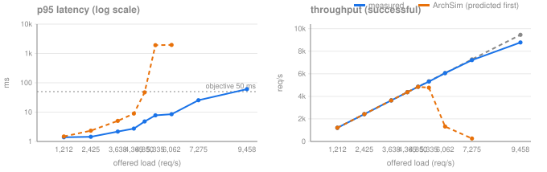
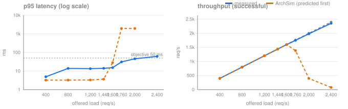

# How accurate is ArchSim?

ArchSim predicts latency and capacity from a model. This page checks those predictions against
real systems running on one machine: for each stack, the model is calibrated from low-load runs,
ArchSim predicts every higher load **before** it is measured, and then k6 measures it. The tables
show the latest run of each experiment, good or bad. `benchmarks/results/` keeps the calibration,
the predictions and every measured repeat's numbers as extracted from k6's end-of-run summary; the
k6 summaries themselves are scratch output and are not committed.

## Headline

<!-- BEGIN GENERATED: summary -->
| Experiment | Knee measured | Knee predicted | Knee error | p95 error at or below the measured knee (median / worst) |
| --- | --- | --- | --- | --- |
| [pg-mixed](#pg-mixed) | 4,237 req/s | 5,055 req/s | +19% | 24% / 93% (3 steps) |
| [pg-hot-row](#pg-hot-row) | 942 req/s | 851 req/s | -10% | 16% / 6527% (6 steps) |
| [cache-aside](#cache-aside) | 6,918 req/s | 5,201 req/s | -25% | 433% / 26294% (7 steps) |
| [kafka](#kafka) | 2,802 req/s | 2,528 req/s | -10% | 64% / 4188% (6 steps) |
<!-- END GENERATED: summary -->

Runs that repeat each experiment's latest conditions:

<!-- BEGIN GENERATED: repeatability -->
| Experiment | Runs repeating the latest | Median knee error | Knee errors | Measured knee inside the predicted range |
| --- | --- | --- | --- | --- |
| [pg-mixed](#pg-mixed) | 3 (v6, engine 0.16.0) | +11% | +6% to +19% | 3 of 3 runs (nominal 80%) |
| [pg-hot-row](#pg-hot-row) | 3 (v6, engine 0.16.0) | -10% | -10% to -9% | 3 of 3 runs (nominal 80%) |
| [cache-aside](#cache-aside) | 3 (v6, engine 0.16.0) | -25% | -27% to -24% | 2 of 3 runs (nominal 80%) |
| [kafka](#kafka) | 3 (v6, engine 0.16.0) | -3% | -10% to -2% | 3 of 3 runs (nominal 80%) |

The tier criteria below judge the median over at least 3 such runs. The nominal coverage is how often the measured knee should fall inside the predicted range. Engine 0.14.0's runs took the range from their three replicate calibration sets ((R - 1) / (R + 1) = 50%), which leaves out how much a calibration moves from one day to the next and the model's own error; since W28 the range is an 80% one that carries both ([Protocol](#protocol), step 3). A disturbed run missed the objective at one load step and met it at a higher one; it is kept and listed under the run history, but not counted.
<!-- END GENERATED: repeatability -->

The knee is the load where the ladder first misses the objective (p95 at most 50 ms with at least
99% of requests successful), interpolated between that step and the one below it; the predicted
knee uses the same steps and the same interpolation. A run that met the objective again higher
up was disturbed and is not counted (see [Protocol](#protocol), step 5). The p95 error covers
the steps at or below the measured knee: error = (predicted - measured) / measured.

Read these numbers as three runs on one laptop, all of them in-sample:

- **Three counted runs each, under protocol v6 and engine 0.16.0** (the v6 campaign, 1-2 Nov
  2026, Windows 11 build 26300 set to Best performance; no run disturbed). The first table shows
  each experiment's latest run, the second the median over its counted runs: **Kafka -3%,
  pg-hot-row -10%, pg-mixed +11%, cache-aside -25%.** Every one of the 12 runs is within 27%,
  and the median absolute knee error over them is 10%, against 22% for engine 0.14.0 under v5
  (the baseline campaign, 30-31 Oct: Kafka +4%, hot-row -16%, pg-mixed +24%, cache-aside -34%).
- **Not all of the gain is the model's.** pg-mixed's prediction barely moved (4,780 to 5,055
  req/s, against 4,729 to 5,003 under v5); its real knee rose about 10% between the campaigns
  (4,237 to 4,495 req/s, against 3,783 to 4,160) on the same laptop, OS build and power mode,
  with nothing on its path made cheaper. Kafka's real knee rose because the broker's healthcheck,
  which held every earlier Kafka run, is gone (2,614 to 2,802 req/s, against 2,028 to 2,132), so
  these are the first Kafka runs that measure Kafka. Cache-aside's and hot-row's predictions did
  move: v6's higher staircase (cache-aside's top at 3,023 to 3,350 req/s instead of 1,201 to
  1,586) and engine 0.15.0's database inputs (hot-row).
- **The predicted range held the measured knee in 11 of 12 runs**, for a nominal 80% (W28; the
  miss is cache-aside's run 6, measured 6,702 against a range up to 6,613). Engine 0.14.0's
  replicate range held 1 of 12. The range is wide, about x0.75 to x1.33 of the knee
  (pg-mixed's latest: 3,788 to 6,733 req/s around 5,055).
- **ArchSim still errs on both sides.** It over-predicts pg-mixed's capacity (+6% to +19%: a
  design sized on it runs out of headroom sooner than predicted) and under-predicts cache-aside's
  (-24% to -27%: safe, but it would buy too much). The causes are under [Where the model is
  wrong](#where-the-model-is-wrong-and-why): pg-mixed's latency climbs before its core fills,
  and cache-aside's cost per request keeps falling above the calibration staircase.
- **Every experiment meets criterion 1** (median knee error within ±25%; cache-aside only just,
  at -24.8%), and pg-mixed and Kafka criterion 2. None meets all of them: hot-row and cache-aside
  miss criterion 2, pg-mixed and hot-row criterion 3a (an unstable step at or below the knee in
  two of three runs), and criterion 3b needs a second machine. See [Proposed tier
  thresholds](#proposed-tier-thresholds).
- **Light-load latency: within 0.6 ms for pg-mixed and hot-row, 2 to 3 times too high for
  cache-aside.** At a quarter and half of the predicted knee ArchSim's p95 is 0.01 to 0.59 ms
  off for pg-mixed and hot-row. For cache-aside it is 2.9 and 4.7 ms against 1.4 and 1.5
  measured; part of that was a harness bug in the latest run (fixed since), the rest the service
  time's spread under v6's inputs ([below](#where-the-model-is-wrong-and-why)). Kafka's is
  0.35 and 1.96 ms under.
- **All four are in-sample.** The protocol (up to v6) and the engine (up to 0.16.0) were
  developed with these four experiments' results in view. The five [held-out
  experiments](#held-out-experiments) are the test of how ArchSim does on stacks it was not
  tuned on.
- **Two model features stay off.** Re-simulated on the 12 v6 runs (in-sample,
  [`docs/validation/dev-checks.md`](validation/dev-checks.md) for the defaults): W26's
  extension of the CPU curve above the staircase moves almost nothing (cache-aside -25% to -23%,
  the rest unchanged; v6's staircase already reaches about two thirds of the core), and W27's
  shared machine takes pg-mixed from +11% to 0% but cache-aside to -34% and Kafka to -27%
  (median absolute error 10% to 14%), with k6's CPU and the machine's background still assumed,
  not measured.
- **Nothing is validated.** No experiment meets all the [proposed tier
  thresholds](#proposed-tier-thresholds): criterion 3b needs a second machine.

## Reproduce

Each stack is one command (Docker and [uv](https://docs.astral.sh/uv/) needed; 20 to 30 minutes
per experiment on the machine below). Keep the machine otherwise idle while it runs: other work
shows up in the measurements (see the protocol history). On a Windows laptop, keep it on mains
power and set the power mode to Best performance: the runner records the mode, and runs under
different modes are not compared with each other:

```bash
uv run python benchmarks/run.py postgres   # pg-mixed and pg-hot-row
uv run python benchmarks/run.py cache      # cache-aside
uv run python benchmarks/run.py kafka      # kafka
uv run python benchmarks/run.py all --runs 3  # three independent runs of each, rotating
uv run python benchmarks/report.py --json  # rewrite this page's tables, charts and accuracy.json
```

`make benchmark` runs all of them. `uv run python benchmarks/run.py compare` recomputes every
`comparison.json` from the committed measurements and predictions without Docker;
`run.py resources` first predicts CPU and memory for results whose predictions have none
(see [Resources](#resources-cpu-and-memory)). Results depend
on the machine: rerun on yours before quoting numbers. `run.py --archive` first moves each
experiment's latest results into its next `run-N/` folder, so the history below keeps them.

Three commands check the model and the machine rather than measure accuracy:

- `run.py resimulate` derives every kept run's inputs again from its calibration passes, with
  today's code, and simulates its measured steps with today's engine (no Docker, about 10
  minutes). It writes `results/dev/<engine>/`, and `report.py --dev` turns that into
  [`docs/validation/dev-checks.md`](validation/dev-checks.md): each run's knee, measured and
  simulated by every engine checked. These checks are in-sample, designed after the
  measurements were seen, so they show what a model change does without claiming accuracy; this
  page's tables never use them. With engine 0.14.0 they reproduce every run calibrated under v3
  or v4 exactly, step by step, which shows the re-simulation itself is faithful.
- `run.py envcheck` characterises the machine (about 8 minutes of Docker): which CPUs share a
  physical core inside Docker's VM, how much CPU the VM loses to steal, and the service's and
  PostgreSQL's CPU per request and p95 across 50 to 1,600 req/s, with k6 on the CPUs the runner
  gives it and again with the service's physical core left to the service alone. It writes
  `results/envcheck/<time>.json`. Each run's `environment.json` also records how its cpusets fall
  on physical cores (`topology`).
- `run.py contention` measures how this machine turns CPUs into capacity (about 12 minutes of
  Docker): pg-mixed's service at rest, from a quarter of its core to past it and at half of it
  with background work on the other CPUs, with k6's own CPU; then a fixed unit of V8 work on one
  CPU, alone and with its hyperthread sibling, other cores or every CPU busy, and at a part of
  its own time. Windows' counters (each logical processor's busy share as the hypervisor sees
  it, the actual frequency, power and thermal limits) are read every second meanwhile. It writes
  `results/envcheck/<time>-contention.json`. With `BENCH_HOST=on` the benchmark designs take
  their host machine from it (`architecture.host`, engine 0.16.0); by default they have none,
  as before (see [What the machine itself does](#environment)). `run.py contention
  --service-only` takes only the machine at rest and the service at three rates (about 4
  minutes).

`report.py --json` also writes the same numbers as data, to `docs/validation/accuracy.json` and a
copy in `apps/web/src/data/` (the web image is built from `apps/web` alone; a test keeps the two
equal). The web app's public `/accuracy` page is built from that copy.

A GitHub Actions workflow (`.github/workflows/benchmark.yml`) runs everything on a hosted runner
every week, on every release tag (`v*`) and by hand: it archives the previous results, measures,
runs `report.py --json`, uploads the raw results as an artifact and opens a pull request for a
person to review and merge. The repository is private, so each automatic run uses about 1.5 hours
of billed Actions minutes: the weekly and release-tag triggers sit in a marked block at the top of
the workflow, to comment out to turn them off. **It has not completed a run yet:** two manual
runs stopped before measuring (the second asked for more CPUs than the hosted runner's 2; the
workflow now shares the runner's own CPUs between the containers). Every measured run so far was
on Windows with Docker Desktop; on Linux, the local runs have not been tried (the k6 container
writes its summary as uid 12345, so the runner makes `benchmarks/results/.k6` world-writable for
it, untested on Linux).

## Protocol

Each experiment (`benchmarks/run.py`) runs on a fresh stack (`benchmarks/compose.yaml`): a small
Node.js service (`benchmarks/service/server.js`, no framework), PostgreSQL 16, Redis 7 and Kafka
3.8 as each experiment needs, and k6 as the open-loop load generator (constant arrival rate,
like ArchSim's clients). Every container is pinned to its own CPUs.

1. **Settle** (protocol v4): after the data load, `VACUUM ANALYZE` and a checkpoint, then a
   discarded 30 s warm-up at the calibration rate, so autovacuum and cold caches do not land in a
   calibration pass.
2. **Calibrate** (protocol v6, since W26; the kept runs ran v5): 20 s at rest, which gives each
   container's idle CPU, then a staircase of the experiment's traffic: 50 req/s, then each pass
   at 65% of the service's core at the CPU per request the pass before measured, but at most
   half of any other capacity that pass implies (the connection pool, the hot row's lock, the
   Kafka consumers: those bounds come from times that include the network and driver, and past
   them a backlog would carry into the next pass); no higher once a pass's p95 passes 10 ms, and
   no rise of less than 10% (at most five rises). Because each step uses the cost the pass
   before measured, and that cost still falls, the climb ends at about 60% to 65% of the core.
   65% is the most the in-sample stacks took with p95 still a few milliseconds: the kept runs'
   ladders put the service at 1.4 to 2.2 ms around half a core and pg-mixed at 8 to 11 ms by
   three quarters. Protocol v5 stopped at 35% of the core (each pass at half the capacity the
   one before implied, at most three rises of at least 25%), about a third of the knee, so the
   inputs and `cpuByLoad` described a third of the load range. The staircase then comes down
   again and the top rate runs once more: every rate twice, the top three times, so drift on
   the machine shows. `calibration.json` records the settings (`staircaseRule`). The
   service records its CPU per request (Node's process CPU, including garbage collection and
   driver work), its own time per request (handler minus awaited calls) and the time of every
   PostgreSQL, Redis and Kafka call; the runner reads PostgreSQL's and Redis's own CPU and
   command time and, since W24 (after every kept run), each container's working set at rest and
   in every pass (`ResourceSampler`, every 5 s). Since engine 0.15.0 it also reads PostgreSQL's
   own statistics over each pass (`compose.yaml` loads `pg_stat_statements` and sets
   `track_wal_io_timing`): each statement's time inside the server, the WAL flushes with their
   time and the commits that shared one, the time backends were active, and the CPU of the
   backends and of the background processes (`calibration.json`, `postgres` in each pass). From
   those, a query's time in PostgreSQL is its CPU per query, the rest of the round trip the
   service measured (its driver and the network) is the link to the database, and a WAL flush
   takes what PostgreSQL measured; runs without the statistics fit the flush in the model to the
   wait the service measured (`run.py`, `database_inputs`, W22). Each top pass, with the
   auxiliary mixes run right after it, gives one replicate set of model inputs: CPU per request
   is the pass's CPU net of what the process burns at rest, timings come from the pass, and the
   one input not measured directly (the client-to-service latency) is set so the model
   reproduces the pass's median. Redis's command time is its container's CPU per command, net of
   idle (W24; before, `INFO commandstats`' own time, which leaves out its network reads and
   writes), and each service's memory at idle and per req/s is fitted to its working set over the
   staircase (W24; calibrations without the readings keep ArchSim's defaults). The inputs are the
   replicates' medians; `cpuByLoad` keeps every rate's CPU per request, which since W21 (engine
   0.15.0) becomes the service's `serviceTimeByLoad`, relative to the top rate and kept at the
   top rate's cost above it. W26 added a way to carry a measured fall above the top
   (`extend_load_curve`, `run.py` `CURVE_FORM = "log"`): fitted over every pass at the rates
   that kept the core at least 30% busy, used only when the top kept it at least 45% busy and
   the fall is more than twice its standard error, continued linearly in log(rate) at most as
   far above the top as those rates span below it, and never past where the core fills. It is
   **off by default** (`CURVE_FORM = "flat"`): it was checked only on staircases built from the
   kept runs' measured ladders, not on a v6 calibration (see "What would make it better next").
   Since W21 the Node.js service also reports V8's garbage
   collections: its mark-compact cycles in the top pass become the model's GC pauses
   (`gcPauseMs`, `gcEveryRequests`), and their time comes off the CPU per request, which already
   held it; the frequent short scavenges stay in the CPU per request. A pass whose p95 is more than 10 times
   its median was disturbed: it is recorded, discarded and run again. Each input is derived by a
   formula recorded next to it in `calibration.json`. Protocol v4 (runs up to 6) calibrated in
   two passes, 50 req/s and a quarter of the pessimistic capacity, and took CPU per request as
   the slope between them; the machine check above shows why that read the cost too high.
3. **Predict**: the runner builds the ArchSim design (one Node.js event loop on 1 vCPU, a pool of
   10 database connections, PostgreSQL on 2 vCPU, and so on), searches the knee, and simulates
   every step of the ladder: 0.25, 0.5, 0.75, 0.9, 1.0, 1.1, 1.25 and 1.5 times the predicted
   knee. Since W28 (1 Nov 2026) it also predicts an **80% range** for the knee: the measured knee
   should fall inside it in about four runs of five. The range is a lognormal around the
   predicted knee whose spread adds two parts, both fitted on the four in-sample experiments
   only (`benchmarks/knee-range.json`, written by `run.py range-fit`; the fit and its check:
   [`docs/validation/knee-range.md`](validation/knee-range.md)):
   - **What a fresh calibration on another day would give.** The inputs move between
     calibrations of the same stack: the service's CPU per request by about 17% (one standard
     deviation; 13% to 14% for three experiments, 24% for hot-row), a query's time in
     PostgreSQL by about 18%, the WAL flush by 9%, Redis's command time and Kafka's publish by
     about 11% (over 25 v5 calibrations: the 14 kept runs and 11 calibration-only trials, all on
     the same machine, OS build and power mode). Within one calibration the three replicate sets
     agree more closely (the service's CPU per request to about 5%). Much of the CPU's
     variation is where the staircase stopped, since the cost per request falls with load:
     pg-mixed's trial that topped at 1,024 req/s read 0.29 ms, the one that topped at 1,931
     read 0.20 ms. The same holds for the WAL flush: hot-row's staircase topped at 221 req/s in
     run 6 and at 381 in run 7, its flush read 1.01 and 0.74 ms, and its predicted knee moved
     from 744 to 1,062 req/s. The runner reads how much the knee moves with each input (a knee
     search with the input 22% higher, against one without, both on 10 s simulations) and
     multiplies, so a knee set by a noisier input gets a wider range: pg-mixed's, cache-aside's
     and Kafka's knees fall 1% for each 1% of the service's CPU, which gives them a calibration
     spread of 0.17 (log standard deviation, about ±17%); hot-row's is set by the flush (-0.8)
     and the write's time (-0.26), 0.10.
   - **The model's own error.** The measured knee was further from the prediction than the
     calibration explains, and on the same side in every run of an experiment (pg-mixed's 17%
     to 20% below the prediction, cache-aside's 35% to 51% above): a log standard deviation of
     0.15, fitted by maximum likelihood over the 12 counted v5 runs. The two parts are about
     the same size; together they make the 80% range about x0.75 to x1.33 of the predicted
     knee.

   Engine 0.14.0's runs took the range from the three replicate sets' knees, the lowest to the
   highest (nominally 50%: (R - 1) / (R + 1)); it held the measured knee in 1 of 12 runs,
   because it carried neither part. Checked on the same 12 runs with today's engine, the new
   80% range holds 9 of 12 in-sample, 9 when the run checked is left out of the fit and 9 when
   its whole experiment is (at 50% and 90% nominal: 5 and 10 of 12). The three misses are
   cache-aside's, whose knee the model puts too low in every run. Two runs sit within 1% of an
   end (Kafka's run 3 inside, cache-aside's run 3 outside), and 12 runs of four experiments are
   a weak check: these are runs the model was tuned on, and the held-out campaign is the test
   on data the range was not fitted to.

   `predictions.json` is written before the first measured step, with its provenance:
   the commit, the engine's and the harness's git object ids, whether either had uncommitted
   changes, and the machine. Its sha256 goes to the log and into `measured.json` before the
   first step is measured. When the system still
   meets the objective at the top of the ladder, the runner climbs by 30% (at most four times),
   predicting and saving each new step before measuring it.
4. **Measure** each step three times: 5 s of warm-up, then 20 s measured, 2 s client timeout;
   each metric is the median of the three (robust to one stall), and a step whose three p95s
   differ by more than 2x across the objective is marked unstable. p50, p95 and p99 are over
   successful requests started in the window, as in ArchSim's reports; requests k6 could not
   send in time count as failures. A repeat in which k6 sent nothing (the load generator failed)
   is recorded, discarded and run again. A repeat in which requests were sent and none succeeded
   is a failed repeat: it has no latency, and in the step's medians it counts as slower than any
   measured repeat (run 4 recorded two such repeats as 0 ms; the comparison now treats them as
   failed). Since run 5, the runner also waits (at most 60 s) between repeats until the service
   answers its health check and PostgreSQL has no query left running (except on the Kafka stack,
   which already waits for its backlog to drain), and each repeat reads every container's CPU
   and memory (cgroup v2: CPU time and working set) every 5 s inside the measured window (run 4
   recorded CPU over the whole k6 command, see [Resources](#resources-cpu-and-memory)).
5. **Compare** step by step (`comparison.json`), the knee, and each part's CPU and memory against
   the model's. A run whose ladder misses the objective at one step and meets it at a higher
   one was **disturbed**: a stable stack does not get faster with more load, and the knee is set
   by the first miss, so that knee is not the stack's. Such a run is kept and listed, but
   `report.py` leaves it out of the criteria, the repeatability and the run-to-run spread. This
   rule was added on 31 Oct 2026, after the baseline campaign's first two pg-mixed runs: at
   2,112 and 2,550 req/s two of three repeats stalled, with every container's CPU per request
   rising 2 to 3 times at once while none was more than half busy, and the same runs then met
   the objective at 3,169 and 5,100 req/s. It flags no other run under v5, and six of the 14
   earlier runs.

Nothing measured at steps 4 and 5 feeds back into the model: the predictions use only the
calibration passes.

### Protocol history

Earlier runs are kept in `benchmarks/results/<experiment>/run-N/` (cache-aside and Kafka were
first run in run 4, which their `run-1/` folders hold). The protocol changed between runs, each
time after a run exposed a flaw in the calibration. Every change was made with earlier results
in view (the PostgreSQL experiments' for v2 to v4, all four's for v5 and v6), so all four
experiments are in-sample for the current protocol (v6, first run in the v6 campaign of 1-2
Nov):

| Run | Protocol | What it showed |
| --- | --- | --- |
| 1 | one pass at 50 req/s, CPU per request as measured | At 50 req/s a laptop's cores sit in low-power states, so CPU per request came out about 4x what it costs under load. |
| 2 | two passes, CPU per request from the slope (v2) | Fixed CPU cancels out; but the database driver's CPU was counted twice (in the CPU per request and inside the measured query time), so the model started about 2x too slow. Measured steps overlapped with other work on the machine. |
| 3 | v2 plus the anchor at the calibration rate (v3) | pg-mixed's first pass met the post-load autovacuum (p95 280 ms at 50 req/s), which inflated CPU per request 3x and sent every input wrong; hot-row's single-row lock turned short host stalls (package installs and test runs in other work) into seconds-long queues. Neither run measured the model. |
| 4 | v3 plus settling and disturbed-pass retries (v4), machine otherwise idle | The first clean runs of pg-hot-row, cache-aside and Kafka. |
| 5 | v4; CPU and memory read inside the measured window; engine 0.13.0 | pg-mixed: knee 2,430 req/s against 2,238 predicted (-8%). The run of the other three was discarded: other work on the machine (video rendering) took its memory, so pg-hot-row's calibration measured a commit-flush p95 of 417 ms and Docker stalled for 20 minutes during cache-aside; Kafka did not run. They were run again in run 6. |
| 6 | v4, as run 5, after a Windows update (build 26300, with a new WSL kernel) | pg-hot-row, cache-aside and Kafka, on an otherwise idle machine (no discarded pass; commit-flush p95 1.8 ms). The update made the stacks faster: Kafka's publish p95 in calibration fell from 10.1 to 2.6 ms and its knee rose from 945 to 2,040 req/s; hot-row held 777 req/s, where run 4 stalled at 333. |
| 7 | v5 (a staircase with replicate sets and a predicted range; CPU per request net of idle at the top rate), engine 0.14.0, Windows on Best performance, k6 off the service's hyperthread sibling; three runs of each experiment, rotating (the baseline campaign, 30-31 Oct) | Engine 0.14.0's numbers, the first ones on /accuracy. The stacks were faster again under Best performance: pg-mixed's knee about 4,000 req/s, cache-aside's about 7,000. pg-mixed's first two runs (22:30 to 01:05, Western European time) were disturbed, cause unknown (Windows logged no throttling, Defender scan or other event around the first stall): two of three repeats stalled at 2,112 req/s in one, and the other missed at 2,550 to 4,590 req/s and met the objective at 5,100. Both are kept and not counted, and pg-mixed ran twice more on the idle machine (`run-9/` and the latest). Calibration retried five disturbed passes, all between 00:29 and 01:08. |
| 8 | v6 (the staircase climbs to about two thirds of the service's core, W26), engine 0.16.0 with the 80% predicted range (W28), Kafka's broker healthcheck run once (W23), same machine, OS build and power mode; three runs of each experiment, rotating (the v6 campaign, 1-2 Nov) | This page's numbers. No run was disturbed; calibration retried four disturbed passes, all pg-mixed's (23:47 to 23:52 and 04:05 to 04:13). The staircases topped at 2,373 to 3,155 req/s for pg-mixed, 357 to 374 for hot-row, 3,023 to 3,350 for cache-aside and 971 to 1,015 for Kafka. The measured knees: pg-mixed 4,237 to 4,495 req/s (v5: 3,783 to 4,160), hot-row 939 to 953, cache-aside 6,702 to 7,010, and Kafka 2,614 to 2,802 without the healthcheck (v5: 2,028 to 2,132 with it). |

**Protocol v6** (W26, 1 Nov 2026; first run in the v6 campaign, run 8) climbs the staircase to
about two thirds of the service's core instead of a third (step 2), because every v5 staircase stopped at a third
of the knee and read the CPU per request where it was still falling: cache-aside's real cost fell
from 0.21 ms at the v5 top to 0.13 ms near the knee. Replaying v6's rise rule on each counted
run's own costs (its staircase, then its measured ladder) puts the climb's top at 3,000 to
3,500 req/s for pg-mixed and cache-aside (60% to 65% of the core) and about 870 req/s for Kafka
(held by half the consumers' capacity); the core would then fill, at the top's cost, 20% below
cache-aside's measured knee (median; was 33%), 20% above pg-mixed's (was 24%) and 12% above
Kafka's (was 4%; Kafka's measured knees are the old healthcheck's). These are estimates from
data the protocol was designed with, not measurements. The first v6 trial, on 1 Nov, ran on a
throttled laptop (busy cores at 74% to 92% of the base clock, every CPU cost about twice its
usual) and was stopped; the trial script now waits for a boosting CPU
(`benchmarks/results/trials/W26-trial.py`). In the campaign itself the climb topped where the
estimate put it for cache-aside (3,023 to 3,350 req/s) and Kafka (971 to 1,015), lower for
pg-mixed in two of three runs (2,453 and 2,502; the third reached 3,155), and the predicted knees
landed 25% below cache-aside's measured knee (median), 11% above pg-mixed's and 3% below
Kafka's.

Every kept run, compared the same way (`run.py compare`):

<!-- BEGIN GENERATED: history -->
| Experiment | Results | Protocol | Calibrated (UTC) | Knee measured | Knee predicted | Knee error | Counted |
| --- | --- | --- | --- | --- | --- | --- | --- |
| pg-mixed | `run-1/` | v1 | 2026-10-26T08:00:55Z | > 1,359 req/s | 906 req/s | - | yes |
| pg-mixed | `run-2/` | v2 | 2026-10-26T08:23:18Z | 1,895 req/s | 2,314 req/s | +22% | no: missed at 2,081 req/s, met higher |
| pg-mixed | `run-3/` | v3 | 2026-10-26T09:46:26Z | 3,162 req/s | 808 req/s | -74% | yes |
| pg-mixed | `run-4/` | v4 | 2026-10-26T11:13:41Z | 2,291 req/s | 2,064 req/s | -10% | yes |
| pg-mixed | `run-5/` | v4 | 2026-10-28T23:21:36Z | 2,430 req/s | 2,238 req/s | -8% | yes |
| pg-mixed | `run-6/` | v5 | 2026-10-30T21:30:44Z | 1,089 req/s | 4,230 req/s | +288% | no: missed at 2,112 req/s, met higher |
| pg-mixed | `run-7/` | v5 | 2026-10-30T23:44:23Z | 1,449 req/s | 5,108 req/s | +253% | no: missed at 2,550, 3,825 and 4,590 req/s, met higher |
| pg-mixed | `run-8/` | v5 | 2026-10-31T01:52:33Z | 4,160 req/s | 5,003 req/s | +20% | yes |
| pg-mixed | `run-9/` | v5 | 2026-10-31T04:02:33Z | 3,783 req/s | 4,729 req/s | +25% | yes |
| pg-mixed | `run-10/` | v5 | 2026-10-31T04:34:12Z | 4,006 req/s | 4,956 req/s | +24% | yes |
| pg-mixed | `run-11/` | v6 | 2026-11-01T22:53:59Z | 4,495 req/s | 4,780 req/s | +6% | yes |
| pg-mixed | `run-12/` | v6 | 2026-11-02T01:02:03Z | 4,364 req/s | 4,856 req/s | +11% | yes |
| pg-mixed | latest (`results/pg-mixed/`) | v6 | 2026-11-02T03:15:28Z | 4,237 req/s | 5,055 req/s | +19% | yes |
| pg-hot-row | `run-1/` | v1 | 2026-10-26T08:11:06Z | 303 req/s | 403 req/s | +33% | no: missed at 363 and 443 req/s, met higher |
| pg-hot-row | `run-2/` | v2 | 2026-10-26T08:42:10Z | 819 req/s | 418 req/s | -49% | yes |
| pg-hot-row | `run-3/` | v3 | 2026-10-26T10:11:09Z | 132 req/s | 504 req/s | +281% | no: missed at 252 and 553 req/s, met higher |
| pg-hot-row | `run-4/` | v4 | 2026-10-26T11:33:38Z | 225 req/s | 444 req/s | +97% | no: missed at 333 req/s, met higher |
| pg-hot-row | `run-5/` | v4 | 2026-10-30T10:32:56Z | 814 req/s | 519 req/s | -36% | yes |
| pg-hot-row | `run-6/` | v5 | 2026-10-30T21:58:50Z | 819 req/s | 663 req/s | -19% | yes |
| pg-hot-row | `run-7/` | v5 | 2026-10-31T00:14:43Z | 960 req/s | 958 req/s | 0% | yes |
| pg-hot-row | `run-8/` | v5 | 2026-10-31T02:21:39Z | 926 req/s | 783 req/s | -16% | yes |
| pg-hot-row | `run-9/` | v6 | 2026-11-01T23:24:56Z | 953 req/s | 862 req/s | -10% | yes |
| pg-hot-row | `run-10/` | v6 | 2026-11-02T01:33:51Z | 939 req/s | 851 req/s | -9% | yes |
| pg-hot-row | latest (`results/pg-hot-row/`) | v6 | 2026-11-02T03:46:41Z | 942 req/s | 851 req/s | -10% | yes |
| cache-aside | `run-1/` | v4 | 2026-10-26T11:53:13Z | 4,016 req/s | 3,457 req/s | -14% | no: missed at 4,312 req/s, met higher |
| cache-aside | `run-2/` | v4 | 2026-10-30T10:50:27Z | 4,848 req/s | 2,352 req/s | -51% | yes |
| cache-aside | `run-3/` | v5 | 2026-10-30T22:22:04Z | 7,138 req/s | 5,303 req/s | -26% | yes |
| cache-aside | `run-4/` | v5 | 2026-10-31T00:38:29Z | 6,432 req/s | 4,227 req/s | -34% | yes |
| cache-aside | `run-5/` | v5 | 2026-10-31T02:44:32Z | 7,324 req/s | 4,851 req/s | -34% | yes |
| cache-aside | `run-6/` | v6 | 2026-11-01T23:49:28Z | 6,702 req/s | 4,925 req/s | -27% | yes |
| cache-aside | `run-7/` | v6 | 2026-11-02T01:58:24Z | 7,010 req/s | 5,302 req/s | -24% | yes |
| cache-aside | latest (`results/cache-aside/`) | v6 | 2026-11-02T04:11:08Z | 6,918 req/s | 5,201 req/s | -25% | yes |
| kafka | `run-1/` | v4 | 2026-10-26T12:22:50Z | 945 req/s | 1,006 req/s | +6% | no: missed at 1,006 req/s, met higher |
| kafka | `run-2/` | v4 | 2026-10-30T11:20:01Z | 2,040 req/s | 1,602 req/s | -21% | yes |
| kafka | `run-3/` | v5 | 2026-10-30T23:00:02Z | 2,132 req/s | 2,829 req/s | +33% | yes |
| kafka | `run-4/` | v5 | 2026-10-31T01:19:14Z | 2,087 req/s | 2,140 req/s | +3% | yes |
| kafka | `run-5/` | v5 | 2026-10-31T03:26:27Z | 2,028 req/s | 2,102 req/s | +4% | yes |
| kafka | `run-6/` | v6 | 2026-11-02T00:26:56Z | 2,614 req/s | 2,551 req/s | -2% | yes |
| kafka | `run-7/` | v6 | 2026-11-02T02:36:13Z | 2,659 req/s | 2,578 req/s | -3% | yes |
| kafka | latest (`results/kafka/`) | v6 | 2026-11-02T04:48:49Z | 2,802 req/s | 2,528 req/s | -10% | yes |
<!-- END GENERATED: history -->

The measured knee moved between runs too, not only the prediction. Each step was measured the
same way in runs 2 to 7 (three repeats with a 20 s measured window), but in runs 2 and 3 the
machine was doing other work and the database was not settled first, run 6 came after a Windows
update and run 7 ran under Best performance. The run-to-run spread quoted here and on
`/accuracy` counts only the counted runs on the latest run's OS build and power mode.

## Environment

<!-- BEGIN GENERATED: environment -->
- CPU: 11th Gen Intel(R) Core(TM) i7-1165G7 @ 2.80GHz; Docker 29.1.3 (linux/amd64) with 8 CPUs and 7.6 GiB; Windows-11-10.0.26300-SP0 (Best performance).
- Images: postgres `postgres:16-alpine`, redis `redis:7-alpine`, kafka `apache/kafka:3.8.0`, k6 `grafana/k6:1.3.0`, service `node:24-alpine + pg 8.23.1, redis 4.7.1, kafkajs 2.2.4`.
- CPUs pinned per container (cpuset; k6 gets the CPUs the stack leaves free): pg-mixed and pg-hot-row: service 1 (`2`), PostgreSQL 2 (`4,5`), k6 4 (`0,1,6,7`); cache-aside: service 1 (`2`), PostgreSQL 2 (`4,5`), Redis 1 (`1`), k6 3 (`0,6,7`); kafka: producer 1 (`2`), consumer 1 (`3`), PostgreSQL 2 (`4,5`), Kafka 2 (`0,1`), k6 2 (`6,7`).
<!-- END GENERATED: environment -->

**What the machine itself does** (`run.py envcheck`, 30 Oct, Windows build 26300, pg-mixed's
workload, `results/envcheck/`):

- **CPU per request falls steeply with the rate, in every container.** The Node.js service used
  0.96 ms per request at 50 req/s, 0.42 at 200, 0.29 at 400 and 0.21 to 0.22 from 800 to 1,600;
  PostgreSQL 0.93, 0.33, 0.21 and 0.19 ms. The cost settles only from about 800 req/s. The
  calibration passes (50 req/s and a quarter of the pessimistic capacity, a few hundred req/s)
  sit where it is highest and still changing, which is why protocol v4's CPU per request was
  about twice the real one near the knee. It looks like the host (cores idling into
  power-saving states at light load) rather than the application. Protocol v5 reads the cost at
  the top of a staircase instead, and under Best performance (run 7) the service's predicted CPU
  came within 4% to 34% of the measured one (see [Resources](#resources-cpu-and-memory)).
- **k6 on the service's hyperthread sibling** (CPUs 2 and 3 are one physical core in Docker's
  VM) cost the service 10% to 15% more CPU per request and raised p95 at 1,600 req/s from 1.4 to
  2.2 ms. Since run 7 the runner leaves that sibling idle (k6 on `0,1,6,7` for the
  PostgreSQL stack and `0,6,7` for the cache stack). PostgreSQL's two CPUs (`4,5`) are one
  physical core too, though the model gives it two cores; its CPU never came close to binding.
- **No CPU steal** in Docker's VM, and no p95 near Windows' 15.6 ms timer tick at these rates.
- **Every container shares the laptop's four physical cores, whatever its cpuset says**
  (`run.py contention`, 1 Nov, `results/envcheck/2026-11-01T00-48-59Z-contention.json`).
  Docker's VM numbers its CPUs as hyperthread pairs (2 and 3, 4 and 5, ...), but Windows
  schedules the VM's CPUs itself: a fixed unit of V8 work on CPU 2 with CPU 3 busy did 1.57 to
  1.70 times one CPU's work together, where two threads of one core do about 1.2. What sets how
  fast CPU work runs is how many of the laptop's 8 logical processors are busy, in the VM or in
  Windows: the probe's CPU per unit of work was 0.85 to 1.0 times its cost with 1.8 to 3.5 of
  them busy, 1.2 times with 4.6, 1.5 with 5.5, 1.9 with 6.6, 2.1 with 7.4 and about 3 with all
  8 busy (more work than processors). The clock fell in a straight line from 4,050 MHz with one
  busy to about 2,950 with eight, with no power or thermal limit flagged. Four physical cores,
  that clock (x0.73) and a thread sharing its core at 0.48 of its speed reproduce the probe's 20
  conditions below full load within 5.5% (rms, in log). A container's CPU time includes the time
  Windows takes its processor away (the VM reports no steal), so a container's CPU per request
  rises with the whole machine's load, not only its own. After about 15 minutes near full load
  (this check and other work) the laptop's clock fell to about 1,600 MHz and stayed low for a
  while, again with no limit flagged: runs need the machine cool as well as idle.

## pg-mixed

<!-- BEGIN GENERATED: pg-mixed -->
**Node.js + PostgreSQL: 90% reads, 10% writes over 100,000 rows.** Calibrated 2026-11-02T03:15:28Z, predicted 2026-11-02T03:20:49Z (engine 0.16.0), measured afterwards. Objective: p95 <= 50 ms with >= 99% success.


Model inputs from a staircase of calibration passes at 50, 743, 2,373 and 3,155 req/s (each rate up and down again): the median of 3 replicate sets from the 3,155 req/s passes, CPU per request net of the 20 s at rest:

| Input | Value | How it was measured |
| --- | --- | --- |
| `serviceTimeMs` | lognormal, median 0.176 ms, p95 0.3888 ms | the median of 3 replicates (third): mean = Node's CPU per request at 3155 req/s net of idle: (18746 - 5 ms at rest) / 94650 requests = 0.1980 ms, less the 0.0003 ms per request of the pauses modelled as GC (gcPauseMs) = 0.1977 ms; shape (p95/median 0.0073/0.0033 ms) from the handler's own time |
| `clientLinkLatencyMs` | 0 ms | the median of 3 replicates (second): anchored: (measured median 0.578 ms - the model's median without it 0.582 ms at 3155 req/s) / 2, one way, at least 0 |
| `serviceTimeByLoad` | x4.21 at 50, x1.39 at 743, x1.05 at 2,373, x1.00 at 3,155 req/s | the median of 3 replicates (first): the staircase's CPU per request net of idle (0.8326 ms at 50, 0.2756 ms at 743, 0.2083 ms at 2373, 0.1980 ms at 3155 req/s), fitted never rising with rate and divided by the top rate's (0.1980 ms); flat outside the staircase |
| `gcPauseMs` | 9.4369 ms | the median of 3 replicates (third): V8's mark-compact cycles in the pass: 33.1 ms (incremental 18.9 ms, major 14.1 ms) over 3 cycles, a mean of 11.021 ms (the model's median: mean / 1.17); 122 scavenges, 129.3 ms, left in the CPU per request |
| `gcEveryRequests` | 31550 | the median of 3 replicates (second): 94650 requests / 3 mark-compact cycles in the pass |
| `writeServiceTimeMs` | lognormal, median 0.0794 ms, p95 0.7685 ms | the median of 3 replicates (third): PostgreSQL's CPU per UPDATE with synchronous_commit off (0.2058 ms), shaped like its round trip (median 0.292, p95 2.820 ms) |
| `readServiceTimeMs` | lognormal, median 0.1254 ms, p95 0.5594 ms | the median of 3 replicates (first): PostgreSQL's CPU per SELECT (0.1896 ms, the pass's less its UPDATEs'), shaped like its round trip (median 0.275, p95 1.228 ms) |
| `dbLinkLatencyMs` | lognormal, median 0.0404 ms, p95 0.4289 ms | the median of 3 replicates (first): each way: the round trip the service measured less PostgreSQL's time, in two legs that keep its mean and variance (median 0.0404, p95 0.4289 ms) |
| `dbCpuShare` | 1 | the median of 3 replicates (first): PostgreSQL CPU per query at the top pass net of idle (0.1912 ms) / the model's mean time per query (85157 reads at 0.190 ms and 9494 writes without their flush at 0.206 ms: 0.191 ms) |
| `commitFlushMs` | lognormal, median 0.9946 ms, p95 1.0045 ms | the median of 3 replicates (third): PostgreSQL's own WAL flushes at 3155 req/s (pg_stat_wal): 9397 flushes of 0.995 ms on average, 1.02 commits per flush (the model: 1.03); shaped like the commit wait the service measured (p95/median 1.01, mean 1.054 ms) |
| `serviceMemoryBaselineMb` | 38.173 | the median of 3 replicates (first): at idle: the api container's working set (the highest reading in each pass) against req/s over 10 points (at rest and 9 passes, 50 to 3,155 req/s), by non-negative least squares: 38.2 MiB + 0.0311 MiB per req/s, largest error at and above the median rate 97% |
| `serviceMemoryPerRpsMb` | 0.031067 | the median of 3 replicates (first): per req/s: the api container's working set (the highest reading in each pass) against req/s over 10 points (at rest and 9 passes, 50 to 3,155 req/s), by non-negative least squares: 38.2 MiB + 0.0311 MiB per req/s, largest error at and above the median rate 97% |
| `serviceMemoryPerRequestMb` | 0.01 | the median of 3 replicates (first): per request held: the floor, since the fit against req/s explains the whole working set (held requests' memory would count twice otherwise) |

Measured in the calibration pass at 3,155 req/s: p50 0.55 ms, p95 3.11 ms.

| Offered req/s | p50 meas / pred (ms) | p95 meas / pred (ms) | p95 error | p99 meas / pred (ms) | Success meas / pred | Throughput meas / pred |
| --- | --- | --- | --- | --- | --- | --- |
| 1,262 | 0.50 / 0.59 | 1.77 / 1.76 | 0% | 3.64 / 2.73 | 100% / 100% | 1,262 / 1,262 |
| 2,525 | 0.56 / 0.56 | 2.42 / 1.84 | -24% | 6.91 / 3.01 | 100% / 100% | 2,525 / 2,524 |
| 3,788 | 0.77 / 0.61 | 30.7 / 2.03 | -93% | 64.8 / 4.05 | 100% / 100% | 3,781 / 3,787 |
| 4,545 | 1.58 / 0.77 | 63.3 / 2.42 | -96% | 74.3 / 9.88 | 99% / 100% | 4,507 / 4,545 |
| 5,050 | 85.1 / 19.0 | 115 / 32.4 | -72% | 138 / 35.1 | 91% / 100% | 4,617 / 5,046 |
| 5,555 | 116 / 1,264 | 174 / 1,916 | +1001% | 203 / 1,994 | 79% / 74% | 4,363 / 4,256 |
| 6,312 | 124 / 1,635 | 181 / 1,954 | +980% | 222 / 1,994 | 69% / 15% | 4,385 / 1,263 |
| 7,575 | 144 / - | 215 / - | - | 268 / - | 57% / 0% | 4,329 / 255 |

Knee: measured 4,237 req/s, predicted 5,055 req/s on the same steps (+19%); ArchSim's own search before measuring put it at 5,050 req/s. Its predicted 80% range was 3,788 to 6,733 req/s: the measured knee fell inside it. Data: `benchmarks/results/pg-mixed/` (each repeat's numbers as extracted from k6's summary; the summaries themselves are not kept).
<!-- END GENERATED: pg-mixed -->

## pg-hot-row

<!-- BEGIN GENERATED: pg-hot-row -->
**Node.js + PostgreSQL: every request updates the same row.** Calibrated 2026-11-02T03:46:41Z, predicted 2026-11-02T03:47:44Z (engine 0.16.0), measured afterwards. Objective: p95 <= 50 ms with >= 99% success.


Model inputs from a staircase of calibration passes at 50, 202, 319 and 374 req/s (each rate up and down again): the median of 3 replicate sets from the 374 req/s passes, CPU per request net of the 20 s at rest:

| Input | Value | How it was measured |
| --- | --- | --- |
| `serviceTimeMs` | lognormal, median 0.2544 ms, p95 0.8361 ms | the median of 3 replicates (third): mean = Node's CPU per request at 374 req/s net of idle: (3710 - 2 ms at rest) / 11220 requests = 0.3305 ms; shape (p95/median 0.0156/0.0047 ms) from the handler's own time |
| `clientLinkLatencyMs` | 0 ms | the median of 3 replicates (second): anchored: (measured median 1.398 ms - the model's median without it 1.536 ms at 374 req/s) / 2, one way, at least 0 |
| `serviceTimeByLoad` | x2.30 at 50, x1.29 at 202, x1.06 at 319, x1.00 at 374 req/s | the median of 3 replicates (first): the staircase's CPU per request net of idle (0.7578 ms at 50, 0.4254 ms at 202, 0.3484 ms at 319, 0.3296 ms at 374 req/s), fitted never rising with rate and divided by the top rate's (0.3296 ms); flat outside the staircase |
| `gcPauseMs` | 0 ms | the median of 3 replicates (second): no mark-compact in the pass; 75 scavenges, 33.9 ms, left in the CPU per request |
| `writeServiceTimeMs` | lognormal, median 0.236 ms, p95 0.6906 ms | the median of 3 replicates (second): PostgreSQL's CPU per UPDATE with synchronous_commit off (0.2920 ms), shaped like its round trip (median 0.320, p95 0.938 ms) |
| `dbLinkLatencyMs` | lognormal, median 0.0202 ms, p95 0.2049 ms | the median of 3 replicates (first): each way: the round trip the service measured less PostgreSQL's time, in two legs that keep its mean and variance (median 0.0202, p95 0.2049 ms) |
| `dbCpuShare` | 1 | the median of 3 replicates (second): PostgreSQL CPU per query at the top pass net of idle (0.3428 ms) / the model's mean time per query (11221 writes without their flush at 0.292 ms: 0.292 ms) |
| `commitFlushMs` | lognormal, median 0.831 ms, p95 1.4201 ms | the median of 3 replicates (third): PostgreSQL's own WAL flushes at 374 req/s (pg_stat_wal): 11149 flushes of 0.876 ms on average, 1.01 commits per flush (the model: 1.00); shaped like the commit wait the service measured (p95/median 1.71, mean 0.826 ms) |
| `serviceMemoryBaselineMb` | 184.86 | the median of 3 replicates (first): at idle: the api container's working set (the highest reading in each pass) against req/s over 10 points (at rest and 9 passes, 50 to 374 req/s), by non-negative least squares: 184.9 MiB + 0.0000 MiB per req/s, largest error at and above the median rate 1%; memory did not grow with the request rate over the range |
| `serviceMemoryPerRpsMb` | 0 | the median of 3 replicates (first): per req/s: the api container's working set (the highest reading in each pass) against req/s over 10 points (at rest and 9 passes, 50 to 374 req/s), by non-negative least squares: 184.9 MiB + 0.0000 MiB per req/s, largest error at and above the median rate 1%; memory did not grow with the request rate over the range |
| `serviceMemoryPerRequestMb` | 0.01 | the median of 3 replicates (first): per request held: the floor, since the fit against req/s explains the whole working set (held requests' memory would count twice otherwise) |

Measured in the calibration pass at 374 req/s: p50 1.37 ms, p95 2.76 ms.

| Offered req/s | p50 meas / pred (ms) | p95 meas / pred (ms) | p95 error | p99 meas / pred (ms) | Success meas / pred | Throughput meas / pred |
| --- | --- | --- | --- | --- | --- | --- |
| 212 | 1.69 / 1.60 | 3.12 / 2.62 | -16% | 3.78 / 3.26 | 100% / 100% | 212 / 212 |
| 425 | 1.30 / 1.54 | 2.70 / 2.52 | -7% | 4.01 / 3.26 | 100% / 100% | 425 / 425 |
| 638 | 1.25 / 1.63 | 2.89 / 2.78 | -4% | 6.17 / 3.67 | 100% / 100% | 638 / 638 |
| 765 | 1.29 / 1.99 | 4.33 / 3.67 | -15% | 12.5 / 4.66 | 100% / 100% | 765 / 765 |
| 850 | 1.35 / 7.06 | 11.8 / 27.7 | +134% | 34.2 / 33.7 | 100% / 100% | 850 / 849 |
| 935 (unstable) | 1.84 / 1,215 | 28.9 / 1,916 | +6527% | 45.2 / 1,994 | 100% / 84% | 935 / 807 |
| 1,062 | 291 / 1,603 | 429 / 1,954 | +356% | 480 / 1,994 | 98% / 17% | 1,039 / 232 |
| 1,275 | 1,171 / - | 1,874 / - | - | 1,967 / - | 46% / 0% | 590 / 47 |

Unstable: the step's repeats' p95s differ by more than 2x across the objective (a repeat with no successful request counts as slower than any).

Knee: measured 942 req/s, predicted 851 req/s on the same steps (-10%); ArchSim's own search before measuring put it at 850 req/s. Its predicted 80% range was 676 to 1,069 req/s: the measured knee fell inside it. Data: `benchmarks/results/pg-hot-row/` (each repeat's numbers as extracted from k6's summary; the summaries themselves are not kept).
<!-- END GENERATED: pg-hot-row -->

## cache-aside

<!-- BEGIN GENERATED: cache-aside -->
**Cache-aside: Node.js, Redis (30 s TTL) and PostgreSQL; Zipf 0.99 over 100,000 keys.** Calibrated 2026-11-02T04:11:08Z, predicted 2026-11-02T04:16:41Z (engine 0.16.0), measured afterwards. Objective: p95 <= 50 ms with >= 99% success.



Model inputs from a staircase of calibration passes at 50, 634, 1,964 and 3,251 req/s (each rate up and down again): the median of 3 replicate sets from the 3,251 req/s passes, CPU per request net of the 20 s at rest:

| Input | Value | How it was measured |
| --- | --- | --- |
| `serviceTimeMs` | lognormal, median 0.0629 ms, p95 0.6912 ms | the median of 3 replicates (third): mean = Node's CPU per request at 3251 req/s net of idle: (17776 - 5 ms at rest) / 97530 requests = 0.1822 ms, less the 0.0003 ms per request of the pauses modelled as GC (gcPauseMs) = 0.1819 ms; shape (p95/median 0.0653/0.0059 ms) from the handler's own time |
| `clientLinkLatencyMs` | 0 ms | the median of 3 replicates (second): anchored: (measured median 0.421 ms - the model's median without it 0.548 ms at 3251 req/s) / 2, one way, at least 0 |
| `serviceTimeByLoad` | x5.06 at 50, x1.71 at 634, x1.05 at 1,964, x1.00 at 3,251 req/s | the median of 3 replicates (first): the staircase's CPU per request net of idle (0.9537 ms at 50, 0.3221 ms at 634, 0.1973 ms at 1964, 0.1884 ms at 3251 req/s), fitted never rising with rate and divided by the top rate's (0.1884 ms); flat outside the staircase |
| `gcPauseMs` | 9.7368 ms | the median of 3 replicates (third): V8's mark-compact cycles in the pass: 34.1 ms (incremental 17.6 ms, major 16.5 ms) over 3 cycles, a mean of 11.371 ms (the model's median: mean / 1.17); 213 scavenges, 162.4 ms, left in the CPU per request |
| `readServiceTimeMs` | lognormal, median 0.1806 ms, p95 0.5743 ms | the median of 3 replicates (second): PostgreSQL's CPU per SELECT (0.2313 ms), shaped like its round trip (median 0.317, p95 1.009 ms) |
| `dbLinkLatencyMs` | lognormal, median 0.0368 ms, p95 0.3206 ms | the median of 3 replicates (second): each way: the round trip the service measured less PostgreSQL's time, in two legs that keep its mean and variance (median 0.0368, p95 0.3206 ms) |
| `dbCpuShare` | 0.9999 | the median of 3 replicates (third): PostgreSQL CPU per query at the top pass net of idle (0.2171 ms) / the model's mean time per query (23234 reads at 0.217 ms: 0.217 ms) |
| `cacheServiceTimeMs` | exponential, mean 0.03587 ms | the median of 3 replicates (second): mean = Redis's CPU per command at 3251 req/s net of idle: (4599 - 258 ms at rest) / 121036 GET/SET calls = 0.0359 ms (its command time alone, INFO commandstats: 349577 us over 121036 GET/SET calls = 0.0029 ms; the rest is reading requests and writing replies) |
| `cacheLinkLatencyMs` | 0.0564 ms | the median of 3 replicates (second): (GET round trip median 0.138 ms - the command time's median 0.0249 ms) / 2, one way |
| `serviceMemoryBaselineMb` | 89.424 | the median of 3 replicates (first): at idle: the api container's working set (the highest reading in each pass) against req/s over 10 points (at rest and 9 passes, 50 to 3,251 req/s), by non-negative least squares: 89.4 MiB + 0.0086 MiB per req/s, largest error at and above the median rate 65% |
| `serviceMemoryPerRpsMb` | 0.008624 | the median of 3 replicates (first): per req/s: the api container's working set (the highest reading in each pass) against req/s over 10 points (at rest and 9 passes, 50 to 3,251 req/s), by non-negative least squares: 89.4 MiB + 0.0086 MiB per req/s, largest error at and above the median rate 65% |
| `serviceMemoryPerRequestMb` | 0.01 | the median of 3 replicates (first): per request held: the floor, since the fit against req/s explains the whole working set (held requests' memory would count twice otherwise) |

Measured in the calibration pass at 3,251 req/s: p50 0.42 ms, p95 1.74 ms.

| Offered req/s | p50 meas / pred (ms) | p95 meas / pred (ms) | p95 error | p99 meas / pred (ms) | Success meas / pred | Throughput meas / pred | Hit ratio meas / pred |
| --- | --- | --- | --- | --- | --- | --- | --- |
| 1,300 | 0.41 / 0.41 | 1.42 / 2.89 | +103% | 2.70 / 8.77 | 100% / 100% | 1,300 / 1,300 | 69% / 69% |
| 2,600 | 0.42 / 0.44 | 1.54 / 4.66 | +202% | 4.03 / 11.3 | 100% / 100% | 2,600 / 2,600 | 74% / 75% |
| 3,900 | 0.44 / 0.83 | 2.22 / 10.9 | +391% | 8.30 / 22.7 | 100% / 100% | 3,900 / 3,900 | 78% / 78% |
| 4,680 | 0.46 / 2.37 | 3.36 / 17.9 | +433% | 15.4 / 29.9 | 100% / 100% | 4,680 / 4,679 | 80% / 79% |
| 5,200 | 0.52 / 15.3 | 4.39 / 46.3 | +954% | 12.5 / 55.3 | 100% / 100% | 5,200 / 5,192 | 80% / 80% |
| 5,720 | 0.55 / 1,123 | 6.98 / 1,842 | +26294% | 21.0 / 1,916 | 100% / 96% | 5,720 / 5,306 | 81% / 81% |
| 6,500 | 0.69 / 1,572 | 13.1 / 1,954 | +14847% | 48.1 / 1,994 | 100% / 21% | 6,476 / 1,657 | 82% / 81% |
| 7,800 | 0.91 / - | 37.2 / - | - | 73.1 / - | 98% / 0% | 7,619 / 338 | 83% / 81% |

Knee: measured 6,918 req/s, predicted 5,201 req/s on the same steps (-25%); ArchSim's own search before measuring put it at 5,200 req/s. Its predicted 80% range was 3,877 to 6,974 req/s: the measured knee fell inside it. Data: `benchmarks/results/cache-aside/` (each repeat's numbers as extracted from k6's summary; the summaries themselves are not kept).
<!-- END GENERATED: cache-aside -->

## kafka

<!-- BEGIN GENERATED: kafka -->
**Kafka: Node.js producer, 6 partitions, 3 consumers inserting into PostgreSQL.** Calibrated 2026-11-02T04:48:49Z, predicted 2026-11-02T04:53:09Z (engine 0.16.0), measured afterwards. Objective: p95 <= 50 ms with >= 99% success.



Model inputs from a staircase of calibration passes at 50, 406 and 1,015 req/s (each rate up and down again): the median of 3 replicate sets from the 1,015 req/s passes, CPU per request net of the 20 s at rest:

| Input | Value | How it was measured |
| --- | --- | --- |
| `serviceTimeMs` | lognormal, median 0.3132 ms, p95 0.9392 ms | the median of 3 replicates (first): mean = Node's CPU per request at 1015 req/s net of idle: (13355 - 1403 ms at rest) / 30452 requests = 0.3925 ms, less the 0.0010 ms per request of the pauses modelled as GC (gcPauseMs) = 0.3914 ms; shape (p95/median 0.0241/0.0080 ms) from the handler's own time |
| `clientLinkLatencyMs` | 0 ms | the median of 3 replicates (second): anchored: (measured median 0.839 ms - the model's median without it 0.882 ms at 1015 req/s) / 2, one way, at least 0 |
| `serviceTimeByLoad` | x1.53 at 50, x1.35 at 406, x1.00 at 1,015 req/s | the median of 3 replicates (first): the staircase's CPU per request net of idle (0.5995 ms at 50, 0.5297 ms at 406, 0.3925 ms at 1015 req/s), fitted never rising with rate and divided by the top rate's (0.3925 ms); flat outside the staircase |
| `gcPauseMs` | 8.991 ms | the median of 3 replicates (first): V8's mark-compact cycles in the pass: 31.5 ms (incremental 11.3 ms, major 20.2 ms) over 3 cycles, a mean of 10.500 ms (the model's median: mean / 1.17); 102 scavenges, 174.8 ms, left in the CPU per request |
| `gcEveryRequests` | 10150 | the median of 3 replicates (third): 30451 requests / 3 mark-compact cycles in the pass |
| `publishTimeMs` | lognormal, median 0.4715 ms, p95 1.5173 ms | the median of 3 replicates (second): producer.send with acks=all on one broker: median 0.472, p95 1.517 ms |
| `consumerTimeMs` | lognormal, median 0.0077 ms, p95 0.0204 ms | the median of 3 replicates (first): consumer's own time per message (handling minus the INSERT): median 0.008, p95 0.020 ms |
| `consumerConcurrency` | 3 | the median of 3 replicates (first): the stack's setting, not measured: one kafkajs consumer processes 3 of its 6 partitions at once (partitionsConsumedConcurrently) |
| `fetchOverheadMs` | lognormal, median 1.9441 ms, p95 5.5091 ms | the median of 3 replicates (first): kafkajs's fetch cycle in the pass (3326 polls): each cycle less its batches' least span on 3 workers, median 1.944, p95 5.509 ms (the fetch: median 0.656 ms; the last batch's commit: median 0.395 ms) |
| `writeServiceTimeMs` | lognormal, median 0.2624 ms, p95 0.753 ms | the median of 3 replicates (third): PostgreSQL's CPU per INSERT (0.3222 ms), shaped like the consumer's INSERT less its commit wait (median 1.724 - 1.022 ms, p95 3.036 - 1.022 ms) |
| `dbLinkLatencyMs` | lognormal, median 0.1483 ms, p95 0.8916 ms | the median of 3 replicates (first): each way: the round trip the service measured less PostgreSQL's time, in two legs that keep its mean and variance (median 0.1483, p95 0.8916 ms) |
| `dbCpuShare` | 1 | the median of 3 replicates (second): PostgreSQL CPU per query at the top pass net of idle (0.3192 ms) / the model's mean time per query (the INSERT, 0.319 ms) |
| `commitFlushMs` | lognormal, median 0.8477 ms, p95 1.6091 ms | the median of 3 replicates (third): PostgreSQL's own WAL flushes at 1015 req/s (pg_stat_wal): 23222 flushes of 0.915 ms on average, 1.31 commits per flush (the model: 1.09); shaped like the commit wait the service measured (p95/median 1.90, mean 1.103 ms) |
| `serviceMemoryBaselineMb` | 36.302 | the median of 3 replicates (first): at idle: the producer container's working set (the highest reading in each pass) against req/s over 8 points (at rest and 7 passes, 50 to 1,015 req/s), by non-negative least squares: 36.3 MiB + 0.0467 MiB per req/s, largest error at and above the median rate 26% |
| `serviceMemoryPerRpsMb` | 0.046695 | the median of 3 replicates (first): per req/s: the producer container's working set (the highest reading in each pass) against req/s over 8 points (at rest and 7 passes, 50 to 1,015 req/s), by non-negative least squares: 36.3 MiB + 0.0467 MiB per req/s, largest error at and above the median rate 26% |
| `serviceMemoryPerRequestMb` | 0.01 | the median of 3 replicates (first): per request held: the floor, since the fit against req/s explains the whole working set (held requests' memory would count twice otherwise) |

Measured in the calibration pass at 1,015 req/s: p50 0.84 ms, p95 3.02 ms.

| Offered req/s | p50 meas / pred (ms) | p95 meas / pred (ms) | p95 error | p99 meas / pred (ms) | Success meas / pred | Throughput meas / pred | Consumed/s meas / pred | Message age p95 meas / pred (ms) |
| --- | --- | --- | --- | --- | --- | --- | --- | --- |
| 631 | 0.85 / 0.94 | 2.63 / 2.28 | -13% | 7.85 / 3.39 | 100% / 100% | 631 / 631 | 631 / 631 | 20.0 / 13.6 |
| 1,262 | 0.75 / 0.90 | 4.20 / 2.24 | -47% | 13.2 / 3.46 | 100% / 100% | 1,262 / 1,262 | 1,262 / 1,260 | 111 / 393 |
| 1,894 | 0.80 / 1.05 | 14.5 / 2.84 | -80% | 40.0 / 5.14 | 100% / 100% | 1,894 / 1,894 | 1,745 / 1,326 | 7,102 / 8,133 |
| 2,272 | 0.93 / 1.48 | 28.7 / 4.75 | -83% | 59.0 / 14.1 | 99% / 100% | 2,260 / 2,272 | 1,707 / 1,336 | 11,637 / 10,946 |
| 2,525 | 0.99 / 7.95 | 35.9 / 28.2 | -21% | 81.6 / 42.8 | 99% / 100% | 2,506 / 2,525 | 1,697 / 1,347 | 14,380 / 13,343 |
| 2,778 | 1.14 / 1,215 | 44.7 / 1,916 | +4188% | 85.9 / 1,994 | 99% / 87% | 2,755 / 2,464 | 1,663 / 1,343 | 10,529 / 8,631 |
| 3,156 | 1.60 / 1,635 | 56.8 / 1,954 | +3340% | 106 / 1,994 | 97% / 16% | 3,051 / 671 | 1,667 / 1,340 | 14,492 / 9,159 |
| 3,788 | 9.27 / - | 110 / - | - | 169 / - | 85% / 0% | 3,226 / 139 | 1,615 / 1,340 | 17,161 / 9,159 |

Knee: measured 2,802 req/s, predicted 2,528 req/s on the same steps (-10%); ArchSim's own search before measuring put it at 2,525 req/s. Its predicted 80% range was 1,895 to 3,365 req/s: the measured knee fell inside it. Data: `benchmarks/results/kafka/` (each repeat's numbers as extracted from k6's summary; the summaries themselves are not kept).
<!-- END GENERATED: kafka -->

## Resources: CPU and memory

Besides latency and capacity, ArchSim predicts how busy each part's CPU is (busy cores) and, for a
part with memory set, how much memory it holds. Auto-sizing picks instance types from those
figures, so they are checked here against each container's own counters (cgroup v2) at every
load step.

<!-- BEGIN GENERATED: resources -->
| Experiment | Part | Load step (req/s) | Busy cores measured | Busy cores predicted | Error | Median error up to both knees (steps) | Memory measured | Memory predicted | Error |
| --- | --- | --- | --- | --- | --- | --- | --- | --- | --- |
| [pg-mixed](#pg-mixed) | Node.js service | 3,788 | 0.80 | 0.75 | -7% | 6% (3) | 152 MiB | 157 MiB | +3% |
| [pg-mixed](#pg-mixed) | PostgreSQL | 3,788 | 0.80 | 0.72 | -10% | 3% (3) | 104 MiB | - | - |
| [pg-hot-row](#pg-hot-row) | Node.js service | 850 | 0.23 | 0.28 | +25% | 15% (5) | 186 MiB | 185 MiB | -1% |
| [pg-hot-row](#pg-hot-row) | PostgreSQL | 850 | 0.28 | 0.25 | -11% | 11% (5) | 109 MiB | - | - |
| [cache-aside](#cache-aside) | Node.js service | 5,200 | 0.80 | 0.94 | +18% | 10% (5) | 182 MiB | 140 MiB | -23% |
| [cache-aside](#cache-aside) | PostgreSQL | 5,200 | 0.24 | 0.24 | -2% | 2% (5) | 98 MiB | - | - |
| [cache-aside](#cache-aside) | Redis | 5,200 | 0.19 | 0.22 | +20% | 14% (5) | 18 MiB | 29 MiB | +61% |
| [kafka](#kafka) | Node.js producer | 2,525 | 0.81 | 0.99 | +22% | 16% (5) | 180 MiB | 160 MiB | -11% |
| [kafka](#kafka) | Node.js consumer | 2,525 | 0.30 | not modelled | - | - | 220 MiB | - | - |
| [kafka](#kafka) | PostgreSQL | 2,525 | 0.48 | 0.43 | -11% | 11% (5) | 149 MiB | - | - |
| [kafka](#kafka) | Kafka broker | 2,525 | 0.60 | not modelled | - | - | 1,018 MiB | - | - |

Each part at the highest load step at or below both knees, the measured one and the model's: past the model's own knee its queue holds every request the real service would time out, so its CPU reads fully busy and its memory grows without bound, and the knee error already counts that. Busy cores are CPU seconds per second; errors are (predicted - measured) / measured.

Measured: each container's CPU and working set (memory less reclaimable page cache), read every 5 s inside the window k6 measures. Predicted: ArchSim's predictions, saved before the measurements.

Not modelled: Node.js consumer (inside the model's queue node, which has no CPU or memory); Kafka broker (the model's queue node has no CPU or memory).
<!-- END GENERATED: resources -->

What the numbers say. All four were read inside the measured window of each experiment's latest
run (run 7, protocol v5, 31 Oct), against ArchSim's predictions saved before the measurements.

- **Node.js services: close, and too high where the real cost falls with load.** Protocol v5
  charges every request the service's CPU per request at the top of its calibration staircase,
  net of what it burns at rest: 0.20 ms in pg-mixed and cache-aside, 0.35 ms in hot-row and
  0.47 ms for Kafka's producer. In pg-mixed the real cost stayed at 0.21 to 0.22 ms per request
  at every step, and ArchSim's busy cores are within 4% (median up to both knees). Elsewhere the
  real event loop kept getting cheaper as load rose: cache-aside from 0.23 to 0.16 ms, Kafka's
  producer from 0.59 to 0.36 ms and hot-row from 0.44 to 0.26 ms, so at the top step ArchSim is
  24% to 34% high (median 12% to 25%). Under v4 the median errors were 32% to 116%. One core
  divided by the calibrated cost still sets the predicted knee in pg-mixed, cache-aside and
  Kafka (4,950, 4,850 and 2,100 req/s).
- **PostgreSQL: 16% to 69% low at the top step.** ArchSim's figure is low in every experiment:
  hot-row 0.07 cores against 0.23, Kafka 0.23 against 0.47, pg-mixed 0.43 against 0.73 and
  cache-aside 0.18 against 0.21. Calibration measures PostgreSQL's CPU per query at load (0.18 ms
  in pg-mixed's top pass, close to the 0.18 to 0.20 ms per request measured at every step), so
  the loss is in how the model turns it into busy cores: as a share of the query time it
  simulates (`dbCpuShare`). The benchmark divided that CPU by the mean query time the service
  measured, which counts each write's WAL flush and the measured tail, while the model spends
  the share of the time it samples: writes without their flush (the flush uses no CPU in the
  model), from a lognormal whose mean is lower. In hot-row the model spent 0.09 ms of CPU per
  query against the 0.32 measured. Since engine 0.15.0 (W22) a query's time in PostgreSQL is
  its CPU per query, so the share is about 1; re-simulated in-sample (development checks, three
  counted runs each), the top step's median error is -11% for pg-mixed and hot-row, -8% for
  cache-aside and -4% for Kafka.
- **Redis: about 90% too low.** The model's Redis time per command is what Redis reports as
  command time (`INFO commandstats`), which leaves out reading and writing the network; the
  real Redis used about nine times that CPU (0.18 cores against 0.02 at 4,850 req/s). Latency is
  not affected (the link time carries it), but a Redis node sized from this CPU would be too
  small.
- **Memory: ArchSim's service memory is 1.6x to 5.9x too high.** The Node.js services' working
  set grew with the load, up to both knees: pg-mixed from 45 to 145 MiB, cache-aside 63 to 182,
  Kafka's producer 48 to 179 and hot-row 49 to 66 (V8's heap grows with the rate it allocates at
  between garbage collections). ArchSim, from its defaults of 256 MiB at idle plus 2 MiB per
  request held, predicted 258 to 920 MiB: far too much at idle, and growing with requests held
  rather than with throughput. Redis held 11 to 12 MiB against ArchSim's 10 to 28 MiB (1 KiB per
  key). PostgreSQL's working set stayed between 92 and 122 MiB and the Kafka broker's about
  1.1 GiB; the model has no figure for either.
- **Not modelled:** the Kafka broker's CPU (0.9 to 1.0 cores at every step) and the consumer's
  (0.30 to 0.33 cores); queue nodes have no CPU or memory.

Memory is each container's working set: its memory less the page cache the kernel reclaims
first, as Kubernetes counts it (anonymous memory is recorded too). In these runs the model's
service memory came from ArchSim's defaults (calibration fits it since W24, after these runs) and
Redis's from 1 KiB per key, which is not calibrated. Past the
model's own knee its service holds every queued request, so its memory there grows far beyond
the real one; errors count only steps up to both knees.

How it was measured: since run 5 the runner reads each container's CPU and memory every 5 s inside the
window k6 measures (`ResourceSampler`). Run 4, kept in the `run-N/` folders, recorded each
container's CPU over the whole k6 command, which includes k6's own container start and stop (the
command took 4% to 67% longer than its 25 s of load). `run.py compare` scales those figures to
the window by the service's own CPU counter (Node's `process.cpuUsage`, which matched its
container's CPU within 1% in every calibration pass), assuming the containers idle while k6
starts and stops, and `run.py resources` simulates their predicted CPU again from each run's
calibration (`resources-predicted.json`), since run 4's predictions did not record it; no
measured step feeds into it. The scaled figures had put pg-mixed's PostgreSQL within 8%; read
inside the window it was 36% off, so treat run 4's scaled figures as rough.

## Where the model is wrong, and why

**What the v6 campaign changed** (run 8: protocol v6, engine 0.16.0, three counted runs of each,
1-2 Nov 2026, same laptop, OS build and power mode). The rest of this section is the baseline
campaign's analysis, and its causes still hold:

- *pg-mixed (+6% to +19%; was +20% to +25%): mostly the measured knee moved, not the
  prediction.* The calibrated CPU per request is the same as under v5 (0.198 to 0.208 ms, against
  0.200 to 0.211) and so is the predicted knee (4,780 to 5,055 req/s, against 4,729 to 5,003),
  but the real stack held the objective higher: 4,237 to 4,495 req/s, against 3,783 to 4,160.
  Nothing on pg-mixed's path got cheaper between the campaigns (PostgreSQL now loads
  `pg_stat_statements`, W22, and the service reports its garbage collection, W21, which both
  cost a little), so this is the laptop's own variation from one day to the next, about 10%.
- *cache-aside (-24% to -27%; was -26% to -34%): the higher staircase helped, the falling cost
  still dominates.* v6's staircase topped at 3,023 to 3,350 req/s and read 0.182 to 0.199 ms
  per request (v5: 0.186 to 0.234 at 1,201 to 1,586 req/s), so the predictions rose and moved
  less (4,925 to 5,302 req/s); the real cost keeps falling above the staircase.
- *pg-hot-row (-9% to -10%; was -19% to 0%):* engine 0.15.0's database inputs (W22), first used
  in a prediction here, and the predictions now agree run to run (851 to 862 req/s).
- *Kafka (-2% to -10%; was +3% to +33% against the healthcheck's knees):* the first runs without
  the broker healthcheck's JVM; the real knee rose to 2,614 to 2,802 req/s, and the model's
  (2,528 to 2,578, the producer's CPU) is now close to it for the right reason.
- *Light-load latency got worse for cache-aside.* At a quarter and half of the predicted knee
  its p95 is predicted at 2.8 to 4.7 ms against 1.4 to 1.5 measured, in all three runs (under
  v5 it was within 0.9 ms). Two causes. In the latest run, a harness bug: the first of the three
  replicate calibrations saw no full garbage collection, and `median_inputs` then dropped how
  often one happens, so the model paused the event loop for 9.7 ms every 1,500 requests (Node's
  default) instead of every 32,500 (fixed after the campaign; re-simulated, the latest run's
  p95 at 2,600 req/s falls from 4.7 to 3.3 ms). In every run, the service time's spread: v6's
  top pass gives a lognormal with p95 11 times its median, and engine 0.15.0's load curve
  (W21) makes each request 1.4 to 1.7 times as costly at these rates as at the top of the
  staircase; with both the model's queue grows a tail the real event loop does not have. Without
  the curve and the pauses the model gives 1.8 to 2.1 ms at a quarter of the knee and 3.1 to
  4.0 ms at half, still too high. Kafka's p95 at half the knee is 47% under (2.2 against
  4.2 ms).

From the baseline campaign (run 7: protocol v5, engine 0.14.0, three counted runs of each,
30-31 Oct 2026), on one Windows laptop with Docker Desktop set to Best performance:

- **Capacity (median knee error): Kafka +4%, pg-hot-row -16%, pg-mixed +24%, cache-aside
  -34%.** Each has its own cause:
  - *pg-mixed (+20% to +25% in each run): latency rises before the CPU fills.* The model's CPU is
    right (above), and its knee is where the event loop's core fills: 4,950 req/s. The real
    service's p95 climbs well before that: 2.0 ms at 2,475 req/s, 8.7 ms at 3,712 (with the
    service 77% busy) and 65 ms at 4,455, where the model predicts 1.6, 1.8 and 2.3 ms. Garbage
    collection, the first suspect, is not the cause: a calibration-only trial with the service
    reporting it (W21, `results/trials/W21-README.md`) found V8's pauses take 0.1% to 0.45% of
    the event loop's time, and its p95 at 3,712 req/s was 1.74 ms. At 4,455 req/s that trial
    overloaded with Node 89% busy and its CPU per request up 31%, and PostgreSQL saturating its
    two CPUs (hyperthread siblings of one physical core) with its CPU per query up from 0.16 to
    0.26 ms. So the likely cause is a CPU cost that rises near full load, in both processes at
    once: on this laptop its clock falls from about 4,050 to 2,950 MHz as its 8 logical
    processors fill, and past one busy thread per core the threads share cores (`run.py
    contention`, [Environment](#environment)). Giving the model's PostgreSQL its one physical
    core instead of two logical CPUs does not move the model's knee, which stays Node's (W22's
    what-if). Engine 0.16.0 can model a machine's threads slowing each other
    (`architecture.host`), but the benchmark designs do not use it yet: re-simulated in-sample
    (with k6's CPU and the machine's background assumed, not measured), it takes pg-mixed from
    +24% to +11% and PostgreSQL's CPU near the knee from 12% low to about right, while
    cache-aside goes from -34% to -41% and Kafka from +4% to -22% (IMPLEMENTATION_STATUS.md,
    W27): the real CPU per request also falls with load, which the model has only up to the top
    of the calibration staircase.
  - *cache-aside (-26% to -34%): the CPU per request falls with load.* The predicted knee is one
    core at the calibrated 0.20 ms per request (4,850 req/s); the real cost fell to 0.16 ms by
    then and kept falling, and the real knee was about 7,000 req/s.
  - *pg-hot-row (-19% to 0%): the row lock is held too long in the model.* The model holds the
    lock for the write and its commit flush as calibrated (0.33 + 0.85 ms, medians), which caps
    the row near 850 req/s; both are timed from the service, so they include network and driver
    time that is not spent holding the lock. The real stack held p95 under 4 ms up to 782 req/s,
    where the model reached 30 ms. PostgreSQL's own statistics (W22's trial, 31 Oct) show how
    much: the UPDATE spends 0.03 to 0.06 ms in the executor and its flush 0.79 ms, while
    PostgreSQL's CPU per UPDATE is 0.19 to 0.23 ms, most of it waking up, reading the query and
    replying, outside the row's lock. The flush also gets faster with load: 1.06 ms per flush at
    196 req/s, 0.79 from about 400 req/s, so a staircase that tops out low (the campaign's first
    hot-row run, `run-6/`: 221 req/s) measures it too long. Engine 0.15.0 takes Node's driver
    and network time off the lock (the query's time in PostgreSQL is its CPU per query; the rest
    of the round trip is the link to the database); in-sample, hot-row's median knee error goes
    from -16% to -7% (-11%, +10% and -7% over the three runs). The protocol work outside the lock is still
    held under it: the engine has no part of a query's server time that holds the connection
    but not the lock.
  - *Kafka (+3% to +33%): two errors that roughly cancel.* The model's knee is the producer's
    CPU (2,100 req/s at 0.47 ms per request), which is 31% high at that load (above). The real
    knee comes from a latency tail that grows with load: the client's p95, which waits for the
    publish, rose from 4.6 ms at 525 req/s to 42 ms at 1,890, while the model's stayed between
    3.3 and 4.9 ms. That tail was the benchmark's, not Kafka's: the broker's healthcheck started
    a JVM every 3 s on the broker's one physical core (about 0.5 cores of CPU). Without it the
    stack's p95 was 5.0 ms at 1,890 req/s (W23 trial, `benchmarks/results/trials/2026-10-31-kafka-w23/`);
    `compose.yaml` runs the check only until it first succeeds from run 8 on, so the kept runs'
    knee is not Kafka's. The first run's +33% came from its calibration: its staircase topped at
    726 req/s rather than about 570, and read 0.35 ms per request rather than 0.46 to 0.47
    (predicted knee 2,829 req/s), the falling cost again.
- **Low-load latency is within 1 ms, except Kafka's.** At a quarter and half of the predicted
  knee (table after this list) ArchSim's p95 is 0.09 to 0.89 ms off for pg-mixed, hot-row and
  cache-aside. Kafka's measured p95 was 4.6 ms at 525 req/s and 10.5 ms at 1,050 against the
  model's 3.3 and 3.4 ms: the healthcheck's tail (above), which the model rightly does not have.
- **Criterion 2 hides under-predicted latency.** It allows ±100% of the measured p95, and a
  prediction that is too low can never be more than 100% below. pg-mixed's 3,712 req/s step
  (1.8 ms predicted, 8.7 measured) and Kafka's steps from 1,050 req/s (3.4 to 4.9 ms against
  10.5 to 42.5) pass it for that reason alone; within a factor of two they would fail.
- **The model's cliff is sharper than the real one.** Past its knee ArchSim's p95 jumps to the 2 s
  client timeout within one or two steps; the real systems degrade over several steps
  (pg-mixed 122 ms at 4,950 req/s and 174 ms at 5,445; cache-aside 7.8 ms at 5,335, where ArchSim
  predicts 1.9 s). So "how far past the knee can I go" is answered pessimistically.
- **Kafka's consumers and message age.** The consumer kept up with about 1,630 to 1,670
  messages/s; ArchSim capped it at 1,383/s from the INSERT and commit times measured at the top
  of calibration. Below that limit real messages waited longer than the model's (p95 132 ms
  against 10 ms at 1,050 req/s); above it the two queues grew alike (7.4 s against 6.4 s at
  1,890). The client's p95, which the criteria check, does not include this wait. The INSERT and
  commit inputs are not the cause: with them timed inside PostgreSQL (engine 0.15.0, W22) the
  cap moves only from 1,383 to 1,404 messages/s in-sample (1,411 to 1,445 and 1,435 to 1,474 in
  the other two runs). In W22's trial the consumer's INSERTs shared more WAL flushes as load
  rose (1.0 commits per flush at 237 req/s, 1.5 at 1,200 to 1,500) while each flush grew (0.94
  to about 1.2 ms); the consumers' fetch cycle is W23's.
- **The predicted range was too narrow (fixed in W28, untested out of sample).** It held the
  measured knee in 1 of 12 runs (nominal 50%). Within a run the three replicate calibration sets
  agree to a few percent, while the calibration itself moves between runs (hot-row's prediction
  was 663, 958 and 783 req/s, Kafka's 2,829, 2,140 and 2,102), and the model misses on the same
  side in every run of an experiment. The W28 range carries both, in about equal parts, so it
  narrows as calibrations repeat more closely and as the model improves (after a refit).

p95 at the ladder's low steps (at most half the predicted knee):

<!-- BEGIN GENERATED: low-load -->
| Experiment | Offered req/s | p95 measured (ms) | p95 predicted (ms) | Predicted - measured |
| --- | --- | --- | --- | --- |
| pg-mixed | 1,262 (0.25x the predicted knee) | 1.77 | 1.76 | -0.01 ms (0%) |
| pg-mixed | 2,525 (0.5x the predicted knee) | 2.42 | 1.84 | -0.59 ms (-24%) |
| pg-hot-row | 212 (0.25x the predicted knee) | 3.12 | 2.62 | -0.50 ms (-16%) |
| pg-hot-row | 425 (0.5x the predicted knee) | 2.70 | 2.52 | -0.18 ms (-7%) |
| cache-aside | 1,300 (0.25x the predicted knee) | 1.42 | 2.89 | +1.47 ms (+103%) |
| cache-aside | 2,600 (0.5x the predicted knee) | 1.54 | 4.66 | +3.11 ms (+202%) |
| kafka | 631 (0.25x the predicted knee) | 2.63 | 2.28 | -0.35 ms (-13%) |
| kafka | 1,262 (0.5x the predicted knee) | 4.20 | 2.24 | -1.96 ms (-47%) |
<!-- END GENERATED: low-load -->

What engine 0.15.0 changed (the plan's W21 to W24, 31 Oct 2026, each tuned on these four
experiments only; in-sample re-simulation of every kept run in
[`docs/validation/dev-checks.md`](validation/dev-checks.md)):

1. **Service CPU that follows load** (`serviceTimeByLoad`, W21), fitted from the calibration
   staircase. It stays flat above the staircase's top rate, about a third of the knee, so it
   corrects CPU at light load but moves no knee.
2. **Node.js garbage collection** calibrated from the service's own report (W21): too small to
   move a knee.
3. **Database inputs timed inside PostgreSQL** (W22): a query's time in the database is its CPU
   per query, the rest of the measured round trip is the link, and the WAL flush is PostgreSQL's
   own. PostgreSQL's predicted busy cores at the top step went from 16% to 70% low to 4% to 11%
   low, and hot-row's median knee error from -16% to -7%.
4. **Kafka** (W23): message age from the start of the publish, and consumers that poll in
   cycles as kafkajs does. The publish tail that grew with load was the benchmark's healthcheck,
   fixed in `compose.yaml` rather than modelled.
5. **Sizing inputs** (W24): Redis's CPU per command including its network work (from 90% low to
   14% to 19% high) and each service's memory fitted over the staircase (from 1.6 to 5.9 times
   too high to 10% to 76% too low near the knee).

What would make it better next, in order:

1. A CPU cost per request that rises near full load (pg-mixed's +24%), and how hyperthreaded
   vCPUs turn into capacity, for services and databases alike: a cloud vCPU is a hyperthread
   too.
2. A CPU per request that keeps falling with load above the calibration staircase
   (cache-aside's -34%). Protocol v6 (W26) calibrates to about two thirds of the core, which is
   estimated to bring cache-aside to about -20% (protocol history, above). The rest of the fall
   comes above that: between half and three quarters of the core pg-mixed's cost fell too (0%
   to 7% in its ladders, like cache-aside's 5% to 12%), and only above three quarters did it stop
   falling while cache-aside's kept going, so a staircase that stops at two thirds cannot tell
   them apart. W26's `extend_load_curve` carries a clear fall on, at most one measured stretch;
   on staircases built from the kept ladders it moved cache-aside's core-full rate from 18% to
   10% below the knee (median, ladders cut at 70% of the core; cut at 65% it fired in one run
   of three), left pg-mixed alone and does not fire on Kafka's or hot-row's v6 staircases (under
   45% busy). It is off by default until the v6 campaign's own runs show the same
   (`CURVE_FORM = "log"`, then `run.py resimulate`).
3. A calibration whose inputs move less from run to run: much of the service's CPU variation
   is where the staircase stopped (W26 calibrates closer to the knee). The predicted range (W28)
   now carries that variation and the model's error; it holds 9 of the 12 runs in-sample and
   9 leaving out each experiment, and the held-out campaign will test it.
4. Memory near the knee (a Node.js heap grows faster than linearly with load), a flush and a CPU
   per query that fall with load, and Kafka's rare consumer stalls (message age at mid load).

Limits of this evidence: one machine, three counted runs per experiment under protocol v5,
Windows with Docker Desktop (a virtual machine between the containers and the hardware) whose
power mode (with k6 moved off the service's core) moved two knees by 45% to 65%, small synthetic
services, and all four
experiments in-sample for the protocol and the engine; k6's own summaries are not kept, only the
numbers taken from them. It shows that on this machine engine 0.14.0 predicts three of the four
knees within 25% (median of three runs), with errors on both sides; it does not show how ArchSim
does on stacks it was not tuned on (the held-out experiments are for that), on other machines or
on real applications.

## Held-out experiments

The four experiments above are in-sample: the model and the calibration protocol were revised
with their results in view. Five more were registered on 30 Oct 2026 in commit `90f067d`
(`benchmarks/run.py`, `Experiment.held_out`) to test ArchSim on stacks it was never
tuned on. They are **sealed** until an engine frozen in `benchmarks/engines.json` has predicted
them:

- `run.py` refuses to calibrate or measure one unless the engine's source tree
  (`git rev-parse HEAD:packages/engine`) matches a frozen entry and nothing in the engine or the
  harness is uncommitted. Its predictions are then saved before the first measured step, as for
  every experiment, so no model change can be tuned on its results first.
- Until then `run.py smoke <experiment>` is the only way to start their stacks: 20 req/s for
  10 s, checking that every request succeeded and that the services counted it. It keeps no
  latency and no results.
- `report.py` labels each pair of engine and experiment `held-out` or `tuned-on`. An experiment
  is held out for a frozen engine that does not list it in `tunedOn`. The held-out experiments
  join this page's tables once they are measured.
- **Changed after registration, before any measurement (31 Oct 2026):** two library updates to
  clear GitHub's dependency alerts. go-mixed's PostgreSQL driver pgx went from 5.7.6 to 5.9.2,
  which also drops `golang.org/x/crypto`, and python-mixed's Flask from 3.1.2 to 3.1.3. None of
  the flagged code could be reached (the SSH packages were never compiled in, the pgx bug is on
  the server side of the protocol, and the service does not use Flask's sessions). No held-out
  experiment had been calibrated or measured, so no result depends on the old versions.

| Experiment | What it tests | Stack |
| --- | --- | --- |
| java-mixed | The `java` profile: a thread pool that waits on its own database calls, and stop-the-world GC | Spring Boot 3.5 (Tomcat's 200 threads, HikariCP), Java 21 with G1 |
| go-mixed | The `go` profile: a goroutine per request, short GC pauses | net/http and a pgx pool, GOMAXPROCS 2 |
| python-mixed | The `python` profile: worker processes that serve one request each | Flask on gunicorn, 10 sync workers with a pool of 1 connection each |
| chain | Two services called one after the other | Node.js gateway (keep-alive) → Node.js API → PostgreSQL |
| cache-ttl | A TTL cache whose hit ratio rises with load, scored at every step | Node.js, Redis with a 5 s TTL, PostgreSQL; Zipf 1.1 over 1,000,000 keys |

Otherwise each uses pg-mixed's setup: 90% reads and 10% writes over 100,000 rows, a pool of 10
connections and PostgreSQL 16 on CPUs 4,5.

- **CPUs.** The three runtimes run on CPUs 2,3, which are the two hyperthreads of one physical
  core on the laptop. The model gives them 2 cores, a gap the results will show. chain's gateway
  and API get one CPU each (0 and 2), as does cache-ttl's Redis (0). No container shares a
  physical core with k6 or with another container. The cost: chain and cache-ttl leave CPUs 1
  and 3 idle and give k6 one core (6,7), so their ladders need watching for dropped iterations.
- **Service statistics.** Every service exposes the same `/stats` as the Node.js one: CPU per
  request, own time, call timings and garbage collection.
  - gunicorn's workers add theirs up in shared memory and take CPU from the container's cgroup.
  - Java's and Go's GC pauses are calibrated from the runtime's own counters.
  - Python's GC stays in the CPU per request: a gunicorn worker's collection stalls only its own
    request, while a pause in the model would stall all ten.
- **Fan-out.** Parallel fan-out is not modelled, so `chain` calls one service after the other.
- **cache-ttl's skew is 1.1, not 0.8.** With Zipf 0.8 over a million keys and a 5 s TTL, the hit
  ratio would be 9% to 24%. With 1.1 it rises from about 52% at 250 req/s to 69% at 4,000 req/s.
  k6 draws keys from a keyspace this large by rejection-inversion, which gives exactly the same
  distribution without a table in every VU.

## Proposed tier thresholds

The owner decides tiers (docs/prompts/how-to-win.md); this is a proposal, not applied anywhere.

A technology is **validated** when every benchmark that exercises it has, over at least three
counted runs under the same protocol, machine, OS build, power mode and engine:

1. a median knee error within ±25%;
2. at or below the measured knee, every step's p95 error within ±100% or 3 ms absolute, whichever
   is larger (so sub-millisecond noise does not fail it), in at least two of three runs;
3. no unstable step at or below the measured knee, in at least two of three runs (3a), and a run
   under the same protocol on a second machine, or the hosted runner (3b).

Criterion 2 is one-sided as written: a predicted p95 that is too low is at most 100% below the
measured one, so it always passes (see [above](#where-the-model-is-wrong-and-why)). A symmetric
rule, within a factor of two of the measured p95 or 3 ms, would fail pg-mixed and Kafka on this
data; the owner decides.

Computed by `benchmarks/report.py` from each experiment's latest run and its kept runs:

<!-- BEGIN GENERATED: tiers -->
| Experiment | 1. Median knee error within ±25% (3+ runs) | 2. p95 within ±100% or 3 ms at or below the measured knee (2 of 3 runs) | 3a. No unstable step at or below the measured knee (2 of 3 runs) | 3b. Reproduced on a second machine, same protocol | All three |
| --- | --- | --- | --- | --- | --- |
| pg-mixed | yes (median +11% over 3 runs) | yes: 3 of 3 steps within; 3 of 3 runs pass | no: none unstable; 1 of 3 runs pass | no: 3 runs under v6, on 1 machine | no |
| pg-hot-row | yes (median -10% over 3 runs) | no: 850 and 935 req/s miss (4 of 6 steps within); 0 of 3 runs pass | no: 935 req/s unstable; 1 of 3 runs pass | no: 3 runs under v6, on 1 machine | no |
| cache-aside | yes (median -25% over 3 runs) | no: 2,600, 3,900, 4,680, 5,200, 5,720 and 6,500 req/s miss (1 of 7 steps within); 0 of 3 runs pass | yes: none unstable; 3 of 3 runs pass | no: 3 runs under v6, on 1 machine | no |
| kafka | yes (median -3% over 3 runs) | yes: 2,778 req/s miss (5 of 6 steps within); 2 of 3 runs pass | yes: none unstable; 3 of 3 runs pass | no: 3 runs under v6, on 1 machine | no |

A technology meets the thresholds when every experiment that exercises it meets all three: Node.js (pg-mixed, pg-hot-row, cache-aside, kafka); PostgreSQL (pg-mixed, pg-hot-row, cache-aside, kafka); Redis (cache-aside); Kafka (kafka). None meets them on this data.
<!-- END GENERATED: tiers -->

The criteria check the client's p95 only. Kafka's consumer side (consumed per second, message
age) is further off (above: the consumer capped at 1,383 messages/s where it kept up with about
1,650/s, and message age 13 times the model's at 1,050 req/s), so Kafka would stay experimental
for asynchronous questions even if it met all three, until the consumers' fetch cycle is
modelled (W23). On this data the core set stays a focus list, as the badge says today.
